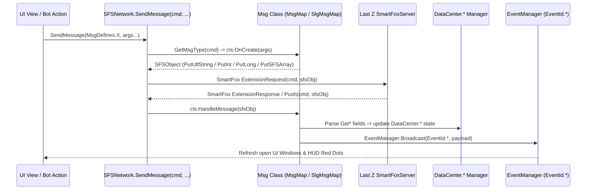

# Volume 01: Last Z Network Packets, Wire Commands & End-to-End Routing

> **Generated:** `2026-11-23 10:42:43 UTC` | **Source:** Live read-only xLua reflection on `Alt3Game.exe` (`v579`) -> `megamind/raw/packets_complete.json` + `ui_windows_and_buttons.json`

## 1. Protocol Architecture Summary

| Metric | Verified Count | Where Defined |
|---|---:|---|
| `MsgDefines` Constants | **2,245** | `_G.MsgDefines` |
| `ChatMsgDefines` Constants | **90** | `_G.ChatMsgDefines` |
| `EventId` Internal Bus Constants | **3,344** | `_G.EventId` |
| Mapped Wire Packet Classes (`MsgMap` + `SlgMsgMap` + Override) | **2,297** | `SFSNetwork.SendMessage` -> `GetMsgType` upvalues |
| Bytecode-Inspected Packet Handlers (`OnCreate` + `HandleMessage`) | **2,279** | Live `string.dump` bytecode reflection |
| Live Active `EventManager` Subscriptions | **735** | `EventManager:GetInstance()` listener tables |
| `PBController` Protobuf Methods | **6** | `CreateArrayUserData, InitBytes, InitPBConfig, LoadBytes, ParsePb1, ParsePbFromBytes` |

### Packet Lifecycle (Where Sent & Received Packets Go)

## 2. Packet Distribution by Functional Domain

| Domain | Inspected Packets |
|---|---:|
| [Alliance & Territory](#alliance--territory) | 618 |
| [Arena & PVP](#arena--pvp) | 195 |
| [Army, Troops & Hospital](#army-troops--hospital) | 34 |
| [Buildings & City](#buildings--city) | 74 |
| [Chat, Moments & Social](#chat-moments--social) | 133 |
| [Core System, Auth & Miscellaneous](#core-system-auth--miscellaneous) | 225 |
| [Daily Tasks & Quests](#daily-tasks--quests) | 120 |
| [Events & Activities](#events--activities) | 411 |
| [Formations, Marches & World Map](#formations-marches--world-map) | 98 |
| [Garage, Vehicles & Chips](#garage-vehicles--chips) | 50 |
| [Heroes, Skills & Equipment](#heroes-skills--equipment) | 101 |
| [Items, Bag, Shops & Economy](#items-bag-shops--economy) | 132 |
| [PVE, Exploration & Monsters](#pve-exploration--monsters) | 68 |
| [Radar & Detect Events](#radar--detect-events) | 5 |
| [Science, Research & Talents](#science-research--talents) | 15 |

## 3. Complete Packet Routing Catalog (All 2,279 Mapped Wire Commands)

### Alliance & Territory (618 packets)

| Wire Cmd | MsgDefines Alias(es) | Src | Outgoing `OnCreate` (Params / `Put*` / Hints) | Incoming `HandleMessage` -> `DataCenter` | `EventId` Broadcasts | UI Targets |
|---|---|---|---|---|---|---|
| `push.challenge.alliance.boss.kill` | PushMonsterTowerAllianceBossKill | Core | p=1 keys: Activity, MonsterTower | ActMonsterTowerData.ParsePushAllianceBossKill | - | - |
| `survival.pve.level.finish` | SU_Pve_Level_Finish | Core | p=2 [PutInt] keys: Survival, Level, levelId, pveLevelId | SUPveLevelDataManager.SetLevelData | - | - |
| `accept.exploit.personal.reward` | ClaimAlContributeBoxReward | Core | p=3 [PutUtfString, PutInt] keys: Activity, AlContribute, actId, stage, activityId,... | AlContributeManager.OnRecvClaimBoxResp | - | - |
| `accept.kingdompersonal.reward` | StrongestCommandGetTodayReward | Core | p=4 [PutUtfString, PutInt] keys: actId, stage | RewardManager.ShowCommonReward | RefreshDataSingleScore | - |
| `accept.personal.reward` | AcceptPersonalReward | Core | p=2 [PutUtfString, PutInt] keys: Activity, actId, stage, eventType | ActPersonalArmsInfo.GetEventInfo | RefreshActivityRedDot | - |
| `accept.personal.reward.batch` | AcceptPersonalRewardBatch | Core | p=2 [PutUtfString, PutInt] keys: Activity, actId, eventType, stages, insert, floor... | - | RefreshActivityRedDot | - |
| `act.city.people.dialog` | SU_ActCityPeople | Core | p=3 [PutLong, PutUtfString] keys: Survival, uuid, dialogId | TalkTaskDataManager.UpdateFromDoomWalker | - | - |
| `activity.rally.boss.info` | ActivityRallyBossInfo | Core | p=2 [PutInt] keys: Activity, DrakeBoss2, activityId | DrakeBoss2Manager.UpdateInfoHandle | - | - |
| `activity.rally.boss.update.stage` | ActivityRallyBossUpdateStage | Core | p=3 [PutInt, PutUtfString] keys: Activity, DrakeBoss2, activityId, stage, clientSt... | DrakeBoss2Manager.UpdateInfoHandle | - | - |
| `add.alliance.order.token.num` | AllianceOrderAddToken | Core | p=3 [PutUtfString, PutInt] keys: Activity, itemId, num, _ENV | ActAllianceOrderManager.HandleMessageAddToken | - | - |
| `adv.alliance.notice` | AdvAllianceNotice | SLG-Ovr | p=3 [PutLong, PutBool] keys: Alliance, uuid, gold, useGold | AllianceAnnouncementManager.AdvAllianceNoticeHandler | - | - |
| `agree.alliance.auto.invite` | AcceptAllianceAutoInvite | Core | p=2 [PutUtfString] keys: Alliance, allianceId | AllianceAutoInviteManager.ClearAllInvite | - | - |
| `al.abbr` | AlAbbr | SLG-Ovr | p=2 [PutUtfString] keys: Alliance, abbr | - | AllianceChangeAbbrSuccess | - |
| `al.acceptapply` | AcceptAllianceApply | Core | p=2 [PutUtfString] keys: Alliance, playerId | AllianceMemberDataManager.UpdateOneAllianceApply | AllianceMemberRedPoint | - |
| `al.acceptinvite` | AllianceInviteAccept | SLG-Ovr | p=2 [PutUtfString] keys: Alliance, mailId, mailUuid | - | AllianceInviteStatusChange | - |
| `al.apply` | AlApply | Core | p=4 [PutUtfString, PutInt] keys: Alliance, applyType, alUid, allianceId, playerlab... | AllianceBaseDataManager.UpdateAllianceBaseData | CLICK_ALLIANCE_ITEM | - |
| `al.applylist` | AlApplyList | Core | p=2 [PutInt] keys: Alliance, page | AllianceMemberDataManager.UpdateAllianceApplyList | AllianceMemberRedPoint | - |
| `al.arena.power` | AlArenaPower | Core | p=2 [PutUtfString] keys: Alliance, allianceId | AllianceMemberDataManager.UpdateAllianceArenaPower | - | - |
| `al.attr` | AllianceChangeAttributes | SLG-Ovr | p=15 [PutUtfString, PutInt, PutLong] keys: Alliance, name, abbr, intro, IsNullOrEm... | AllianceBaseDataManager.UpdateAllianceSetting | UpdateGold | - |
| `al.attr.x.info` | - | SLG | p=1 keys: AllianceAttrX | AllianceAttrXManager.OnAlAttrXInfoResponse | - | - |
| `al.attr.x.skill.use` | - | SLG | p=2 [PutInt] keys: AllianceAttrX, lineId | AllianceAttrXManager.OnAlAttrXSkillUseResponse | - | - |
| `al.attr.x.up` | - | SLG | p=2 [PutInt] keys: AllianceAttrX, lineId | AllianceAttrXManager.OnAlAttrXUpResponse | - | - |
| `al.battle.day.vs.announce` | EditorAlCompeteAnno | Core | p=2 [PutUtfString] keys: anno | - | AllianceCompeteAnnounceRefresh | - |
| `al.battle.day.vs.info` | GetAlBattleDayVsInfo | Core | p=2 [PutInt] keys: Activity, day | AllianceCompeteDataManager.HandelDayVsInfo | - | - |
| `al.battle.event` | AlBattleEvent | Core | p=4 [PutUtfString, PutLong, PutInt] keys: Glory, allianceId, startTime, page | GloryManager.HandleGetBattleDetail | - | - |
| `al.battle.live.join` | JoinAlBattleLive | Core | p=1 keys: Activity | - | - | - |
| `al.battle.live.leave` | LeaveAlBattleLive | Core | p=1 keys: Activity | - | - | - |
| `al.battle.live.like` | PushAlBattleLiveLike | Core | p=1 keys: Activity | AllianceCompeteDataManager.UpdateLiveLikeNum | - | - |
| `al.battle.live.notice` | SendAlDanMu | Core | p=2 [PutUtfString] keys: DanMu, msg | - | - | - |
| `al.battle.rank.info` | AllianceCompeteRankList | Core | p=2 [PutLong] keys: Activity | AllianceCompeteDataManager.RefreshRankList | - | - |
| `al.battle.rush.detail` | GetAlBattleRushDetail | Core | p=6 [PutInt, PutLong] keys: Activity, day, time, vsTime, order, limit | AllianceCompeteDataManager.HandelRushScoreDetail | - | - |
| `al.battle.week.result.info` | AllianceCompeteWeeklySummary | Core | p=1 keys: Activity | AllianceCompeteDataManager.RefreshWeeklySummaryMsg | - | - |
| `al.battle.week.vs.info` | AllianceCompeteWeekResult | Core | p=1 keys: Activity | AllianceCompeteDataManager.RefreshWeekResultVS | - | - |
| `al.call.help` | AllianceCallHelp | Core | p=5 [PutLong, PutInt, PutUtfString] keys: Alliance, uuid, qType, itemId | AllianceHelpDataManager.AddCheckHelpTimer | - | UITimeManager |
| `al.cancelapply` | AlCancelApply | Core | p=2 [PutUtfString] keys: Alliance, alUid, allianceId | AllianceTempListManager.CancelApplyAllianceByUid | CLICK_ALLIANCE_ITEM | - |
| `al.cr.last.time` | AlCrLastTime | SLG-Ovr | p=1 keys: Alliance | AllianceMainManager.SetLastCreateTime | - | - |
| `al.create` | AlCreate | SLG-Ovr | p=8 [PutUtfString, PutInt] keys: Alliance, IsNullOrEmpty, name, intro, icon, langu... | AllianceBaseDataManager.UpdateAllianceBaseData | SetMovingUI | UIMovingType |
| `al.dismiss` | AlDismiss | Core | p=1 keys: Alliance | AllianceDissolutionManager.IsFeatureEnabled | AllianceQuitOK | - |
| `al.donate.rank.all` | AllianceDonateRankAll | SLG-Ovr | p=1 keys: Alliance | AllianceDonateRankDataManager.UpdateRankHistoryList | AllianceDonateRankAll | - |
| `al.donate.rank.today` | AllianceDonateRankDay | SLG-Ovr | p=1 keys: Alliance | AllianceDonateRankDataManager.UpdateRankDayList | AllianceDonateRankDay | - |
| `al.donate.rank.week` | AllianceDonateRankWeek | SLG-Ovr | p=1 keys: Alliance | AllianceDonateRankDataManager.UpdateRankWeekList | AllianceDonateRankWeek | - |
| `al.duel.member.status` | AlDuelMemberStatus | Core | p=1 keys: Alliance | AllianceBaseDataManager.SetRejoinPunishInfo | OnAlDuelMemberStatusUpdate | - |
| `al.fight.act.info` | AlFightActInfo | Core | p=1 keys: Glory | GloryManager.HandleGetAct | - | - |
| `al.fight.act.info.record` | AlFightActInfoRecord | Core | p=2 [PutLong] keys: Glory, readyTime | GloryManager.HandleGetAct | - | - |
| `al.fight.act.member.score` | AlFightActMemberScore | Core | p=2 [PutUtfString] keys: Glory, allianceId | GloryManager.HandleGetMemberRecord | - | - |
| `al.flag.special.item` | AlFlagSpecialItem | Core | p=2 [PutLong] keys: Alliance, itemId, id | AllianceBaseDataManager.OnHandlerChangeSeasonEffect | - | - |
| `al.help.all` | AlHelpAll | Core | p=3 [PutLong, PutBool] keys: Alliance, cmdBaseTime, autoHelp | AllianceHelpDataManager.OnHelpAll | AllianceHelpSever | - |
| `al.help.from.all` | AlHelpFromAll | Core | p=2 [PutUtfString] keys: Alliance, helpId | - | - | - |
| `al.invite` | AllianceInvitePlayer | SLG-Ovr | p=3 [PutUtfString] keys: Alliance, playerId, playerArr, playerIdList, playerUid, s... | - | - | - |
| `al.kick` | AllianceKickMember | SLG-Ovr | p=2 [PutUtfString] keys: Alliance, playerId | AllianceMemberDataManager.RemoveAllianceMemberByUid | AllianceMember | - |
| `al.kick.batch` | AlKickBatch | SLG-Ovr | p=2 [PutSFSArray] keys: Alliance, AddUtfString, uidArr, uuidList, uuidArr, for, state | - | - | - |
| `al.kick.batch.result` | AlKickBatchResult | SLG-Ovr | p=1 keys: Alliance | AllianceDissolutionManager.IsFeatureEnabled | - | - |
| `al.leader.replace` | AllianceLeaderReplace | SLG-Ovr | p=2 [PutUtfString] keys: Alliance, playerId | AllianceBaseDataManager.UpdateAllianceBaseData | UpdateGold | - |
| `al.leader.trans` | AllianceLeaderTrans | SLG-Ovr | p=2 [PutUtfString] keys: Alliance, playerId | AllianceBaseDataManager.UpdateAllianceBaseData | AllianceMember | - |
| `al.leave` | AlLeave | Core | p=1 keys: Alliance | AllianceBaseDataManager.ResetAllianceData | AllianceQuitOK | - |
| `al.leave.item` | AlLeaveItem | Core | p=1 | - | - | UIAllianceExitTip |
| `al.missile.create` | MissileCreate | Core | p=5 [PutUtfString, PutLong, PutInt] keys: Activity, Missile, itemId, uuid, serverI... | MissileManager.MissileCreateHandler | - | - |
| `al.missile.info` | MissileInfoGet | Core | p=1 keys: Activity, Missile | MissileManager.MissileInfoGetHandler | - | - |
| `al.name` | AlName | SLG-Ovr | p=2 [PutUtfString] keys: Alliance, name | - | AllianceChangeNameSuccess | - |
| `al.name.get` | AlNameGet | SLG-Ovr | p=1 keys: Alliance | - | AutoWriteAllianceNameAndAbbr | - |
| `al.offical.process` | AllianceDeleteOffical | Core | p=5 [PutUtfString, PutInt] keys: Alliance, allianceId, operateType, officalType, p... | AllianceMemberDataManager.DeleteAllianceOfficial | AllianceMember | - |
| `al.point.find` | AlPointFind | Core | p=1 | - | - | - |
| `al.rank` | AlRank | SLG-Ovr | p=2 [PutUtfString] keys: Alliance, allianceId, GuideManager, WaitMessageFinishType... | GuideManager.SetWaitingMessage | SelfAllianceMemberInfoPull | - |
| `al.refuseapply` | RefuseAllianceApply | Core | p=2 [PutUtfString] keys: Alliance, playerId | AllianceMemberDataManager.UpdateOneAllianceApply | AllianceMemberRedPoint | - |
| `al.refuseinvite` | AllianceInviteRefuse | SLG-Ovr | p=2 [PutUtfString] keys: Alliance, mailId, mailUuid | - | AllianceInviteStatusChange | - |
| `al.render.help` | AllianceRenderHelp | Core | p=3 [PutUtfString] keys: Alliance, helpId, uid | AllianceHelpDataManager.OnFinishAllianceHelp | AllianceHelpSever | - |
| `al.science.donate` | AlScienceDonate | SLG-Ovr | p=6 [PutInt] keys: Alliance, scienceId, option, btnPos, techPointPos, resPos, alSc... | AllianceScienceDataManager.EndRefreshAllScienceNum | ShowAlScienceCriticalHitRatio | - |
| `al.science.donate.gold` | AlScienceGoldDonate | SLG-Ovr | p=5 [PutInt] keys: Alliance, scienceId, btnPos, techPointPos, resPos, alScienceDon... | AllianceScienceDataManager.EndRefreshAllScienceNum | UpdateGold | - |
| `al.science.fresh` | AlScienceFresh | SLG-Ovr | p=2 [PutInt] keys: Alliance, scienceId | AllianceScienceDataManager.EndRefreshAllScienceNum | AllianceTechnology | - |
| `al.science.recommend` | AlScienceRecommend | SLG-Ovr | p=3 [PutInt] keys: Alliance, scienceId, state | AllianceScienceDataManager.EndRefreshAllScienceNum | AllianceTechnology | - |
| `al.science.refreshNum` | AlScienceNumFresh | SLG-Ovr | p=2 [PutInt] keys: Alliance, scienceId | AllianceScienceDataManager.EndRefreshAllScienceNum | AllianceTechnology | - |
| `al.science.research` | AlScienceResearch | SLG-Ovr | p=2 [PutInt] keys: Alliance, scienceId | AllianceScienceDataManager.EndRefreshAllScienceNum | AllianceTechnology | - |
| `al.search` | AlSearch | Core | p=6 [PutInt, PutUtfString, PutBool] keys: Alliance, page, key, searchType, Localiz... | AllianceTempListManager.RefreshSearchAllianceList | SearchAllianceSuccess | - |
| `al.searchuser` | AllianceSearchUser | SLG-Ovr | p=5 [PutInt, PutUtfString] keys: Alliance, page, key, lang | AllianceTempListManager.RefreshAllianceInviteList | GET_INVITE_USERS_SUCCESS | - |
| `al.set.offical` | SetAllianceOfficialPos | SLG-Ovr | p=3 [PutInt, PutUtfString] keys: Alliance, officalType, playerId, uid, pos | AllianceMemberDataManager.UpdateOneAlliancePos | - | - |
| `al.setrank` | AllianceSetRank | SLG-Ovr | p=4 [PutUtfString, PutInt] keys: Alliance, playerId, rank, offical | AllianceMemberDataManager.SetAllianceRank | AllianceMember | - |
| `al.shop.buy.al` | AlShopBuyAl | Core | p=3 [PutUtfString, PutInt] keys: Alliance, goodsId, num | - | - | - |
| `al.shop.buy.usr` | AlShopBuyUsr | Core | p=3 [PutUtfString, PutInt] keys: Alliance, goodsId, num | AllianceBaseDataManager.GetAllianceBaseData | - | - |
| `al.shop.new.update` | PushAlShopNewUpdate | Core | p=1 | AllianceShopPlusDataManager.RefreshOneShopFromUpdate | AllianceShopPlusShow | - |
| `al.shop.show` | AlShopShow | Core | p=2 [PutInt] keys: Alliance, fromType | AllianceBaseDataManager.GetAllianceBaseData | AllianceShopShow | - |
| `al.show.help` | AllianceShowHelp | Core | p=1 keys: Alliance | AllianceHelpDataManager.UpdateHelpInfoList | AllianceHelpSever | - |
| `al.skill.info` | AlSkillInfo | Core | p=1 keys: AllianceSkill | AllianceSkillManager.UpdateSkills | AlSkillInfoUpdate | - |
| `al.skill.use` | AlSkillUse | Core | p=4 [PutInt] keys: AllianceSkill, skillId, pointId, serverId, targetId | AllianceSkillManager.UpdateSkill | AlSkillInfoUpdate | - |
| `alliance.assistance.info` | AllianceAssistanceInfo | Core | p=3 [PutLong, PutInt] keys: number, bUuid, assistanceType, targetServer, GetCurSer... | FormationAssistanceDataManager.UpdateAssistanceData | GetAssistanceData | - |
| `alliance.assistance.info.list` | AllianceAssistanceInfoList | Core | p=1 [PutInt] keys: targetServer, GetCurServerId, worldId, GetCurWorldId, _ENV | FormationAssistanceDataManager.UpdateAssistanceDataList | - | - |
| `alliance.boss.damage.rank` | GetAllianceBossDamageRank | Core | p=2 [PutInt] keys: activityId | AllianceBossManager.OnHandleGetAllianceBossDamageRankMessage | - | - |
| `alliance.boss.donate` | AllianceBossDonate | Core | p=4 [PutInt] keys: activityId, itemId, num | AllianceBossManager.OnHandleAllianceBossDonateMessage | - | - |
| `alliance.boss.reward.info` | GetAllianceBossRewardInfo | Core | p=2 [PutInt] keys: activityId | AllianceBossManager.OnHandleGetAllianceBossRewardInfoMessage | - | - |
| `alliance.boss.select.time` | AllianceBossSelectTime | Core | p=4 [PutInt, PutLong] keys: activityId, readyTime, difficulty | AllianceBossManager.OnHandleCallAllianceBossMessage | - | - |
| `alliance.building.v2.build.marchList` | - | SLG | p=2 [PutLong] keys: AllianceBuilding, uuid | AllianceBuildingManager.CompleteMarchListRequest | - | - |
| `alliance.building.v2.buildpoint.claim` | - | SLG | p=2 [PutInt] keys: AllianceBuilding, Logger, LogError, previous, request, still, p... | AllianceBuildingManager.Logger | - | - |
| `alliance.building.v2.collect.marchList` | - | SLG | p=2 [PutLong] keys: AllianceBuilding, uuid | AllianceBuildingManager.Logger | - | - |
| `alliance.building.v2.fix` | - | SLG | p=2 [PutLong] keys: AllianceBuilding, Logger, LogError, previous, request, still, ... | - | - | - |
| `alliance.building.v2.get` | - | SLG | p=1 keys: AllianceBuilding | AllianceBuildingManager.UpdateAllianceBuildingDatas | - | - |
| `alliance.building.v2.move` | - | SLG | p=3 [PutLong, PutInt] keys: AllianceBuilding, uuid, pointId, toInt, anchorUuid, an... | AllianceBuildingManager.CompleteMoveRequest | - | - |
| `alliance.building.v2.place` | - | SLG | p=3 [PutInt] keys: AllianceBuilding, buildingId, pointId | AllianceBuildingManager.CompleteResourceMinePlace | - | - |
| `alliance.building.v2.recycle` | - | SLG | p=2 [PutLong] keys: AllianceBuilding, uuid | AllianceBuildingManager.CompleteResourceMineRecycle | - | - |
| `alliance.building.v2.replace` | - | SLG | p=3 [PutLong, PutInt] keys: AllianceBuilding, Logger, LogError, missing, uuid, or,... | - | - | - |
| `alliance.building.v2.upgrade` | - | SLG | p=4 [PutInt] keys: AllianceBuilding, Logger, LogError, previous, request, still, p... | AllianceBuildingManager.ApplyUpgradeResult | - | - |
| `alliance.building.v2.upgrade.info` | - | SLG | p=2 [PutLong] keys: AllianceBuilding, uuid | AllianceBuildingManager.errorCode | - | - |
| `alliance.cancelDismiss` | AlCancelDismiss | Core | p=1 keys: Alliance | AllianceDissolutionManager.OnCancelDismissResponse | - | - |
| `alliance.city.battle.detail` | ViewAllianceWarLogDetail | SLG-Ovr | p=4 [PutUtfString, PutLong] keys: Alliance, selfAllianceId, otherAllianceId, newsId | AllianceWarLogManager.ReciveLogDetail | - | - |
| `alliance.city.news` | ViewAllianceWarLog | SLG-Ovr | p=1 keys: Alliance | AllianceWarLogManager.ReciveLog | - | - |
| `alliance.city.war.auto.join` | - | SLG | p=2 [PutBool] keys: Alliance, autoJoin, checked | AllianceDeclareWarManager.SetSiegeAutoAttackInfo | DeclareWarAutoJoin | - |
| `alliance.city.war.guide.get` | - | SLG | p=1 keys: Alliance | AllianceDeclareWarManager.HandleAllianceCityWarGuideGet | - | - |
| `alliance.city.war.guide.remind.manager` | - | SLG | p=2 keys: Alliance, remindType | - | - | - |
| `alliance.city.war.guide.stage.reward` | - | SLG | p=2 [PutInt] keys: Alliance, stage | AllianceDeclareWarManager.HandleAllianceCityWarGuideStageReward | - | - |
| `alliance.confirmDismiss` | AlConfirmDismiss | Core | p=1 keys: Alliance | AllianceDissolutionManager.OnConfirmDismissResponse | AllianceQuitOK | - |
| `alliance.declare.war.cancel` | AllianceDeclareWarCancel | SLG | p=2 [PutLong] keys: Alliance, uuid | AllianceDeclareWarManager.DeleteWar | - | - |
| `alliance.declare.war.create` | AllianceDeclareWarCreate | SLG | p=5 [PutLong, PutInt, PutUtfString] keys: Alliance, durTime, content, anno | AllianceDeclareWarManager.CreateWar | - | - |
| `alliance.declare.war.get` | AllianceDeclareWarGet | SLG | p=1 keys: Alliance | AllianceDeclareWarManager.Init | - | - |
| `alliance.declare.war.get.result.reward` | AllianceDeclareWarGetResultReward | Core | p=2 [PutInt] keys: index | GloryManager.HandleAllianceDeclareWarGetResultReward | - | - |
| `alliance.declare.war.personal.rank` | AllianceDeclareWarPersonalRank | Core | p=1 keys: Glory | - | AllianceDeclareWarPersonalRank | - |
| `alliance.declare.war.personal.reward` | AllianceDeclareWarPersonalReward | Core | p=1 keys: Glory | GloryManager.HandleGetPersonalRewardList | AllianceDeclareWarPersonalReward | - |
| `alliance.declare.war.reward` | AllianceDeclareWarReward | SLG | p=2 [PutLong] keys: Alliance, uuid | AllianceDeclareWarManager.HandleAllianceDeclareWarRewardMessage | - | - |
| `alliance.duel.draw` | LeagueMatchDrawLots | Core | p=1 keys: Activity, LeagueMatch | LeagueMatchManager.OnRecvDrawLotsResultResp | - | - |
| `alliance.get.city.declare.times` | AllianceGetCityDeclareTimes | SLG | p=1 keys: Alliance | AllianceDeclareWarManager.CheckIsCanDeclare | - | - |
| `alliance.haggle` | AllianceHaggle | Core | p=2 [PutLong] keys: AllianceHaggle, activityId | AllianceHaggleManager.GetAllianceHaggleData | - | UIAllianceHaggleSlot |
| `alliance.haggle.buy` | AllianceHaggleBuy | Core | p=2 [PutLong] keys: AllianceHaggle, activityId | RewardManager.AddRewards | UpdateGold | - |
| `alliance.haggle.open` | AllianceHaggleOpen | Core | p=2 [PutLong] keys: AllianceHaggle, activityId | AllianceHaggleManager.UpdateHangleOpenData | AllianceHaggleUpdate | - |
| `alliance.haggle.stat` | AllianceHaggleStat | Core | p=2 keys: AllianceHaggle | AllianceHaggleManager.UpdateHangleStatData | AllianceHaggleStatUpdate | - |
| `alliance.level.info` | - | SLG | p=1 keys: Alliance | AllianceBaseDataManager.UpdateAllianceLevelInfo | - | - |
| `alliance.march.army.info` | AllianceMarchArmyInfo | SLG-Ovr | p=2 [PutLong, PutInt] keys: Alliance, uuid, GetCurServerId, GetCurWorldId, serverI... | AllianceWarDataManager.ClearPendingOpenWarInfoView | - | - |
| `alliance.milestone.finish.panel` | - | SLG | p=2 [PutInt] keys: AllianceMilestone, stageId | AllianceMilestoneManager.errorCode | - | - |
| `alliance.milestone.get` | - | SLG | p=2 [PutInt] keys: AllianceMilestone, stageId | AllianceMilestoneManager.errorCode | - | - |
| `alliance.milestone.member` | - | SLG | p=4 [PutInt] keys: AllianceMilestone, stageId, tab, page | AllianceMilestoneManager.errorCode | - | - |
| `alliance.milestone.remind` | - | SLG | p=3 [PutInt, PutUtfString] keys: AllianceMilestone, stageId, uid | AllianceMilestoneManager.errorCode | - | - |
| `alliance.milestone.remind.all` | - | SLG | p=2 [PutInt] keys: AllianceMilestone, stageId | AllianceMilestoneManager.errorCode | - | - |
| `alliance.milestone.reward` | - | SLG | p=3 [PutInt] keys: AllianceMilestone, rewardType, refId | AllianceMilestoneManager.errorCode | - | - |
| `alliance.milestone.share` | - | SLG | p=2 [PutInt] keys: AllianceMilestone, stageId | AllianceMilestoneManager.errorCode | - | - |
| `alliance.milestone.share.panel` | - | SLG | p=2 [PutInt] keys: AllianceMilestone, stageId | AllianceMilestoneManager.errorCode | - | - |
| `alliance.milestone.stage.played` | - | SLG | p=2 [PutInt] keys: AllianceMilestone, stageId | AllianceMilestoneManager.OnHandleStagePlayed | - | - |
| `alliance.milestone.view.report` | - | SLG | p=3 [PutInt] keys: AllianceMilestone, stageId | AllianceMilestoneManager.OnHandleViewReport | - | - |
| `alliance.pay.heap.reward` | AlliancePayHeapReward | SLG-Ovr | p=3 [PutInt] keys: Alliance, rewardId, rewardType | RewardManager.AddOneReward | UpdateAllianceCumulativeRechargeInfo | - |
| `alliance.pay.heap.reward.all` | AlliancePayHeapRewardBatch | SLG-Ovr | p=3 [PutIntArray] keys: Alliance, rewardIds, alRewardIds | ActivityListDataManager.ReceiveAlliancePayHeapRewardBatchHandle | AllianceCumulativeBatchClaimFinish | - |
| `alliance.rank` | AllianceRankList | SLG-Ovr | p=3 [PutInt] keys: Alliance, ismerge, serverId, rangeType | RankDataManager.ParseAllianceRankData | AllianceRank | - |
| `alliance.rank.limit` | AllianceRankLimit | Core | p=2 [PutInt] keys: svrId, serverId | RankDataManager.ParseAllianceRankData | OtherServerAlliancePowerRank | - |
| `alliance.reward.allreceive` | AllianceReceiveAllGift | Core | p=2 [PutInt] keys: Alliance | AllianceGiftDataManager.RetBaseData | UpdateAllianceGiftNum | - |
| `alliance.reward.allremove` | AllianceAllGiftRemove | Core | p=2 [PutInt] keys: Alliance | - | - | - |
| `alliance.reward.hide.name` | AllianceRewardHideName | Core | p=2 [PutInt] keys: Alliance, openHide | - | AlGiftHideNameStateUpdate | - |
| `alliance.reward.info` | AllianceGiftInfo | Core | p=2 [PutUtfString] keys: Alliance, uuid | AllianceGiftDataManager.UpdateGiftNum | UpdateAllianceGiftNum | - |
| `alliance.reward.list` | AllianceGiftList | Core | p=3 [PutInt] keys: Alliance, index, len | AllianceGiftDataManager.RetBaseData | RefreshAllianceGift | - |
| `alliance.reward.receive` | AllianceGiftGetReward | Core | p=3 [PutUtfString, PutInt] keys: Alliance, uuid | AllianceGiftDataManager.SetGiftReceive | UpdateAllianceGiftNum | - |
| `alliance.reward.remove` | AllianceGiftRemove | Core | p=2 [PutUtfString] keys: Alliance, uuid | - | - | - |
| `alliance.team.cancel` | AllianceWarCancel | Core | p=2 [PutLong] keys: Alliance, teamUuid | - | CancelAllianceTeam | - |
| `alliance.team.direct.move` | AllianceTeamDirectMove | SLG-Ovr | p=2 [PutLong] keys: Alliance, teamUuid | MasteryManager.GetData | - | - |
| `alliance.team.ls` | GetAllianceWarList | Core | p=2 [PutInt] keys: Alliance, targetServer, worldId, GetCurWorldId, _ENV | AllianceWarDataManager.InitAllianceWarList | AllianceWarUpdate | - |
| `alliance.team.manual.march` | AllianceTeamManualMarch | Core | p=4 [PutLong, PutInt] keys: Alliance, teamUuid, targetServer, worldId | - | - | - |
| `alliance.team.retreat` | AllianceWarRetreat | Core | p=3 [PutLong, PutInt] keys: Alliance, teamUuid, marchUuid, worldId, GetCurWorldId,... | - | - | - |
| `alliance.train.assign` | AllianceTrainAssign | Core | p=2 [PutInt, PutUtfString] keys: Railway, trainPlatformId, targetUserId, playerUid | - | AllianceTrainAssignMessageSuccess | - |
| `alliance.train.assign.army` | AllianceTrainAssignArmy | Core | p=2 [PutInt, PutSFSArray] keys: Railway, trainPlatformId, teamInfos, teamInfoArray | LWAllyStationDataManager.OnFormationGet | - | - |
| `alliance.train.attack` | AllianceTrainAttack | Core | p=4 [PutLong, PutInt, PutSFSArray] keys: Railway, uuid, serverId, teamInfos, train... | RewardManager.AddOneReward | - | - |
| `alliance.train.battle.detail` | AllianceTrainBattleDetail | Core | p=2 [PutLong] keys: Railway, uuid | - | AllianceTrainBattleRecordDetail | - |
| `alliance.train.battle.record` | AllianceTrainBattleRecord | Core | p=2 [PutLong] keys: Railway, trainUuid | - | AllianceTrainBattleRecordList | - |
| `alliance.train.buy` | AllianceTrainBuy | Core | p=1 [PutInt] keys: Railway, trainPlatformId | LWAllyStationDataManager.OnAllianceTrainBuySuccess | - | - |
| `alliance.train.formation` | AllianceTrainFormation | Core | p=2 [PutInt] keys: Railway | LWAllyStationDataManager.OnFormationGet | - | - |
| `alliance.train.info` | AllianceTrainInfo | Core | p=1 keys: Railway | LWAllyStationDataManager.OnAllyStationDataGet | - | - |
| `alliance.train.invite.list` | AllianceTrainInviteList | Core | p=1 keys: Railway | - | AllianceTrainInviteList | - |
| `alliance.train.lineUp` | AllianceTrainLineUp | Core | p=2 [PutInt] keys: Railway, trainPlatformId, carriageId | - | - | - |
| `alliance.train.refresh` | AllianceTrainRefresh | Core | p=1 [PutInt] keys: Railway, trainPlatformId | - | AllianceTrainRefreshMessageSuccess | - |
| `alliance.treasure.score.info` | GetCastleAdventureAllianceTaskInfo | Core | p=2 [PutInt] keys: CastleAdventure, activityId, _ENV | CastleAdventureManager.GetAllianceTaskInfo | - | - |
| `alliance.treasure.score.reward` | GetCastleAdventureAllianceTaskReward | Core | p=4 [PutInt] keys: CastleAdventure, activityId, treasureId, stage, _ENV | CastleAdventureManager.GetAllianceTaskInfo | - | - |
| `alliance.world.mark.add` | WorldAddAllianceMark | SLG-Ovr | p=6 [PutInt, PutUtfString] keys: point, serverId, markType, markName, push, server... | WorldFavoDataManager.OnAddAllianceMark | - | - |
| `alliance.world.mark.del` | WorldDelAllianceMark | SLG-Ovr | p=2 [PutInt] keys: markType, marktype | WorldFavoDataManager.OnDelAllianceMark | - | - |
| `animal.stage.reward.info` | GetAnimalStageRewardInfo | Core | p=2 [PutInt] keys: FrozenLand, activityId | FrozenLandDataManager.GetFrozenLandStageRewardHandler | - | - |
| `apply.merge.alliance` | ApplyMergeToAlliance | Core | p=2 [PutUtfString] keys: Alliance, targetAllianceId, allianceId | AllianceMergeManager.OnRecvApplyMergeToAllianceResp | - | - |
| `apply.wait.merge.alliance.leader` | BecomeAlLeader | SLG-Ovr | p=1 keys: Alliance | - | - | - |
| `auto.join.alliance` | AutoJoinAlliance | Core | p=1 keys: Alliance | GuideManager.CheckDoTriggerGuide | HideCanBuildEffect | UIAllianceIntro |
| `auto.join.alliance.by.mail` | AutoJoinAllianceMail | Core | p=2 [PutUtfString] keys: Mail, mailUuid, uid | - | SelectAllianceChannel | - |
| `banquet.add.meal.records` | BanquetAddMealRecords | Core | p=3 [PutInt, PutUtfString] keys: FoodFestival, activityId, allianceId | FoodFestivalEatManager.ParseExchangeRecordList | FoodFestivalEatExchangeRecord | - |
| `banquet.info` | BanquetInfo | Core | p=2 [PutInt] keys: FoodFestival, activityId | FoodFestivalEatManager.ParseData | FoodFestivalEatInfo | - |
| `banquet.info.list` | BanquetInfoList | Core | p=2 [PutInt] keys: FoodFestival, activityId | - | FoodFestivalEatInfoList | - |
| `banquet.meal.records` | BanquetMealRecords | Core | p=2 [PutInt] keys: FoodFestival, activityId | FoodFestivalEatManager.ParseSelfEatRecordList | FoodFestivalEatSelfRecord | - |
| `banquet.search.table` | BanquetSearchTable | Core | p=2 [PutInt] keys: FoodFestival, activityId, searchRange | - | - | - |
| `banquet.select.time` | BanquetSelectTime | Core | p=3 [PutInt, PutLong] keys: FoodFestival, activityId, readyTime | FoodFestivalEatManager.ParseData | FoodFestivalEatInfo | - |
| `banquet.table.eat.players` | BanquetTableEatPlayers | Core | p=3 [PutInt, PutLong] keys: FoodFestival, activityId, tableUuid | - | FoodFestivalEatPlayers | - |
| `banquet.table.list` | BanquetTableList | Core | p=3 [PutInt] keys: FoodFestival, activityId, pointId | FoodFestivalEatManager.ParseData | - | - |
| `be.alliance.leader.candidate` | AllianceLeaderElect | SLG-Ovr | p=1 keys: Alliance | AllianceBaseDataManager.UpdateLeaderElectStatus | AlLeaderElectStatusChange | - |
| `call.alliance.boss` | CallAllianceBoss | Core | p=2 [PutInt] keys: activityId | AllianceBossManager.OnHandleCallAllianceBossMessage | - | - |
| `call.help.animal` | CallHelpAnimal | Core | p=3 [PutInt, PutLong] keys: FrozenLand, activityId, uuid | - | - | - |
| `cancel.apply.merge.alliance` | CancelAllianceMergeApply | Core | p=2 [PutUtfString] keys: Alliance, targetAllianceId, allianceId | AllianceMergeManager.OnRecvCancelMergeToAllianceResp | - | - |
| `challenge.alliance.boss.call` | CallMonsterTowerAllianceBoss | Core | p=3 [PutInt] keys: Activity, MonsterTower, activityId, difficulty | ActMonsterTowerData.CallAlBossHandle | - | - |
| `challenge.alliance.boss.info` | GetMonsterTowerAllianceBossInfo | Core | p=2 [PutInt] keys: Activity, MonsterTower, activityId | ActMonsterTowerData.ParseAllianceActData | - | - |
| `challenge.alliance.boss.members.list` | InquireMonsterTowerAllianceMemberList | Core | p=2 [PutInt] keys: Activity, MonsterTower, activityId | ActMonsterTowerData.ParseFightRecordMessage | - | - |
| `challenge.alliance.boss.reward` | InquireMonsterTowerAllianceReward | Core | p=2 [PutInt] keys: Activity, MonsterTower, activityId | ActMonsterTowerData.ParseGetOneBossRewardInfo | - | - |
| `championBattle.final.rank` | ChampionBattleFinalRank | Core | p=1 keys: ChampionBattleActivity | ActChampionBattleManager.OnGetFinalRank | - | - |
| `change.mail.global.account` | ChangeMailGlobal | Core | p=3 [PutInt, PutUtfString] keys: Account, AccountManager, SetParam, verifyCode, em... | - | ChangeBindMailAck | - |
| `christmas.tree2.rank.alliance` | ChristmasTreeRankAlliance | Core | p=2 [PutInt] keys: Christmas, activityId | ChristmasActManager.ReceiveChristmasTreeRankAlliance | - | - |
| `comment.alliance.notice` | CommentAllianceNotice | SLG-Ovr | p=3 [PutLong, PutInt] keys: Alliance, uuid, op | AllianceAnnouncementManager.CommentAllianceNoticeHandler | - | - |
| `comment.alliance.vote` | CommentAllianceVote | SLG-Ovr | p=3 [PutLong, PutInt] keys: Alliance, uuid, op | AllianceAnnouncementManager.CommentAllianceNoticeHandler | - | - |
| `cook.act.alliance.rank` | CookActAllianceRank | Core | p=2 [PutInt] keys: FoodFestival, activityId | FoodFestivalManager.CookActAllianceRankMessage | FoodFestivalEatInfo | - |
| `cook.act.user.rank` | CookActUserRank | Core | p=2 [PutInt] keys: FoodFestival, activityId | FoodFestivalManager.CookActUserRankMessage | - | - |
| `cook.new.free` | CookNewFree | Core | p=2 [PutInt] keys: FoodFestival, activityId | FoodFestivalManager.CookNewFreeMessage | - | - |
| `cook.new.info` | CookNewInfo | Core | p=2 [PutInt] keys: FoodFestival, activityId | FoodFestivalManager.CookNewInfoMessage | - | - |
| `cook.submit.food` | CookSubmitFood | Core | p=4 [PutInt] keys: FoodFestival, activityId, foodId, num | FoodFestivalManager.CookSubmitFoodMessage | - | - |
| `cross.get.alliance.point` | CrossGetAlliancePoint | Core | p=1 | - | CrossServerAlliancePoint | - |
| `daily.task.reward` | DailyTaskReward | Core | p=2 [PutUtfString] keys: Alliance, taskId | DailyTaskManager.DailyTaskRewardMessageHandle | - | - |
| `del.alliance.notice` | DelAllianceNotice | SLG-Ovr | p=2 [PutLong] keys: Alliance, uuid | AllianceAnnouncementManager.DelAllianceNoticeHandler | - | - |
| `del.alliance.vote` | DelAllianceVote | SLG-Ovr | p=2 [PutLong] keys: Alliance, uuid | AllianceAnnouncementManager.DelAllianceNoticeHandler | - | - |
| `demon.hunter.special.refresh` | RefreshSpecialQuest | Core | p=2 [PutLong] keys: DemonHunter, uuid | DemonHunterDataManager.HandleDemonHunterSpecialRefresh | - | - |
| `detect.event.help.end` | DetectEventHelpEnd | Core | p=2 [PutLong] keys: RadarCenter, uuid | - | - | - |
| `detect.event.help.start` | DetectEventHelpStart | Core | p=2 [PutLong] keys: RadarCenter, uuid | - | - | - |
| `dish.act.info` | DishActInfo | Core | p=2 [PutInt] keys: FoodFestival, activityId | FoodFestivalManager.DishActInfoMessage | - | - |
| `dish.cook` | DishCook | Core | p=5 [PutInt] keys: FoodFestival, activityId, foodId, num, quality | FoodFestivalManager.DishCookMessage | - | - |
| `dish.exchange` | DishExchange | Core | p=3 [PutInt, PutLong] keys: FoodFestival, activityId, uuid | FoodFestivalManager.DishExchangeMessage | - | - |
| `dish.exchange.cancel` | DishExchangeCancel | Core | p=3 [PutInt, PutLong] keys: FoodFestival, activityId, uuid | FoodFestivalManager.DishExchangeCancelMessage | - | - |
| `dish.exchange.history` | DishExchangeHistory | Core | p=2 [PutInt] keys: FoodFestival, activityId | FoodFestivalManager.DishExchangeHistoryMessage | - | - |
| `dish.exchange.request` | DishExchangeRequest | Core | p=5 [PutInt] keys: FoodFestival, activityId, dishId, toDishId, num | FoodFestivalManager.DishExchangeRequestMessage | - | - |
| `dish.exchange.reset` | DishExchangeReset | Core | p=3 [PutInt, PutLong] keys: FoodFestival, activityId, uuid | FoodFestivalManager.DishExchangeResetMessage | - | - |
| `domain.al.declare.war` | DomainAlDeclareWar | Core | p=3 [PutUtfString, PutInt] keys: Glory, allianceId | GloryManager.HandleDeclareWar | - | - |
| `domain.al.his` | DomainAlHis | Core | p=1 keys: Glory | GloryManager.HandleGetMyHistory | - | - |
| `domain.al.match.vs` | DomainAlMatchVs | Core | p=1 keys: Glory | GloryManager.OnHasNoMatchAlliance | - | - |
| `domain.al.set.avoid.time` | DomainAlSetAvoidTime | Core | p=2 [PutInt] keys: Glory, index | GloryManager.HandleSetAvoid | - | - |
| `domain.al.set.avoid.time.his` | DomainAlSetAvoidTimeHis | Core | p=1 keys: Glory | - | GlorySetAvoidTimeHis | - |
| `domain.al.war.member.score.his` | DomainAlWarMemberScoreHis | Core | p=3 [PutUtfString, PutLong] keys: Glory, allianceId, flag, readyTime | GloryManager.HandleGetMemberRecord | - | - |
| `domain.al.war.panel` | DomainAlWarPanel | Core | p=1 keys: Glory | GloryManager.HandleGetDeclareAlliance | - | - |
| `domain.al.war.result` | DomainAlWarResult | Core | p=2 [PutInt] keys: Glory, page | GloryManager.HandleGetHistory | - | - |
| `donate.user.alliance.candy` | DonateUserAllianceCandy | Core | p=3 [PutInt] keys: Activity, ICDCandyRoom, activityId, bubbleIndex, index | ICDCandyRoomManager.DoWhenInfoDataBack | - | - |
| `dragon.battle.spical.show` | PushDragonBattleSpicalShow | Core | p=1 keys: Activity, Dragon | ActDragonManager.SendGetInfo | PushDragonBattleSpicalShow | - |
| `fill.alliance.order` | AllianceOrderFill | Core | p=4 [PutLong, PutInt] keys: Activity, resourceItemUuid, uuid, num, resUuid | ActAllianceOrderManager.HandleMessageFill | - | - |
| `first.join.alliance` | FirstJoinAlliance | Core | p=2 [PutInt] keys: chooseLeader, status, GuideManager, WaitMessageFinishType, Firs... | GuideManager.SetWaitingMessage | GuideWaitMessage | - |
| `flip.fun.help.record` | FlipFunHelpRecord | Core | p=2 [PutInt] keys: FlipFun, activityId | FlipFunManager.OnGetHelpRecordResponse | - | - |
| `get.al.flag.destroy.time` | GetAlFlagDestroyTime | Core | p=1 | AllianceMineManager.RefreshAllianceFlagTime | - | - |
| `get.al.info` | GetAllianceInfo | Core | p=2 [PutUtfString] keys: allianceId | AllianceTempListManager.RefreshAllianceData | SearchAllianceSuccess | - |
| `get.alliance.act.mine.member` | GetAllianceActMineMember | Core | p=1 | AllianceMineManager.SetAllianceActMember | AllianceActMemberUpdate | - |
| `get.alliance.alert.info` | GetAllianceAlertInfo | SLG-Ovr | p=2 [PutInt] keys: Alliance, targetServer | AllianceAlertDataManager.InitAllianceAlertList | - | - |
| `get.alliance.alert.march` | GetAllianceAlertMarch | SLG-Ovr | p=6 [PutUtfString, PutInt, PutLong] keys: Alliance, uid, content, targetUuid, targ... | AllianceAlertDataManager.UpdateMarchList | - | - |
| `get.alliance.auto.invite.info` | GetAllianceAutoInviteInfo | Core | p=1 keys: Alliance | AllianceAutoInviteManager.UpdateAutoInviteList | - | - |
| `get.alliance.boss.activity.info` | GetAllianceBossActivityInfo | Core | p=2 [PutInt] keys: activityId | AllianceBossManager.OnHandleGetAllianceBossActivityInfoMessage | - | - |
| `get.alliance.boss.donate.rank` | GetAllianceBossDonateRank | Core | p=2 [PutInt] keys: activityId | AllianceBossManager.OnHandleGetAllianceBossDonateRankMessage | - | - |
| `get.alliance.center.point` | AlMoveInviteGetPoints | Core | p=1 | AllianceBaseDataManager.OnRecvAlMoveInvitePoints | - | - |
| `get.alliance.city.first.kill.reward` | GetAllianceCityFirstKillReward | SLG | p=2 [PutInt] keys: Alliance, lev, level | AllianceDeclareWarManager.HandleGetAllianceCityFirstKillReward | - | - |
| `get.alliance.city.kill.rank` | GetAllianceCityKillRank | SLG-Ovr | p=1 keys: World | WorldAllianceCityRecordManager.UpdateRecordList | - | - |
| `get.alliance.city.kill.reward` | GetAllianceCityKillReward | SLG-Ovr | p=1 keys: World | WorldAllianceCityRecordManager.GetRecordRewardList | - | - |
| `get.alliance.city.record.red.point` | GetAllianceCityRecordRedPoint | SLG-Ovr | p=2 [PutLong] keys: World, lastTime | WorldAllianceCityRecordManager.RefreshShowState | - | - |
| `get.alliance.dispatch.mission.info` | DispatchGetAllianceTasks | Core | p=1 keys: DispatchTask | ActDispatchTaskDataManager.UpdateAllAllianceTasks | DispatchTaskUpdateAlliance | - |
| `get.alliance.dividend.info` | - | SLG | p=1 keys: Alliance | AllianceBounsManager.OnGetAllianceDividendInfoResponse | AllianceBounsInfoRefresh | - |
| `get.alliance.dividend.last.summary` | - | SLG | p=1 keys: Alliance | AllianceBounsManager.OnGetAllianceDividendLastSummaryResponse | AllianceBounsLastSummaryRefresh | - |
| `get.alliance.dividend.rank` | - | SLG | p=1 keys: Alliance | AllianceBounsManager.OnGetAllianceDividendRankResponse | AllianceBounsRankRefresh | - |
| `get.alliance.duel.group.info` | GetCurSeasonLeagueMatchGroupInfo | Core | p=1 keys: Activity, LeagueMatch | LeagueMatchManager.OnRecvMatchGroupResp | - | - |
| `get.alliance.duel.last.season.group.info` | GetLastSeasonLeagueMatchGroupInfo | Core | p=1 keys: Activity, LeagueMatch | LeagueMatchManager.OnRecvLastMatchGroupResp | - | - |
| `get.alliance.duel.reward.info` | GetLeagueMatchRewardInfo | Core | p=2 [PutInt] keys: Activity, LeagueMatch | LeagueMatchManager.OnRecvLeagueMatchRewardInfoResp | - | - |
| `get.alliance.duel.season.info` | GetMyLeagueMatchInfo | Core | p=1 keys: Activity, LeagueMatch | LeagueMatchManager.OnRecvMyMatchInfoResp | - | - |
| `get.alliance.duel.warm.up.reward.info` | GetLeagueMatchWarmRewardInfo | Core | p=1 keys: Activity, LeagueMatch | LeagueMatchManager.OnRecvLeagueMatchWarmRewardResp | - | - |
| `get.alliance.goblin.treasure` | GetChatGoblinTreasureUuids | Core | p=1 | GoblinTreasureManager.OnGetAllianceTreasureList | - | - |
| `get.alliance.leader.candidate.info` | GetAlLeaderCandidates | SLG-Ovr | p=1 keys: Alliance | AllianceLeaderElectManager.UpdateCandidates | AlLeaderCandidateUpdate | - |
| `get.alliance.mythical.equip.boss` | GetAllianceMythicalEquipBossRallyInfo | Core | p=1 keys: RedEquipBossRally | RedEquipBossRallyDataManager.GetAllianceBossHandle | - | - |
| `get.alliance.notice` | GetAllianceNotice | SLG-Ovr | p=2 [PutInt] keys: Alliance, start | AllianceAnnouncementManager.GetAllianceNoticeHandler | - | - |
| `get.alliance.order.info` | AllianceOrderGetInfo | Core | p=1 keys: Activity | ActAllianceOrderManager.HandleMessageGetInfo | - | - |
| `get.alliance.order.rank` | AllianceOrderGetRank | Core | p=1 keys: Activity | ActAllianceOrderManager.HandleMessageGetRank | - | - |
| `get.alliance.recruit.info` | - | SLG | p=1 keys: Alliance | AllianceBaseDataManager.UpdateRecruitInfo | - | - |
| `get.alliance.red.packet` | GetAllianceRedPacket | Core | p=1 keys: RedPacket | AllianceRedPacketManager.redPacketTime | GetRedPacketUpdate | - |
| `get.alliance.resource.store.info` | GetAllianceStorageInfo | Core | p=1 keys: Alliance | AllianceStorageManager.UpdateStorageInfo | - | - |
| `get.alliance.season.monster.win` | GetAllianceSeasonMonsterWin | Core | p=1 | AllianceMineManager.UpdateAllianceMonsterInfo | - | - |
| `get.alliance.season.rank` | GetAllianceSeasonRank | Core | p=1 | AllianceBaseDataManager.SetAllianceForceData | AllianceForceRankUpdate | - |
| `get.alliance.season.score.rank` | GetAllianceSeasonScoreRank | Core | p=1 | AllianceBaseDataManager.SetAllianceScoreData | GetAllianceSeasonScoreRank | - |
| `get.alliance.tank.chip.trial.boss` | GetCarAllianceTrailBoss | Core | p=2 [PutInt] keys: CarChipActivity, activityId, _ENV | CarTrailBossManager.GetAllianceBossHandle | - | - |
| `get.alliance.task.info` | GetAllianceTaskInfo | Core | p=1 | AllianceTaskManager.UpdateAllianceTaskInfoDic | - | - |
| `get.alliance.treasure` | GetAllianceTreasure | Core | p=1 | DigTreasureDataManager.OnGetOneAllianceTreasure | - | - |
| `get.alliance.vote` | GetAllianceVote | SLG-Ovr | p=2 [PutInt] keys: Alliance, start | AllianceAnnouncementManager.GetAllianceVoteHandler | - | - |
| `get.alliance.vote.info` | GetAlLeaderElectCandidates | SLG-Ovr | p=1 keys: Alliance | AlLeaderElectManager.UpdateCandidatesList | - | - |
| `get.alliance.welfare.info` | GetAllianceWelfareInfo | Core | p=1 keys: Alliance | AllianceLeaderRewardManager.HandleInfo | - | - |
| `get.alliance.world.mark.info` | WorldGetAllianceMark | SLG-Ovr | p=1 | WorldFavoDataManager.OnInitAllianceMarkDic | - | - |
| `get.apply.merge.alliance.info` | GetAllianceMergeList | Core | p=1 keys: Alliance | AllianceMergeManager.OnRecvAllianceList | - | - |
| `get.cross.throne.activity.info` | GetCrossThroneActivityInfo | Core | p=1 keys: CrossWonder | CrossWonderManager.HandleGetInfo | - | - |
| `get.cross.throne.all.building` | GetCrossThroneAllBuilding | Core | p=3 [PutInt] keys: CrossWonder, serverId, worldId | CrossWonderManager.HandleGetCrossThroneBuild | - | - |
| `get.cross.throne.alliance.rank` | GetCrossThroneAllianceRank | Core | p=1 keys: CrossWonder | CrossWonderManager.HandleGetAllianceRank | - | - |
| `get.cross.throne.alliance.rank.reward` | GetCrossThroneAllianceRankReward | Core | p=1 keys: CrossWonder | CrossWonderManager.HandleGetAllianceRankReward | - | - |
| `get.cross.throne.self.alliance.score` | GetCrossThroneSelfAllianceScore | Core | p=1 keys: CrossWonder | CrossWonderManager.HandleGetCrossThroneBuildScore | - | - |
| `get.cross.throne.user.rank` | GetCrossThroneUserRank | Core | p=1 keys: CrossWonder | CrossWonderManager.HandleGetUserRank | - | - |
| `get.cross.throne.user.rank.reward` | GetCrossThroneUserRankReward | Core | p=1 keys: CrossWonder | CrossWonderManager.HandleGetUserRankReward | - | - |
| `get.daily.alliance.donate.rank` | DailyAllianceDonaterRank | Core | p=1 | AllianceMemberDataManager.OnRecvDonaterRankListResp | - | - |
| `get.declare.target.alliance.position` | GetDeclareTargetAlliancePosition | Core | p=1 keys: Glory | GloryManager.HandleGoToOpponent | - | - |
| `get.hero.medal.shop.info` | GetHeroMedalShopInfoCmd | Core | p=1 | HeroMedalShopDataManager.SetMedalShopData | CheckPubBubble | - |
| `get.ice.animal.by.uuid` | GetIceAnimalByUuid | Core | p=2 [PutLong] keys: FrozenLand, uuid | FrozenLandDataManager.GetIceAnimalByUuidHandler | - | - |
| `get.ice.cave.alliance.rank.info` | GetIceCaveAllianceRankInfo | Core | p=1 keys: IceCave | ActIceCaveManager.GetAllianceRankInfoHandle | - | - |
| `get.ice.cave.boss.alliance.score.rank` | GetIceCaveBossAllianceScoreRank | Core | p=3 [PutInt] keys: serverId, caveId | - | RefreshIceCaveBossAllianceScoreRank | - |
| `get.kingdom.act.score.info` | GetKingdomActScoreInfo | Core | p=1 keys: Throne | ThroneActManager.UpdateActScoreInfo | - | - |
| `get.kingdom.act.score.rank` | GetKingdomActScoreRank | Core | p=1 keys: Throne | ThroneActManager.UpdateActScoreRankArr | - | - |
| `get.kingdom.act.score.rank.reward` | GetKingdomActScoreRankReward | Core | p=1 keys: Throne | ThroneActManager.UpdateActScoreRankRewardArr | - | - |
| `get.pve.formation` | ReqPveFormation | Core | p=2 [PutUtfStringArray] keys: AllianceMine, uids, uidList | AllianceMineManager.UpdatePveFormation | - | - |
| `get.rally.boss.count` | RadarRallyGetBossCount | Core | p=1 | - | RadarRallyGetBossCount | - |
| `get.recommend.user.list` | GetAlMemberRecommendList | Core | p=1 keys: Alliance | AllianceMemberDataManager.UpdateAlMemberRecommendList | - | - |
| `get.rescue.animal.act.info` | GetRescueAnimalActInfo | Core | p=2 [PutInt] keys: FrozenLand, activityId | FrozenLandDataManager.GetFrozenLandInfoHandler | - | - |
| `get.reward.alliance.order` | AllianceOrderGetReward | Core | p=2 [PutInt] keys: Activity, stage | ActAllianceOrderManager.HandleMessageGetReward | - | - |
| `get.season.alliance.snapshot` | SeasonAllianceSnapShot | Core | p=2 [PutInt] keys: SeasonReview, season | AllianceSnapShotManager.RefreshAllianceData | - | UIAllianceMemberDetail |
| `get.season.trial.act.info` | SeasonTrialActInfo | Core | p=2 [PutInt] keys: activityId, toInt, _ENV | SeasonTrialManager.OnRecvActInfo | - | - |
| `get.season.trial.rank` | SeasonTrialRankGet | Core | p=2 [PutInt] keys: activityId, toInt, _ENV | - | RefreshSeasonTrialRank | - |
| `get.showtime.pack.info` | GetShowtimePackInfo | Core | p=4 [PutUtfString, PutInt] keys: Carnival, uuid, serverId, live | CarnivalMomentManager._pendingShowData | - | UICarnivalMomentMain |
| `get.tank.chip.trial.open` | CarChipActivityGetTrailInfo | Core | p=2 [PutInt] keys: CarChipActivity, activityId, _ENV | ActivityListDataManager.GetActivityDataById | - | - |
| `get.throne.fight.record` | GetThroneFightRecord | Core | p=3 [PutInt, PutLong] keys: Throne, serverId, time | ThroneActManager.UpdateActFightRecordArr | - | - |
| `get.trade.post.alliance.rank.info` | GetTradeAllianceRankInfo | Core | p=1 keys: TradePostMessages | ActTradePostManager.GetAllianceRankInfoHandle | - | - |
| `get.user.alliance.candy.info` | GetUserAllianceCandyInfo | Core | p=2 [PutInt] keys: Activity, ICDCandyRoom, activityId | ICDCandyRoomManager.DoWhenInfoDataBack | - | - |
| `get.user.mythical.equip.boss` | GetUserMythicalEquipBossRallyInfo | Core | p=2 [PutInt] keys: RedEquipBossRally, activityId | RedEquipBossRallyDataManager.GetUserDrakeBossHandle | - | - |
| `get.week.alliance.donate.rank` | WeekAllianceDonaterRank | Core | p=1 | AllianceMemberDataManager.OnRecvDonaterRankListResp | - | - |
| `giveup.alliance.order` | AllianceOrderGiveUp | Core | p=2 [PutLong] keys: Activity, uuid | ActAllianceOrderManager.HandleMessageGiveUp | - | - |
| `global.account.cancel` | GameCenterUnBind | Core | p=7 [PutInt, PutUtfString] keys: Account, optType, googlePgs, pf, google, googlePl... | AccountManager.ResetBindState | - | UIAccountVerify, UITimeManager |
| `global.account.login.new` | AccountLoginNewGlobal | Core | p=5 [PutUtfString, PutInt] keys: Account, 80, MasteryManager, GetId, uid, App, Get... | AccountManager.pendingPgsLoginType | - | UIAccountVerify |
| `halloween.survival.attack` | HalloweenAttack | Core | p=3 [PutInt] keys: Halloween, activityId, toInt, num, attNum, _ENV | HalloweenManager.ReceiveHalloweenAttack | - | - |
| `halloween.survival.info` | HalloweenInfo | Core | p=2 [PutInt] keys: Halloween, activityId | HalloweenManager.ReceiveHalloweenInfo | - | - |
| `halloween.survival.special.reward` | HalloweenSpecialReward | Core | p=2 [PutInt] keys: Halloween, activityId | HalloweenManager.ReceiveHalloweenSpecialReward | - | - |
| `halloween.survival.stage.reward` | HalloweenStageReward | Core | p=4 [PutInt, PutBool] keys: Halloween, activityId, stageId, all | HalloweenManager.ReceiveHalloweenStageReward | - | - |
| `halloween.survival.temp.save.reward` | HalloweenTempSaveReward | Core | p=2 [PutInt] keys: Halloween, activityId | HalloweenManager.ReceiveHalloweenTempSaveReward | - | - |
| `handle.merge.alliance.apply` | HandleAllianceMergeApply | Core | p=3 [PutUtfString, PutInt] keys: Alliance, applyAllianceId, allianceId | AllianceMergeManager.HandleMergeApplyResp | - | - |
| `hero.equip.material.compose` | HeroEquipMaterialCompose | Core | p=3 [PutUtfString, PutInt] keys: HeroEquip, costId, exchangeNum, _ENV | HeroEquipManager.HeroEquipMaterialComposeHandler | - | - |
| `hero.equip.material.decompose` | HeroEquipMaterialDecompose | Core | p=3 [PutUtfString, PutInt] keys: HeroEquip, costId, costNum, _ENV | HeroEquipManager.HeroEquipMaterialDecomposeHandler | - | - |
| `hero.equip.mythical.up` | HeroEquipForgeMythicalUp | Core | p=3 [PutLong, PutSFSArray] keys: HeroEquipForge, uuid, walk, costEquipArr, AddLong... | HeroEquipManager.HeroEquipPromoteHandler | HeroEquipForgeSuccess | - |
| `hospital.cure` | HospitalCure | Core | p=2 [PutUtfString, PutInt, PutSFSArray] keys: arr, armyId, healNum, AddSFSObject, ... | HospitalManager.HospitalCureHandle | - | - |
| `ignore.move.city.invite` | RefuseAllianceMoveInvite | Core | p=1 keys: Alliance | - | - | - |
| `invite.wait.merge.alliance.user` | AlInviteRecommendUser | Core | p=2 [PutUtfString] keys: Alliance, inviteUid, uid | - | AlInviteRecommendUserSucc | - |
| `kill.al.rank` | AllianceKillRankList | SLG-Ovr | p=3 [PutInt] keys: Alliance, ismerge, serverId, rangeType | RankDataManager.ParseAllianceRankData | AllianceRank | - |
| `kill.boss.task.reward.get` | RallyBossTaskReward | Core | p=1 | TaskManager.OnHandleRallyBossTaskReward | - | - |
| `kingdom.skill.use` | KingdomSkillUse | Core | p=3 [PutInt] keys: AllianceSkill, skillId, pointId | AllianceSkillManager.UpdateSkill | AlSkillInfoUpdate | - |
| `like.alliance.notice` | LikeAllianceNotice | SLG-Ovr | p=3 [PutLong, PutInt] keys: Alliance, uuid, like | AllianceAnnouncementManager.LikeAllianceNoticeHandler | - | - |
| `like.alliance.vote` | LikeAllianceVote | SLG-Ovr | p=3 [PutLong, PutInt] keys: Alliance, uuid, like | AllianceAnnouncementManager.LikeAllianceNoticeHandler | - | - |
| `modify.alliance.vote.declaration` | AlLeaderElectChangeSlogan | SLG-Ovr | p=2 [PutUtfString] keys: Alliance, declaration, slogan | AlLeaderElectManager.AddOrUpdateOneCandidate | - | - |
| `monster.siege.alliance.member.info` | MonsterSiegeAllianceMemberInfo | Core | p=1 keys: Activity, BlackKnight, _ENV | ActBlackKnightManager.HandleAllianceMemberData | - | - |
| `move.city.to.alliance` | AllianceMoveCity | Core | p=3 [PutInt] keys: Alliance, costType, byInvite, isInviteMove | AllianceBaseDataManager.GetAlMoveInvite | UpdateGold | UIChatNew, UIMain, UIMovingType |
| `new.al.shop.buy.al` | AlShopNewBuyAl | Core | p=3 [PutUtfString, PutInt] keys: Alliance, shopId, num, _ENV | AllianceShopPlusDataManager.TakePendingLaunchNotice | AllianceShopPlusShow | - |
| `new.al.shop.buy.records` | AlShopNewBuyRecords | Core | p=2 [PutInt] keys: Alliance, logType, _ENV | AllianceShopPlusDataManager.HandleRecordsMsg | AllianceShopPlusRecord | - |
| `new.al.shop.buy.usr` | AlShopNewBuyUsr | Core | p=3 [PutUtfString, PutInt] keys: Alliance, shopId, num, _ENV | RewardManager.ShowCommonReward | AllianceShopPlusShow | - |
| `new.al.shop.favorite` | AlShopNewFavorite | Core | p=3 [PutUtfString, PutInt] keys: Alliance, shopId, opt, _ENV | AllianceShopPlusDataManager.HandleFavoriteMsg | AllianceShopPlusFavorite | - |
| `new.al.shop.set.pri.msg.st` | AlShopNewSetPriMsg | Core | p=3 [PutUtfString, PutBool] keys: Alliance, shopId, state, _ENV | AllianceShopPlusDataManager.SetPriMsgState | - | - |
| `new.al.shop.show` | AlShopNewShow | Core | p=1 keys: Alliance | AllianceShopPlusDataManager.RefreshFromShowMsg | AllianceShopPlusShow | - |
| `official.navigation.act.info` | GetOfficialNavigationInfo | Core | p=2 [PutInt] keys: OfficialNavigation, activityId, id, _ENV | OfficialNavigationManager.RefreshActivityInfo | - | - |
| `official.navigation.act.reward` | GetOfficialNavigationReward | Core | p=2 [PutInt] keys: OfficialNavigation, activityId, id | RewardManager.AddOneReward | - | - |
| `player.rank` | PushPlayerAllianceRank | Core | p=1 | AllianceMemberDataManager.SetAllianceRank | AllianceMember | - |
| `push.al.apply` | PushAlApply | Core | p=1 keys: Alliance | AllianceMemberDataManager.OnRecvNewApplyReq | - | - |
| `push.al.auto.help.count` | PushAlAutoHelpCount | Core | p=1 keys: Alliance | MonthCardNewManager.SetTodayAutoHelpCount | AllianceHelpSever | - |
| `push.al.dismiss.status` | PushAlDismissStatus | Core | p=1 keys: Alliance | AllianceDissolutionManager.OnDismissStatusPush | PushAlDismissStatus | - |
| `push.al.domain.fight.open` | PushAlDomainFightOpen | Core | p=1 keys: Glory | GloryManager.HandleStart | - | - |
| `push.al.gift.cd` | PushAllianceGiftCd | Core | p=1 | - | - | - |
| `push.al.help.new` | PushAlHelpNew | Core | p=1 keys: Alliance | AllianceHelpDataManager.SetHelpNum | UpdateAllianceHelpNum | - |
| `push.al.help.update` | PushAlHelpUpdate | Core | p=1 keys: Alliance | - | - | - |
| `push.al.help.update.batch` | PushAlHelpUpdateBatch | Core | p=1 keys: Alliance | - | - | - |
| `push.al.join` | PushAlJoin | SLG-Ovr | p=1 keys: Alliance | AllianceBaseDataManager.UpdateAllianceBaseData | AllianceApplySuccess | - |
| `push.al.leader.trans` | PushAllianceLeaderTrans | SLG-Ovr | p=1 keys: Alliance | AllianceBaseDataManager.UpdateAllianceBaseData | - | - |
| `push.al.leave` | PushAllianceLeave | SLG-Ovr | p=1 keys: Alliance | AllianceBaseDataManager.ResetAllianceData | AllianceQuitOK | UIJoinAlliance |
| `push.al.member.leave` | AlMemberLeave | SLG-Ovr | p=1 keys: Alliance | AllianceMemberDataManager.RemoveAllianceMemberByUid | AllianceMember | - |
| `push.al.science` | PushAlScienceUpdate | SLG-Ovr | p=1 keys: Alliance | AllianceScienceDataManager.EndRefreshAllScienceNum | AllianceTechnology | - |
| `push.al.science.recommend` | PushAllianceTechRecommend | SLG-Ovr | p=1 keys: Alliance | AllianceScienceDataManager.UpdateAllianceScienceRecommend | - | - |
| `push.al.science.update` | PushAlScienceUpdate1 | SLG-Ovr | p=1 keys: Alliance | AllianceScienceDataManager.EndRefreshAllScienceNum | AllianceTechnology | - |
| `push.al.sign` | PushAllianceSign | Core | p=1 | - | - | - |
| `push.al.train.buy.gift.info` | PushAlTrainBuyGiftInfo | Core | p=1 keys: Railway | LWAllyStationDataManager.OnAllianceTrainBuySuccess | - | - |
| `push.al.train.info.del` | PushAlTrainInfoDel | Core | p=1 keys: Railway | LWAllyStationDataManager.PushAllyTrainDel | - | - |
| `push.al.train.info.new` | PushAlTrainInfoNew | Core | p=1 keys: Railway | LWAllyStationDataManager.PushAllyTrainAdd | - | - |
| `push.al.train.info.update` | PushAlTrainInfoUpdate | Core | p=1 keys: Railway | LWAllyStationDataManager.PushAllyTrainRefresh | - | - |
| `push.al.train.platform.create` | PushAlTrainPlatformCreate | Core | p=1 keys: Railway | LWAllyStationDataManager.PushPlatformAdd | - | - |
| `push.al.train.platform.update` | PushAlTrainPlatformUpdate | Core | p=1 keys: Railway | LWAllyStationDataManager.PushPlatformRefresh | - | - |
| `push.al.update` | PushAllianceBaseInfo | SLG-Ovr | p=1 keys: Alliance | AllianceBaseDataManager.UpdateAllianceBaseData | - | - |
| `push.al.vote.del` | PushDelAllianceVote | SLG-Ovr | p=1 keys: Alliance | AllianceAnnouncementManager.DelAllianceNoticeHandler | - | - |
| `push.alliance.alert.info.create` | PushAllianceAlertInfoCreate | SLG-Ovr | p=1 keys: Alliance | AllianceAlertDataManager.UpdateAllianceAlertList | UpdateAlertData | - |
| `push.alliance.alert.info.remove` | PushAllianceAlertInfoRemove | SLG-Ovr | p=1 keys: Alliance | AllianceAlertDataManager.RemoveAlertKey | - | - |
| `push.alliance.attacker.add` | PushAllianceAttackerAdd | SLG-Ovr | p=1 keys: World | WorldNewsDataManager.PushAlAttackerAddHandle | - | - |
| `push.alliance.auto.invite.add` | PushNewAllianceAutoInvite | Core | p=1 keys: Alliance | AllianceAutoInviteManager.UpdateOneAutoInvite | - | - |
| `push.alliance.battle.live.notice` | PushAlDanMu | Core | p=2 keys: DanMu, msg | AllianceDanMuManager.OnReciveOneDanMuFromServer | - | - |
| `push.alliance.battle.rush` | PushAlBattleRush | Core | p=1 keys: Activity | AllianceCompeteDataManager.UpdateOneRushDetail | - | - |
| `push.alliance.boss.create` | PushAllianceBossCreate | Core | p=2 [PutInt] keys: activityId | AllianceBossManager.OnHandlePushAllianceBossCreateMessage | - | - |
| `push.alliance.boss.damage.update` | PushAllianceBossDamageUpdate | Core | p=2 [PutInt] keys: activityId | AllianceBossManager.OnHandlePushAllianceBossDamageUpdateMessage | - | - |
| `push.alliance.build.defend.change` | PushAllianceBuildDefendChange | Core | p=1 | - | - | - |
| `push.alliance.building` | PushAllianceMineAdd | Core | p=1 keys: AllianceMine | AllianceMineManager.AddOneAllianceMineInfo | - | - |
| `push.alliance.building.del` | PushAllianceMineDel | Core | p=1 keys: AllianceMine | AllianceMineManager.DelOneAllianceMineInfo | - | - |
| `push.alliance.building.territory.info.update` | - | SLG | p=1 | AllianceBuildingManager.ApplyTerritoryCenterPush | - | - |
| `push.alliance.building.v2` | - | SLG | p=1 | AllianceBuildingManager.ApplyBuildingPush | - | - |
| `push.alliance.building.v2.buildpoint` | - | SLG | p=1 | AllianceBuildingManager.Logger | - | - |
| `push.alliance.building.v2.npc` | - | SLG | p=1 | - | - | - |
| `push.alliance.building.v2.point` | - | SLG | p=1 | AllianceBuildingManager.Logger | - | - |
| `push.alliance.building.v2.upgrade.finish` | - | SLG | p=1 | AllianceBuildingManager.Logger | - | - |
| `push.alliance.building.vs` | PushAllianceBuildingVs | Core | p=1 keys: AllianceMine | GloryManager.OnPushAllianceBuildingVs | - | - |
| `push.alliance.city.defend.change` | PushAllianceCityDefendChange | Core | p=1 | - | - | - |
| `push.alliance.city.give.up` | PushGiveUpAlCity | SLG-Ovr | p=1 keys: World | WorldAllianceCityDataManager.UpdateOneGivingUpCity | - | - |
| `push.alliance.city.give.up.fail` | PushGiveUpAlCityFail | SLG-Ovr | p=1 keys: World | WorldAllianceCityDataManager.OnAlCityGiveUpFail | - | - |
| `push.alliance.city.info.update` | PushAlCityInfoUpdate | SLG-Ovr | p=1 keys: World | WorldAllianceCityDataManager.UpdateAllCityDataRequest | - | - |
| `push.alliance.city.war.guide.remind.manager` | - | SLG | p=1 keys: Alliance | AllianceDeclareWarManager.HandlePushAllianceCityWarGuideRemindManager | - | - |
| `push.alliance.duel.season.time` | PushLeagueMatchBaseInfo | Core | p=1 keys: Activity, LeagueMatch | LeagueMatchManager.OnRecvSeasonChangePush | - | - |
| `push.alliance.join` | PushAllianceJoin | Core | p=1 | AllianceMemberDataManager.OnPushMemberJoin | - | - |
| `push.alliance.leader.point.change` | PushAlLeaderPointChange | Core | p=1 | AllianceBaseDataManager.OnRecvLeaderPointChange | - | - |
| `push.alliance.log.member` | PushAllianceLogMember | SLG-Ovr | p=1 keys: Alliance | AllianceWarLogManager.IsFeatureEnabled | - | - |
| `push.alliance.march.create` | PushAllianceMarchCreate | SLG-Ovr | p=1 keys: Alliance | AllianceWarDataManager.UpdateOneAllianceWarList | AllianceWarUpdate | UITimeManager |
| `push.alliance.march.refresh` | PushAllianceMarchRefresh | SLG-Ovr | p=1 keys: Alliance | AllianceWarDataManager.GetAllianceWarDataByUuid | AllianceWarUpdate | UITimeManager |
| `push.alliance.march.remove` | PushAllianceMarchRemove | SLG-Ovr | p=1 keys: Alliance | AllianceWarDataManager.GetAllianceWarDataByUuid | ALLIANCE_WAR_DELETE | UITimeManager |
| `push.alliance.milestone.reddot` | - | SLG | p=1 | AllianceMilestoneManager.errorCode | - | - |
| `push.alliance.milestone.remind` | - | SLG | p=1 | AllianceMilestoneManager.Logger | - | - |
| `push.alliance.milestone.stage` | - | SLG | p=1 | AllianceMilestoneManager.errorCode | - | - |
| `push.alliance.milestone.sync` | - | SLG | p=2 [PutInt] keys: AllianceMilestone, stageId | AllianceMilestoneManager.OnHandleStagePlayed | - | - |
| `push.alliance.milestone.task` | - | SLG | p=1 | AllianceMilestoneManager.errorCode | - | - |
| `push.alliance.move.city.invite` | PushAllianceMoveInvite | Core | p=1 keys: Alliance | AllianceBaseDataManager.UpdateMoveInviteInfo | - | - |
| `push.alliance.order.stage.reward` | AllianceOrderUpdateStage | Core | p=1 keys: Activity | ActAllianceOrderManager.HandleMessageUpdateStage | - | - |
| `push.alliance.recharge.init` | PushAllianceRechargeInit | Core | p=1 keys: Alliance | ActivityListDataManager.PushAllianceRechargeInit | - | - |
| `push.alliance.reward.new` | PushAlGiftNum | Core | p=1 keys: Alliance | AllianceGiftDataManager.UpdateGiftNum | UpdateAllianceGiftNum | - |
| `push.alliance.skill` | PushAlSkill | Core | p=1 keys: AllianceSkill | AllianceSkillManager.UpdateSkill | AlSkillInfoUpdate | - |
| `push.alliance.treasure.task.update` | PushCastleAdventureAllianceTask | Core | p=1 | CastleAdventureManager.GetAllianceTaskInfo | - | - |
| `push.alliance.worldmark.add` | WorldAddAllianceMarkPush | Core | p=1 | WorldFavoDataManager.OnAddAllianceMarkPush | - | - |
| `push.alliance.worldmark.del` | WorldDelAllianceMarkPush | Core | p=1 | WorldFavoDataManager.OnDelAllianceMarkPush | RefreshBookmark | - |
| `push.alliancemember.pay.heap` | PushAllianceMemberPayHeap | Core | p=1 keys: Alliance | ActivityListDataManager.PushAllianceMemberPayHeap | - | - |
| `push.animal.remove` | PushAnimalRemove | Core | p=1 keys: FrozenLand | FrozenLandDataManager.PushAnimalRemoveHandler | - | - |
| `push.banquet.build.info.update` | PushBanquetBuildInfoUpdate | Core | p=1 keys: FoodFestival | FoodFestivalEatManager.ParseData | - | - |
| `push.banquet.meal.add` | PushBanquetMealAdd | Core | p=1 keys: FoodFestival | - | FoodFestivalEatSendToChat | - |
| `push.banquet.meal.record` | PushBanquetMealRecord | Core | p=1 keys: FoodFestival | FoodFestivalEatManager.AddEatRecord | FoodFestivalEatNewRecord | - |
| `push.blood.general.add` | PushBloodGeneralAdd | Core | p=1 keys: BloodMoon | ActBloodMoonManager.PushBloodGeneralAddHandle | - | - |
| `push.blood.general.del` | PushBloodGeneralDel | Core | p=1 keys: BloodMoon | ActBloodMoonManager.PushBloodGeneralDelHandle | - | - |
| `push.call.help.animal` | PushCallHelpAnimal | Core | p=1 keys: FrozenLand | FrozenLandDataManager.PushCallHelpAnimalHandler | - | - |
| `push.challenge.alliance.boss.summon` | PushMonsterTowerAllianceBossSummon | Core | p=1 keys: Activity, MonsterTower | ActMonsterTowerData.ParsePushAllianceBossSummon | - | - |
| `push.challenge.alliance.boss.unlock` | PushMonsterTowerAllianceBossUnlock | Core | p=1 keys: Activity, MonsterTower | ActMonsterTowerData.ParsePushAllianceBossUnlock | - | - |
| `push.christmas.parkour.animal.add` | PushChristmasParkourAnimalAdd | Core | p=1 keys: Christmas | ChristmasActManager.UpdateParkourAnimalAdd | - | - |
| `push.city.defend.alliance.subsidy` | DefenceFailPush | Core | p=1 | AllianceHelpVirtualMarchManager.OnGetDefenceFailInfo | - | - |
| `push.city.people.add` | PushActCityPeople | Core | p=1 | TalkTaskDataManager.AddFromDoomWalker | - | - |
| `push.cross.throne.build` | PushCrossThroneBuild | Core | p=1 keys: CrossWonder | CrossWonderManager.HandlePushCrossThroneBuild | - | - |
| `push.daily.kill.mythical.boss.number` | PushDailyKillMythicalBossNumber | Core | p=1 keys: RedEquipBossRally | RedEquipBossRallyDataManager.ApplyServerData | - | - |
| `push.daily.quest` | PushDailyQuest | Core | p=1 keys: Alliance | DailyTaskManager.UpdateOneDailyTaskInfo | DailyQuestSuccess | - |
| `push.declare.alliance.position.info` | PushDeclareAlliancePositionInfo | Core | p=1 keys: Glory | GloryManager.PushDeclareAlliancePositionInfoHandle | - | - |
| `push.declare.war.exit.alliance.record` | PushDeclareWarExitAllianceRecord | Core | p=1 | GloryManager.InitQuitAllianceTime | - | - |
| `push.destroy.alliance.center` | PushDestroyAllianceCenter | Core | p=1 | - | - | UIGloryDeclareWarLastHit |
| `push.dish.update` | PushDishUpdate | Core | p=1 keys: FoodFestival | FoodFestivalManager.PushDishUpdateMessage | - | - |
| `push.fold.al.flag.time` | PushFoldAlFortressTime | Core | p=1 | AllianceMineManager.RefreshAllianceFrontTime | - | - |
| `push.fold.al.fortress.time` | PushFoldAlFlagTime | Core | p=1 | AllianceMineManager.RefreshAllianceFlagTime | - | - |
| `push.hospital.change` | PushHospitalChange | Core | p=2 | HospitalManager.PushHospitalChangeHandle | - | - |
| `push.kingdom.act.score.update` | PushKingdomActScoreUpdate | Core | p=1 keys: Throne | ThroneActManager.UpdateActSelfScore | - | - |
| `push.kingdom.skill` | PushKingdomSkill | Core | p=1 keys: AllianceSkill | AllianceSkillManager.UpdateSkill | AlSkillInfoUpdate | - |
| `push.march.win.count` | PushMarchWinCount | Core | p=1 keys: Throne | ThroneActManager.UpdateOneMarchWinCount | - | - |
| `push.missile.del` | PushMissileDel | Core | p=1 keys: AllianceSkill | AllianceSkillManager.RemoveMissile | WorldMissileUpdate | - |
| `push.missile.march` | PushMissileMarch | Core | p=1 keys: AllianceSkill | AllianceSkillManager.UpdateMissile | WorldMissileUpdate | - |
| `push.mythical.boss.dead` | PushMythicalBossDead | Core | p=1 | RedEquipBossRallyDataManager.OnMythicalBossDead | - | - |
| `push.mythical.boss.new` | PushMythicalBossNew | Core | p=1 | RedEquipBossRallyDataManager.OnMythicalBossNew | - | - |
| `push.new.alliance.declare.war` | PushNewAllianceDeclareWar | SLG | p=1 keys: Alliance | AllianceDeclareWarManager.SetReservationChanged | - | - |
| `push.pve.level.update` | PushPVELevelUpdate | Core | p=1 keys: Alliance | ActivityListDataManager.PushAllianceRechargeInit | - | - |
| `push.recommend.user.list` | PushRecommendAlMember | Core | p=1 keys: Alliance | AllianceMemberDataManager.UpdateAlMemberRecommendNum | - | - |
| `push.seal.city.boss.dead` | PushSealCityBossDead | Core | p=1 | NightBaronessManager.PushBloodGeneralDelHandle | - | - |
| `push.seal.city.boss.summon` | PushSealCityBossSummon | Core | p=1 | NightBaronessManager.PushBloodGeneralAddHandle | - | - |
| `push.season.declare.force.finish` | PushSeasonDeclareForceFinish | Core | p=1 keys: Alliance | GloryManager.HandlePushSeasonDeclareForceFinish | - | - |
| `push.season.declare.lose.time` | PushSeasonDeclareLoseTime | Core | p=1 | GloryManager.HandlePushSeasonDeclareLoseTime | - | - |
| `push.season.trial.act.score` | PushSeasonTrialActScore | Core | p=1 | SeasonTrialManager.OnPushScore | - | - |
| `push.showtime.danmaku` | PushShowtimeDanmaku | Core | p=1 keys: Carnival | CarnivalMomentManager.OnDanmakuPush | - | - |
| `push.survival.area.complete` | SU_PushSurvivalAreaFinish | Core | p=1 keys: Survival | MainCityAreaDataManager.UpdateOneArea | UserAreaUnLock | - |
| `push.survival.data` | SU_PUSH_SURVIVAL_DATA | Core | p=1 | TowerClimbingManager.UpdatePushLevel | - | - |
| `push.survival.dialog` | PushSurvivalDialog | Core | p=1 keys: Survival | TalkTaskDataManager.UpdateFromPushSurvivalDialogMessage | - | - |
| `push.survival.grid` | BagPushUpdateGrid | Core | p=1 keys: Survival, Bag | BagGridDataManager.AddOrSetGridDataByServer | Survival_PushUpdateBagGridData | - |
| `push.survival.hero.skin` | PushSurvivalHeroSkin | Core | p=1 | HeroSkinManager.UnlockSkin | - | - |
| `push.survival.individual.stage.rank` | PushTimeCompetitionRank | Core | p=1 keys: Survival | ActTimeCompeDataManager.RefreshData | - | - |
| `push.survival.npc.gift` | SU_PushNpcGift | Core | p=1 keys: Survival | MistressLvTemplateManager.SetNetData | SU_GirlUnlock | - |
| `push.survival.player.info` | SU_PushPlayerInfo | Core | p=2 keys: Survival, Character | CharacterInfoMgr.GetPvePlayerInfo | SU_CharacterBeAttack | - |
| `push.survival.pve.trigger` | SU_PushPveTrigger | Core | p=1 keys: Survival, Level | SV_MapItemInfoManager.GetItemInfoList | SU_UpdateMapItemObject | - |
| `push.survival.random.reward.receive` | SURandomReward | Core | p=2 [PutInt] keys: Survival, GirlCollect, uuid | GirlBehaviorManager.OnResponseRandomReward | - | - |
| `push.survival.resource.food` | SU_PUSH_SURVIVAL_RES_FOOD | Core | p=1 | - | - | - |
| `push.survival.trigger.reward.empty` | SU_PushSurvivalTriggerRewardEmpty | Core | p=1 keys: Survival | SV_MapItemInfoManager.GetZombieEmptyBoxMgr | - | UITimeManager |
| `push.survival.visitor` | PushSurvivalVisitor | Core | p=1 | SmallPeopleDataManager.UpdateDatas | - | - |
| `push.sys.alliance.state` | AllianceSysStateChange | Core | p=1 keys: Alliance | AllianceBaseDataManager.UpdateAlSysState | AlSysStateChange | - |
| `push.tank.chip.trial.boss.change` | PushCarTrailBossUpdate | Core | p=1 keys: CarChipActivity, _ENV | CarTrailBossManager.UpdateAllianceBossHandle | - | - |
| `push.throne.assistance.full` | PushThroneAssistanceFull | Core | p=1 keys: Throne | - | - | - |
| `push.throne.win` | PushThroneWin | Core | p=1 keys: Throne | ThroneActManager.OnThroneWinPush | - | - |
| `push.treasure.hunt.help.alliance` | PushCastleAdventureAllianceHelp | Core | p=1 | CastleAdventureManager.UpdateAllianceHelpMember | - | - |
| `push.update.al.missile` | MissileInfoPush | Core | p=1 keys: Activity, Missile | MissileManager.MissileInfoPushHandler | - | - |
| `push.update.al.official.info` | PushAllianceOfficialPosChange | SLG-Ovr | p=1 keys: Alliance | AllianceMemberDataManager.UpdateAlliancePosition | - | - |
| `push.update.wait.merge` | PushAlWaitMergeStatus | Core | p=1 keys: Alliance | AllianceBaseDataManager.UpdateAlWaitMergeStatus | - | - |
| `push.user.al.candy.data` | PushUserAlCandyData | Core | p=4 keys: Activity, ICDCandyRoom, activityId, day, all | ICDCandyRoomManager.DoWhenPushInfo | - | - |
| `push.user.alBuild.point` | PushAlMineScoreChange | Core | p=2 [PutLong] keys: AllianceMine, uuid | AllianceMineManager.UpdateAlMineScoreChange | - | - |
| `push.user.alliance.team.retreat` | PushUserAllianceTeamRetreat | Core | p=1 keys: Alliance | - | - | - |
| `push.user.main.alliance.missile.attack` | MissileAttackPush | Core | p=1 keys: Activity, Missile | MissileManager.MissileAttackPushHandler | - | - |
| `push.user.tank.chip.trial.reward.num` | PushCarChipActivityTrailCount | Core | p=1 keys: CarChipActivity, _ENV | ActivityListDataManager.GetActivityDataById | - | - |
| `push.volcano.battle.command.alliance.land` | PushVolcanoBattleCommandAllianceLand | Core | p=1 | VolcanoWarManager.HandleVolcanoBattleCommandOpen | VolcanoBattleCommandOpenBack | - |
| `push.world.banquet.table.create` | PushWorldBanquetTableCreate | Core | p=1 keys: FoodFestival | FoodFestivalEatManager.UpdateOrAddTable | - | - |
| `push.world.banquet.table.remove` | PushWorldBanquetTableRemove | Core | p=1 keys: FoodFestival | FoodFestivalEatManager.RemoveTable | - | - |
| `push.world.banquet.table.update` | PushWorldBanquetTableUpdate | Core | p=1 keys: FoodFestival | FoodFestivalEatManager.UpdateOrAddTable | FoodFestivalEatTableInfoUpdate | - |
| `query.alliance.member.act.records` | QueryAllianceMemberActRecords | Core | p=1 keys: RedPacket | RedPacketManager.SaveActMemberRecords | - | - |
| `real.reward.info` | RealRewardInfo | Core | p=2 [PutUtfStringArray] keys: IsNullOrEmpty, rewardIds, _ENV | RewardManager.RealRewardInfoHandler | - | - |
| `receive.alliance.boss.alliance.reward` | ReceiveAllianceBossAllianceReward | Core | p=2 [PutInt] keys: activityId | AllianceBossManager.OnReceiveAllianceBossAllianceReward | - | - |
| `receive.alliance.boss.free.reward` | ReceiveAllianceBossFreeReward | Core | p=2 [PutInt] keys: activityId | AllianceBossManager.OnHandleReceiveAllianceBossFreeRewardMessage | - | - |
| `receive.alliance.order` | AllianceOrderReceive | Core | p=2 [PutLong] keys: Activity, uuid | ActAllianceOrderManager.HandleMessageReceive | - | - |
| `receive.alliance.task.reward` | ClaimAllianceTaskReward | Core | p=2 [PutInt] keys: taskId | RewardManager.AddOneReward | OnUpdateAllianceTask | - |
| `receive.alliance.welfare.daily.reward` | ReceiveAllianceWelfareDailyReward | Core | p=1 keys: Alliance | AllianceLeaderRewardManager.HandleDailyReward | - | - |
| `receive.alliance.welfare.stage.reward` | ReceiveAllianceWelfareStageReward | Core | p=2 [PutInt] keys: Alliance, stage | AllianceLeaderRewardManager.HandleStageReward | - | - |
| `receive.and.fill.order` | AllianceOrderReceiveAndFill | Core | p=2 [PutLong] keys: Activity, uuid | ActAllianceOrderManager.HandleMessageReceiveAndFill | - | - |
| `receive.building.growval.reward` | ReceiveBuildingGrowValReward | Core | p=2 [PutLong] keys: uuid | BuildManager.ReceiveBuildingGrowValRewardHandle | - | - |
| `receive.hero.medal.shop.daily.reward` | ReceiveHeroMedalShopDailyReward | Core | p=1 | RewardManager.AddOneReward | CheckPubBubble | - |
| `receive.kingdom.act.score.reward` | ReceiveKingdomActScoreReward | Core | p=2 [PutInt] keys: Throne, stage | RewardManager.AddOneReward | - | - |
| `receive.season.trial.act.reward` | SeasonTrialReceiveReward | Core | p=3 [PutInt] keys: activityId, toInt, index, _ENV | RewardManager.ShowCommonReward | - | - |
| `register.for.alliance.election` | AlLeaderElectSignUp | SLG-Ovr | p=2 [PutUtfString] keys: Alliance, declaration, slogan | AllianceBaseDataManager.GetAllianceBaseData | - | - |
| `rescue.animal.rank` | RescueAnimalRank | Core | p=2 [PutInt] keys: FrozenLand, activityId | FrozenLandDataManager.RescueAnimalRankHandler | - | - |
| `rescue.animal.stage.reward` | RescueAnimalStageReward | Core | p=2 [PutInt] keys: FrozenLand, activityId | FrozenLandDataManager.RescueAnimalStageRewardHandler | - | - |
| `seal.city.boss.info` | SealCityBossInfo | Core | p=2 [PutInt] keys: NightBaroness, activityId | NightBaronessManager.HandleStageInfo | - | - |
| `send.alliance.move.city.invite` | InviteMoveCity | Core | p=1 keys: Alliance | - | - | - |
| `send.alliance.recruit` | SendAllianceRecruit | SLG-Ovr | p=1 | - | - | - |
| `server.battle.cross.reward` | GetServerBattleCrossReward | Core | p=2 [PutInt] keys: CrossThroneNew, index | CrossWonderManager.HandleGetServerBattleCrossReward | - | - |
| `server.battle.cross.reward.batch` | GetServerBattleCrossRewardBatch | Core | p=2 [PutIntArray] keys: CrossThroneNew, indexs | CrossWonderManager.HandleGetServerBattleCrossRewardBatch | OnServerBattleCrossRewardBatch | - |
| `server.battle.intro.alli.reward` | ServerBattleIntroAlliReward | Core | p=2 [PutUtfString] keys: CrossThroneNew, id | CrossWonderManager.HandleWarFlagAlliRewardError | - | - |
| `server.battle.intro.info` | ServerBattleIntroInfo | Core | p=1 keys: CrossThroneNew | CrossWonderManager.HandleWarFlagInfo | - | - |
| `server.battle.intro.task.reward` | ServerBattleIntroTaskReward | Core | p=2 [PutUtfString] keys: CrossThroneNew, id | CrossWonderManager.HandleWarFlagTaskReward | - | - |
| `server.battle.intro.user.score.rank` | ServerBattleIntroUserScoreRank | Core | p=1 keys: CrossThroneNew | CrossWonderManager.HandleWarFlagRank | - | - |
| `server.battle.maininfo` | GetServerBattleMainInfo | Core | p=1 keys: CrossThroneNew | CrossWonderManager.HandleGetInfo | - | - |
| `server.battle.rank` | GetServerBattleRank | Core | p=1 keys: CrossThroneNew | CrossWonderManager.HandleGetServerBattleRank | - | - |
| `server.battle.score.ali.rank` | GetServerBattleScoreAllianceRank | Core | p=1 keys: CrossThroneNew | CrossWonderManager.HandleGetScoreAllianceRank | - | - |
| `server.battle.score.info` | GetServerBattleScoreInfo | Core | p=1 keys: CrossThroneNew | CrossWonderManager.HandleGetScoreInfo | - | - |
| `server.battle.score.person.rank` | GetServerBattleScorePersonRank | Core | p=1 keys: CrossThroneNew | CrossWonderManager.HandleGetScorePersonRank | - | - |
| `server.battle.win.reward` | GetServerBattleWinReward | Core | p=2 [PutInt] keys: CrossThroneNew, index | CrossWonderManager.HandleGetServerBattleWinReward | - | - |
| `server.battle.win.reward.new` | GetServerBattleWinRewardNew | Core | p=3 [PutInt] keys: CrossThroneNew, stage, winnum | CrossWonderManager.HandleGetServerBattleWinRewardNew | - | - |
| `server.cross.battle.maininfo` | GetServerCrossBattleMainInfo | Core | p=1 keys: CrossThroneNew | CrossWonderManager.HandleGetServerCrossBattleMainInfo | - | - |
| `set.alliance.career.pos` | SetAllianceCareerPos | SLG-Ovr | p=2 [PutUtfString, PutInt, PutSFSArray] keys: Alliance, arr, uid, pos, AddSFSObjec... | - | - | - |
| `showtime.pack.cheering` | ShowtimePackCheering | Core | p=3 [PutUtfString, PutInt] keys: Carnival, uuid, serverId | CarnivalMomentManager.OnCheeringResponse | - | - |
| `snow.man.get.steal.list` | SnowManGetStealList | Core | p=2 [PutInt] keys: Activity, SnowMan, activityId | SnowManManager.ParseData | SnowManGetStealListInfo | - |
| `snow.man.steal.reward` | SnowManStealReward | Core | p=3 [PutInt, PutLong] keys: Activity, SnowMan, activityId, taskUuid | SnowManManager.UpdateOtherTaskData | SnowManBallHasBeenTaken | - |
| `snow.man.view.allies.steal.list` | SnowManGetOneStealData | Core | p=3 [PutInt, PutUtfString] keys: Activity, SnowMan, activityId, targetUid | SnowManManager.UpdateOtherTaskData | SnowManGetOneStealData | - |
| `start.showtime.pack` | StartShowtimePack | Core | p=5 [PutUtfString, PutInt] keys: Carnival, goodsId, channel, redpack_msg, redpack_... | CarnivalMomentManager.OnStartShowtimePackResponse | - | - |
| `steal.dispatch.mission` | DispatchSteal | Core | p=3 [PutLong, PutInt] keys: DispatchTask, uuid, serverId | RewardManager.ShowCommonReward | - | - |
| `survival.area.finish` | LW_AreaFinish | Core | p=2 [PutInt] keys: Survival, areaId, _ENV | MainCityAreaDataManager.UpdateOneArea | LW_CheckBattlePve | - |
| `survival.area.start` | SU_AreaStart | Core | p=2 [PutInt] keys: Survival, areaId, id, GuideManager, SetCompleteNeedParam, Check... | - | - | - |
| `survival.bluePrint.craft` | BluePrintCraft | Core | p=2 [PutInt] keys: Survival, bluePrintId, QuestArrowManager, ResetLastRecordTime, ... | QuestArrowManager.ResetLastRecordTime | SU_CraftDone | - |
| `survival.building.people.station` | SU_SURVIVAL_BUILDING_PEOPLE_STATION | Core | p=3 [PutLong, PutInt] keys: uuid, people | - | - | - |
| `survival.building.unlock` | SU_BuildUnlock | Core | p=2 [PutLong] keys: Survival, Building, uuid | BuildManager.GetBuildingDataByUuid | - | - |
| `survival.building.use` | SU_BuildUse | Core | p=2 [PutLong] keys: Survival, bUuid | BuildManager.FreeBuildingUpgradeFinishHandle | - | UI_BuildUseFullScreenDialog |
| `survival.debug.reward` | SurvivalDebugReward | Core | p=2 [PutUtfString] keys: Debug, App, IsEditor, IsDebug, rewardId, _ENV | RewardManager.ShowCommonReward | - | - |
| `survival.detect.dialog` | SU_DetectDialog | Core | p=2 [PutLong, PutUtfString] keys: Survival, uuid, dialogId | TalkTaskDataManager.UpdateFromRadarMessage | - | - |
| `survival.detect.summon` | SU_DetectSummon | Core | p=1 keys: Survival | RadarCenterDataManager.UpdateRadarLevelEventsInfo | - | - |
| `survival.dialog.step` | SU_DialogStep | Core | p=2 [PutInt, PutUtfString] keys: Survival, groupId, dialogId | RewardManager.AddOneReward | - | - |
| `survival.get.energy` | SU_EnergyBubble | Core | p=3 keys: Survival, time, addEnergy | - | - | - |
| `survival.grid.add.debug` | BagDebugAdd | Core | p=3 [PutInt] keys: Survival, Bag, itemId, count, itemNum, _ENV | - | - | - |
| `survival.grid.get` | BagGetGridData | Core | p=2 [PutUtfString] keys: Survival, Bag, gridUuid, _ENV | BagGridDataManager.AddOrSetGridDataByServer | - | - |
| `survival.grid.modify` | BagCommonModify | Core | p=3 [PutUtfString, PutInt, PutSFSArray] keys: Survival, Bag, gridUuid, slotIdx, it... | - | - | - |
| `survival.grid.move.package` | BagGridMoveAll | Core | p=5 [PutUtfStringArray, PutInt] keys: Survival, Bag, src, dst, srcSlotIdx, quickPi... | - | SU_BagMoveAllResponse | - |
| `survival.grid.move.single` | BagGridSingleMove | Core | p=5 [PutUtfString, PutInt, PutSFSObject] keys: Survival, Bag, gridUuid, slotIdx, s... | - | SU_BagMoveAllResponse | - |
| `survival.grid.move.sort` | BagSort | Core | p=2 [PutUtfStringArray, PutUtfString] keys: Survival, Bag, gridUuids, gridUuid, gr... | - | - | - |
| `survival.grid.move.split` | BagSplit | Core | p=4 [PutUtfString, PutInt] keys: Survival, Bag, gridUuid, slotIdx, splitOutNum, sl... | - | - | - |
| `survival.grid.remove` | BagRemove | Core | p=2 [PutUtfString, PutInt, PutSFSArray] keys: Survival, Bag, gridUuid, slotIdx, Ad... | - | SU_RefreshBagData | - |
| `survival.grid.stack.package` | BagGridStackAll | Core | p=3 [PutUtfStringArray] keys: Survival, Bag, src, dst, srcGridUuid, dstGridUuid, _ENV | - | - | - |
| `survival.grid.sync.count` | SU_SurvivalGridSyncCount | Core | p=2 [PutUtfString, PutInt, PutSFSArray] keys: Survival, Bag, gridUuid, slotIdx, it... | - | Survival_ItemChanges | - |
| `survival.guide.save` | SU_GuideToAddLove | Core | p=3 [PutInt] keys: Survival, guideId, choose | - | - | - |
| `survival.hero.collection.reward` | SurvivalHeroCollectionReward | Core | p=3 [PutInt] keys: num, typeEnum | PhotoWallManager.SurvivalHeroCollectionReward | - | - |
| `survival.hero.collection.reward.view` | SurvivalHeroCollectionRewardView | Core | p=1 | PhotoWallManager.SurvivalHeroCollectionRewardView | - | - |
| `survival.hero.message` | SurvivalHeroMessage | Core | p=3 [PutInt, PutLong] keys: groupId, messageId, storyId | LoveNewsletterDataManager.SurvivalHeroMessageHandler | - | - |
| `survival.hero.message.power.buy` | SurvivalHeroMessagePowerBuy | Core | p=1 | LoveNewsletterDataManager.InitBatteryInfo | - | - |
| `survival.hero.message.power.refresh` | SurvivalHeroMessagePowerRefresh | Core | p=1 | LoveNewsletterDataManager.InitBatteryInfo | - | - |
| `survival.hero.message.reward` | SurvivalHeroMessageReward | Core | p=2 [PutInt] keys: groupId, storyId | LoveNewsletterDataManager.SurvivalHeroMessageReward | - | - |
| `survival.hero.skill.upgrade` | HeroSkillUpgrade | Core | p=3 [PutLong, PutInt] keys: HeroAbout, heroUuid, skillIndex | HeroDataManager.UpdateOneHero | SkillUpgradeEnd | - |
| `survival.hero.skin.switch` | SurvivalHeroSkinSwitch | Core | p=3 [PutInt] keys: heroId, skinId | HeroSkinManager.UpdateData | - | - |
| `survival.hero.skin.unlock` | SurvivalHeroSkinUnlock | Core | p=2 [PutInt] keys: skinId | HeroSkinManager.UnlockSkin | - | - |
| `survival.individual.stage.rank` | TimeCompetitionRank | Core | p=1 keys: Survival | ActTimeCompeDataManager.RefreshRankDataList | - | - |
| `survival.individual.stage.rank.reward` | TimeCompeRankGetReward | Core | p=2 [PutInt] keys: Survival, rank | RewardManager.AddOneReward | - | - |
| `survival.item.exchange` | SU_ItemExchange | Core | p=2 [PutSFSArray] keys: Survival, Level, walk, uuid, AddLong, array, buildlist | - | SU_CheckRepairBubble | - |
| `survival.npc.action` | SU_SurvivalMistressAction | Core | p=3 [PutInt] keys: Survival, npcId, level, tempNpcId, tempLevel | MistressLvTemplateManager.SetNetData | RefreshMistressView | - |
| `survival.npc.action.refresh` | SU_SurvivalMistressActionRefresh | Core | p=1 keys: Survival | MistressLvTemplateManager.SetNetActionData | RefreshMistressView | - |
| `survival.npc.direct.scout` | RadarNpcDirectScout | Core | p=3 [PutInt, PutLong] keys: RadarCenter, pointid, cityUuid, pointId, uuid | - | - | - |
| `survival.npc.event.finish` | SU_SurvivalMistressEventFinish | Core | p=6 [PutInt, PutUtfString] keys: Survival, npcId, groupId, stepId, nextStepId, aut... | MistressLvTemplateManager.SetNetData | RefreshMistressView | - |
| `survival.npc.event.submit` | SU_SurvivalMistressEvevtSubmit | Core | p=3 [PutInt] keys: Survival, eventId, lineId, tempLineId | MistressLoveTemplateManager.SetSubmitData | RefreshMistressView | - |
| `survival.npc.exchange` | SU_SurvivalMistressExchange | Core | p=4 [PutInt] keys: Survival, npcId, index, notNeed, tempIndex, notNeedBroadcast | MistressLvTemplateManager.GetNeedOpenNpcGirlId | RefreshMistressViewByExchange | UINpcGirl |
| `survival.npc.gift` | SU_SurvivalMistressGift | Core | p=3 [PutInt, PutSFSArray] keys: Survival, npcId, itemId, count, AddSFSObject, item... | MistressLvTemplateManager.GetNetData | SU_RefreshMistressEffect | - |
| `survival.npc.leve.up` | SU_SurvivalMistressLevelUp | Core | p=2 [PutInt] keys: Survival, npcId | MistressLvTemplateManager.GetNetData | RefreshMistressView | - |
| `survival.npc.receive` | SU_SurvivalMistressReceive | Core | p=4 [PutInt] keys: Survival, npcId, index, notNeed, tempIndex, notNeedBroadcast | MistressLvTemplateManager.SetNetData | RefreshMistressViewByExchange | - |
| `survival.npc.tap` | SU_NpcTap | Core | p=2 [PutInt] keys: npcId | MistressLvTemplateManager.SetNetData | RefreshMistressView | - |
| `survival.player.dead` | SU_SurvivalPlayerDead | Core | p=1 keys: Survival, Character | BattleLevel.PveLose | - | - |
| `survival.player.info.update` | SU_PvePlayerInfoUpdate | Core | p=2 [PutInt, PutSFSObject, PutDouble] keys: Survival, Character, trigger, levelId,... | - | - | - |
| `survival.player.revive` | SU_SurvivalPlayerRevive | Core | p=2 [PutInt] keys: Survival, Character, useGold, m_useGold | CharacterInfoMgr.AddPvePlayerInfo | UpdateGold | - |
| `survival.pve.dialog.task` | SU_FinishQuest | Core | p=2 [PutUtfString] keys: Survival, Level, id, questId, _ENV | - | - | - |
| `survival.pve.event.update` | SU_UpdateEvent | Core | p=5 [PutInt] keys: Survival, Level, levelId, eventId, state, clientState | SU_EventSystem.UpdateEvent | SU_GameEventUpdated | - |
| `survival.pve.formation.info` | GetBarrelHeroInfo | Core | p=2 [PutInt, PutLong, PutSFSArray, PutUtfString] keys: flag, level, heroes, armys,... | - | RefreshBarrelHeroInfo | - |
| `survival.pve.heartbeat` | SU_HeartBeat | Core | p=3 [PutInt, PutUtfString] keys: Survival, Level, levelId, rolePos, UITimeManager,... | - | - | - |
| `survival.pve.level.start` | SU_Pve_Level_Start | Core | p=5 [PutInt, PutBool] keys: Survival, Level, levelId, restart, gatherResourceId, A... | - | SU_RecvLevelRequestInfo | - |
| `survival.pve.set.curlevelid` | SU_Pve_SetCurLevelId | Core | p=2 [PutInt] keys: Survival, Level, levelId, _ENV | - | - | - |
| `survival.pve.task.give.item` | SU_GiveNpcItem | Core | p=2 [PutUtfString] keys: Survival, Level, id, questId, _ENV | - | - | - |
| `survival.pve.trigger.submit.item` | SU_PveTriggerSubmitItem | Core | p=2 [PutInt] keys: Survival, Level, levelId, triggerId, _levelId, _triggerId | - | - | - |
| `survival.pve.trigger.update` | SU_PveTriggerUpdate | Core | p=2 [PutInt, PutUtfString] keys: Survival, Level, level, trigger, zombieId, state,... | SV_MapItemInfoManager.GetItemInfoList | - | - |
| `survival.queue.gather.cancel` | SUCancelCollectGarbage | Core | p=2 [PutLong] keys: Survival, GirlCollect, robotUuid | BuildQueueManager.UpdateQueueData | - | - |
| `survival.queue.gather.finish.reward` | SUConfirmGarbageCollect | Core | p=3 [PutInt] keys: Survival, GirlCollect, levelId, triggerId, _ENV | SV_MapItemInfoManager.GetItemInfoList | - | - |
| `survival.queue.gather.finish.type1` | SUFinishGarbageCollect1 | Core | p=2 [PutLong] keys: Survival, GirlCollect, robotUuid | BuildQueueManager.UpdateQueueData | - | - |
| `survival.queue.gather.finish.type2` | SUFinishGarbageCollect2 | Core | p=2 [PutLong] keys: Survival, GirlCollect, robotUuid | BuildQueueManager.UpdateQueueData | - | - |
| `survival.queue.gather.show.reward` | SUGetGarbageInfo | Core | p=3 [PutInt] keys: Survival, GirlCollect, levelId, triggerId, _ENV | SV_MapItemInfoManager.GetItemInfoList | - | - |
| `survival.queue.gather.speed` | GirlCollectSpeedUp | Core | p=2 [PutInt, PutUtfString, PutBool] keys: Survival, GirlCollect, levelId, triggerI... | SV_MapItemInfoManager.GetItemInfoList | - | - |
| `survival.queue.gather.start` | SUDispatchGirlToCollect | Core | p=5 [PutLong, PutInt] keys: Survival, GirlCollect, time, ceil, robotUuid, levelId,... | BuildQueueManager.UpdateQueueData | - | - |
| `survival.reward.item.use` | SurvivalRewardItemUse | Core | p=3 [PutUtfString, PutInt] keys: Survival, uuid, num, itemUuid, useNum, _ENV | ItemData.UpdateOneItem | - | - |
| `survival.save.base.formation` | SU_SaveMainCityRoleTeam | Core | p=2 [PutUtfString] keys: Survival, format, formation, tabFormation, role1, role2, ... | SU_MainCityRoleTeam.InitTeam | - | - |
| `survival.story.scene` | SU_SurvivalStoryScene | Core | p=2 [PutInt] keys: scene | StoryManager.HandleStoryScene | - | - |
| `survival.sync.equip.durable` | SyncEquipDurable | Core | p=2 [PutUtfString, PutInt, PutSFSArray] keys: Survival, Bag, gridUuid, slotIdx, du... | - | - | - |
| `survival.visitor.reward` | SurvivalVisitorReward | Core | p=2 [PutLong] keys: SmallHero, uuid | SmallPeopleDataManager.OnVisitorRewardhangdle | - | - |
| `survival.zombie.building.damage` | SU_ZombieBuildingDamage | Core | p=2 [PutLong, PutInt] keys: Survival, Level, uuid, damage, _uuid, _damage | - | SU_UpdateMapItemObject | - |
| `survival.zombie.building.repair` | SU_BuildRepair | Core | p=2 [PutSFSArray] keys: Survival, Level, walk, uuid, AddLong, array, buildlist | BuildManager.GetBuildingDataByUuid | SU_CheckRepairBubble | - |
| `survival.zombie.event.finish` | SU_ZombieEventFinish | Core | p=2 keys: Survival, Level | - | - | - |
| `survival.zombie.event.start` | SU_ZombieEventStart | Core | p=2 [PutInt] keys: Survival, Level, times | BattleLevel.levelState | - | - |
| `survival.zombie.init` | SU_ZombieInit | Core | p=2 [PutInt, PutUtfString, PutSFSArray] keys: Survival, Level, zombies, levelId, t... | - | - | - |
| `talkto.animal.reward` | TalkToAnimalReward | Core | p=2 [PutLong] keys: FrozenLand, uuid | FrozenLandDataManager.GetIceAnimalTemplate | - | - |
| `tank.chip.trial.alliance` | CarChipActivityGetAllianceMember | Core | p=2 [PutInt] keys: CarChipActivity, activityId, _ENV | ActivityListDataManager.GetActivityDataById | - | - |
| `tank.chip.trial.call` | CarChipActivitySummonMonster | Core | p=4 [PutInt, PutBool] keys: CarChipActivity, activityId, monsterId, autoShare, _ENV | ActivityListDataManager.GetActivityDataById | - | - |
| `task.normal.reward.info` | GetTaskNormalRewardInfo | Core | p=2 [PutUtfStringArray] keys: taskIds | TaskManager.FindTaskInfoAll | TaskRewardInfoUpdate | - |
| `tree.prayer.donate.alliance.reward.receive` | TreePrayerDonateAllianceRewardReceive | Core | p=2 [PutLong] keys: ActSacredTree, activityId | RewardManager.AddOneReward | - | - |
| `turkey.hunt.alliance.list` | TurkeyHuntAllianceList | Core | p=2 [PutInt] keys: ThanksGiving, activityId | ThanksGivingCatchHitManager.HandleUpdateLiveTurkeyData | - | - |
| `update.alliance.notice` | UpdateAllianceNotice | SLG-Ovr | p=2 [PutUtfString] keys: Alliance, notice, content, imgUrl, width, height | AllianceAnnouncementManager.UpdateAllianceNoticeHandler | - | - |
| `update.alliance.pay.heap` | UpdateAlliancePayHeap | Core | p=1 keys: Alliance | ActivityListDataManager.UpdateAllianceCumulativeRechargeInfo | - | - |
| `update.alliance.vote` | UpdateAllianceVote | SLG-Ovr | p=7 [PutUtfString, PutInt, PutBool, PutSFSArray] keys: Alliance, notice, noticeTyp... | AllianceAnnouncementManager.UpdateAllianceVoteHandler | - | - |
| `user.activity.treasure.help.call.time` | UserActivityTreasureHelpCallTime | Core | p=3 [PutInt] keys: CastleAdventure, activityId, stage, _ENV | CastleAdventureManager.GetTreasureInfo | - | - |
| `user.cancel.auto.join.team` | StopAllianceAutoRally | SLG-Ovr | p=1 keys: Alliance | AllianceBaseDataManager.GetAllianceBossRallyInfo | - | - |
| `user.create.auto.join.team` | StartAllianceAutoRally | SLG-Ovr | p=2 [PutBool, PutSFSObject, PutInt] keys: Alliance, normalBoss, drakeBoss, allianc... | AllianceBaseDataManager.UpdateAutoRallyInfo | - | - |
| `user.get.auto.join.team.info` | GetAllianceAutoJoinRallyInfo | SLG-Ovr | p=1 keys: Alliance | AllianceBaseDataManager.UpdateAutoRallyInfo | - | - |
| `user.hero.medal.shop.buy` | UserHeroMedalShopBuy | Core | p=4 [PutInt] keys: medalShopId, id, num | HeroMedalShopDataManager.UpdateMedalShopData | HeroExChange | - |
| `user.server.battle.group` | UserServerBattleGroup | Core | p=4 keys: CrossThroneNew, uid, serverId | CrossWonderManager.HandleGetServerGroup | - | - |
| `user.server.battle.sub.score` | UserServerBattleSubScore | Core | p=4 [PutUtfString, PutInt] keys: CrossThroneNew, uid, serverId | - | OnGetServerBattleScore | - |
| `user.treasure.alliance.progress` | GetCastleAdventureAllianceProgress | Core | p=2 [PutInt] keys: CastleAdventure, activityId, _ENV | CastleAdventureManager.HandleAllianceProgressResponse | - | - |
| `view.alliance.log` | ViewAllianceLog | SLG-Ovr | p=4 [PutLong, PutBool, PutInt] keys: Alliance, time, isAllianceCity, allianceLogTa... | AllianceCityLogManager.UpdateAllianceLogData | - | - |
| `volcano.battle.alliance.allocate.reward.re...` | VolcanoBattleAllianceAllocateRewardRecord | Core | p=2 [PutInt] keys: VolcanoBattle, activityId | - | VolcanoBattleAllianceRewardRecord | - |
| `volcano.battle.alliance.allocate.reward.save` | VolcanoBattleAllianceAllocateRewardSave | Core | p=4 [PutInt, PutSFSArray, PutUtfString] keys: VolcanoBattle, activityId, walk, all... | VolcanoWarManager.HandleAllianceReward | - | - |
| `volcano.battle.command.alliance.land` | VolcanoBattleCommandAllianceArea | Core | p=4 [PutInt, PutUtfString] keys: activityId, landId, allianceId, allianceUid | - | VolcanoBattleCommandAllianceAreaBack | UIVolcanoEditorAttack |
| `volcano.battle.score.alliance.rank` | VolcanoBattleScoreAllianceRank | Core | p=4 [PutInt, PutBool] keys: VolcanoBattle, activityId, camp, selfSever | VolcanoWarManager.HandleAllianceRank | - | - |
| `volcano.battle.score.personal.rank` | VolcanoBattleScorePersonalRank | Core | p=3 [PutInt, PutBool] keys: VolcanoBattle, activityId, selfAlliance | VolcanoWarManager.HandlePersonalRank | - | - |
| `vote.alliance.leader.candidate` | AllianceLeaderVote | SLG-Ovr | p=2 [PutUtfString] keys: Alliance, candidateUid, uid | AllianceBaseDataManager.UpdateLeaderVoteStatus | AlLeaderVoteStatusChange | - |
| `vote.alliance.notice` | VoteAllianceNotice | SLG-Ovr | p=3 [PutLong, PutUtfString] keys: Alliance, uuid, voteId | AllianceAnnouncementManager.UpdateVoteDetailsHandler | - | - |
| `vote.for.alliance.election` | AlLeaderElectVote | SLG-Ovr | p=2 [PutUtfString] keys: Alliance, playerUid, uid | AlLeaderElectManager.OnRecvVoteResult | UpdateAlElectRed | - |
| `world.build.alliance.building` | BuildAllianceMine | Core | p=4 [PutInt] keys: AllianceMine, pointId, buildId, serverId | AllianceMineManager.GetAllianceMineTemplate | - | - |
| `world.change.alliance.city.name` | WorldChangeAllianceCityName | SLG-Ovr | p=3 [PutInt, PutUtfString] keys: World, cityId, name, cityName | WorldAllianceCityDataManager.UpdateCityName | - | - |
| `world.check.alliance.city.name` | WorldCheckAllianceCityName | Core | p=3 [PutInt, PutUtfString] keys: cityId, name, cityName | - | AllianceCityNameCheck | - |
| `world.fix.alliance.building` | WorldFixAllianceBuilding | Core | p=2 [PutLong] keys: uuid | - | - | - |
| `world.fold.up.alliance.building` | WorldFoldUpAllianceBuilding | Core | p=2 [PutLong] keys: uuid | - | - | - |
| `world.get.all.alliance.city.info` | GetAllAlCityInfo | SLG-Ovr | p=1 keys: World | WorldAllianceCityDataManager.UpdateMyAlCities | - | - |
| `world.get.alliance.building` | GetAllAllianceMineList | Core | p=2 [PutBool, PutInt] keys: AllianceMine, needDetail, targetServer, GetSrcServerId... | AllianceMineManager.UpdateAllianceMineInfo | - | - |
| `world.get.alliance.building.march` | GetAllMarchesOfAlMine | Core | p=2 [PutLong] keys: AllianceMine, uuid | AllianceMineManager.UpdateAlMineMarchList | - | - |
| `world.get.alliance.building.territory.info` | - | SLG | p=2 [PutInt] keys: AllianceBuilding, serverId, _ENV | AllianceBuildingManager.FailTerritoryCenterSync | - | - |
| `world.get.alliance.city.detail` | WorldGetAllianceCityDetail | SLG-Ovr | p=3 [PutInt] keys: World, cityId, serverId | WorldPointDetailManager.UpdateAllianceCity | WorldAllianceCityDetail | - |
| `world.get.alliance.city.effect` | WorldGetAllianceCityEffect | SLG-Ovr | p=1 keys: World | WorldAllianceCityDataManager.UpdateAllianceCityEffect | - | - |
| `world.get.alliance.city.info` | GetWorldCityInfo | SLG-Ovr | p=2 [PutInt] keys: World, serverId | WorldAllianceCityDataManager.UpdateAllCityData | KingdomPresidentInfoUpdate | - |
| `world.give.up.alliance.city` | GiveUpAlCity | SLG-Ovr | p=3 [PutInt, PutBool] keys: World, cityId, isCancel | WorldAllianceCityDataManager.UpdateOneGivingUpCity | - | - |
| `world.missile.info` | WorldMissileInfo | Core | p=1 keys: AllianceSkill | AllianceSkillManager.UpdateMissiles | WorldMissileInfoRefresh | - |
| `world.move.alliance.building` | WorldMoveAllianceBuilding | Core | p=4 [PutInt, PutLong] keys: AllianceMine, point, uuid, serverId, pointId | AllianceMineManager.GetAllianceMineTemplate | - | - |
| `world.mv.near.al.leader` | WorldAlMove | Core | p=2 [PutInt] keys: forCalc | AllianceBaseDataManager.OnRecvAlPoints | - | - |

### Arena & PVP (195 packets)

| Wire Cmd | MsgDefines Alias(es) | Src | Outgoing `OnCreate` (Params / `Put*` / Hints) | Incoming `HandleMessage` -> `DataCenter` | `EventId` Broadcasts | UI Targets |
|---|---|---|---|---|---|---|
| `achievement.rank` | AchievementRank | Core | p=1 keys: Achievement | AchievementManager.ApplyRank | AchievementRankUpdated | - |
| `activity.engine.lucky.roll.rank` | - | SLG-Ovr | p=2 [PutInt] keys: Activity, LuckyRoll, activityId | ActLuckyRollInfo.GetCardRankHandle | - | - |
| `activity.missile.unlock.get.player.rank` | MissileUnlockPlayerRank | Core | p=2 [PutInt] keys: Activity, MissileUnlock, stage, limit | MissileUnlockManager.HandlePlayerRank | - | - |
| `activity.missile.unlock.get.state.rank` | MissileUnlockStateRank | Core | p=2 [PutInt] keys: Activity, MissileUnlock, stage, limit | MissileUnlockManager.HandleStateRank | - | - |
| `activity.spin.rank` | - | SLG | p=2 [PutInt] keys: Activity, SlgTreasureBox, activityId | SlgDC.SlgTreasureBoxTypeManager.GetBoxRankHandle | - | - |
| `blood.moon.float.rank.get` | BloodMoonFloatRankGet | Core | p=2 [PutInt] | - | RefreshNightSacrificeRank | - |
| `blood.moon.rank.get` | BloodMoonRankGet | Core | p=3 [PutInt, PutBool] keys: BloodMoon, isSmall | ActBloodMoonManager.BloodMoonRankGetHandle | - | - |
| `building.rank` | PlayerBaseRankList | Core | p=3 [PutInt] keys: ismerge, serverId, rangeType | RankDataManager.ParsePlayerRankData | PlayerRank | - |
| `cake.team.rank.info` | CakeTeamRankInfo | Core | p=2 [PutInt] keys: CakeTeam, activityId | CakeTeamManager.OnCakeTeamRankInfoResponse | - | - |
| `championBattle.get.rank.data` | ACT_CHAMPIONBATTLE_GET_RANK_DATA | Core | p=1 keys: ChampionBattleActivity | - | ChampionBattleRankDataBack | - |
| `check.skin.own` | CheckSkinOwn | Core | p=4 [PutInt, PutUtfString] keys: SkinGift, activityId, checkPlayerUid, skinId | SkinGiftManager.OnCheckSkinOwnResponse | - | - |
| `choose.king` | ChooseKing | Core | p=2 [PutUtfString] keys: Government, targetUid | GovernmentManager.ChooseKingHandler | - | - |
| `christmas.parkour.rank.info` | ChristmasParkourRankInfo | Core | p=3 [PutInt] keys: Christmas, activityId | ChristmasActManager.UpdateParkourRankInfo | - | - |
| `christmas.parkour.rank.reward` | ChristmasParkourRankReward | Core | p=3 [PutInt] keys: Christmas, activityId | ChristmasActManager.UpdateParkourRankReward | - | - |
| `christmas.tree2.rank.personal` | ChristmasTreeRankPersonal | Core | p=2 [PutInt] keys: Christmas, activityId | ChristmasActManager.ReceiveChristmasTreeRankPersonal | - | - |
| `christmas.tree2.rank.reward` | ChristmasTreeRankReward | Core | p=3 [PutInt] keys: Christmas, activityId | ChristmasActManager.ReceiveChristmasTreeRankReward | - | - |
| `cross.server.rank` | CrossServerRank | Core | p=2 [PutInt] keys: serverId | RankDataManager.ParsePlayerRankData | PlayerRank | - |
| `desert.force.self.rank` | DesertForceSelfRank | Core | p=1 | DesertDataManager.SetSelfForceRank | ForceSelfRank | - |
| `desert.force.server.rank` | DesertForceServerRank | Core | p=3 [PutInt] keys: ismerge, serverId, rangeType | DesertDataManager.SetDesertRankList | - | - |
| `fill.individuel.order` | IndividualOrderFill | Core | p=4 [PutLong, PutInt] keys: Activity, resourceItemUuid, uuid, num, resUuid | ActIndividualOrderManager.HandleMessageFill | OnQuestRedCountChanged | - |
| `fill.individuel.order.batch` | IndividualOrderFillBatch | Core | p=2 [PutSFSArray, PutLong, PutInt] keys: Activity, walk, fillArr, resourceItemUuid... | ActIndividualOrderManager.HandleMessageFillBatch | OnQuestRedCountChanged | - |
| `get.activity.level.rank` | PveActGetRank | Core | p=2 [PutInt] keys: activityId, actId | PveActManager.HandleGetRank | - | - |
| `get.blood.float.rank` | GetBloodFloatRank | Core | p=2 [PutLong] keys: BloodMoon, uuid | ActBloodMoonManager.GetBloodFloatRankHandle | - | - |
| `get.challenge.act.endless.boss.rank` | GetChallengeActEndlessBossRank | Core | p=2 [PutInt] keys: Activity, MonsterTower, activityId | ActMonsterTowerData.EndlessBossRankHandle | - | - |
| `get.desert.force.group.rank` | GetDesertForceGroupRank | Core | p=2 [PutInt] keys: activityId | - | ActDesertForceGroupRank | - |
| `get.dig.rank` | GetDigActivityRankInfo | Core | p=2 [PutInt] keys: activityId, _ENV | DigActivityManager.OnRecvDigRankResp | - | - |
| `get.discount.shop.rank` | GetDiscountShopRank | Core | p=2 [PutInt] keys: activityId | LuckyShopManager.GetDiscountShopRank | - | - |
| `get.donate.rank.reward` | DonateRankReward | Core | p=1 | AllianceMemberDataManager.OnRecvRankRewardListResp | - | - |
| `get.exploit.rank` | GetAlContributeRankList | Core | p=1 keys: Activity, AlContribute | AlContributeManager.OnRecvRankListResp | - | - |
| `get.ghost.king.activity.info` | GhostKingInfo | Core | p=1 keys: GhostKing | GhostKingBornManager.HandleGhostKingInfoMessage | - | - |
| `get.ghost.king.rank.info` | GhostKingRankInfo | Core | p=2 [PutBool] keys: GhostKing, onlyTop | GhostKingBornManager.HandleGhostKingRankMessage | - | - |
| `get.ghost.king.rank.reward` | GhostKingRewardInfo | Core | p=1 keys: GhostKing | GhostKingBornManager.HandleGhostKingRewardMessage | - | - |
| `get.gift.box.rank` | GetGiftBoxRank | Core | p=2 [PutInt] keys: Activity, GiftBox, activityId | ActGiftBoxData.GetBoxRankHandle | - | - |
| `get.gift.like.rank` | GetGiftLikeRank | Core | p=2 [PutUtfString] keys: Like, uid | LikeManager.HandleGetLikeRank | - | - |
| `get.golloes.card.rank` | GetGolloesCardRank | Core | p=2 [PutInt] keys: Activity, GolloesCard, activityId | ActGolloesCardData.GetCardRankHandle | - | - |
| `get.greeting.card.info` | GetGreetingCardInfo | Core | p=2 [PutInt] keys: SkinGift, greetingCardId | SkinGiftManager.OnGetGreetingCardInfoResponse | - | - |
| `get.hero.battle.rank` | GetHeroBattleRank | Core | p=3 [PutInt] keys: Activity, LandingOperations, camp, serverId | LandingOperationsDataManager.ParseRankHandle | - | - |
| `get.hero.equip.rank` | GetHeroEquipRank | Core | p=1 keys: HeroEquip | HeroEquipRankManager.GetHeroEquipRankHandler | - | - |
| `get.hero.equip.rank.by.slot` | GetHeroEquipRankBySlot | Core | p=2 [PutUtfString] keys: HeroEquip, slot | HeroEquipRankManager.GetHeroEquipRankBySlotHandler | - | - |
| `get.history.king.record` | GetKingHistory | Core | p=3 [PutInt] keys: Government, serverId, page | GovernmentManager.GetKingHistoryHandler | - | - |
| `get.ice.cave.boss.user.score.rank` | GetIceCaveBossUserScoreRank | Core | p=3 [PutInt] keys: serverId, caveId | - | RefreshIceCaveBossUserScoreRank | - |
| `get.ice.cave.user.rank.info` | GetIceCaveUserRankInfo | Core | p=1 keys: IceCave | ActIceCaveManager.GetaIceCaveUserRankInfoHandle | - | - |
| `get.individuel.order.info` | IndividualOrderGetInfo | Core | p=1 keys: Activity | ActIndividualOrderManager.HandleMessageGetInfo | - | - |
| `get.jigsaw.rank` | GetJigsawRankInfo | Core | p=3 [PutInt] keys: activityId, id, _ENV | JigsawPuzzleManager.UpdateRankInfo | - | - |
| `get.king.info` | GetKingInfo | Core | p=2 [PutInt] keys: Government, serverId | GovernmentManager.GetKingInfoHandler | - | - |
| `get.kingdom.position.history` | GetKingdomPosHistory | Core | p=2 [PutUtfString] keys: Government, positionId, _ENV | GovernmentManager.GetKingdomPosHistoryHandler | - | - |
| `get.kingdom.positions` | GetKingdomPositions | Core | p=2 [PutInt] keys: Government, serverId | GovernmentManager.GetKingdomPositionsHandler | - | - |
| `get.kingdom.present.info` | GetKingdomPresentInfo | Core | p=2 [PutInt] keys: Government, serverId | GovernmentManager.GetKingdomPresentInfoHandler | - | - |
| `get.kingdom.present.record` | GetKingdomPresentRecord | Core | p=2 [PutInt] keys: Government, serverId | GovernmentManager.GetKingdomPresentRecordHandler | - | - |
| `get.like.activity.rank` | GetLikeActivityRank | Core | p=2 [PutInt] keys: Activity, activityId | LikeRankActManager.HandleRankInfo | - | - |
| `get.luck.roll.rank` | GetLuckRollRank | SLG-Ovr | p=2 [PutInt] keys: Activity, activityId | ActLuckyRollInfo.GetCardRankHandle | - | - |
| `get.mysterious.rank` | GetMysteriousRankInfo | Core | p=2 [PutInt] keys: Activity, Mysterious, activityId, _ENV | MysteriousManager.OnRecvRankInfo | - | - |
| `get.new.cross.desert.user.rank` | GetCrossDesertRank | Core | p=1 | CrossHitBlockManager.UpdateDesertRank | - | - |
| `get.person.arms.group.rank` | PersonalArmsGetRank | Core | p=2 [PutUtfString] keys: activityId | PersonalArmsDataManager.OnRecvRankListResp | - | - |
| `get.person.arms.group.rank.reward` | PersonalArmsGetRankReward | Core | p=2 [PutUtfString] keys: activityId | PersonalArmsDataManager.OnRecvRankRewardListResp | - | - |
| `get.pirate.siege.rank.info` | GetDonateArmyRankMessage | Core | p=2 [PutInt] | ActivityDonateSoldierManager.OnGetDonateSoldierRankData | - | - |
| `get.puzzle.boss.rank.reward.info` | GetPuzzleBossRankRewardInfo | Core | p=2 [PutLong] keys: Activity, uuid | ActivityPuzzleDataManager.HandleMessageGetPuzzleBossRankRewardInfo | - | - |
| `get.refresh.desert.activity.info` | GetRefreshDesertActivityInfo | Core | p=2 [PutInt] keys: Activity, KingRefreshDesert, activityId | PresidentMineRefreshManager.GetRefreshDesertActivityInfoHandler | - | - |
| `get.season.actboss.rankreward` | GetSeasonActBossRankReward | Core | p=1 keys: Activity, DinosaurBoss | ActDinosaurBossDataManager.SetRewardFromServer | RefreshDinosaurBossRank | - |
| `get.skin.gift.act.info` | GetSkinGiftActInfo | Core | p=2 [PutInt] keys: SkinGift, activityId | SkinGiftManager.OnGetSkinGiftActInfoResponse | - | - |
| `get.story.rank` | GetStoryRank | Core | p=1 keys: Story | StoryManager.HandleGetRank | - | - |
| `get.tank.chip.target.rank` | CarChipActivityGetChipPowerRank | Core | p=2 [PutInt] keys: CarChipActivity, activityId, _ENV | ActivityListDataManager.GetActivityDataById | - | - |
| `get.title.rank` | GetTitleRank | Core | p=2 [PutInt] keys: titleId | - | RefreshChatTitleRank | - |
| `get.trade.post.user.rank.info` | GetTradeCityRankInfo | Core | p=1 keys: TradePostMessages | ActTradePostManager.GetCityRankInfoHandle | - | - |
| `get.wander.dmg.rank` | GetWanderDmgRank | Core | p=2 [PutBool] keys: RoamingBoss, first, isFirst | ActRoamingBossManager.HandleGetRankInfo | - | - |
| `gift.skin` | GiftSkin | Core | p=5 [PutInt, PutUtfString] keys: SkinGift, activityId, message, giftPlayerUid, gre... | SkinGiftManager.OnGiftSkinResponse | - | - |
| `hero.event.ranking.get` | ActivityEventRankReward | Core | p=2 [PutUtfString] keys: Activity, actId | StrongestCommanderDataManager.ParseEventRewardInfo | MsgFreshSingleScoreRankView | - |
| `hero.server.inside.ranking` | ActivityTodayPersonalRank | Core | p=2 [PutUtfString] keys: Activity, actId | StrongestCommanderDataManager.ParseTodayRankData | ZONE_CONTRIBUTE_RANK_UPDATE | - |
| `hotNews.rank.info` | HotNewsRankInfo | Core | p=4 [PutLong, PutInt] keys: uuid, landId, GetCurServerId, serverId, _ENV | WorldHotNewsManager.HandleHotNewsRank | - | - |
| `kill.rank` | PlayerKillRankList | Core | p=3 [PutInt] keys: ismerge, serverId, rangeType | RankDataManager.ParsePlayerRankData | PlayerRank | - |
| `king.refresh.desert` | KingRefreshDesert | Core | p=3 [PutInt] keys: Activity, KingRefreshDesert, activityId, pointId | PresidentMineRefreshManager.KingRefreshDesertHandler | - | - |
| `king.send.present` | KingSendPresent | Core | p=3 [PutInt, PutSFSArray] keys: Government, presentId, AddUtfString, uidArr, oneAr... | GovernmentManager.KingSendPresentHandler | - | - |
| `kingdom.position.adjust.prepare.order` | KingdomPosAdjust | Core | p=4 [PutUtfString, PutInt] keys: Government, positionId, playerUid, _ENV | GovernmentManager.KingdomPosAdjustHandler | - | - |
| `kingdom.position.agree.all.apply` | KingdomAgreeAllApply | Core | p=2 [PutUtfString] keys: Government, positionId, _ENV | GovernmentManager.GetKingdomPositions | - | - |
| `kingdom.position.agree.apply` | KingdomApplyPosAgree | Core | p=3 [PutUtfString] keys: Government, positionId, playerUid, _ENV | GovernmentManager.KingdomApplyPosAgreeHandler | - | - |
| `kingdom.position.apply` | KingdomApplyPos | Core | p=2 [PutUtfString] keys: Government, positionId, _ENV | GovernmentManager.KingdomApplyPosHandler | - | - |
| `kingdom.position.appoint` | KingdomPositionAppoint | Core | p=4 [PutUtfString, PutInt] keys: Government, targetUid, positionId, _ENV | GovernmentManager.KingdomPositionAppointHandler | - | - |
| `kingdom.position.cancel.apply` | KingdomApplyCancelPos | Core | p=2 [PutUtfString] keys: Government, positionId, _ENV | GovernmentManager.KingdomApplyCancelPosHandler | - | - |
| `kingdom.position.cancel.prepare` | KingdomPosCancelPrepare | Core | p=2 [PutUtfString] keys: Government, positionId, _ENV | GovernmentManager.KingdomPosCancelPrepareHandler | - | - |
| `kingdom.position.condition.get` | KingdomPositionConditionGet | Core | p=1 keys: Government | GovernmentManager.KingdomPositionConditionGetHandler | - | - |
| `kingdom.position.condition.set` | KingdomPositionConditionSet | Core | p=5 [PutInt, PutLong, PutUtfString] keys: Government, mainBuildMin, powerMin, alli... | GovernmentManager.KingdomPositionConditionSetHandler | - | - |
| `kingdom.position.delete.prepare` | KingdomPosDelPrepare | Core | p=3 [PutUtfString] keys: Government, positionId, playerUid, _ENV | GovernmentManager.KingdomPosDelPrepareHandler | - | - |
| `kingdom.position.reject.apply` | KingdomApplyPosReject | Core | p=3 [PutUtfString] keys: Government, positionId, playerUid, _ENV | GovernmentManager.KingdomApplyPosRejectHandler | - | - |
| `kingdom.position.resign` | KingdomPositionResign | Core | p=2 [PutUtfString] keys: Government, positionId, _ENV | GovernmentManager.KingdomPositionResignHandler | - | - |
| `kingdom.position.set.auto.approval` | KingdomPosSetAutoApproval | Core | p=3 [PutUtfString, PutBool] keys: Government, positionId, autoApproval, _ENV | GovernmentManager.KingdomPosSetAutoApprovalHandler | - | - |
| `kingdom.season.contribution.rank` | StrongestCommandTotalRank | Core | p=1 | StrongestCommanderDataManager.ParseTotalRankData | ZONE_CONTRIBUTE_RANK_UPDATE | - |
| `kingdom.swap.exec` | KingdomSwapExec | Core | p=4 [PutInt, PutUtfString] keys: KingdomSwap, uidA, uidB, swapType | KingdomSwapManager.OnExecHandler | - | - |
| `kingdom.swap.favorite` | KingdomSwapFavorite | Core | p=3 [PutUtfString, PutInt] keys: KingdomSwap, uid, opt | KingdomSwapManager.OnFavoriteError | - | - |
| `kingdom.swap.info` | KingdomSwapInfo | Core | p=2 [PutInt] keys: KingdomSwap, swapType | KingdomSwapManager.self | - | - |
| `kingdom.swap.list` | KingdomSwapList | Core | p=2 [PutLong] keys: KingdomSwap, time, floor, _ENV | KingdomSwapManager.OnListHandler | - | - |
| `kingdom.swap.record` | KingdomSwapRecord | Core | p=3 [PutInt, PutLong] keys: KingdomSwap, time, swapType | KingdomSwapManager.self | - | - |
| `kingdom.swap.search` | KingdomSwapSearch | Core | p=2 [PutUtfString] keys: KingdomSwap, name | KingdomSwapManager.OnSearchHandler | - | - |
| `mine.cave.fight` | BeginPvpCaveFight | Core | p=8 [PutInt, PutLong, PutSFSArray, PutUtfString] keys: PveModule, mineIndex, forma... | BattleLevel.GetLevelType | - | - |
| `modify.king.declaration` | ModifyKingDeclaration | Core | p=2 [PutUtfString] keys: Government, declaration | GovernmentManager.ModifyKingDeclarationHandler | - | - |
| `overlord.upgrade.military.rank` | OverlordUpgradeMilitaryRankMessage | Core | p=2 [PutLong] keys: Overlord, uuid, _ENV | OverlordManager.HandleOverlordData | OverlordUpgradeMilitaryRankResponse | - |
| `overlord.upgrade.rank` | OverlordUpgradeRankMessage | Core | p=3 [PutLong, PutInt] keys: Overlord, uuid, useCommonNum, overlordUUID, _ENV | OverlordManager.HandleOverlordData | OverlordUpgradeRankResponse | - |
| `push.activity.level.rank.status` | PveActRankUpdate | Core | p=1 | PveActManager.HandleRankUpdate | - | - |
| `push.exploit.rank.update` | AlContributeUpdateSelfExploit | Core | p=1 keys: Activity, AlContribute | AlContributeManager.OnRecvUpdateSelfExploitRank | - | - |
| `push.king.refresh.desert` | KingRefreshDesertPush | Core | p=3 [PutInt] keys: Activity, KingRefreshDesert, activityId, pointId | PresidentMineRefreshManager.KingRefreshDesertPushHandler | - | - |
| `push.kingdom.position.apply.add` | PushKingdomPosAdd | Core | p=1 keys: Government | GovernmentManager.PushKingdomPosAddHandler | - | - |
| `push.kingdom.position.apply.remove` | PushKingdomPosRemove | Core | p=1 keys: Government | GovernmentManager.PushKingdomPosRemoveHandler | - | - |
| `push.kingdom.swap` | PushKingdomSwap | Core | p=1 keys: KingdomSwap | KingdomSwapManager.self | - | - |
| `push.user.arena.cross.get.fight` | PushCrossArenaHistoryTime | SLG-Ovr | p=1 keys: CrossArena | CrossArenaManager.UpdateBaseInfo | - | - |
| `push.user.arena.get.fight` | PushArenaHistoryTime | SLG-Ovr | p=1 | ArenaManager.UpdateBaseInfo | - | - |
| `push.user.kingdom.position.update` | PushUserKingdomPositionUpdate | Core | p=1 keys: Government | GovernmentManager.PushPositionUpdate | - | - |
| `rank.get` | GetRank | Core | p=2 [PutInt] | RankDataManager.ParsePlayerRankData | GetRankRefresh | - |
| `rank.get.by.range` | RankGetByRange | Core | p=4 [PutInt] keys: RankingRangeType, Local, rangeType, serverId, _rangeType, _ENV | RankDataManager.ParsePlayerRankData | PlayerRank | - |
| `rank.get.preview` | GetRankPreviewMessage | Core | p=3 [PutInt] keys: serverId, rangeType | - | UpdateRankPreview | - |
| `rank.like` | RankLike | Core | p=3 [PutInt, PutUtfString] keys: target | - | UpdateGold | - |
| `receive.exploit.rank.reward` | GetAlContributeExploitReward | Core | p=2 [PutInt] keys: Activity, AlContribute, rank, _ENV | AlContributeManager.OnRecvExploitRewardMessage | - | - |
| `receive.individuel.order.stage.reward` | IndividualOrderGetReward | Core | p=2 [PutInt] keys: Activity, stage | ActIndividualOrderManager.HandleMessageGetReward | - | - |
| `receive.skin.reward` | ReceiveSkinReward | Core | p=2 [PutInt] keys: SkinGift, greetingCardId | SkinGiftManager.OnReceiveSkinRewardResponse | - | - |
| `refresh.individuel.order` | IndividualOrderReset | Core | p=1 keys: Activity | ActIndividualOrderManager.HandleMessageReset | - | - |
| `rhythm.beat.rank` | RhythmBeatRank | Core | p=1 keys: RhythmBeat | MusicActManager.HandlerRhythmBeatRank | - | - |
| `rose.receive.rank` | RoseReceiveRank | Core | p=2 [PutInt] keys: Activity, GivingRoses, activityId, _ENV | GivingRosesActManager.HandleSendGetCharmRankList | - | - |
| `rose.receive.rank.top` | RoseReceiveRankTop | Core | p=2 [PutInt] keys: Activity, GivingRoses, activityId, _ENV | GivingRosesActManager.HandleGetCharmRankTop | - | - |
| `rose.send.rank` | RoseSendRank | Core | p=2 [PutInt] keys: Activity, GivingRoses, activityId, _ENV | GivingRosesActManager.HandleSendGetHeartbeatRankList | - | - |
| `rose.send.rank.top` | RoseSendRankTop | Core | p=2 [PutInt] keys: Activity, GivingRoses, activityId, _ENV | GivingRosesActManager.HandleGetHeartbeatRankTop | - | - |
| `select.ghost.king.open.time` | GhostKingSelectOpenTime | Core | p=2 [PutInt] keys: GhostKing, index | GhostKingBornManager.HandleGhostKingSelectOpenTimeMessage | - | - |
| `server.battle.user.score.rank` | BattleUserScoreRanklist | Core | p=1 keys: CrossWonder | CrossWonderManager.HandleBattleUserScoreRanklist | - | - |
| `server.rank` | PlayerRankList | Core | p=3 [PutInt] keys: ismerge, serverId, rangeType | RankDataManager.ParsePlayerRankData | PlayerRank | - |
| `server.trends.rank` | ServerTrendsRank | Core | p=2 [PutUtfString] keys: WorldTrend, id | WorldTrendManager.ReceiveRankData | - | - |
| `skin.act.reward` | ChristmasSkinGift | Core | p=2 [PutInt] keys: Christmas, activityId | ChristmasActManager.OnReceiveSkinGiftMessage | - | - |
| `snow.man.get.rank` | SnowManGetRank | Core | p=3 [PutInt] keys: Activity, SnowMan, activityId | SnowManManager.ParseData | SnowManGetRankInfo | - |
| `strongest.consul.rank` | StrongestConsulRank | Core | p=4 [PutInt] keys: Activity, StrongCommander, activityId, stage, allStage, actId | StrongestCommanderDataManager.ParseRankHandle | - | - |
| `tank.chip.power.rank` | TankChipRank | Core | p=1 keys: TankPowerRank | GarageRefitManager.GarageRankManager | - | - |
| `tank.compon.power.rank` | TankComponentRank | Core | p=1 keys: TankPowerRank | GarageRefitManager.GarageRankManager | - | - |
| `tank.level.power.rank` | TankRefitRank | Core | p=1 keys: TankPowerRank | GarageRefitManager.GarageRankManager | - | - |
| `tank.power.rank` | TankPowerRank, TankSummaryRank | Core | p=1 keys: TankPowerRank | GarageRefitManager.GarageRankManager | - | - |
| `thanks.giving.star.rank.info` | ThanksGivingStarRankInfo | Core | p=3 [PutInt] keys: ThanksGiving, activityId | - | ThanksGivingStarRankInfo | - |
| `thanks.giving.star.rank.reward` | ThanksGivingStarRankReward | Core | p=3 [PutInt] keys: ThanksGiving, activityId | - | ThanksGivingStarRankReward | - |
| `transfer.king` | TransferKing | Core | p=2 [PutUtfString] keys: Government, targetUid, uid | GovernmentManager.TransferKingHandler | - | - |
| `turkey.cook.cooking` | TurKeyCookCooking | Core | p=4 [PutInt] keys: ThanksGiving, activityId, num, quality | TurkeyCookManager.ReceiveTurkeyCookCooking | - | - |
| `turkey.hunt.hit.rank` | TurkeyHuntHitRank | Core | p=2 [PutInt] keys: ThanksGiving, activityId | ThanksGivingCatchHitManager.HandleHitRank | - | - |
| `upgrade.hero.career.rank` | SmallPeopleUpgradeRank | Core | p=2 [PutLong] keys: SmallHero, uuid | HeroSmallPeopleDataManager.UpdateOneHero | SmallPeopleRankUpFail | - |
| `upgrade.hero.rank` | HeroRankUpgrade | Core | p=3 [PutLong, PutInt] keys: HeroAbout, uuid, useCommonPieceNum, heroUuid | HeroDataManager.UpdateOneHero | HeroRankUpFail | - |
| `user.activity.treasure.rank` | CastleAdventureTreasureRank | Core | p=2 [PutInt] keys: CastleAdventure, activityId, _ENV | CastleAdventureManager.GetTreasureInfo | - | - |
| `user.arena.buy.ticket` | BuyArenaTicket | SLG-Ovr | p=1 | ItemData.UpdateOneItem | UpdateGold | - |
| `user.arena.cross.buy.ticket` | BuyCrossArenaTicket | SLG-Ovr | p=1 keys: CrossArena | ItemData.UpdateOneItem | UpdateGold | - |
| `user.arena.cross.fight` | StartCrossArenaBattle | SLG-Ovr | p=8 [PutUtfString, PutInt, PutLong, PutSFSArray] keys: CrossArena, target, power, ... | BattleLevel.GetLevelType | - | - |
| `user.arena.cross.fight.batch` | StartCrossArena3V3Battle | SLG-Ovr | p=4 [PutUtfString, PutInt, PutLong, PutSFSArray] keys: Arena3V3, target, heroes, i... | CrossArenaManager.OnStart3V3BattleResponse | ArenaChallengeTimes | - |
| `user.arena.cross.get.effect` | GetCrossArenaUserEffect | SLG-Ovr | p=3 [PutUtfString, PutInt] keys: CrossArena, target | CrossArenaManager.SetTargetEnemyArmyData | - | - |
| `user.arena.cross.get.latest.info` | GetCrossArenaLatestInfo | SLG-Ovr | p=2 [PutUtfString] keys: CrossArena, targetUid, _ENV | CrossArenaManager.UpdateRankInfoFromServer | - | - |
| `user.arena.cross.refresh` | RefreshCrossArenaChallenge | SLG-Ovr | p=2 [PutBool] keys: CrossArena, useGold | CrossArenaManager.UpdateBaseInfo | UpdateGold | - |
| `user.arena.cross.reward` | UserGetCrossArenaReward | SLG-Ovr | p=1 keys: CrossArena | CrossArenaManager.UpdateArenaRewardInfo | - | - |
| `user.arena.cross.save.defend.army` | SetCrossArenaDefenseArmy | SLG-Ovr | p=7 [PutInt, PutLong, PutSFSArray, PutUtfString] keys: CrossArena, index, uuid, po... | CrossArenaManager.OnSendSetDefenseArmyResponse | - | - |
| `user.arena.cross.save.defend.batch` | SetCrossArena3V3DefenseArmy | SLG-Ovr | p=2 [PutInt, PutLong, PutSFSArray, PutUtfString] keys: Arena3V3, heroes, index, uu... | CrossArenaManager.OnSendSetDefenseArmyResponse | Arena3V3FormationTeamSave | - |
| `user.arena.fight` | StartArenaBattle | SLG-Ovr | p=8 [PutUtfString, PutInt, PutLong, PutSFSArray] keys: target, power, index, uuid,... | BattleLevel.GetLevelType | - | - |
| `user.arena.fight.batch` | StartArena3V3Battle | SLG-Ovr | p=4 [PutUtfString, PutInt, PutLong, PutSFSArray] keys: Arena3V3, target, heroes, i... | ArenaManager.OnStart3V3BattleResponse | ArenaChallengeTimes | - |
| `user.arena.get.effect` | GetArenaUserEffect | SLG-Ovr | p=3 [PutUtfString, PutInt] keys: target | ArenaManager.SetTargetEnemyArmyData | - | - |
| `user.arena.get.latest.info` | GetArenaLatestInfo | SLG-Ovr | p=2 [PutUtfString] keys: targetUid, _ENV | ArenaManager.UpdateRankInfoFromServer | - | - |
| `user.arena.refresh` | RefreshArenaChallenge | SLG-Ovr | p=2 [PutBool] keys: useGold | ArenaManager.UpdateBaseInfo | UpdateGold | - |
| `user.arena.reward` | UserGetArenaReward | SLG-Ovr | p=1 keys: Arena3V3 | ArenaManager.UpdateArenaRewardInfo | - | - |
| `user.arena.save.defend.army` | SetArenaDefenseArmy | SLG-Ovr | p=7 [PutInt, PutLong, PutSFSArray, PutUtfString] keys: index, uuid, power, AddSFSO... | ArenaManager.OnSendSetDefenseArmyResponse | - | - |
| `user.arena.save.defend.batch` | SetArena3V3DefenseArmy | SLG-Ovr | p=2 [PutInt, PutLong, PutSFSArray, PutUtfString] keys: Arena3V3, heroes, index, uu... | ArenaManager.OnSendSetDefenseArmyResponse | Arena3V3FormationTeamSave | - |
| `user.engine.arena.buy.ticket` | - | SLG | p=1 keys: Arena | ItemData.UpdateOneItem | UpdateGold | - |
| `user.engine.arena.cross.buy.ticket` | - | SLG | p=1 keys: CrossArena | ItemData.UpdateOneItem | UpdateGold | - |
| `user.engine.arena.cross.fight` | - | SLG | p=8 [PutUtfString, PutInt, PutLong, PutSFSArray] keys: CrossArena, target, power, ... | BattleLevel.GetLevelType | - | - |
| `user.engine.arena.cross.fight.batch` | - | SLG | p=4 [PutUtfString, PutInt, PutLong, PutSFSArray] keys: Arena3V3, target, heroes, i... | CrossArenaManager.OnStart3V3BattleResponse | ArenaChallengeTimes | - |
| `user.engine.arena.cross.get.effect` | - | SLG | p=3 [PutUtfString, PutInt] keys: CrossArena, target | CrossArenaManager.SetTargetEnemyArmyData | - | - |
| `user.engine.arena.cross.get.latest.info` | - | SLG | p=2 [PutUtfString] keys: CrossArena, targetUid, _ENV | CrossArenaManager.UpdateRankInfoFromServer | - | - |
| `user.engine.arena.cross.refresh` | - | SLG | p=2 [PutBool] keys: CrossArena, useGold | CrossArenaManager.UpdateBaseInfo | UpdateGold | - |
| `user.engine.arena.cross.reward` | - | SLG | p=1 keys: CrossArena | CrossArenaManager.UpdateArenaRewardInfo | - | - |
| `user.engine.arena.cross.save.defend.army` | - | SLG | p=7 [PutInt, PutLong, PutSFSArray, PutUtfString] keys: CrossArena, index, uuid, po... | CrossArenaManager.OnSendSetDefenseArmyResponse | - | - |
| `user.engine.arena.cross.save.defend.batch` | - | SLG | p=2 [PutInt, PutLong, PutSFSArray, PutUtfString] keys: Arena3V3, heroes, index, uu... | CrossArenaManager.OnSendSetDefenseArmyResponse | Arena3V3FormationTeamSave | - |
| `user.engine.arena.fight` | - | SLG | p=8 [PutUtfString, PutInt, PutLong, PutSFSArray] keys: Arena, target, power, index... | BattleLevel.GetLevelType | - | - |
| `user.engine.arena.fight.batch` | - | SLG | p=4 [PutUtfString, PutInt, PutLong, PutSFSArray] keys: Arena3V3, target, heroes, i... | ArenaManager.OnStart3V3BattleResponse | ArenaChallengeTimes | - |
| `user.engine.arena.get.effect` | - | SLG | p=3 [PutUtfString, PutInt] keys: Arena, target | ArenaManager.SetTargetEnemyArmyData | - | - |
| `user.engine.arena.get.latest.info` | - | SLG | p=2 [PutUtfString] keys: Arena, targetUid, _ENV | ArenaManager.UpdateRankInfoFromServer | - | - |
| `user.engine.arena.refresh` | - | SLG | p=2 [PutBool] keys: Arena, useGold | ArenaManager.UpdateBaseInfo | UpdateGold | - |
| `user.engine.arena.reward` | - | SLG | p=1 keys: Arena3V3 | ArenaManager.UpdateArenaRewardInfo | - | - |
| `user.engine.arena.save.defend.army` | - | SLG | p=7 [PutInt, PutLong, PutSFSArray, PutUtfString] keys: Arena, index, uuid, power, ... | ArenaManager.OnSendSetDefenseArmyResponse | - | - |
| `user.engine.arena.save.defend.batch` | - | SLG | p=2 [PutInt, PutLong, PutSFSArray, PutUtfString] keys: Arena3V3, heroes, index, uu... | ArenaManager.OnSendSetDefenseArmyResponse | Arena3V3FormationTeamSave | - |
| `user.engine.get.arena.cross.info` | - | SLG | p=2 [PutInt] keys: CrossArena | CrossArenaManager.UpdateBaseInfo | - | - |
| `user.engine.get.arena.cross.record` | - | SLG | p=1 keys: CrossArena | CrossArenaManager.UpdateHistoryInfo | - | - |
| `user.engine.get.arena.cross.report` | - | SLG | p=2 [PutLong] keys: CrossArena, uuid | MailInfoShim.NewFromRawData | - | UIArena3V3BattleReport, UITimeManager |
| `user.engine.get.arena.info` | - | SLG | p=2 [PutInt] keys: Arena | ArenaManager.UpdateBaseInfo | - | - |
| `user.engine.get.arena.record` | - | SLG | p=1 keys: Arena | ArenaManager.UpdateHistoryInfo | - | - |
| `user.engine.get.arena.report` | - | SLG | p=2 [PutLong] keys: Arena, uuid | MailInfoShim.NewFromRawData | - | UIArena3V3BattleReport, UITimeManager |
| `user.get.act.boss.rank` | UserGetActBossRank | Core | p=2 [PutLong] keys: uuid | ActBossDataManager.RefreshRankDataList | OnActBossRankRefresh | - |
| `user.get.arena.cross.info` | GetCrossArenaInfo | SLG-Ovr | p=2 [PutInt] keys: CrossArena | CrossArenaManager.UpdateBaseInfo | - | - |
| `user.get.arena.cross.record` | GetCrossArenaBattleHistory | SLG-Ovr | p=1 keys: CrossArena | CrossArenaManager.UpdateHistoryInfo | - | - |
| `user.get.arena.cross.report` | UserGetCrossArenaReport | SLG-Ovr | p=2 [PutLong] keys: CrossArena, uuid | MailInfoShim.NewFromRawData | - | UIArena3V3BattleReport, UITimeManager |
| `user.get.arena.info` | GetArenaInfo | SLG-Ovr | p=2 [PutInt] | ArenaManager.UpdateBaseInfo | - | - |
| `user.get.arena.record` | GetArenaBattleHistory | SLG-Ovr | p=1 | ArenaManager.UpdateHistoryInfo | - | - |
| `user.get.arena.report` | UserGetArenaReport | SLG-Ovr | p=2 [PutLong] keys: uuid | MailInfoShim.NewFromRawData | - | UIArena3V3BattleReport, UITimeManager |
| `user.get.puzzle.boss.rank` | UserGetPuzzleBossRank | Core | p=2 [PutLong] keys: Activity, uuid | ActivityPuzzleDataManager.HandleMessageUserGetPuzzleBossRank | - | - |
| `user.get.season.act.boss.rank` | UserGetSeasonActBossRank | Core | p=1 keys: Activity, DinosaurBoss | ActDinosaurBossDataManager.RefreshRankDataList | RefreshDinosaurBossRank | - |
| `volcano.battle.king.allocate.reward.auto` | VolcanoBattleKingAllocateRewardAuto | Core | p=2 [PutInt] keys: VolcanoBattle, activityId | VolcanoWarManager.GetActData | VolcanoWarKingAutoAllocate | - |
| `volcano.battle.king.allocate.reward.save` | VolcanoBattleKingAllocateRewardSave | Core | p=4 [PutInt, PutUtfString, PutSFSArray] keys: VolcanoBattle, activityId, allId, re... | VolcanoWarManager.HandlePresidentReward | - | - |
| `volcano.battle.king.chat.list` | VolcanoBattleKingChatList | Core | p=2 [PutInt] keys: VolcanoBattle, activityId | - | - | UIVolcanoWarWarZoneList |
| `volcano.battle.king.difficult` | VolcanoBattleKingDifficult | Core | p=2 [PutInt] keys: VolcanoBattle, activityId | VolcanoWarManager.GetActData | - | - |
| `week.level.car.get.rank` | WeekLevelCarGetRank | Core | p=4 [PutInt] keys: Activity, WeekendChallengeCar, activityId, page | WeekendChallengeCarManager.HandleRankInfo | - | - |
| `week.level.get.rank` | WeekLevelGetRank | Core | p=4 [PutInt] keys: Activity, WeekendChallenge, activityId, page | WeekendChallengeManager.HandleRankInfo | - | - |
| `world.cup.guess.rank` | WorldCupGuessRank | Core | p=2 [PutInt] keys: WorldCupBetting, activityId | WorldCupBettingManager.OnWorldCupGuessRankResponse | - | - |

### Army, Troops & Hospital (34 packets)

| Wire Cmd | MsgDefines Alias(es) | Src | Outgoing `OnCreate` (Params / `Put*` / Hints) | Incoming `HandleMessage` -> `DataCenter` | `EventId` Broadcasts | UI Targets |
|---|---|---|---|---|---|---|
| `army.add` | ArmyAdd | Core | p=2 [PutUtfString, PutBool, PutInt] keys: id, gold, num, goldV2, itemIDs, GuideMan... | ArmyManager.ArmyAddMessageHandle | GuideWaitMessage | - |
| `army.info` | PushArmyInfo | Core | p=1 | HeroDataManager.UpdateHeroes | PushArmyInfoEvent | - |
| `donate.army` | DonateArmy | Core | p=2 [PutSFSArray, PutUtfString, PutInt] keys: walk, soldiers, armyId, count, AddSF... | ActivityDonateSoldierManager.OnHandleDonateSoldierMessage | - | - |
| `donate.army.declare.war` | ALVSDonateArmyDeclareWar | Core | p=3 [PutUtfString, PutInt] keys: allianceId | ActivityALVSDonateSoldierManager.OnHandleALVSDonateArmyDeclareWarMessage | - | - |
| `donate.army.open.attack` | ALVSDonateArmyOpenAttack | Core | p=1 | ActivityALVSDonateSoldierManager.OnHandleALVSDonateArmyOpenAttackMessage | - | - |
| `donate.army.random.match.enemy` | ALVSDonateArmyRandomMatchEnemy | Core | p=1 | ActivityALVSDonateSoldierManager.OnHandleALVSDonateArmyRandomMatchEnemyM... | - | - |
| `donate.army.v2` | ALVSDonateArmy | Core | p=2 [PutSFSArray, PutUtfString, PutInt] keys: walk, soldiers, armyId, count, AddSF... | ActivityALVSDonateSoldierManager.OnHandleALVSDonateSoldierMessage | - | - |
| `get.dead.army.record` | GetDeadArmyRecord | Core | p=2 | DeadArmyRecordManager.GetDeadArmyRecordHandle | - | - |
| `get.donate.army.battle.info` | GetALVSDonateArmyBattleInfo | Core | p=1 | ActivityALVSDonateSoldierManager.OnHandleGetALVSDonateArmyBattleInfoMessage | - | - |
| `get.donate.army.declare.war.list` | GetALVSDonateArmyDeclareWarList | Core | p=1 | ActivityALVSDonateSoldierManager.OnHandleGetALVSDonateArmyDeclareWarList... | - | - |
| `get.donate.army.score.info` | GetDonateArmyScoreInfo | Core | p=1 | ActivityDonateSoldierManager.OnHandleGetDonateArmyScoreInfoMessage | - | - |
| `get.dragon.boss.health` | GetDragonBossHealth | SLG-Ovr | p=2 [PutInt, PutLong] keys: World, worldId, uuid, serverId | WorldPointManager.GetPointInfoByUuid | GetDragonBossHpMax | - |
| `get.pirate.siege.info` | GetDonateArmyInfoMessage | Core | p=1 | ActivityDonateSoldierManager.OnGetDonateSoldierInfoViewData | - | - |
| `get.user.guard.army` | GetUserGuardArmy | Core | p=1 | DefenceWallDataManager.UpdateGuardArmyInfo | GetPlayerPoliceStationData | - |
| `overlord.cure` | OverlordCureMessage | Core | p=4 [PutLong, PutUtfString, PutInt] keys: Overlord, uuid, itemId, num, overlordUUI... | OverlordManager.HandleOverlordCureResponse | OverlordCureResponse | - |
| `overlord.train` | OverlordTrainMessage | Core | p=2 [PutLong] keys: Overlord, uuid, overlordUUID, _ENV | OverlordManager.HandleOverlordData | OverlordTrainResponse | - |
| `push.army.change` | PushArmyChange | Core | p=2 | ArmyManager.PushArmyChangeHandle | - | - |
| `push.army.return` | PushArmyReturn | Core | p=1 | ArmyFormationDataManager.InitArmyFormationListData | ArmyFormatUpdate | - |
| `push.cross.fill.army.times` | PushCrossFillArmyTimes | Core | p=1 | - | - | - |
| `push.donate.army.match.success` | PushALVSDonateArmyMatchSuccess | Core | p=1 | ActivityALVSDonateSoldierManager.OnHandlePushALVSDonateArmyMatchSuccess | - | - |
| `push.volcano.battle.camp.effect.change` | PushVolcanoBattleCampEffectChange | Core | p=1 keys: VolcanoBattle | VolcanoWarManager.UpdateVolcanoEffect | - | - |
| `push.volcano.battle.camp.score.change` | PushVolcanoBattleCampScoreChange | Core | p=1 keys: VolcanoBattle | VolcanoWarManager.HandleCampScoreChange | - | - |
| `receive.donate.army.stage.reward` | ReceiveDonateArmyStageReward | Core | p=3 [PutInt, PutSFSArray] keys: AddInt, idArr, idArray, sfsIdArr, for, state, _ENV | ActivityDonateSoldierManager.OnHandleReceiveDonateArmyStageRewardMessage | - | - |
| `receive.donate.army.stage.reward.v2` | ReceiveALVSDonateArmyStageReward | Core | p=3 [PutInt, PutSFSArray] keys: AddInt, idArr, idArray, sfsIdArr, for, state, _ENV | ActivityALVSDonateSoldierManager.OnHandleALVSReceiveDonateArmyStageRewar... | - | - |
| `soldier.up` | SoldierUp | Core | p=2 [PutUtfString, PutBool, PutInt] keys: curArmyId, isGold, num, goldV2, itemIDs | ArmyManager.SoldierUpMessageHandle | - | - |
| `train.attack` | AttackTrain | Core | p=10 [PutLong, PutInt, PutSFSArray, PutUtfString] keys: Railway, uuid, formationPo... | LWBattleManager.Exit | TruckInfoUpdate | - |
| `train.change` | ChangeTrain | Core | p=3 [PutLong, PutInt] keys: Railway, uuid, goldCost, gold | LWMyStationDataManager.OnTrainChanged | UpdateGold | - |
| `train.change.super` | TrainChangeSuper | Core | p=3 [PutInt] keys: Railway, costItem, costGold | LWMyStationDataManager.SuperRefreshStationData | - | - |
| `train.info.now` | TrainInfoNow | Core | p=3 [PutLong, PutInt] keys: Railway, marchUid, serverId | LWTrainDataManager.AddOrUpdateTrain | - | - |
| `train.list` | GetTrainList | Core | p=3 [PutBool] keys: Railway, isRefresh, filterLocalServer | LWTrainDataManager.OnTrainListGet | - | - |
| `train.send` | DepartureTrain | Core | p=9 [PutLong, PutInt, PutSFSArray] keys: Railway, uuid, squadNo, squadNoClient, he... | LWMyStationDataManager.OnMyTrainDeparture | - | - |
| `train.status` | TrainStatus | Core | p=3 [PutInt, PutLong] keys: Railway, serverId, trainUuid | LWTrainDataManager.OnTrainStatusResponse | - | - |
| `train.supply.army` | ReinforceTrain | Core | p=1 keys: Railway | LWMyStationDataManager.OnReinforceSend | - | - |
| `user.fill.cross.worm.army` | UserFillCrossWormArmy | Core | p=2 [PutUtfString, PutInt, PutSFSArray] keys: armyId, count, AddSFSObject, formati... | - | - | - |

### Buildings & City (74 packets)

| Wire Cmd | MsgDefines Alias(es) | Src | Outgoing `OnCreate` (Params / `Put*` / Hints) | Incoming `HandleMessage` -> `DataCenter` | `EventId` Broadcasts | UI Targets |
|---|---|---|---|---|---|---|
| `back.building.collect.time` | BackBuildingCollectTime | Core | p=2 [PutLong] keys: uuid | BuildManager.BackBuildingCollectTimeMessageHandle | - | - |
| `black.land.user.city.swap.record` | BlackLandCitySwapRecord | Core | p=1 keys: BlackLandSwap | GloryCitySwapManager.OnSwapRecordResponse | - | - |
| `black.land.user.city.swap.req` | BlackLandCitySwapReq | Core | p=3 [PutUtfString] keys: BlackLandSwap, uidA, uidB, _ENV | GloryCitySwapManager.OnSwapReqResponse | UpdateGold | - |
| `black.land.user.city.swap.resp` | BlackLandCitySwapResp | Core | p=3 [PutLong, PutInt] keys: BlackLandSwap, uuid, status | GloryCitySwapManager.OnSwapRespResponse | - | - |
| `build.ccd.m.new` | BuildCcdMNew | Core | p=3 [PutLong, PutBool, PutUtfString, PutInt] keys: bUUID, isFixRuins, itemIDs, mod... | BuildManager.BuildCcdMNewHandle | - | - |
| `build.main.city` | BuildMainCity | Core | p=2 | - | ShowBuildDetail | - |
| `build.world.move.new` | BuildWorldMoveNew | Core | p=2 [PutLong, PutInt] keys: uuid, rotation, pointId, lastIndex, BuildManager, AddO... | BuildManager.BuildWorldMoveNewHandle | - | - |
| `buy.citydef.add` | CityDefenceAdd | Core | p=1 | DefenceWallDataManager.UpdateColdDownTime | UpdateGold | - |
| `city.pick.garbage` | CityPickGarbage | Core | p=2 [PutLong] keys: uuid | GuideCityManager.CityPickGarbageHandle | - | - |
| `city.pick.garbage.finish` | CityPickGarbageFinish | Core | p=2 [PutLong] keys: uuid | GuideCityManager.CityPickGarbageFinishHandle | - | - |
| `city.unlock.fog` | CityUnlockFog | Core | p=2 [PutInt] keys: fogId | GuideCityManager.isUnlockFog | OpenFogSuccess | - |
| `find.main.build.init.position` | FindMainBuildInitPosition | Core | p=2 [PutInt] keys: GetSelfServerId, serverId, sid, _ENV | BuildManager.FindMainBuildInitPositionHandle | - | - |
| `find.monster.in.city` | FindMonsterInCity | Core | p=2 [PutInt] keys: level | CityPointDataManager.SetPointDataByUuid | END_SEARCH | - |
| `free.building.expend.dome` | FreeBuildingExpendDome | Core | p=1 | BuildManager.FreeBuildingExpendDomeHandle | - | - |
| `free.building.fold.up.new` | FreeBuildingFoldUpNew | Core | p=2 [PutLong] keys: buildUuid | BuildManager.FreeBuildingFoldUpNewHandle | - | - |
| `free.building.place.main.building` | FreeBuildingPlaceMainBuilding | Core | p=2 [PutInt] keys: pointId, BuildManager, AddOneChangeMoveBuild, _ENV | BuildManager.FreeBuildingPlaceMainBuildingHandle | - | - |
| `free.building.place.new` | FreeBuildingPlaceNew | Core | p=2 [PutInt, PutUtfString, PutLong] keys: buildingId, rotation, pointId, pathTime,... | BuildManager.FreeBuildingPlaceNewHandle | EnterDragonWorld | - |
| `free.building.replace.new` | FreeBuildingReplaceNew | Core | p=2 [PutLong, PutInt] keys: buildUuid, rotation, pointId | BuildManager.FreeBuildingReplaceNewHandle | - | - |
| `free.building.up.new` | FreeBuildingUpNew | Core | p=2 [PutUtfString, PutInt, PutLong] keys: BuildManager, SetCurStamina, uuid, bId, ... | BuildManager.FreeBuildingUpNewHandle | - | - |
| `free.building.upgrade.finish` | FreeBuildingUpgradeFinish | Core | p=2 [PutLong] keys: BuildManager, SetCurStamina, uuid, _ENV | BuildManager.GetBuildingDataByUuid | SU_BuildGiftPackage | - |
| `free.building.world.move` | FreeBuildingWorldMove | Core | p=2 [PutLong, PutInt] keys: buildUuid, rotation, pointId | BuildManager.FreeBuildingReplaceNewHandle | - | - |
| `free.speed.queue` | FreeSpeedQueue | Core | p=2 [PutSFSArray] keys: walk, queueList, AddLong, array, _ENV | QueueDataManager.FreeSpeedQueueHandle | - | - |
| `get.main.building.feed.reward` | ValentineGetFeedReward | Core | p=2 [PutInt] keys: ValentineInteraction | ValentineDecorationManager.HandleGetFeedRewardMessage | - | - |
| `get.npc.city.info` | GetNpcCityInfo | SLG-Ovr | p=2 [PutLong] keys: World, uuid | NpcCityManager.HandleGetNpcCityInfo | - | - |
| `get.npc.city.msg` | GetNpcCityChat | SLG-Ovr | p=1 keys: World | NpcCityManager.HandleGetNpcCityChat | - | - |
| `get.season.building.recommend.point` | GetSeasonBuildingRecommendPoint | Core | p=2 [PutInt] keys: buildingId | - | SeasonBuildingRecommendPoint | - |
| `main.building.feed` | ValentineFeed | Core | p=2 [PutUtfString] keys: ValentineInteraction, uid, uuid | ValentineDecorationManager.GetCacheSkinId | UpdateGold | - |
| `main.building.greet` | ValentineHallow | Core | p=3 [PutUtfString, PutInt] keys: ValentineInteraction, uid, uuid | ValentineDecorationManager.UpdateHallowTime | - | - |
| `move.city.to.world` | MoveCityToWorld | Core | p=2 [PutInt] keys: boolean, asAlLeader, chooseLeader, status, GuideManager, WaitMe... | RadarCenterDataManager.GetDetectEventData | - | - |
| `push.add.building` | PushAddBuilding | Core | p=1 | BuildManager.PushAddBuildingHandle | - | - |
| `push.build.del` | PushBuildDelete | Core | p=1 | BuildManager.PushBuildDeleteHandle | - | - |
| `push.build.fold.up` | PushBuildFoldUp | Core | p=2 | BuildManager.PushBuildFoldUpHandle | - | - |
| `push.build.unlock.add` | PushBuildUnlockAdd | Core | p=1 | BuildQueueManager.InitQueueList | - | - |
| `push.build.upgrade.finish` | PushBuildUpgradeFinish | Core | p=2 | BuildManager.PushBuildUpgradeFinishHandle | - | - |
| `push.building.break.free.time` | PushBuildingBreakFreeTime | Core | p=1 | BuildBreakManager.PushBuildingBreakFreeTimeHandle | - | - |
| `push.building.connect.status` | PushBuildingConnectStatus | Core | p=2 | BuildManager.PushBuildingConnectStatusHandle | - | - |
| `push.building.info` | PushBuildingInfo | Core | p=2 | BuildManager.GetBuildingDataByUuid | BuildUpdateRefreshView | - |
| `push.building.status.add` | PushBuildingStatusAdd | Core | p=1 | BuildStatusManager.HandleAdd | - | - |
| `push.building.status.del` | PushBuildingStatusDel | Core | p=1 | BuildStatusManager.HandleDel | - | - |
| `push.city.fight.result` | PushCityFightResult | Core | p=1 | GuideCityManager.PushCityFightResultHandle | - | - |
| `push.city.point.refresh` | PushCityPointRefresh | Core | p=2 | GuideCityManager.PushCityPointRefreshHandle | - | - |
| `push.cityskin.play` | PushCitySkinPlay | Core | p=1 keys: World | - | PushCitySkinPlay | - |
| `push.defend.wall.compensate` | PushDefendWallCompensate | Core | p=1 | WoundedCompensateData.UpdateData | - | - |
| `push.defend.wall.update` | PushDefenceWallUpdate | Core | p=1 | DefenceWallDataManager.UpdateDefenceWallData | DefenceWallUpdate | - |
| `push.donate.army.defence.result` | PushDonateArmyDefenceResult | Core | p=1 | ActivityALVSDonateSoldierManager.OnHandlePushDonateArmyDefenceResultMessage | - | - |
| `push.init.build` | PushInitBuild | Core | p=2 | BuildManager.PushInitBuildHandle | - | - |
| `push.main.building.interactive` | PushValentineInteraction | Core | p=1 keys: ValentineInteraction | ValentineDecorationManager.HandlePushMessage | - | - |
| `push.npc.city.defend.change` | PushNpcCityDefendChange | SLG-Ovr | p=1 keys: World | NpcCityManager.HandleNpcCityDefendChange | NpcCityBloodValueChange | - |
| `push.npc.city.new.msg` | PushNpcCityNewChat | SLG-Ovr | p=1 keys: World | NpcCityManager.HandleNpcCityNewChat | - | - |
| `push.queue.add` | PushQueueAdd | Core | p=1 | QueueDataManager.UpdateQueueData | - | - |
| `push.queue.del` | PushQueueDelete | Core | p=1 | QueueDataManager.DeleteQueueByUuid | - | - |
| `push.queue.update` | PushQueueUpdate | Core | p=1 | QueueDataManager.QueueFinishHandle | - | - |
| `push.robot.effect.change` | PushRobotEffectChange | Core | p=1 | BuildQueueManager.UpdateRobotEffect | - | - |
| `push.user.build.stamina.change` | PushUserBuildStaminaChange | Core | p=1 | - | - | - |
| `push.user.defend.change` | PushUserDefenceChange | Core | p=1 keys: World | DefenceWallDataManager.UpdateCurDurability | - | - |
| `push.user.defend.wall.out.fire` | PushUserDefendWallOutFire | Core | p=1 keys: Outfire | - | - | - |
| `queue.ccd.m.new` | QueueCcdMNew | Core | p=3 [PutLong, PutUtfString, PutInt] keys: qUUID, itemIDs, isGold, modf, golloesSpe... | QueueDataManager.QueueCcsMNewHandle | DelayRefreshResource | - |
| `queue.finish` | QueueFinish | Core | p=2 [PutLong] keys: uuid | QueueDataManager.QueueFinishHandle | - | - |
| `queue.finish.batch` | QueueFinishBatch | Core | p=3 [PutSFSArray, PutInt] keys: walk, queueList, QueueProductState, DEFAULT, Guide... | ResourceItemDataManager.DoWhenStorageMaxError | - | - |
| `receive.city.garbage.reward` | ReceiveCityGarbageReward | Core | p=2 [PutLong] keys: uuid | GuideCityManager.ReceiveCityGarbageRewardHandle | - | - |
| `refresh.city.garbage` | RefreshCityGarbage | Core | p=2 | GuideCityManager.RefreshCityGarbageHandle | - | - |
| `season.building.res.quick` | SeasonBuildingResQuick | Core | p=1 | RewardManager.ShowDesertResReward | UserDesertResCollect | - |
| `unlock.building.queue` | UnlockBuildingQueue | Core | p=2 [PutInt] keys: robotId, index | BuildQueueManager.UnlockBuildingQueueHandle | - | - |
| `upgrade.trigger.building` | UpgradeTriggerBuilding | Core | p=2 [PutInt] keys: level, trigger, index | BattleLevel.OnUpgradeTriggerBuildingHandler | - | - |
| `user.finish.fix.building` | UserFinishFixBuilding | Core | p=2 [PutLong] keys: uuid | BuildManager.FreeBuildingFinishFixHandle | - | - |
| `user.get.defend.wall.compensate` | UserGetDefendWallCompensate | Core | p=2 [PutLong] keys: uuid | WoundedCompensateData.ReceiveRewardHandle | - | - |
| `user.newbie.robot.unlock` | UserNewbieRobotUnlock | Core | p=1 | BuildQueueManager.UserNewbieRobotUnlockHandle | - | - |
| `user.recover.building.stamina` | UserRecoverBuildingStamina | Core | p=2 [PutLong] keys: uuid, bUuid | BuildManager.AddBuilding | ShowIsOnFire | - |
| `user.resupply.building` | UserResupplyBuilding | Core | p=2 [PutLong, PutInt] keys: uuid, resupplyNum | BuildManager.UserResupplyBuildingHandle | - | - |
| `user.robot.dismiss` | UserRobotDismiss | Core | p=2 [PutLong] keys: robotUuid, uuid | BuildManager.AddBuilding | - | - |
| `user.robot.occupy` | UserRobotOccupy | Core | p=3 [PutLong] keys: robotUuid, bUuid | BuildManager.AddBuilding | - | - |
| `user.start.fix.building` | UserStartFixBuilding | Core | p=2 [PutLong] keys: uuid | BuildManager.FreeBuildingStartFixHandle | - | - |
| `world.city.fight` | CityWorldFight | Core | p=2 [PutLong, PutSFSObject] keys: targetUuid, formationUuid, formationParam | GuideCityManager.CityWorldFightHandle | - | - |
| `worm.build.world.move` | WormBuildWorldMove | Core | p=2 [PutLong, PutInt] keys: uuid, buildId, pointId, targetServer, worldId | WorldPointManager.ForceDeletePoint | UpdateDragonMoveCityPos | - |

### Chat, Moments & Social (133 packets)

| Wire Cmd | MsgDefines Alias(es) | Src | Outgoing `OnCreate` (Params / `Put*` / Hints) | Incoming `HandleMessage` -> `DataCenter` | `EventId` Broadcasts | UI Targets |
|---|---|---|---|---|---|---|
| `account.mail.bind.verify` | AccountVerify | Core | p=2 [PutUtfString] keys: Account, verifyCode, code | AccountManager.ApplyServerPgsBind | - | - |
| `activity.gift.box.lottery` | ActivityGiftBoxLottery | Core | p=4 [PutInt] keys: Activity, GiftBox, activityId, fiveLottery, useFree | ActGiftBoxData.GiftBoxLotteryHandle | - | - |
| `activity.gift.recommend` | ActivityGiftRecommend | Core | p=2 [PutInt] keys: Activity, activityId | - | RefreshGiftRecommendedList | - |
| `add.friend.moments.like` | MomentFriendLike | SLG | p=4 [PutUtfString, PutInt] keys: Moment, targetUid, msgId, uid, uuid, _ENV | - | - | - |
| `add.like` | AddLike | Core | p=3 [PutUtfString, PutInt] keys: Like, uid, tmpType | LikeManager.Like_Type | LikeRefresh | - |
| `add.like.batch` | LikeBatch | Core | p=3 [PutInt, PutUtfStringArray] keys: Like, uidList, uids | - | - | - |
| `az.account.changemail` | AccountChangeMail | Core | p=2 [PutUtfString] keys: Account, AccountManager, SetParam, newEmail, uid, CS, AES... | AccountManager.AccountChangeMailHandle | - | - |
| `az.account.mailconfirmed` | PushAccountFirmed | Core | p=2 keys: Account | AccountManager.PushAccountFirmedHandle | - | - |
| `az.account.sendmailagain` | AccountResendMail | Core | p=2 [PutUtfString] keys: Account, account | - | AccountResendMailEvent | - |
| `cancel.like` | CancelLike | Core | p=5 [PutUtfString, PutInt] keys: Like, uid, uuid, cancelType | LikeManager.HandleCancelLike | - | - |
| `change.mail` | ChangeMail | Core | p=3 [PutInt, PutUtfString] keys: Account, AccountManager, SetParam, verifyCode, em... | - | ChangeBindMailAck | - |
| `chat.batch.create.and.send.msg` | ChatBatchCreateAndSendMsg | Core | p=2 [PutLuaArray, PutLong, PutUtfString, PutSFSObject] keys: members, post, msg, e... | - | - | - |
| `chat.get.new.mails.v4` | MailGetNewMailsV4 | SLG-Ovr | p=3 [PutUtfString, PutLong] keys: Mail, lastUid, lastTime | MailFacade.OnV4NewMailsResponse | - | - |
| `chat.get.system.mails` | MailGetMuti | SLG-Ovr | p=5 [PutUtfString, PutLong, PutInt] keys: Mail, clientseq, time, count, firstCmd, ... | MailFacade.IsUseNewSystem | - | - |
| `chat.get.system.mails.v3` | MailGetMutiV3 | SLG-Ovr | p=4 [PutLong, PutInt, PutUtfString] keys: Mail, startTime, count, firstCmd, YES, i... | MailFacade.IsUseNewSystem | - | - |
| `chat.get.system.mails.v3.tab` | MailGetMutiV3Tab | SLG-Ovr | p=5 [PutInt, PutIntArray, PutLong] keys: Mail, tabId, types, beforeTime, count | MailFacade.IsUseNewSystem | - | - |
| `chat.get.system.mails.v4` | MailGetMutiV4 | SLG-Ovr | p=4 [PutLong, PutInt, PutUtfString] keys: Mail, startTime, count, firstCmd, YES, i... | MailFacade.OnV4FirstScreenResponse | - | - |
| `chat.get.system.mails.v4.tab` | MailGetMutiV4Tab | SLG-Ovr | p=5 [PutInt, PutIntArray, PutLong] keys: Mail, tabId, types, beforeTime, count | MailFacade.OnV4MoreResponse | - | - |
| `chat.push.follow` | ChatPushFollow | Core | p=2 [PutUtfString] keys: uid, followId, op | - | - | - |
| `chat.push.follow.info` | ChatPushFollowInfo | Core | p=2 [PutUtfString] keys: followId, uid | - | ChatPushFollowUpdate | - |
| `chat.push.notice` | ChatPushNotice | Core | p=2 [PutInt, PutUtfStringArray, PutUtfString] keys: pushTo, content | - | - | - |
| `chat.report` | ReportChat | Core | p=7 [PutUtfString, PutInt, PutLong] keys: reportUid, content, reportType, msgCreat... | - | - | - |
| `chat.room.dismiss` | ChatRoomDismiss | Core | p=2 [PutUtfString] keys: roomId | - | ChatRoomDismiss | - |
| `chat.room.mk.v2` | ChatRoomCreate | Core | p=2 [PutLong, PutUtfString, PutLuaArray] keys: name, memberList, split, members, _ENV | - | ChatRoomCreate | - |
| `chat.set.top.list` | ChatSetTopList | Core | p=1 | - | ChatSetTopListUpdate | - |
| `chat.set.top.op` | ChatSetTopOp | Core | p=2 [PutUtfString] keys: roomId, op, _ENV | - | ChatSetTopOpResult | - |
| `chat.stat` | UserChatStat | Core | p=4 [PutInt, PutUtfString] keys: postType, emojiId | - | - | - |
| `chat.statistics.handle` | ChatStatisticsHandle | Core | p=2 [PutLong] keys: chatMsgId, chatTextId, chatText | - | - | - |
| `check.account.mail.verify.code` | CheckAccountMailVerifyCode | Core | p=2 [PutUtfString] keys: Account, mail, verifyCode, code | - | - | UIAccountVerify, UIModifyPassword |
| `check.friend.alias` | CheckFriendAlias | Core | p=2 [PutUtfString] keys: Friend, alias | - | CheckFriendAlias | - |
| `clear.friend.alias` | ClearFriendAlias | Core | p=2 [PutUtfString] keys: Friend, targetUid, uid | FriendManager.ClearFriendAlias | - | - |
| `create.group.chat.check` | CreateGroupChatCheck | Core | p=2 [PutSFSArray] keys: Friend, walk, uidList, AddUtfString, array, uids, _ENV | FriendManager.OnOnlyFriendGroupChat | - | - |
| `custom.package.choose.equip` | PackageChooseEquip | Core | p=3 [PutUtfString] keys: GiftPackage, exchangeId, chooseRecord | - | - | - |
| `delete.friend` | DeleteFriend | Core | p=2 [PutUtfString] keys: Friend, targetUid, uid | FriendManager.DeleteFriend | - | - |
| `dragon.history.like` | DragonHistoryLike | Core | p=5 [PutUtfString, PutLong, PutInt] keys: Activity, Dragon, allianceId, battleTime... | ActDragonManager.HandleAddLike | - | - |
| `friend.apply` | FriendApply | Core | p=2 [PutUtfString] keys: Friend, targetUid, uid | FriendManager.SendFriendApply | RefreshFriendApply | - |
| `friend.apply.agree` | FriendApplyAgree | Core | p=2 [PutSFSArray] keys: Friend, walk, uidList, AddUtfString, array, uids, _ENV | FriendManager.AgreeApply | - | - |
| `friend.apply.refuse` | FriendApplyRefuse | Core | p=2 [PutSFSArray] keys: Friend, walk, uidList, AddUtfString, array, uids, _ENV | FriendManager.RefuseApply | - | - |
| `get.activity.gift.box.info` | GetActivityGiftBoxInfo | Core | p=2 [PutInt] keys: Activity, GiftBox, activityId | ActGiftBoxData.ParseActivityData | - | - |
| `get.activity.gift.box.lottery.count` | GetActivityGiftBoxLotteryCount | Core | p=2 [PutInt] keys: Activity, GiftBox, activityId | ActGiftBoxData.GiftBoxLotteryCount | - | - |
| `get.activity.gift.box.reward` | GetGiftBoxProgressReward | Core | p=3 [PutInt] keys: Activity, GiftBox, activityId, idx, index | ActGiftBoxData.GetGiftBoxProgressReward | - | - |
| `get.bind.mail.reward` | GetBindMailReward | Core | p=1 keys: Account | AccountManager.SaveBindAccountReward | - | - |
| `get.black.land.ruin.record` | GetBlackLandRuinRecord | Core | p=2 [PutLong] keys: World, uuid | WorldPointDetailManager.UpdateBlackLandRuin | GetBlackLandRuinResponse | - |
| `get.chat.join.room.code` | GetChatJoinRoomCode | SLG | p=2 [PutSFSArray] keys: AddUtfString, roomIds, idArr, for, state, _ENV | - | - | - |
| `get.chat.verify.code` | GetChatVerifyCode | SLG | p=1 | - | - | - |
| `get.del.mail.list` | MailGetNeedDelList | SLG-Ovr | p=1 keys: Mail | MailFacade.IsUseNewSystem | - | - |
| `get.fight.report.detail` | MailGetFightReportDetail | Core | p=6 [PutLong] keys: Mail, fightReportUuid, reportId, _mailId, _roundIdx, _mailInfo... | - | Event_ShowBattleReportDetail | - |
| `get.friend.apply.list` | GetFriendApplyList | Core | p=1 keys: Friend | FriendManager.InitApplyList | - | - |
| `get.friend.list` | GetFriendList | Core | p=2 [PutBool] keys: Friend, onLogin | FriendManager.InitFriendList | - | - |
| `get.friend.moments.like.info` | MomentFriendLikeInfo | SLG | p=1 keys: Moment | MomentManager.HandleFriendMomentsLikeInfo | - | - |
| `get.friend.moments.like.reward` | MomentFriendLikeReward | SLG | p=3 [PutInt] keys: Moment, opt, stage, pendingOpt, pendingStage | MomentManager.HandleFriendMomentsLikeRewardFailed | - | - |
| `get.gift.detail` | GetGiftDetail | SLG | p=3 [PutUtfString, PutInt] keys: Present, item, page, itemId, _ENV | PresentManager.HandlePresentHistory | - | - |
| `get.gift.reward.info` | GetGiftRewardInfo | SLG | p=1 keys: Present | PresentManager.HandleScore | - | - |
| `get.like.info` | GetLikeInfo | Core | p=1 keys: Like | LikeManager.HandleGetLikeInfo | - | - |
| `get.recharge.roll.info` | GetPaidLotteryData | Core | p=2 [PutInt] keys: GiftPackage, activityId | PaidLotteryManager.OnRecvPaidLotteryInfoResp | - | - |
| `get.translate.rate.reward` | GetTranslateRateReward | Core | p=2 [PutSFSArray, PutUtfString, PutInt] keys: walk, evaluateArr, uiName, path, tex... | RewardManager.AddOneReward | - | UIMultiLanguagePop, UITimeManager |
| `get.week.card.info` | GetWeekCardList | Core | p=1 keys: GiftPackage | WeekCardManager.UpdateWeekCardList | - | - |
| `gift.show.info` | GiftShowInfo | SLG | p=1 keys: Present | PresentManager.HandlePresentShowInfo | - | - |
| `gift.vouchers.reward.list` | GiftVouchersRewardList | Core | p=1 | HeroSkinShopManager.UpdateTicketData | - | - |
| `give.up.activity.gift.box` | GiveUpActivityGiftBox | Core | p=3 [PutInt, PutLong] keys: Activity, GiftBox, activityId, uuid | ActGiftBoxData.GiveUpActivityGiftBox | - | - |
| `halloween.draw.gift.record` | LotteryMachineActivityGiftRecord | Core | p=2 [PutInt] keys: Halloween, activityId | - | LotteryMachineActivityGiftRecord | - |
| `halloween.draw.receive.gift` | LotteryMachineActivityReceiveGift | Core | p=2 [PutInt] keys: Halloween, activityId | HalloweenLotteryInfo.ParseMessage | LotteryMachineActivityReceiveGift | - |
| `like.goblin.treasure` | LikeGoblinTreasure | Core | p=2 [PutLong] keys: Like, uuid | GoblinTreasureManager.HandleLikeErrorResponse | - | - |
| `mail.cancel.save` | MailCancelFavor | SLG-Ovr | p=3 [PutUtfString, PutInt] keys: Mail, uid, MailFacade, IsUseNewSystem, DualWriteS... | MailFacade.OnFavorResponse | - | - |
| `mail.delete` | MailDelete | SLG-Ovr | p=3 [PutUtfString, PutInt] keys: Mail, uids, num, MailFacade, IsUseNewSystem, IsNu... | - | MailPush | - |
| `mail.delete.batch` | MailBatchDel | SLG-Ovr | p=3 [PutUtfString] keys: Mail, concat, IsNullOrEmpty, uids, MailFacade, IsUseNewSy... | - | MailBatchDelete | - |
| `mail.favorite.list` | MailFavoriteList | SLG-Ovr | p=1 keys: Mail | MailFacade.IsUseNewSystem | - | - |
| `mail.favorite.read` | MailFavoriteRead | SLG-Ovr | p=2 [PutSFSArray] keys: Mail, AddUtfString, uids, uidList, uuidArr, for, state | MailFacade.IsUseNewSystem | - | - |
| `mail.like` | MailLike | Core | p=3 [PutUtfString, PutInt] keys: Like, activityId | LikeManager.HandelMailLike | - | - |
| `mail.read` | MailGet | SLG-Ovr | p=4 [PutUtfString] keys: Mail, uid, IsNullOrEmpty, GetUid, toUser, mailId, mailType | MailFacade.IsUseNewSystem | - | - |
| `mail.read.status` | MailReadStatus | SLG-Ovr | p=3 [PutUtfString, PutInt] keys: Mail, uid, MailFacade, IsUseNewSystem, DualWriteS... | - | - | - |
| `mail.read.status.betch` | MailReadStatusBatch | SLG-Ovr | p=3 [PutUtfString] keys: Mail, concat, IsNullOrEmpty, uids, MailFacade, IsUseNewSy... | - | - | - |
| `mail.reward` | MailReward | Core | p=2 [PutUtfString] keys: Mail, IsNullOrEmpty, uid, mailId, _ENV | - | - | - |
| `mail.reward.batch` | MailRewardBatch | SLG-Ovr | p=2 [PutUtfString] keys: Mail, concat, IsNullOrEmpty, uids, mailIds, _ENV | MailFacade.IsUseNewSystem | ReadOneMailRespond | - |
| `mail.save` | MailAddFavor | SLG-Ovr | p=3 [PutUtfString, PutInt] keys: Mail, uid, MailFacade, IsUseNewSystem, DualWriteS... | MailFacade.OnFavorResponse | - | - |
| `mail.send` | MailSend | Core | p=8 [PutUtfString, PutLong, PutInt] keys: Mail, name, title, contents, allianceId,... | - | MailPush | - |
| `mail.translate` | MailTranslate | SLG-Ovr | p=4 [PutUtfString] keys: Mail, uuid, actId, lang, uid | MailFacade.IsUseNewSystem | - | - |
| `mark.mail.jump.status` | MarkMailJumpStatus | Core | p=2 [PutUtfString] keys: Mail, uuid, mailId | - | - | - |
| `modify.gift.show` | ModifyGiftShow | SLG | p=2 [PutUtfString, PutSFSObject] keys: Present, showInfo, tmpsfsObj, for, state, _ENV | PresentManager.SendGetShowList | - | - |
| `moment.follow.gift` | MomentFollowGift | SLG-Ovr | p=2 [PutUtfString] keys: Moment, followUid, uid, _ENV, tempParam | - | MomentFollowGiftResult | - |
| `moment.stat` | MomentStat | SLG-Ovr | p=3 [PutInt] keys: Moment, subType | - | - | - |
| `monster.siege.activity.info` | MonsterSiegeActivityInfo | Core | p=1 keys: Activity, BlackKnight | ActBlackKnightManager.MonsterSiegeActivityInfoHandle | - | - |
| `monster.siege.reward.info` | MonsterSiegeRewardInfo | Core | p=1 keys: Activity, BlackKnight | ActBlackKnightManager.MonsterSiegeRewardInfoHandle | - | - |
| `monster.siege.select.time` | MonsterSiegeSelectTime | Core | p=2 [PutLong] keys: Activity, BlackKnight, readyTime | ActBlackKnightManager.MonsterSiegeSelectTimeHandle | - | - |
| `monster.siege.start` | MonsterSiegeStart | Core | p=1 keys: Activity, BlackKnight | ActBlackKnightManager.MonsterSiegeStartHandle | - | - |
| `open.activity.gift.box` | OpenActivityGiftBox | Core | p=3 [PutInt, PutLong] keys: Activity, GiftBox, activityId, uuid | ActGiftBoxData.OpenGiftBoxHandle | - | - |
| `post.friend.moments` | MomentFriendPost | SLG | p=1 keys: Moment | MomentManager.HandlePostFriendMoments | - | - |
| `push.add.emoji` | PushAddEmoji | SLG-Ovr | p=1 keys: MarchEmoji | MarchEmojiDataManager.PushAddEmojiHandler | - | - |
| `push.add.like` | PushAddLike | Core | p=3 keys: Like, uid | LikeManager.HandlePushAddLike | - | - |
| `push.black.land.swap` | PushBlackLandSwap | Core | p=1 keys: BlackLandSwap | GloryCitySwapManager.OnPushSwap | - | - |
| `push.black.ruin.durability` | PushBlackRuinDurability | Core | p=1 | WorldPointDetailManager.UpdateBlackLandRuinDurability | PushBlackLandDurability | - |
| `push.black.ruin.result` | PushBlackRuinResult | Core | p=1 | WorldPointDetailManager.UpdateBlackLandRuin | PushBlackLandRuinResult | - |
| `push.del.mail` | PushNeedDelMail | SLG-Ovr | p=1 keys: Mail | MailFacade.IsUseNewSystem | - | - |
| `push.friend.add` | PushFriendAdd | Core | p=1 keys: Friend | FriendManager.AddFriend | - | - |
| `push.friend.apply.add` | PushFriendApplyAdd | Core | p=1 keys: Friend | FriendManager.AddFriendApply | - | - |
| `push.friend.delete` | PushFriendDelete | Core | p=1 keys: Friend | FriendManager.DeleteFriend | - | - |
| `push.goblin.treasure.destroy` | PushChatGoblinTreasureUuids | Core | p=1 | GoblinTreasureManager.OnTreasureDestroyed | - | - |
| `push.halloween.gift.reward` | PushHalloweenGiftReward | Core | p=2 keys: Halloween, activityId | RewardManager.AddOneReward | - | - |
| `push.like.gift.data` | PushLikeGiftData | SLG | p=1 keys: Present | PresentManager.HandleScore | - | - |
| `push.mail` | PushMail | SLG-Ovr | p=1 keys: Mail | MailFacade.IsUseNewSystem | - | - |
| `push.march.emoji` | PushMarchEmoji | Core | p=1 keys: World | - | - | - |
| `push.monster.attack` | PushMonsterAttack | Core | p=1 keys: Activity, BlackKnight | ActBlackKnightManager.PushMonsterAttackHandle | - | - |
| `push.monster.siege.fail.times` | PushMonsterSiegeFailTimes | Core | p=1 keys: Activity, BlackKnight | ActBlackKnightManager.HandleFailTimesChanged | - | - |
| `push.monster.siege.survivor` | PushMonsterSiegeSurvivor | Core | p=1 keys: Activity, BlackKnight | ActBlackKnightManager.HandleSurvivorPush | - | - |
| `push.recharge.roll.score` | PushPaidLotteryScoreChange | Core | p=1 keys: GiftPackage | PaidLotteryManager.OnRecvScoreChangePush | - | - |
| `push.rose.gift.reward` | PushRoseGiftReward | Core | p=2 [PutInt] keys: Valentine, activityId | ValentineManager.ReceivePushGiftReward | - | - |
| `push.self.friend.apply.refuse` | PushSelfFriendApplyRefuse | Core | p=1 keys: Friend | FriendManager.RemoveSelfApply | - | - |
| `push.super.week.card` | PushWeekSuperCardInfoChange | Core | p=1 keys: GiftPackage | WeekCardManager.UpdateOneWeekCard | OnWeekCardInfoChange | - |
| `push.turkey.cook.gift.reward` | PushTurkeyCookGiftReward | Core | p=1 keys: ThanksGiving | TurkeyCookManager.ReceivePushTurkeyCookGiftReward | - | - |
| `push.turkey.cook.new.gift` | PushTurkeyCookNewGift | Core | p=1 keys: ThanksGiving | TurkeyCookManager.PushTurkeyCookNewGift | - | - |
| `push.user.gift.vouchers` | PushUserGiftVouchers | Core | p=1 | HeroSkinShopManager.UpdateTicketData | - | - |
| `push.week.card` | PushWeekCardInfoChange | Core | p=1 keys: GiftPackage | WeekCardManager.UpdateOneWeekCard | - | - |
| `receive.gift.daily.reward` | ReceiveGiftDailyReward | SLG | p=2 [PutInt] keys: Present, stage, index | PresentManager.HandleLevelReward | - | - |
| `receive.gift.lev.reward` | ReceiveGiftLevReward | SLG | p=2 [PutInt] keys: Present, level | PresentManager.HandleLevelReward | - | - |
| `receive.recharge.roll.stage.reward` | ClaimPaidLotteryTicket | Core | p=3 [PutInt] keys: GiftPackage, activityId, stageId | PaidLotteryManager.OnRecvClaimTicketsResp | - | - |
| `receive.super.week.card.reward` | AllClaimWeekCardReward | Core | p=2 [PutInt] keys: GiftPackage, isFree, hasFree | RewardManager.ShowCommonReward | OnWeekCardInfoChange | - |
| `receive.week.card.daily.free.reward` | ClaimWeekCardFreeReward | Core | p=1 keys: GiftPackage | RewardManager.ShowCommonReward | - | - |
| `receive.week.card.reward` | ClaimWeekCardReward | Core | p=3 [PutInt] keys: GiftPackage, id, isFree | RewardManager.ShowCommonReward | - | - |
| `recharge.roll.lottery` | BeginPaidLotteryRoll | Core | p=2 [PutInt] keys: GiftPackage, activityId | PaidLotteryManager.OnRecvBeginRollResp | - | - |
| `rev.gift.vouchers.free.reward` | RevGiftVouchersFreeReward | Core | p=2 keys: id | HeroSkinShopManager.UpdateTicketFreeReward | - | - |
| `rev.gift.vouchers.reward` | RevGiftVouchersReward | Core | p=2 [PutInt] keys: index | HeroSkinShopManager.UpdateTicketStage | - | - |
| `send.contact.gift.search` | SendContactGiftSearch | Core | p=3 [PutInt, PutUtfString] keys: Activity, Decoration, serverId, searchName, serve... | - | SendContactGiftSearchBack | - |
| `send.gift.by.activity` | SendGiftByActivity | Core | p=6 [PutInt, PutUtfString] keys: Activity, Decoration, activityId, toInt, notice, ... | ActivityListDataManager.UpdateActBarterShopInfo | UpdateGold | - |
| `send.like.gift` | SendLikeGift | SLG | p=7 [PutUtfString, PutInt] keys: Present, uid, itemId, num, string2array_s, conste... | PresentManager.GetEggSPConf | ReceiveSendListGift | UIPresentEgg |
| `send.march.emoji` | SendMarchEmoji | SLG-Ovr | p=5 [PutInt, PutLong, PutUtfString] keys: MarchEmoji, uuid, emoji, punchIndex, tar... | MarchEmojiDataManager.SendMarchEmojiHandler | - | - |
| `set.chat.level.limit` | SetChatLevelLimit | Core | p=6 [PutInt] keys: level, applyLimitLv, onlyFriendGroupChat, onlyFriendChat | - | - | - |
| `set.emoji` | SetEmoji | SLG-Ovr | p=3 [PutUtfString, PutInt] keys: MarchEmoji, emojiId, position | MarchEmojiDataManager.SetEmojiPosHandler | - | - |
| `set.friend.alias` | SetFriendAlias | Core | p=3 [PutUtfString] keys: Friend, targetUid, alias, uid | FriendManager.UpdateFriendAlias | - | - |
| `thanks.giving.star.gift.request` | ThanksGivingStarGiftRequest | Core | p=3 [PutInt] keys: ThanksGiving, activityId, channel | - | - | - |
| `turkey.cook.gift.receive` | TurkeyCookGiftReceive | Core | p=2 [PutInt] keys: ThanksGiving, activityId | TurkeyCookManager.ReceiveTurkeyCookGiftReceive | - | - |
| `turkey.cook.gift.recommend` | TurkeyCookGiftRecommend | Core | p=2 [PutInt] keys: ThanksGiving, activityId | - | HalloweenCandyRecommendedList | - |
| `update.friend.moments` | MomentFriendInfoPush | SLG | p=1 | MomentManager.HandlePostFriendMoments | - | - |
| `week.card.select.goods` | SetWeekCardCustomRewards | Core | p=3 [PutInt, PutUtfString] keys: GiftPackage, id, selectGoods, strSelect | WeekCardManager.OnRecvSelectedCustomRewards | - | - |

### Core System, Auth & Miscellaneous (225 packets)

| Wire Cmd | MsgDefines Alias(es) | Src | Outgoing `OnCreate` (Params / `Put*` / Hints) | Incoming `HandleMessage` -> `DataCenter` | `EventId` Broadcasts | UI Targets |
|---|---|---|---|---|---|---|
| `account.delete.verify.device` | AccountDeleteVerifyDevice | Core | p=3 [PutInt, PutUtfString] keys: Account, verifyCode | - | - | UIMailVerify |
| `account.get.all.server` | AccountGetAllServer | Core | p=3 [PutInt] keys: Account, page | AccountManager.AccountGetAllServerHandle | - | - |
| `account.verify.device` | AccountVerifyDevice | Core | p=4 [PutUtfString, PutInt] keys: Account, mail, verifyCode | - | - | UIMailAuthenticate, UIMailVerify |
| `adult.verificate` | AdultVerificate | Core | p=2 [PutInt] keys: idVerStatus, IdVerStatus, UNVERIFIED, _ENV | - | - | - |
| `ally.out.fire` | AllyOutfire | Core | p=2 [PutUtfString] keys: Outfire, uid, tempParam | - | UpdateGold | - |
| `assistance.team.retreat` | AssistanceTeamRetreat | Core | p=3 [PutLong, PutInt] keys: bUuid, marchUuid, targetServer, GetCurServerId, worldI... | FormationAssistanceDataManager.UpdateAssistanceData | CancelAllianceTeam | - |
| `az.account.bind` | AccountBind | Core | p=2 [PutUtfString] keys: Account, AccountManager, SetParam, userName, _ENV | AccountManager.AccountBindHandle | - | - |
| `bauble.museum.pannel` | GetBaubleRewardInfo | Core | p=2 keys: Bauble | BaubleLibraryManager.HandleData | - | - |
| `bauble.museum.reward` | ClaimBaubleReward | Core | p=2 [PutUtfString] keys: Bauble, id | BaubleLibraryManager.HandleClaimReward | ClaimBaubleRewardResponse | - |
| `bauble.score.change` | PushBaubleScoreChange | Core | p=2 keys: Bauble | BaubleLibraryManager.HandleScoreChanged | - | - |
| `bind.cancel` | UserBindCancel | Core | p=4 [PutUtfString, PutInt, PutBool] keys: Account, UserBindManager, SetParam, canc... | - | AccountDeleteEnterCD | - |
| `bind.cancel.new` | UserBindCancelNew | Core | p=4 [PutInt, PutUtfString, PutBool] keys: Account, cancelType, IsNullOrEmpty, veri... | - | AccountDeleteEnterCD | UITimeManager |
| `bind.cancel.verify.code` | BindCancelVerifyCode | Core | p=2 [PutUtfString] keys: email | - | - | - |
| `bind.gaid` | BindGaid | Core | p=2 [PutUtfString] keys: gaid | - | - | - |
| `blind.box.choose` | BlindBoxChoose | Core | p=3 [PutInt] keys: BlindBox, activityId, boxId | BlindBoxManager.BlindBoxChooseMessage | - | - |
| `blind.box.collide` | BlindBoxCollide | Core | p=2 [PutInt] keys: BlindBox, activityId | BlindBoxManager.BlindBoxCollideMessage | - | - |
| `blind.box.info` | BlindBoxInfo | Core | p=2 [PutInt] keys: BlindBox, activityId | BlindBoxManager.BlindBoxInfoMessage | - | - |
| `change.assistance.team.leader` | ChangeAssistanceTeamLeader | Core | p=3 [PutLong, PutUtfString, PutInt] keys: uuid, uid, targetServer, GetCurServerId,... | FormationAssistanceDataManager.ChangeAssistanceLeader | - | - |
| `change.mood.str` | ChangeMoodStr | Core | p=2 [PutUtfString] keys: moodstr, content | PlayerInfoDataManager.GetPlayerDataByUid | - | - |
| `check.can.choose.leader` | AlBeLeaderCheck | SLG-Ovr | p=1 keys: Alliance | AllianceLeaderManager.UpdateBeLeader | - | - |
| `check.device.change` | CheckDeviceChange | Core | p=1 [PutInt] keys: sound, GetUserSoundSet | - | - | - |
| `checked.refund.deduct` | CheckedRefundDeduct | Core | p=1 | - | - | - |
| `christmas.parkour.attr.levelup` | ChristmasParkourAttrLevelUp | Core | p=3 [PutInt] keys: Christmas, activityId | ChristmasActManager.UpdateParkourAttrLevelUp | - | - |
| `christmas.parkour.end` | ChristmasParkourEnd | Core | p=5 [PutInt, PutFloat] keys: Christmas, activityId, distance, duration, Mathf, Dec... | ChristmasActManager.UpdateParkourEnd | - | - |
| `christmas.parkour.idle.reward` | ChristmasParkourIdleReward | Core | p=3 [PutInt] keys: Christmas, activityId | ChristmasActManager.UpdateParkourIdleReward | - | - |
| `christmas.parkour.idle.rewardview` | ChristmasParkourIdleRewardView | Core | p=2 [PutInt] keys: Christmas, activityId | ChristmasActManager.UpdateParkourIdleRewardViewInfo | - | - |
| `christmas.parkour.info` | ChristmasParkourInfo | Core | p=2 [PutInt] keys: Christmas, activityId | ChristmasActManager.UpdateParkourInfo | - | - |
| `christmas.parkour.quickgame` | ChristmasParkourQuickGame | Core | p=2 [PutInt, PutIntArray] keys: Christmas, activityId, ChristmasActManager, GetPar... | RewardManager.AddOneReward | - | - |
| `christmas.tree2.donate` | ChristmasTreeDonate | Core | p=4 [PutInt, PutUtfString] keys: Christmas, activityId, num, goodsId | ChristmasActManager.ReceiveChristmasTreeDonate | - | - |
| `christmas.tree2.info` | ChristmasTreeInfo | Core | p=2 [PutInt] keys: Christmas, activityId | ChristmasActManager.ReceiveChristmasTreeInfo | - | - |
| `christmas.tree2.settle.reward` | ChristmasTreeSettleReward | Core | p=2 [PutInt] keys: Christmas, activityId | ChristmasActManager.ReceiveChristmasTreeSettleReward | - | - |
| `claim.record.reward` | ClaimRecordReward | Core | p=1 keys: Phonograph | PhonographManager.HandleClaimRecordRewardResponse | - | - |
| `client.log` | ClientLog | Core | p=4 [PutLong, PutUtfString] keys: curTime, delayTime, errLog | - | - | - |
| `client.setting` | ClientNotifySetting | Core | p=2 [PutInt] keys: notify, isNotifyOpen | - | - | - |
| `concert.info.get` | ConcertInfoGet | Core | p=2 [PutInt] keys: Concert, activityId | ConcertInfo.InitMessage | ConcertInfoGet | - |
| `concert.join` | ConcertJoin | Core | p=3 [PutUtfString, PutInt] keys: Concert, tarUid, activityId | RewardManager.AddOneReward | ConcertJoin | - |
| `concert.share` | ConcertShare | Core | p=3 [PutInt] keys: Concert, activityId, channelType | - | - | - |
| `cross.server.ls` | CrossServerList | Core | p=1 | - | - | - |
| `cycle.box.info` | CycleBoxInfo | Core | p=2 [PutInt] keys: activityId | CycleBoxInfo.InitMessage | self | - |
| `cycle.box.open` | CycleBoxOpen | Core | p=3 [PutInt, PutUtfString] keys: activityId, itemId | RewardManager.AddOneReward | CycleBoxOpen | - |
| `cycle.box.receive.cycle.reward` | CycleBoxReceiveCycleReward | Core | p=2 [PutInt] keys: activityId | RewardManager.AddOneReward | CycleBoxReceiveCycleReward | - |
| `cycle.box.receive.level.reward` | CycleBoxReceiveLevelReward | Core | p=2 [PutInt] keys: activityId | RewardManager.AddOneReward | CycleBoxReceiveLevelReward | - |
| `demon.hunter.info` | GetDemonHunterInfo | Core | p=2 [PutInt] keys: DemonHunter, activityId | DemonHunterDataManager.HandleDemonHunterInfo | - | - |
| `dragon.kick.member` | DragonKickMember | Core | p=3 [PutUtfString, PutInt] keys: DragonSwap, targetUid, teamIndex, uid | DragonSwapManager.RequestMemberStatusInfo | - | - |
| `dragon.member.status.info` | DragonMemberStatusInfo | Core | p=2 [PutInt] keys: DragonSwap, teamIndex | DragonSwapManager.OnMemberStatusInfoResponse | - | - |
| `dragon.swap.record.info` | DragonSwapRecordInfo | Core | p=2 [PutInt] keys: DragonSwap, teamIndex | DragonSwapManager.OnSwapRecordInfoResponse | - | - |
| `exit.dragon.server` | ExitDragonServer | Core | p=2 [PutInt] keys: exitType | ActDragonManager.ExitDragonBattler | - | - |
| `find.ice.animal` | FindIceAnimal | Core | p=1 keys: FrozenLand | FrozenLandDataManager.FindIceAnimalHandler | - | - |
| `finish.user.land` | FinishUserLand | Core | p=3 [PutInt] keys: landId, triggerId, id | LandLockManager.FinishHandle | LWLandLockFinish | - |
| `get.adv.notice.time` | GetAdvNoticeTime | SLG-Ovr | p=1 keys: Alliance | AllianceAnnouncementManager.GetAdvNoticeTimeHandler | - | - |
| `get.all.chapter.info` | GetAllChapterInfo | Core | p=2 keys: uuid | ChapterTaskManager.GetAllChapterInfoHandle | - | - |
| `get.cross.server.info` | GetCrossServerInfo | Core | p=2 [PutInt] keys: serverId | AllWorldsManager.onServerList | OnGetServerDataRefresh | - |
| `get.declare.war.info` | GetDeclareWarInfo | Core | p=1 keys: Glory | GloryManager.HandleGetWarData | - | - |
| `get.first.charge.info` | GetFirstChargeInfo | Core | p=1 keys: FirstCharge | ActFirstChargeData.HandleCharge | - | - |
| `get.fish.atlas.info` | GetFishAtlasInfo | Core | p=1 keys: FishingCatalog | FishingCatalogDataManager.UpdateFishAtlasInfo | - | - |
| `get.grocery.order` | GetGroceryOrder | Core | p=1 | GroceryStoreOrderDataManager.GetGroceryStoreOrderHandle | - | - |
| `get.ice.cave.occupy.history` | GetIceCaveOccupyHistory | Core | p=3 [PutInt] keys: serverId, caveId | - | RefreshIceCaveOccupyHistory | - |
| `get.luck.roll.notice` | GetLuckyRollNotice | SLG-Ovr | p=2 [PutInt] keys: Activity, activityId | ActLuckyRollInfo.UpdateNoticeRecord | LuckyRollBigRewardRankUpdate | - |
| `get.lucky.roll.info` | GetLuckyRollInfo | SLG-Ovr | p=2 [PutInt] keys: Activity, activityId | ActLuckyRollInfo.ParseEventData | ActLuckyRollUpdate | - |
| `get.migrate.servers` | GetMigrateServers | Core | p=1 | MigrateDataManager.OnRefreshServerList | - | - |
| `get.migrate.servers.detail` | GetMigrateServersDetail | Core | p=1 | MigrateDataManager.OnRefreshServerListDetail | - | - |
| `get.new.cross.desert.info` | GetCrossDesertInfo | Core | p=2 [PutBool] keys: onlyRank | CrossHitBlockManager.UpdateActInfo | UpdateActInfoHitBlock | - |
| `get.new.user.info` | GetNewUserInfo | Core | p=2 [PutUtfString] keys: uid | PlayerInfoDataManager.RefreshPlayerData | GetNewUserInfoSucc | - |
| `get.notice.list` | GetNoticeList | Core | p=1 keys: Notice | WorldNoticeManager.ParseNoticeList | - | - |
| `get.place.objects` | GetPlaceObjects | Core | p=1 | WorldSeasonObjectManager.OnGetPlaceObjects | - | - |
| `get.player.level.reward.info` | GetPlayerLevelRewardInfoMessage | Core | p=1 | PlayerLevelManager.InitData | - | - |
| `get.send.fish.record` | GetSendFishRecord | Core | p=2 [PutInt] keys: FishingCatalog | FishingCatalogDataManager.UpdateSendRecord | - | - |
| `get.server.ice.cave.info` | GetServerIceCaveInfo | Core | p=2 [PutInt] keys: IceCave, serverId | ActIceCaveManager.GetServerIceCaveInfoHandle | - | - |
| `get.shield.log` | GetShieldLog | Core | p=1 | WarGuardLogManager.UpdateAllianceLogData | - | - |
| `get.story.info` | GetStoryInfo | Core | p=1 keys: Story | StoryManager.HandleGetInfo | - | - |
| `get.story.time.reward` | GetStoryTimeReward | Core | p=1 keys: Story | StoryManager.HandleGetHangupReward | - | - |
| `get.trigger.reward` | GetTriggerReward | Core | p=2 [PutInt] keys: level, trigger | BattleLevel.self | - | - |
| `get.user.record.notes` | PhonographRecord | Core | p=1 keys: Phonograph | PhonographManager.OnGetRecordFromServer | - | - |
| `grocery.order.get.reward` | GroceryOrderEnd | Core | p=2 [PutLong] keys: uuid | RewardManager.ShowCommonReward | - | - |
| `growth.plan.info` | GrowthPlanGetInfo | Core | p=2 [PutUtfString] keys: exchangeId, packId | - | GrowthPlanGetInfo | - |
| `halloween.candy.recommended.list` | HalloweenCandyRecommendedList | Core | p=2 [PutInt] keys: Halloween, activityId | - | HalloweenCandyRecommendedList | - |
| `halloween.candy.setting` | HalloweenCandySetting | Core | p=3 [PutInt] keys: Halloween, activityId, likeState | - | - | - |
| `halloween.draw.lottery.member` | HalloweenDrawLotteryMember | Core | p=3 [PutInt, PutLong] keys: Halloween, activityId, drawTime, openTime | - | HalloweenDrawLotteryMember | - |
| `halloween.draw.receive.big.reward` | HalloweenDrawReceiveBigReward | Core | p=3 [PutInt, PutLong] keys: Halloween, activityId, drawTime, openTime | RewardManager.AddOneReward | HalloweenDrawReceiveBigReward | - |
| `halloween.free` | HalloweenFree | Core | p=2 [PutInt] keys: Halloween, activityId | HalloweenManager.ReceiveHalloweenFree | - | - |
| `hotNews.land.info` | HotNewsLandInfo | Core | p=3 [PutLong, PutInt] keys: startTime, serverId | WorldHotNewsManager.HandleHotNewsInfo | - | - |
| `ice.cave.open.fishing` | IceCaveOpenFishing | Core | p=3 [PutInt] keys: serverId, caveId | - | RefreshIceCaveOpenSuccess | - |
| `init` | Init | Core | p=1 | ActDragonManager.Init | UpdateAllianceGiftNum | UIHHShowTip, UITimeManager |
| `join.account.invite.reward` | JoinAccountInviteReward | Core | p=3 [PutInt] keys: activityId, _ENV | RewardManager.AddOneReward | RefreshDiscordBindStatus | - |
| `jwt.function` | JwtFunction | Core | p=1 [PutInt, PutUtfString] keys: alg, HS256, typ, JWT, kid, app_67ac6c7732ae74a30e... | - | - | - |
| `lucky.roll.lottery` | LuckyRollLottery | SLG-Ovr | p=5 [PutInt] keys: Activity, activityId, fiveLottery, useFree, exchangeNum | ActLuckyRollInfo.UpdateRollInfo | ActLuckyRollGetReward | - |
| `lucky.roll.select` | LuckyRollSelect | SLG-Ovr | p=3 [PutInt] keys: Activity, activityId, rollId | ActLuckyRollInfo.SetRollSelect | ActLuckyRollSelect | - |
| `lucky.roll.select.show` | LuckyRollSelectShow | SLG-Ovr | p=2 [PutInt] keys: Activity, activityId | - | ActLuckyRollSelectShow | - |
| `migrate.apply` | MigrateApply | Core | p=2 [PutInt] keys: serverId | ActivityListDataManager.GetActivityDataByType | - | - |
| `migrate.apply.list` | MigrateApplyList | Core | p=2 [PutInt] keys: serverId | MigrateDataManager.OnGetApplyList | - | - |
| `migrate.approve` | MigrateApprove | Core | p=3 [PutUtfString, PutInt] keys: applyUid | MigrateDataManager.OnApproveUser | - | - |
| `migrate.invite.refuse` | MigrateInviteRefuse | Core | p=2 [PutInt] keys: targetServer | MigrateDataManager.OnRefreshMyInviteData | - | - |
| `migrate.self.apply.list` | MigrateSelfApplyList | Core | p=1 | MigrateDataManager.OnGetMyApplyList | - | - |
| `migrate.server` | MigrateToServer | Core | p=3 [PutInt] keys: toServerId, toPointId | - | OnSetMigratingUI | UIMigrateType |
| `migrate.user.info` | GetMigrateUserInfo | Core | p=2 [PutUtfString] keys: targetUid, _ENV | MigrateDataManager.RefreshInviteUserInfoData | - | - |
| `new_account` | NewAccount | Core | p=2 [PutInt] keys: Account, confirm, specify, targetServer, deviceVerify | - | - | - |
| `overlord.change.name` | OverlordChangeNameMessage | Core | p=3 [PutLong, PutUtfString] keys: Overlord, uuid, name, overlordUUID, _ENV | OverlordManager.HandleOverlordNameChanged | OverlordChangeNameResponse | - |
| `overlord.file.reward.get` | OverlordFileRewardGet | Core | p=3 [PutLong, PutInt] keys: Overlord, uuid, id, fileId, _ENV | RewardManager.AddOneReward | - | - |
| `overlord.get.info` | OverlordGetInfoMessage | Core | p=1 keys: Overlord, _ENV | OverlordManager.InitData | - | - |
| `overlord.hunt.info` | OverlordHuntInfoMessage | Core | p=1 keys: Overlord, _ENV | OverlordManager.UpdateHuntInfo | OverlordHuntInfoUpdated | - |
| `overlord.hunt.info.push` | PushOverlordHuntInfoMessage | Core | p=1 keys: Overlord, _ENV | OverlordManager.UpdateHuntPushInfo | - | - |
| `overlord.hunt.reward.get` | OverlordHuntRewardGetMessage | Core | p=3 [PutInt] keys: Overlord, opt, level, _ENV | OverlordManager.UpdateHuntRewardStatus | OverlordHuntRewardGet | - |
| `overlord.status.push` | PushOverlordStatusMessage | Core | p=1 keys: Overlord, _ENV | OverlordManager.HandleOverlordStatusChange | - | - |
| `parse.push.set` | ParsePushSet | Core | p=2 [PutInt] keys: status, audio | PushSettingData.ParsePushSetHandle | - | - |
| `pic.change` | UserChangePic | Core | p=3 [PutUtfString] keys: pic, picVer, localPic | - | UpdatePlayerHeadIcon | - |
| `pinball.machine.info` | PinballMachineInfo | Core | p=2 [PutInt] keys: HalloweenMarble, activityId | HalloweenMarbleManager.OnPinballMachineInfoResponse | - | - |
| `pinball.machine.record` | PinballMachineRecord | Core | p=2 [PutInt] keys: HalloweenMarble, activityId | HalloweenMarbleManager.OnPinballMachineRecordResponse | - | - |
| `pirate.siege.open` | PirateSiegeOpen | Core | p=2 keys: soldiers | ActivityDonateSoldierManager.OnHandlePirateSiegeOpenMessage | - | - |
| `place.bauble` | PlaceBauble | Core | p=2 [PutInt] keys: Bauble, baubleId, pointId | BaubleManager.PlaceBaubleHandle | - | - |
| `player.info` | PushPlayerInfo | Core | p=1 | - | - | - |
| `push.all.notice` | PushAllNotice | Core | p=1 | ThroneActManager.CheckThroneEnd | - | - |
| `push.area.hot.news.add` | PushAreaHotNewAdd | SLG-Ovr | p=1 keys: World | WorldNewsDataManager.PushAreaHotNewAddHandle | - | - |
| `push.assistance.team.leader.change` | PushAssistanceTeamLeaderChange | Core | p=1 | FormationAssistanceDataManager.ChangeAssistanceLeader | - | - |
| `push.avoid.war.time.change` | PushAvoidWarTimeChange | Core | p=1 keys: Glory | GloryManager.HandlePushAvoidWarTimeChange | - | - |
| `push.common.notice` | PushCommonNotice | Core | p=1 | - | - | - |
| `push.cross.alert` | PushCrossAlert | Core | p=1 | AllianceAlertDataManager.PushCrossAlertHandle | - | - |
| `push.delete.notice` | PushDeleteNotice | Core | p=1 keys: Notice | WorldNoticeManager.DeleteNoticeHandle | - | - |
| `push.desert.fight.win.lv` | PushDesertFightWinLv | Core | p=1 | SeasonDataManager.RefreshSeasonFightWinLv | - | - |
| `push.dragon.player.num` | PushDragonPlayerNum | Core | p=1 | ActDragonManager.SetPlayerNumInfo | - | - |
| `push.fight.reward` | PushFightReward | Core | p=1 | RewardManager.SetMailFightReward | - | - |
| `push.first.charge.update` | PushFirstChargeUpdate | Core | p=1 keys: FirstCharge | ActFirstChargeData.HandlePushChargeInfo | - | - |
| `push.fish.update` | PushFishUpdate | Core | p=1 | FishingCatalogDataManager.UpdateFishInfo | - | - |
| `push.fold.cross.worm.time` | PushFoldCrossWormTime | Core | p=1 | - | FoldCrossWormHoleTimeUpdate | - |
| `push.fold.sub.worm.time` | PushFoldSubWormTime | Core | p=1 | - | FoldSubWormHoleTimeUpdate | - |
| `push.golloes.data` | PushGolloesData | Core | p=1 | GolloesCampManager.UpdateGolloesInfo | - | - |
| `push.golloes.data.new` | PushGolloesDataNew | Core | p=1 | GolloesCampManager.UpdateGolloesInfoNew | - | - |
| `push.hot.news` | PushHotNews | Core | p=1 | WorldHotNewsManager.HandlePushNotify | - | - |
| `push.hot.update.notice` | PushHotUpdateNotice | Core | p=2 | - | - | - |
| `push.ice.cave.durability` | PushIceCaveDurability | Core | p=1 | - | RefreshIceCaveDurability | - |
| `push.init.dataconfig` | PushInitDataConfig | Core | p=2 | PushSettingData.InitData | PushInitDataConfigDone | - |
| `push.init.other` | PushInitOther | Core | p=2 | HeroDataManager.InitData | PUSH_INIT_OK | - |
| `push.init.small` | PushInitSmall | Core | p=2 | DrakeBoss2Manager.InitData | PushInitSmallDone | UITimeManager |
| `push.join.discord` | PushJoinDiscord | Core | p=1 | - | RefreshDiscordBindStatus | - |
| `push.lucky.roll.notice.new` | PushLuckyRollNotice | SLG-Ovr | p=2 [PutInt] keys: Activity, activityId | ActLuckyRollInfo.UpdateNoticeTopOne | LuckyRollBigRewardRankUpdate | - |
| `push.migrate.new.apply` | PushMigrateNewApply | Core | p=1 | MigrateDataManager.OnRefreshApplyData | - | - |
| `push.modfiy.pic.authority` | PushModifyPicAuthority | Core | p=2 keys: stationId | - | - | - |
| `push.new.cross.desert.score` | PushCrossDesertScore | Core | p=1 | CrossHitBlockManager.UpdateDesertScore | - | - |
| `push.new.entrust` | PushNewEntrust | Core | p=1 | - | - | - |
| `push.new.notice` | PushNewNotice | Core | p=1 keys: Notice | WorldNoticeManager.NewNoticeHandle | - | - |
| `push.picVer.update` | PushPicVerUpdate | Core | p=2 keys: Account | - | - | - |
| `push.piggy.bank.update` | PiggyBankUpdate | Core | p=1 | - | - | - |
| `push.player.add.exp` | PlayerAddExpMessage | Core | p=1 | PlayerLevelManager.PlayerAddExp | - | - |
| `push.player.nitrogen` | PushPlayerNitrogen | Core | p=1 | - | PlayerNitrogenUpdate | - |
| `push.purchase.order.update` | PushPurchaseOrderUpdate | Core | p=1 | GroceryStoreOrderDataManager.DoWhenUpdateHandle | - | - |
| `push.receive.fish` | PushReceiveFish | Core | p=1 | FishingCatalogDataManager.OnReceiveFishPush | - | - |
| `push.record.use` | PushRecordUse | Core | p=1 keys: Phonograph | PhonographManager.OnPushRecordUse | - | - |
| `push.refund.deduct` | PushRefundDeduct | Core | p=1 | CreditManager.ShowDeductResource | - | - |
| `push.server.tostop` | PushServerToStop | Core | p=1 | - | - | UINoticeTips, UITimeManager |
| `push.setting` | PushSetting | Core | p=2 keys: Account | PushSettingData.PushSettingHandle | - | - |
| `push.share.msg` | PushShareMsg | Core | p=1 keys: ShareMsg | ShareMsgManager.Init | - | - |
| `push.share.msg.delete` | PushShareMsgDelete | Core | p=1 keys: ShareMsg | ShareMsgManager.DeleteDataById | PushShareMsgDelete | - |
| `push.share.msg.update` | PushShareMsgUpdate | Core | p=1 keys: ShareMsg | ShareMsgManager.UpdateOrAddChannelBySingle | - | - |
| `push.show.msg` | PushShowMsg | Core | p=1 | - | - | - |
| `push.story.time.update` | PushStoryTimeUpdate | Core | p=1 keys: Story | StoryManager.HandleUpdateHangupTime | - | - |
| `push.trebuchet.attack` | PushTrebuchetAttack | Core | p=2 | WorldFortManager.AddToAtkList | - | - |
| `push.turkey.hunt.hit` | PushTurkeyHuntHit | Core | p=1 keys: ThanksGiving | - | PushTurkeyHuntHit | - |
| `push.turkey.hunt.new` | PushTurkeyHuntNew | Core | p=2 keys: ThanksGiving, activityId | ThanksGivingCatchHitManager.SetSummonPlayerName | - | UIHitTurkeyNotice |
| `push.ub.upgrade.stock.del` | PushUBUpgradeStockDel | Core | p=1 | BuildUpgradeStockManager.PushUBUpgradeStockDelHandle | - | - |
| `push.unlock.land` | PushUnlockLand | Core | p=1 | LandLockManager.PushUnlockHandle | - | - |
| `push.user.appsflyer` | PushUserAppsflyer | Core | p=1 | - | - | - |
| `push.user.cross.fight.quit` | PushUserCrossFightQuit | Core | p=1 | - | - | - |
| `push.user.get.desert` | PushUserGetDesert | Core | p=1 | DesertDataManager.UpdateOneDesertData | UserGetDesert | - |
| `push.user.gm.off` | PushUserGMOff | Core | p=1 | - | - | - |
| `push.user.goblin.attNum` | PushUserGoblinAttNum | Core | p=1 | WorldSeasonObjectManager.OnPushUserGoblinAttNum | - | - |
| `push.user.lost.desert` | PushUserLostDesert | Core | p=1 | DesertDataManager.RemoveMyDesert | UserLostDesert | - |
| `push.user.off` | PushUserOff | Core | p=1 | - | - | - |
| `push.user.reward.get` | PushUserRewardGet | Core | p=1 | RewardManager.ShowCommonReward | - | - |
| `push.usr.reward.control` | PushUserRewardControl | Core | p=1 | ActivityListDataManager.UpdateRewardControlInfo | self | - |
| `push.zendesk.notice` | PushZendeskNotice | Core | p=2 | - | Zendesk_ReCheck | - |
| `read.notice` | ReadNotice | Core | p=2 [PutLong] keys: Notice, uuid | WorldNoticeManager.ReadNoticeHandle | - | - |
| `receice.notice.reward` | ReceiceNoticeReward | Core | p=2 [PutLong] keys: Notice, uuid | WorldNoticeManager.ReceiveRewardHandle | - | - |
| `receive.blind.box.temp.reward` | ReceiveBlindBoxTempReward | Core | p=2 [PutInt] keys: BlindBox, activityId | BlindBoxManager.ReceiveBlindBoxTempRewardMessage | - | - |
| `receive.first.charge.day.reward` | ReceiveFirstChargeDayReward | Core | p=1 keys: FirstCharge | ActFirstChargeData.HandleGetDayReward | - | - |
| `receive.fish.atlas.reward` | ReceiveFishAtlasReward | Core | p=2 [PutUtfString] keys: FishingCatalog, id | RewardManager.ShowCommonReward | - | - |
| `receive.golloes.reward` | ClaimGolloesReward | Core | p=2 [PutInt] keys: golloesParam | RewardManager.ShowCommonReward | - | - |
| `receive.growth.plan.reward` | GrowthPlanGetReward | Core | p=2 [PutUtfString, PutInt] keys: exchangeId, packId, id | RewardManager.ShowGiftReward | GrowthPlanGetReward | - |
| `receive.land.reward` | ReceiveLandReward | Core | p=3 [PutInt] keys: landId, triggerId, id | LandLockManager.ReceiveLandRewardHandle | LandRewardCollected | - |
| `receive.player.level.reward` | PlayerReceiveLevelRewardMessage | Core | p=2 [PutInt] keys: level | PlayerLevelManager.PlayerReceiveLevelReward | - | - |
| `receive.story.time.reward` | ReceiveStoryTimeReward | Core | p=1 keys: Story | StoryManager.HandleReceiveHangupReward | - | - |
| `refund.deduct.history` | RefundDeductHistory | Core | p=1 | CreditManager.HandleHistoryData | - | - |
| `rhythm.beat.finish` | RhythmBeatFinish | Core | p=3 [PutLong, PutInt] keys: RhythmBeat, uuid, score | MusicActManager.HandlerRhythmBeatFinish | HandlerRhythmBeatFinishError | - |
| `rhythm.beat.panel` | RhythmBeatPanel | Core | p=1 keys: RhythmBeat | MusicActManager.HandlerRhythmBeatPanel | - | - |
| `rhythm.beat.sweep` | RhythmBeatSweep | Core | p=1 keys: RhythmBeat | MusicActManager.HandlerRhythmBeatSweep | - | - |
| `save.defense.info` | DefenseInfoSave | Core | p=5 [PutLong, PutInt, PutSFSArray] keys: uuid, walk, chipFormationId, overlordUuid... | ArmyFormationDataManager.InitArmyFormationListData | - | - |
| `send.fish` | SendFish | Core | p=3 [PutInt, PutUtfString] keys: FishingCatalog, fishId, targetUid | FishingCatalogDataManager.UpdateFishInfo | FishSendComplete | - |
| `send.fish.check` | SendFishCheck | Core | p=3 [PutInt, PutUtfString] keys: FishingCatalog, fishId, targetUid | - | FishSendCheckComplete | - |
| `set.countryflag` | SetCountryFlag | Core | p=2 [PutUtfString] keys: Account, flag, nation | - | CountryFlagChanged | - |
| `set.ice.cave.candidate` | SetIceCaveCandidate | Core | p=4 [PutInt, PutUtfString] keys: serverId, caveId, candidateUid | - | RefreshIceCaveCandidate | - |
| `set.switch.info` | SetUserSetting | Core | p=3 [PutUtfString] keys: key, value | - | - | - |
| `share.extra.get` | ShareExtraGet | SLG-Ovr | p=3 [PutUtfString] keys: Mail, extraUuid, extraUid | MailFacade.IsUseNewSystem | - | - |
| `share.msg.get` | ShareMsg | Core | p=3 [PutInt, PutLong] keys: ShareMsg, channel, endTime | ShareMsgManager.UpdateOrAddChannelByList | - | - |
| `share.msg.send` | ShareMsgSend | Core | p=6 [PutInt, PutUtfString, PutSFSArray] keys: ShareMsg, channel, p1, p2 | ShareMsgManager.OnShareMsgSendResponse | - | - |
| `stat.tt` | StatTT | Core | p=2 [PutUtfString] keys: id, curId | - | - | - |
| `status.push` | PushStatus | Core | p=1 | StatusManager.OnUpdateMapStatus | MSG_ITME_STATUS_TIME_CHANGE | UITimeManager |
| `sweep.detail` | SweepDetail | Core | p=2 [PutInt] keys: Sweep | SweepManager.OnSweepDetailResponse | - | - |
| `sweep.execute` | SweepExecute | Core | p=3 [PutInt, PutUtfString] keys: Sweep, soldiers | SweepManager.OnSweepExecuteResponse | - | - |
| `sweep.info` | SweepInfo | Core | p=2 [PutSFSArray] keys: Sweep, power, powerArray | SweepManager.OnSweepInfoResponse | - | - |
| `sweep.setting` | SweepSetting | Core | p=7 [PutInt, PutUtfString] keys: Sweep, monsterType, monsterCount, mineResource, d... | SweepManager.OnSweepSettingResponse | - | - |
| `turkey.cook.info` | TurKeyCookInfo | Core | p=2 [PutInt] keys: ThanksGiving, activityId | TurkeyCookManager.ReceiveTurkeyCookInfo | - | - |
| `turkey.hunt.hit` | TurkeyHuntHit | Core | p=4 [PutInt, PutLong] keys: ThanksGiving, activityId, uuid, hitNum, pointUid, _ENV | ThanksGivingCatchHitManager.HandleHitTurkey | - | - |
| `turkey.hunt.hit.record` | TurkeyHuntHitRecord | Core | p=3 [PutInt, PutLong] keys: ThanksGiving, activityId, uuid, pointUid, _ENV | ThanksGivingCatchHitManager.HandleHitRecord | - | - |
| `turkey.hunt.info` | TurkeyHuntInfo | Core | p=2 [PutInt] keys: ThanksGiving, activityId, _ENV | ThanksGivingCatchHitManager.HandleActInfo | - | - |
| `turkey.hunt.summon` | TurkeyHuntSummon | Core | p=2 [PutInt] keys: ThanksGiving, activityId, _ENV | ThanksGivingCatchHitManager.HandleSummonTurkey | - | - |
| `unlock.user.land` | UnlockUserLand | Core | p=2 [PutInt] keys: landId, id | LandLockManager.UnlockHandle | - | - |
| `update.auto.join.team.setting` | UpdateAutoJoinTeamSetting | SLG-Ovr | p=2 [PutBool, PutSFSObject] keys: Alliance, normalBoss, drakeBoss, allianceBoss, s... | AllianceBaseDataManager.UpdateAutoRallyInfo | - | - |
| `update.push.switch` | UpdatePushSwitch | Core | p=3 [PutUtfString, PutBool] keys: Account, tab, open | PushNoticeManager.HandlePushUpdate | - | - |
| `upgrade.bauble` | UpgradeBauble | Core | p=2 [PutInt, PutLong, PutSFSArray] keys: Bauble, baubleId, retainUuid, costUuids, ... | BaubleManager.UpgradeBaubleHandle | - | - |
| `use.record.free` | UseRecordFree | Core | p=2 [PutInt, PutUtfString] keys: Phonograph, recordId, itemId, _ENV | PhonographManager.OnUseRecordFreeResponse | - | - |
| `user.agree.tos` | UserAgreeTos | Core | p=11 [PutUtfString, PutBool, PutInt, PutSFSObject] keys: deviceId, net, uid, accep... | - | - | - |
| `user.bind` | GameCenterBind, UserBind | Core | p=6 [PutUtfString, PutInt] keys: Account, pf, google, googlePlay, googleAccountNam... | AccountManager.pendingBindPf | - | - |
| `user.cancel.give.up.desert` | UserCancelGiveUpDesert | Core | p=3 [PutLong, PutInt] keys: uuid, serverId | DesertDataManager.UpdateOneDesertData | UserCancelDismissDesert | - |
| `user.change.pic.from.old` | UserChangePicFromOld | Core | p=2 [PutInt] keys: newPicVer, picVer, localPicVer | - | - | - |
| `user.check.nickName` | NickNameCheck | Core | p=2 [PutUtfString] keys: nickName | - | NickNameChackEvent | - |
| `user.clean.post` | UserCleanPost | Core | p=1 keys: Account | - | - | - |
| `user.del.pic.from.old` | UserDeletePicFromOld | Core | p=2 [PutInt] keys: picVer, localPicVer | - | - | - |
| `user.get.all.desert` | UserGetAllDesert | Core | p=1 | DesertDataManager.UpdateAllDesertData | - | - |
| `user.get.order.info` | UserGetOrderInfo | Core | p=1 | GroceryStoreOrderDataManager.InitGroceryStoreOrderDataList | RefreshGroceryStoreOrder | - |
| `user.give.up.desert` | UserGiveUpDesert | Core | p=3 [PutLong, PutInt] keys: uuid, serverId | DesertDataManager.UpdateOneDesertData | UserDismissDesert | - |
| `user.modify.nickName` | NickNameChange | Core | p=2 [PutUtfString] keys: nickName | PlayerInfoDataManager.ChangeSelfName | UpdateGold | - |
| `user.modify.nickName.free` | NickNameChangeFree | Core | p=3 [PutUtfString, PutInt] keys: nickName, sex | PlayerInfoDataManager.ChangeSelfName | UpdateGold | - |
| `user.modify.sex` | UserModifySex | Core | p=2 [PutInt] keys: sex | - | - | - |
| `user.recover.player.stamina` | UserRecoverPlayerStamina | Core | p=1 | - | UpdateGold | - |
| `user.set.hd` | UserSetHd | Core | p=3 [PutInt] keys: cq, rq | - | - | - |
| `user.update.picVer` | UpdatePic | Core | p=2 [PutBool] keys: Account, uploadSuccess | ChangeNameAndPicManager.CheckSendGetUploadPicActivityInfo | - | - |
| `weapon.info.view` | WeaponInfoView | Core | p=3 [PutUtfString, PutInt] keys: Railway, uid, serverId | LWMyStationDataManager.OnGetEnemyWeaponInfo | - | - |

### Daily Tasks & Quests (120 packets)

| Wire Cmd | MsgDefines Alias(es) | Src | Outgoing `OnCreate` (Params / `Put*` / Hints) | Incoming `HandleMessage` -> `DataCenter` | `EventId` Broadcasts | UI Targets |
|---|---|---|---|---|---|---|
| `account.login.new` | AccountLoginNew | Core | p=3 [PutUtfString, PutInt] keys: Account, AccountManager, SetParam, mail, verifyCo... | AccountManager.AccountLoginHandle | - | UIAccountVerify |
| `account.login.send.verify.code` | AccountLoginSendVerifyCode | Core | p=2 [PutUtfString] keys: Account, mail | - | - | UIAccountVerify, UIAddAccount |
| `achievement.info` | AchievementInfo | Core | p=1 keys: Achievement | AchievementManager.infoRequested | AchievementInfoUpdated | - |
| `achievement.reward.get` | AchievementRewardGet | Core | p=2 [PutInt] keys: Achievement | AchievementManager.ApplyReward | AchievementInfoUpdated | - |
| `achievement.trophy.reward` | AchievementTrophyReward | Core | p=2 [PutInt] keys: Achievement, confId | AchievementManager.ApplyTrophyReward | AchievementInfoUpdated | - |
| `activity.engine.lucky.roll.receive.daily.r...` | - | SLG-Ovr | p=2 [PutInt] keys: Activity, LuckyRoll, activityId | ActLuckyRollInfo.UpdateStage | - | - |
| `activity.get.seven.day.login.info` | - | SLG | p=2 [PutInt] keys: Activity, SlgSevenDayLogin, activityId | SlgDC.SlgSevenDayLoginData.ParseActivityData | - | - |
| `activity.missile.unlock.receive.daily.reward` | MissileUnlockReceiveDailyReward | Core | p=1 keys: Activity, MissileUnlock | MissileUnlockManager.HandleReceiveDailyReward | - | - |
| `activity.missile.unlock.receive.state.dail...` | MissileUnlockReceiveStateDailyReward | Core | p=1 keys: Activity, MissileUnlock | MissileUnlockManager.HandleReceiveDailyReward | - | - |
| `activity.receive.seven.day.login.reward` | - | SLG | p=4 [PutInt] keys: Activity, SlgSevenDayLogin, activityId, day, all | SlgDC.SlgSevenDayLoginData.GetRewardState | - | - |
| `activity.trade.swap.request` | SwapRequestMsg | Core | p=5 [PutInt] keys: Exchange, activityId, itemId, needItemId, num | CastleAdventureManager.GetExchangeInfo | - | - |
| `activity.trade.swap.request.cancel` | SwapRequestCancelMsg | Core | p=3 [PutInt, PutUtfString] keys: Exchange, activityId, uuid | CastleAdventureManager.GetExchangeInfo | - | - |
| `activity.trade.swap.request.list` | SwapRequestListMsg | Core | p=2 [PutInt] keys: Exchange, activityId | CastleAdventureManager.GetExchangeInfo | - | - |
| `assist.dispatch.mission` | DispatchAssist | Core | p=2 [PutLong] keys: DispatchTask, uuid | RewardManager.ShowCommonReward | - | - |
| `az.account.login` | AccountLogin | Core | p=2 [PutUtfString] keys: Account, AccountManager, SetParam, userName, uid, CS, AES... | AccountManager.AccountLoginHandle | - | - |
| `cake.team.task.change.push` | PushCakeTeamTaskChange | Core | p=1 keys: CakeTeam | CakeTeamManager.OnPushCakeTeamTaskChange | - | - |
| `cake.team.task.reward` | CakeTeamTaskReward | Core | p=3 [PutInt] keys: CakeTeam, activityId, taskId | CakeTeamManager.OnCakeTeamTaskRewardResponse | - | - |
| `chapter.task` | ChapterTask | Core | p=2 [PutUtfString, PutBool] keys: chapterid, chapterId, garbageRefresh | ChapterTaskManager.ChapterTaskHandle | - | - |
| `client.trigger.task` | ClientTriggerTask | Core | p=2 [PutInt] | - | - | - |
| `custom.daily.package.preview` | GetDailyPackageInfos | Core | p=1 keys: DailyPackage | DailyPackageManager.UpdateDailyPackage | GetDailyPackageInfos | - |
| `custom.daily.package.select` | DailyPackageSelectHero | Core | p=2 [PutUtfString] keys: DailyPackage, id | DailyPackageManager.OnChooseUpdate | DailyPackageSelectHero | - |
| `daily.must.list` | DailyMustBuyList | Core | p=1 keys: Activity | DailyMustBuyManager.UpdateData | - | - |
| `daily.must.reward` | DailyMustBuyReward | Core | p=2 [PutInt] keys: Activity, index | RewardManager.ShowCommonReward | - | - |
| `daily.quest.ls` | DailyQuestLs | Core | p=1 | DailyTaskManager.DailyQuestLsMessageHandle | - | - |
| `daily.quest.reward` | DailyQuestReward | Core | p=2 [PutInt] keys: stage | DailyTaskManager.DailyQuestRewardMessageHandle | - | - |
| `daily.quest.reward.multi` | DailyQuestRewardMulti | Core | p=2 [PutSFSArray] keys: walk, stages, AddInt, array, _ENV | DailyTaskManager.DailyQuestRewardMessageHandle | - | - |
| `demon.hunter.quest.accept` | AcceptDemonHunterQuest | Core | p=3 [PutLong] keys: DemonHunter, hunterUuid, questUuid | DemonHunterDataManager.HandleAcceptQuest | - | - |
| `demon.hunter.quest.drop` | DropDemonHunterQuest | Core | p=2 [PutLong] keys: DemonHunter, hunterUuid | DemonHunterDataManager.HandleDropQuest | - | - |
| `demon.hunter.quest.submit` | SubmitDemonHunterQuest | Core | p=2 [PutLong] keys: DemonHunter, hunterUuid | DemonHunterDataManager.HandleSubmitQuest | - | - |
| `dispatch.mission.status` | DispatchMissionStatus | Core | p=3 [PutInt, PutLong] keys: DispatchTask, serverId, missionUuid | ActDispatchTaskDataManager.OnDispatchMissionStatusResponse | - | - |
| `dragon.assign.player` | DragonAssignPlayer | Core | p=4 [PutUtfString, PutInt] keys: Activity, Dragon, targetUid, state, teamIndex | ActDragonManager.SendGetPlayerList | - | - |
| `dragon.assign.player.info` | DragonAssignPlayerInfo | Core | p=1 keys: Activity, Dragon | ActDragonManager.HandleGetPlayerList | - | - |
| `dragon.auto.assign.player` | DragonAutoAssignPlayer | Core | p=2 [PutInt] keys: Activity, Dragon, teamIndex | ActDragonManager.HandleGetPlayerList | - | - |
| `dragon.battle.sign.up` | DragonBattleSignUp | Core | p=3 [PutInt] keys: Activity, Dragon, battlePeriod, teamIndex | ActDragonManager.HandleSignUp | - | - |
| `dragon.swap.request` | DragonSwapRequest | Core | p=4 [PutUtfString, PutInt] keys: DragonSwap, insideUid, outsideUid, teamIndex | DragonSwapManager.OnSwapRequestResponse | - | - |
| `elite.new.receive.task.reward` | ChampionTaskReceive | Core | p=2 [PutUtfString] keys: ChampionBattleActivity, taskId, id | ActChampionBattleManager.OnReceiveTaskReward | - | - |
| `elite.new.task.info` | ChampionTaskInfo | Core | p=1 keys: ChampionBattleActivity | ActChampionBattleManager.OnTaskInfoResponse | - | - |
| `flip.fun.daily.reward` | FlipFunDailyReward | Core | p=2 [PutInt] keys: FlipFun, activityId | FlipFunManager.OnClaimDailyRewardResponse | - | - |
| `get.challenge.act.task.info` | GetChallengeActTaskInfo | Core | p=2 [PutInt] keys: Activity, MonsterTower, activityId | ActMonsterTowerData.GetActTaskInfoHandle | - | - |
| `get.dawn.day.act.info` | GetDawnDayActInfo | Core | p=2 [PutInt] keys: Activity, DawnTask, activityId | DawnTaskManager.GetDawnDayActInfoMessage | - | - |
| `get.dispatch.mission.info` | DispatchGetTasks | Core | p=1 keys: DispatchTask | ActDispatchTaskDataManager.UpdateAllSingleTasks | - | - |
| `get.dispatch.mission.record` | DispatchGetLog | Core | p=2 [PutBool] keys: DispatchTask, newType, isNewType | ActDispatchTaskDataManager.GetTaskLog | - | - |
| `get.guide.detect.event.info` | GetGuideDetectEventInfo | Core | p=2 keys: RadarCenter | GuideDetectEventManager.GetGuideDetectEventInfoHandle | - | - |
| `get.pve.push.level.info` | GetPvePushLevelInfo | Core | p=1 | PveTaskManager.GetPveTaskHandle | - | - |
| `get.seven.day.buy.login.info` | GetSevenDayBuyLoginInfo | Core | p=2 [PutInt] keys: Activity, SevenDayBuyLogin, activityId | ActSevenLoginBuyData.ParseActivityData | - | - |
| `get.seven.day.login.info` | GetSevenDayLoginInfo | Core | p=2 [PutInt] keys: Activity, SevenLogin, activityId | ActSevenLoginData.ParseActivityData | - | - |
| `get.wander.task` | GetWanderTask | Core | p=1 keys: RoamingBoss | ActRoamingBossManager.HandleGetTaskInfo | - | - |
| `get.wander.task.reward` | GetWanderTaskReward | Core | p=2 [PutSFSArray] keys: RoamingBoss, AddUtfString, taskIds, ids, idArr, for, state | RewardManager.AddRewards | - | - |
| `login.init` | LoginInitCommand | Core | p=1 [PutUtfString] keys: DataConfig, GetMd5, IsNullOrEmpty, dataConfigMd5, _ENV | - | GameReconnectSuccess | - |
| `login.other` | LoginOther | Core | p=2 [PutUtfString] keys: key | AllianceBaseDataManager.UpdateAllianceBaseData | AllianceInitOK | - |
| `login.third.part.web` | LoginThirdPartWeb | Core | p=2 [PutUtfString] keys: LoginThirdPartWeb, token | - | WebLoginResult | - |
| `month.card.reward` | ClaimGolloesDailyReward | Core | p=2 [PutUtfString] keys: itemId, monthCardId | RewardManager.ShowCommonReward | - | - |
| `pinball.machine.daily.progress.reward` | PinballMachineDailyProgressReward | Core | p=3 [PutInt] keys: HalloweenMarble, activityId, index | HalloweenMarbleManager.OnPinballMachineDailyProgressRewardResponse | - | - |
| `pinball.machine.emission` | PinballMachineEmission | Core | p=4 [PutInt] keys: HalloweenMarble, activityId, emissionTimes, entrance | HalloweenMarbleManager.OnPinballMachineEmissionResponse | HalloweenMarbleLaunchFailed | - |
| `player.market.task.finish` | PlayerMarketTaskFinish | Core | p=2 [PutInt] keys: PlayerMarket, activityId, _ENV | - | - | - |
| `push.achievement.update` | PushAchievementUpdate | Core | p=1 keys: Achievement | AchievementManager.ApplyUpdate | AchievementInfoUpdated | UIAchievementTitlePopupView |
| `push.activity.level.task.update` | PveActUpdateTask | Core | p=1 | PveActManager.HandleUpdateTask | - | - |
| `push.all.battlepass.task` | PushAllBattlePassTask | SLG | p=1 keys: Activity, BattlePass | ActBattlePassData.GetTaskRewardHandle | - | - |
| `push.battlepass.task.update` | PushBattlePassTaskUpdate | SLG | p=1 keys: Activity, BattlePass | ActBattlePassData.PushBattlePassTaskUpdateHandle | - | - |
| `push.daily.kill.boss.number` | PushDailyKillBossNumber | Core | p=1 | MonsterManager.UpdateKillBossNum | - | - |
| `push.daily.kill.drake.boss.number` | PushDailyKillDrakeBossNumber | Core | p=1 keys: Activity, DrakeBoss | ActDrakeBossManager.PushDailyKillDrakeBossNumberHandle | - | - |
| `push.dawn.day.act.score` | PushDawnDayActScore | Core | p=1 keys: Activity, DawnTask | DawnTaskManager.OnRecvGrowthScorePush | - | - |
| `push.demon.hunter.quests` | PushDemonHunterQuests | Core | p=1 keys: DemonHunter | DemonHunterDataManager.HandlePushQuestsStatus | - | - |
| `push.demon.hunter.task.del` | PushDemonHunterTaskDel | Core | p=1 keys: DemonHunter | DemonHunterDataManager.HandlePushTaskDel | - | - |
| `push.demon.hunter.task.update` | PushDemonHunterTaskUpdate | Core | p=1 keys: DemonHunter | DemonHunterDataManager.HandlePushTaskUpdate | - | - |
| `push.dispatch.mission.record.add` | PushDispatchGetLog | Core | p=1 keys: DispatchTask | ActDispatchTaskDataManager.UpdateOneTaskLog | - | - |
| `push.donate.army.task.update` | PushDonateArmyTaskUpdate | Core | p=1 | ActivityDonateSoldierManager.OnHandlePushDonateArmyTaskUpdateMessage | - | - |
| `push.donate.army.task.update.v2` | PushALVSDonateArmyTaskUpdate | Core | p=1 | ActivityALVSDonateSoldierManager.OnHandlePushALVSDonateArmyTaskUpdateMes... | - | - |
| `push.dragon.swap.request` | PushDragonSwapRequest | Core | p=1 keys: DragonSwap | DragonSwapManager.OnPushSwapRequest | - | - |
| `push.elite.task.red.point` | ChampionPushRedPoint | Core | p=1 keys: ChampionBattleActivity | ActChampionBattleManager.OnPushRedPoint | - | - |
| `push.finish.guide.event` | PushFinishGuideEvent | Core | p=1 keys: RadarCenter | GuideDetectEventManager.PushFinishGuideEventHandle | - | - |
| `push.hero.target.achieved` | ActivityPushMessage | Core | p=1 keys: Activity | ActivityListDataManager.RetEventData | - | - |
| `push.ptglodweb.login` | PushPtGlodWebLogin | Core | p=1 | - | RefreshDiscordBindStatus | - |
| `push.puzzle.task.finish` | PushPuzzleTaskFinish | Core | p=2 keys: Activity, activityId | ActivityPuzzleDataManager.HandlePushPuzzleTaskFinish | - | - |
| `push.season.battlepass.task.update` | PushSeasonPassTaskUpdate | Core | p=1 keys: Activity, SeasonPass | SeasonPassManager.OnRecvTaskInfoPush | - | - |
| `push.snowman.task.update` | SnowManUpdateTask | Core | p=1 keys: Activity, SnowMan | SnowManManager.ParsePushInfo | - | - |
| `push.task.chapterTask` | PushTaskChapterTask | Core | p=1 | ChapterTaskManager.PushTaskChapterTaskHandle | - | - |
| `push.task.complete` | PushTaskComplete | Core | p=2 | TaskManager.PushUpdateTaskHandle | - | - |
| `push.task.day.act` | PushTaskDayAct | Core | p=1 keys: Activity | ActivityListDataManager.RefreshSevenDayActData | - | - |
| `push.task.day.act.score` | PushTaskDayActScore | Core | p=1 keys: Activity | ActivityListDataManager.UpdateDayActScore | - | - |
| `push.task.new` | PushTaskNew | Core | p=2 | TaskManager.PushUpdateTaskHandle | - | - |
| `push.user.questionnaire` | PushUserQuestionnaire | Core | p=1 | QNManager.InitQNData | - | - |
| `pve.task.reward.get.all` | PveTaskRewardGetAll | Core | p=2 [PutInt] keys: level, taskId | PveTaskManager.JeepAdventureGetAllRewardHandle | - | - |
| `receive.activity.level.task.reward` | PveActTaskReward | Core | p=4 [PutInt] keys: activityId, level, taskId, actId, pve | PveActManager.HandleTaskReward | - | - |
| `receive.battlepass.task.reward` | ReceiveBattlePassTaskReward | SLG | p=3 [PutInt] keys: Activity, BattlePass, activityId, taskId | ActBattlePassData.GetTaskRewardHandle | - | - |
| `receive.challenge.act.task.reward` | ReceiveChallengeActTaskReward | Core | p=3 [PutInt] keys: Activity, MonsterTower, activityId, id | ActMonsterTowerData.GetTaskRewardHandle | - | - |
| `receive.daily.task.and.stage.reward` | DailyQuestGetAllReward | Core | p=1 | DailyTaskManager.DailyQuestGetAllRewardHandle | - | - |
| `receive.dawn.day.act.reward` | ReceiveDawnDayActReward | Core | p=3 [PutInt] keys: Activity, DawnTask, activityId, index | DawnTaskManager.ReceiveDawnDayActRewardMessage | - | - |
| `receive.dispatch.mission.reward` | DispatchReward | Core | p=2 [PutLong] keys: DispatchTask, uuid | RewardManager.AddOneReward | DispatchTaskUpdateSingle | - |
| `receive.dispatch.mission.reward.all` | DispatchRewardAll | Core | p=2 keys: DispatchTask, uuid | RewardManager.AddOneReward | DispatchTaskUpdateSingle | - |
| `receive.donate.army.task.reward` | ReceiveDonateArmyTaskReward | Core | p=1 | ActivityDonateSoldierManager.OnHandleReceiveDonateArmyTaskRewardMessage | - | - |
| `receive.donate.army.task.reward.v2` | ReceiveALVSDonateArmyTaskReward | Core | p=1 | ActivityALVSDonateSoldierManager.OnHandleReceiveALVSDonateArmyTaskReward... | - | - |
| `receive.golloes.daily.free.reward` | ClaimGolloesFreeReward | Core | p=1 | RewardManager.ShowCommonReward | - | - |
| `receive.hero.bounty.task.reward` | ReceiveHeroBountyTaskReward | Core | p=2 [PutInt] keys: index | HeroBountyDataManager.OnRewardReceive | - | - |
| `receive.lucky.roll.daily.reward` | ReceiveLuckyRollDailyReward | SLG-Ovr | p=2 [PutInt] keys: Activity, activityId | ActLuckyRollInfo.UpdateStage | - | - |
| `receive.mine.occupy.task.reward` | ClaimMineCaveReward | Core | p=2 [PutLong] keys: uuid | MineCaveManager.ShowMineRewards | - | - |
| `receive.puzzle.task.reward` | ReceivePuzzleTaskReward | Core | p=1 keys: Activity | ActivityPuzzleDataManager.HandleMessageGetTaskReward | - | - |
| `receive.season.battlepass.task.reward` | ClaimSeasonPassTaskReward | Core | p=3 [PutInt] keys: Activity, SeasonPass, activityId, taskId | SeasonPassManager.OnRecvTaskRewardResp | - | - |
| `receive.seven.day.buy.login.reward` | ReceiveSevenDayBuyLoginReward | Core | p=5 [PutInt] keys: Activity, SevenDayBuyLogin, activityId, day, all, buyday, buyDay | ActSevenLoginBuyData.GetRewardState | - | - |
| `receive.seven.day.login.reward` | ReceiveSevenDayLoginReward | Core | p=4 [PutInt] keys: Activity, SevenLogin, activityId, day, all | ActSevenLoginData.GetRewardState | - | - |
| `refresh.dispatch.mission` | DispatchTaskRefresh | Core | p=3 [PutInt] keys: DispatchTask, costType, lock, isLockOrange | ActDispatchTaskDataManager.UpdateAllSingleTasks | UpdateGold | - |
| `refresh.dispatch.mission.legend` | DispatchRefreshSuper | Core | p=3 [PutInt] keys: DispatchTask, costItem, costGold | ActDispatchTaskDataManager.UpdateAllSingleTasks | UpdateGold | - |
| `refresh.hero.bounty.task` | RefreshHeroBountyTask | Core | p=2 [PutInt] keys: index | HeroBountyDataManager.RefreshOneTaskData | - | - |
| `rev.monopoly.daily.reward` | RevMonopolyDailyReward | Core | p=3 [PutInt] keys: Activity, MonopolyActivity, activityId, num | MonopolyActivityDataManager.RevMonopolyDailyRewardHandler | - | - |
| `save.guide` | SaveGuide | Core | p=2 [PutUtfString] keys: saveKey, saveValue | - | - | - |
| `snow.man.receive.task.all.reward` | SnowManReceiveAllTaskReward | Core | p=2 [PutInt] keys: Activity, SnowMan, activityId | SnowManManager.ParseData | SnowManGetTaskRewardSuccess | - |
| `snow.man.receive.task.reward` | SnowManReceiveTaskReward | Core | p=3 [PutInt, PutLong] keys: Activity, SnowMan, activityId, taskUuid | SnowManManager.ParseData | SnowManGetTaskRewardSuccess | - |
| `start.dispatch.mission` | DispatchStart | Core | p=4 [PutLong, PutSFSArray] keys: DispatchTask, uuid, AddLong, heroUuidList, marchT... | ActDispatchTaskDataManager.PlayDispatchSuccessSound | - | UIFormationDispatchTip |
| `start.hero.bounty.task` | StartHeroBountyTask | Core | p=3 [PutInt, PutLong, PutSFSArray] keys: index, heroUuid, AddSFSObject, heroInfos,... | HeroBountyDataManager.OnStartTaskReceive | - | - |
| `task.reward.batch` | TaskRewardBatch | Core | p=2 [PutUtfString] keys: id, GuideManager, WaitMessageFinishType, TaskRewardGet, t... | TaskManager.TaskRewardGetDayActHandle | GuideWaitMessage | - |
| `task.reward.get` | TaskRewardGet | Core | p=2 [PutUtfString] keys: id, GuideManager, WaitMessageFinishType, TaskRewardGet, _ENV | TaskManager.TaskRewardGetHandle | GuideWaitMessage | - |
| `task.reward.get.day.act` | TaskRewardGetDayAct | Core | p=2 [PutUtfString] keys: id, GuideManager, WaitMessageFinishType, TaskRewardGet, t... | TaskManager.TaskRewardGetDayActHandle | GuideWaitMessage | - |
| `task.reward.info` | TaskRewardInfo | Core | p=2 [PutUtfStringArray] keys: IsNullOrEmpty, taskIds, _ENV | ActBossDataManager.RefreshPersonalTaskRewards | - | - |
| `user.get.questionnaire.list` | UserGetQuestionnaireList | Core | p=1 | QNManager.InitQNData | - | - |
| `user.npc.question` | UserNpcQuestion | Core | p=3 [PutLong] keys: question, answer | NpcQAManager.DoWhenQAResultBack | - | - |
| `user.npc.questionnaire` | UserNpcQuestionnaire | Core | p=3 [PutInt, PutSFSArray] keys: question, answer, AddSFSObject, questionArr, id, Q... | QNManager.InitQNData | - | - |
| `user.start.guide.pve` | UserStartGuidePve | Core | p=4 [PutInt] keys: id, isStart, armyDict | - | - | - |
| `vip.add.login.score` | VipAddLoginScore | Core | p=1 keys: Vip | VIPManager.UpdateVipInfo | - | - |
| `world.cup.daily.discuss.reward` | WorldCupDailyDiscussReward | Core | p=2 [PutInt] keys: WorldCupSchedule, activityId | WorldCupScheduleManager.OnWorldCupDailyDiscussRewardResponse | - | - |
| `world.cup.daily.face.reward` | WorldCupDailyFaceReward | Core | p=2 [PutInt] keys: WorldCupBetting, activityId | WorldCupBettingManager.OnWorldCupGuessDailyRewardResponse | - | - |

### Events & Activities (411 packets)

| Wire Cmd | MsgDefines Alias(es) | Src | Outgoing `OnCreate` (Params / `Put*` / Hints) | Incoming `HandleMessage` -> `DataCenter` | `EventId` Broadcasts | UI Targets |
|---|---|---|---|---|---|---|
| `account.change.password` | AccountChangePassword | Core | p=3 [PutUtfString] keys: Account, AccountManager, SetParam, userName, pwd, uid, CS | AccountManager.AccountChangePasswordHandle | - | - |
| `account.forget.password` | AccountForgetPassword | Core | p=2 [PutUtfString] keys: Account, mail, account | AccountManager.AccountForgetPasswordHandle | - | - |
| `account.reset.password` | AccountResetPassword | Core | p=2 [PutUtfString] keys: Account, AccountManager, SetParam, userName, mail, pwd, v... | - | - | UIAddAccount, UIModifySuccess |
| `activate.fossil.book.reward` | Season4FossilBookReward | Core | p=3 [PutInt] keys: Season4, activityId, bookId | Season4FossilCollectionManager.UpdateOneFossilCollectionByActivate | - | - |
| `active.fish` | ActiveFish | Core | p=2 [PutInt] keys: FishingCatalog, fishId | FishingCatalogDataManager.UpdateFishInfo | - | - |
| `active.golloes.carvan.open` | GolloesNewDataGet | Core | p=2 [PutInt] keys: login | GolloesCampManager.UpdateGolloesInfoNew | - | - |
| `active.golloes.carvan.quickly` | GolloesIsQuickDispatchRecord | Core | p=2 [PutInt] keys: isQuick | - | - | - |
| `active.golloes.carvan.reward` | ClaimGolloesRewardNew | Core | p=4 [PutInt, PutUtfString] keys: id, rewardPos | RewardManager.AddOneReward | - | - |
| `active.golloes.carvan.share.control` | GolloesShareControl | Core | p=3 [PutInt] keys: control, GolloesCampManager, GetGolloesMsgBubbleSetValue, sysMs... | GolloesCampManager.HandelReceiveStateMesssage | - | - |
| `active.golloes.carvan.share.other` | GolloesShareCheckOtherState | Core | p=2 [PutUtfString] keys: otherUid | - | GolloesStateGet | - |
| `active.golloes.carvan.share.stat` | GolloesShareCheckMyState | Core | p=2 keys: control | GolloesCampManager.HandelReceiveStateMesssage | - | - |
| `active.golloes.func` | ActiveGolloesFunc | Core | p=3 [PutInt] keys: num, golloesParam | GolloesCampManager.UpdateGolloesInfo | - | - |
| `activity.engine.lucky.roll.choose.item` | - | SLG-Ovr | p=4 [PutInt] keys: Activity, LuckyRoll, activityId, itemId, chooseIndex | ActLuckyRollInfo.ChooseItemHandle | - | - |
| `activity.engine.lucky.roll.info` | - | SLG-Ovr | p=2 [PutInt] keys: Activity, LuckyRoll, activityId | ActLuckyRollInfo.ParseEventData | ActLuckyRollUpdate | - |
| `activity.engine.lucky.roll.lottery` | - | SLG-Ovr | p=6 [PutInt] keys: Activity, LuckyRoll, activityId, fiveLottery, useFree, exchange... | ActLuckyRollInfo.UpdateRollInfo | ActLuckyRollGetReward | - |
| `activity.engine.lucky.roll.notice.record` | - | SLG-Ovr | p=2 [PutInt] keys: Activity, LuckyRoll, activityId | ActLuckyRollInfo.UpdateNoticeRecord | LuckyRollBigRewardRankUpdate | - |
| `activity.engine.lucky.roll.receive.stage.r...` | - | SLG-Ovr | p=3 [PutInt] keys: Activity, LuckyRoll, activityId, stage | ActLuckyRollInfo.UpdateStage | - | - |
| `activity.engine.lucky.roll.select` | - | SLG-Ovr | p=3 [PutInt] keys: Activity, LuckyRoll, activityId, rollId | ActLuckyRollInfo.SetRollSelect | ActLuckyRollSelect | - |
| `activity.engine.lucky.roll.select.show` | - | SLG-Ovr | p=2 [PutInt] keys: Activity, LuckyRoll, activityId | - | ActLuckyRollSelectShow | - |
| `activity.get.spin.info` | - | SLG | p=2 [PutInt] keys: Activity, SlgTreasureBox, activityId | SlgDC.SlgTreasureBoxTypeManager.ParseActivityData | - | - |
| `activity.get.spin.lottery.count` | - | SLG | p=2 [PutInt] keys: Activity, SlgTreasureBox, activityId | SlgDC.SlgTreasureBoxTypeManager.GiftBoxLotteryCount | - | - |
| `activity.missile.unlock.donate` | MissileUnlockDonate | Core | p=2 [PutInt] keys: Activity, MissileUnlock, donateType, count | MissileUnlockManager.HandleDonate | - | - |
| `activity.missile.unlock.get.info` | MissileUnlockGetInfo | Core | p=1 keys: Activity, MissileUnlock | MissileUnlockManager.HandleGetInfo | - | - |
| `activity.open.spin.box` | - | SLG | p=3 [PutInt, PutLong] keys: Activity, SlgTreasureBox, activityId, uuid | SlgDC.SlgTreasureBoxTypeManager.OpenGiftBoxHandle | - | - |
| `activity.panel.info` | ActivityPanelInfo | Core | p=1 keys: Activity | ActivityListDataManager.InitActivityListData | - | - |
| `activity.red.packet.info` | GetActivityRedPacketInfo | Core | p=2 [PutInt] keys: RedPacket, activityId | RedPacketManager.UpdateStageInfo | - | - |
| `activity.red.packet.reward` | ReceiveActivityRedPacketReward | Core | p=3 [PutInt] keys: RedPacket, activityId, stageId | RedPacketManager.SendRewardHandle | - | - |
| `activity.season.shop.info` | SeasonShopInfoGet | Core | p=2 [PutInt] keys: Season4, activityId | Season4SpeciesShopManager.UpdateOneShopInfo | - | - |
| `activity.season.shop.refresh` | SeasonShopInfoRefresh | Core | p=2 [PutInt] keys: Season4, activityId | Season4SpeciesShopManager.UpdateOneShopInfo | - | - |
| `activity.spin.give.up` | - | SLG | p=3 [PutInt, PutLong] keys: Activity, SlgTreasureBox, activityId, uuid | SlgDC.SlgTreasureBoxTypeManager.GiveUpActivityGiftBox | - | - |
| `activity.spin.give.up.all` | - | SLG | p=2 [PutInt] keys: Activity, SlgTreasureBox, activityId | SlgDC.SlgTreasureBoxTypeManager.HandleGiveUpAllMsg | - | - |
| `activity.spin.lottery` | - | SLG | p=4 [PutInt] keys: Activity, SlgTreasureBox, activityId, fiveLottery, useFree | SlgDC.SlgTreasureBoxTypeManager.HandleLotteryError | - | - |
| `activity.spin.pre.choose` | - | SLG | p=3 [PutInt, PutUtfString] keys: Activity, SlgTreasureBox, activityId, boxIds | SlgDC.SlgTreasureBoxTypeManager.HandlePreChooseMsg | - | - |
| `activity.spin.receive.stage.reward` | - | SLG | p=3 [PutInt] keys: Activity, SlgTreasureBox, activityId, idx, index | SlgDC.SlgTreasureBoxTypeManager.GetGiftBoxProgressReward | - | - |
| `activity.trade.clear` | SwapTradeClear | Core | p=2 [PutInt] keys: Exchange, activityId | CastleAdventureManager.GetExchangeInfo | - | - |
| `activity.trade.exchange` | ExchangeMsg | Core | p=3 [PutInt] keys: Exchange, activityId, num | CastleAdventureManager.GetExchangeInfo | - | - |
| `activity.trade.random.reward` | ActivityTradeRandomReward | Core | p=4 [PutInt, PutUtfString] keys: CastleAdventure, activityId, itemId, num, _ENV | RewardManager.ShowCommonReward | - | - |
| `activity.trade.reward.receive` | ActivityTradeRewardReceive | Core | p=3 [PutInt] keys: CastleAdventure, activityId, stage, _ENV | CastleAdventureManager.GetExchangeInfo | - | - |
| `activity.trade.share` | SwapTradeShare | Core | p=3 [PutInt, PutUtfString] keys: Exchange, activityId, uuid | CastleAdventureManager.GetExchangeInfo | - | - |
| `activity.trade.swap` | SwapMsg | Core | p=3 [PutInt, PutUtfString] keys: Exchange, activityId, uuid | CastleAdventureManager.GetExchangeInfo | - | - |
| `activity.trade.swap.record` | SwapRecordMsg | Core | p=2 [PutInt] keys: Exchange, activityId | CastleAdventureManager.GetExchangeInfo | - | - |
| `auto.activity.dig` | StartAutoDig | Core | p=2 [PutInt] keys: activityId | DigActivityManager.OnRecvAutoDigResult | - | - |
| `auto.activity.dig.vertical` | StartAutoDigVertical | Core | p=2 [PutInt] keys: activityId | DigActivityManager.OnRecvAutoDigResult | - | - |
| `auto.finish.detect.event` | AutoFinishDetectEvent | Core | p=2 [PutSFSArray] keys: RadarCenter, walk, uuidArr, AddLong, arr, uuids, _ENV | RadarCenterDataManager.UpdateOneDetectEventInfo | DetectInfoChange | - |
| `az.account.password.changed` | PushAccountChangePwd | Core | p=2 keys: Account | AccountManager.PushAccountChangePwdHandle | - | - |
| `batch.receive.detect.event.reward` | BatchDetectEventRewardReceive | Core | p=2 [PutSFSArray] keys: RadarCenter, walk, uuidList, GuideManager, WaitMessageFini... | RadarCenterDataManager.GetDetectEventRewardBack | DetectEventRewardGet | - |
| `buy.activity.dig.goods` | BuyDigTool | Core | p=3 [PutInt] keys: activityId, num | DigActivityManager.OnRecvBuyItemRet | UpdateGold | - |
| `buy.activity.monopoly.goods` | BuyActivityMonopolyGoods | Core | p=3 [PutInt] keys: Activity, MonopolyActivity, activityId, num | MonopolyActivityDataManager.BuyActivityMonopolyGoodsHandler | - | - |
| `buy.battle.pass.level` | BuyBattlePassLevel | SLG | p=3 [PutInt] keys: Activity, BattlePass, activityId, buyLevel | ActBattlePassData.BuyBattlePassLevelHandle | - | UIBattlePassBuy |
| `cake.team.bless` | CakeTeamBless | Core | p=4 [PutInt, PutUtfString] keys: CakeTeam, activityId, targetUid | CakeTeamManager.OnCakeTeamBlessResponse | - | - |
| `cake.team.confirm` | CakeTeamConfirm | Core | p=2 [PutInt] keys: CakeTeam, activityId | CakeTeamManager.OnCakeTeamConfirmResponse | - | - |
| `cake.team.dynamic.info` | CakeTeamDynamicInfo | Core | p=2 [PutInt] keys: CakeTeam, activityId | CakeTeamManager.OnCakeTeamDynamicInfoResponse | - | - |
| `cake.team.event.info` | CakeTeamEventInfo | Core | p=3 [PutInt, PutUtfString] keys: CakeTeam, activityId, uuid | CakeTeamManager.OnCakeTeamEventInfoResponse | - | - |
| `cake.team.event.refresh` | CakeTeamEventRefresh | Core | p=3 [PutInt, PutUtfString] keys: CakeTeam, activityId, uuid | CakeTeamManager.OnCakeTeamEventRefreshResponse | - | - |
| `cake.team.event.refresh.push` | PushCakeTeamEventRefresh | Core | p=1 keys: CakeTeam | CakeTeamManager.OnPushCakeTeamEventRefresh | - | - |
| `cake.team.event.submit` | CakeTeamEventSubmit | Core | p=6 [PutInt, PutUtfString] keys: CakeTeam, activityId, uuid, answer, password, rec... | CakeTeamManager.OnCakeTeamEventSubmitResponse | - | - |
| `cake.team.has.team` | CakeTeamHasTeam | Core | p=3 [PutInt, PutUtfString] keys: CakeTeam, activityId, uid | CakeTeamManager.OnCakeTeamHasTeamError | - | - |
| `cake.team.info` | CakeTeamInfo | Core | p=2 [PutInt] keys: CakeTeam, activityId | CakeTeamManager.OnCakeTeamInfoResponse | - | - |
| `cake.team.invite.join` | CakeTeamInviteJoin | Core | p=5 [PutInt, PutUtfString, PutLong] keys: CakeTeam, activityId, uid, shareId, IsNu... | CakeTeamManager.OnCakeTeamInviteJoinResponse | - | - |
| `cake.team.invite.share` | CakeTeamInviteShare | Core | p=3 [PutInt] keys: CakeTeam, activityId, channel | - | - | - |
| `cake.team.make` | CakeTeamMake | Core | p=3 [PutInt] keys: CakeTeam, activityId, times | CakeTeamManager.OnCakeTeamMakeResponse | - | - |
| `cake.team.progress.reward` | CakeTeamProgressReward | Core | p=3 [PutInt] keys: CakeTeam, activityId, rewardId | CakeTeamManager.OnCakeTeamProgressRewardResponse | - | - |
| `cake.team.push` | PushCakeTeam | Core | p=1 keys: CakeTeam | CakeTeamManager.OnPushCakeTeam | - | - |
| `cake.team.quit` | CakeTeamQuit | Core | p=2 [PutInt] keys: CakeTeam, activityId | CakeTeamManager.OnCakeTeamQuitResponse | - | - |
| `call.challenge.act.boss` | CallChallengeActBoss | Core | p=2 [PutInt] keys: Activity, MonsterTower, activityId | ActMonsterTowerData.CallBossHandle | - | - |
| `call.challenge.act.endless.boss` | CallChallengeActEndlessBoss | Core | p=2 [PutInt] keys: Activity, MonsterTower, activityId | ActMonsterTowerData.CallEndlessBossHandle | - | - |
| `call.challenge.act.help` | CallChallengeActHelp | Core | p=2 [PutInt] keys: Activity, MonsterTower, activityId | ActMonsterTowerData.CallBossHelpHandle | - | - |
| `championBattle.bet` | ACT_CHAMPIONBATTLE_BET | Core | p=4 [PutUtfString, PutInt] keys: ChampionBattleActivity, uid, uuid, count | - | UpdateGold | - |
| `championBattle.bet.cancel` | ChampionBattleBetCancel | Core | p=2 [PutUtfString] keys: ChampionBattleActivity, uuid | ActChampionBattleManager.OnBetCancel | - | - |
| `championBattle.bet.info` | ChampionBattleBetRefresh | Core | p=2 [PutInt] keys: ChampionBattleActivity, index, callBack, _ENV | ActChampionBattleManager.OnNewBattleBetResponse | - | - |
| `championBattle.bet.match` | ChampionBattleMatch | Core | p=1 keys: ChampionBattleActivity | ActChampionBattleManager.OnGetBetMatch | - | - |
| `championBattle.bet.receive.reward` | ChampionBattleClaimBetReward | Core | p=2 [PutUtfString] keys: ChampionBattleActivity, uuid | ActChampionBattleManager.OnGetBetReward | - | - |
| `championBattle.bet.record` | ACT_CHAMPIONBATTLE_BET_RECORD, ChampionBattleBetRecord | Core | p=1 keys: ChampionBattleActivity | ActChampionBattleManager.OnGetBetRecord | - | - |
| `championBattle.bet.view` | ACT_CHAMPIONBATTLE_BET_VIEW | Core | p=3 [PutLong] keys: ChampionBattleActivity, phase, location | - | ChampionBattleBetViewBack | - |
| `championBattle.data.refresh` | ACT_CHAMPIONBATTLE_DATA_REFRESH | Core | p=1 keys: ChampionBattleActivity | ActChampionBattleManager.RefreshChampionBattleInfo | - | - |
| `championBattle.data.refresh.push` | ACT_CHAMPIONBATTLE_DATA_REFRESH_PUSH | Core | p=2 keys: ChampionBattleActivity, formationArr | ActChampionBattleManager.RefreshChampionBattleInfo | - | - |
| `championBattle.firework.push` | ChampionFireWorkPush | Core | p=1 keys: ChampionBattleActivity | ActChampionBattleManager.OnPushOneFireWorkUse | - | - |
| `championBattle.firework.use` | ChampionFireWork | Core | p=4 [PutUtfString, PutInt] keys: ChampionBattleActivity, itemId, num, callBack, id | ActChampionBattleManager.OnUseFireWorkResponse | - | - |
| `championBattle.get.group.data` | ACT_CHAMPIONBATTLE_GET_GROUP_DATA | Core | p=2 [PutInt] keys: ChampionBattleActivity, group | - | ChampionBattleGroupDataBack | - |
| `championBattle.match.record` | ChampionBattleMatchRecord | Core | p=1 keys: ChampionBattleActivity | ActChampionBattleManager.OnGetMatchRecord | - | - |
| `championBattle.msg.push` | ChampionBattleMsgPush | Core | p=1 keys: ChampionBattleActivity | ActChampionBattleManager.OnPushOneMsg | - | - |
| `championBattle.receive.server.reward` | ChampionReceiveServerReward | Core | p=3 [PutInt] keys: ChampionBattleActivity, index, callBack | ActChampionBattleManager.OnHandleGetInvivationReward | - | - |
| `championBattle.reward` | ACT_CHAMPIONBATTLE_REWARD | Core | p=2 [PutLong] keys: ChampionBattleActivity, boxIndex | RewardManager.ShowCommonReward | ChampionBattleReceiveBoxBack | - |
| `championBattle.reward.view` | ACT_CHAMPIONBATTLE_REWARD_VIEW | Core | p=1 keys: ChampionBattleActivity | - | ChampionBattleRewardPreviewBack | - |
| `championBattle.setting.msg` | ChampionBattleSettingMsg | Core | p=2 [PutUtfString] keys: ChampionBattleActivity, msg | ActChampionBattleManager.OnSetMsgResponse | - | - |
| `championBattle.singup` | ACT_CHAMPIONBATTLE_SINGUP | Core | p=1 keys: ChampionBattleActivity | ActChampionBattleManager.RefreshChampionBattleInfo | ChampionBattleSingUpBack | - |
| `check.account.password` | CheckAccountPassword | Core | p=2 [PutUtfString] keys: Account, uid, CS, AESHelper, Encrypt, oldPassword, oldpwd | - | CheckAccountPwdSuccess | - |
| `check.old.password` | CheckOldPassword | Core | p=2 [PutUtfString] keys: Account, oldPassword, CS, StringUtils, GetMD5, _ENV | - | CheckOldPasswordSuccess | - |
| `check.password.verify.code` | CheckPasswordVerifyCode | Core | p=2 [PutUtfString] keys: Account, verifyCode | - | CheckVerifyCodeSuccess | - |
| `check.pay.pwd.code` | CheckPayPwdCode | Core | p=3 [PutInt, PutUtfString] keys: PayPassword, verifyCode | - | PayPasswordCheckVerificationCodeResponse | - |
| `choose.challenge.act.difficulty` | ChooseChallengeActDifficulty | Core | p=3 [PutInt] keys: Activity, MonsterTower, activityId, difficulty | ActMonsterTowerData.ChooseDiffHandle | - | - |
| `choose.dig.big.reward` | SelectFinalDigReward | Core | p=3 [PutInt] keys: activityId, bigRewardIndex | DigActivityManager.OnRecvSelectFinalRewardSucc | - | - |
| `choose.hero.event` | ChooseHeroEvent | Core | p=3 [PutUtfString] keys: Activity, activityId, eventId | ActivityListDataManager.RetEventData | RefreshAllianceArmsUI | - |
| `christmas.tree2.pass.reward` | ChristmasTreePassReward | Core | p=3 [PutInt] keys: Christmas, activityId, level | ChristmasActManager.ReceiveChristmasTreePassReward | - | - |
| `christmas.tree2.pass.reward.all` | ChristmasTreePassRewardAll | Core | p=2 [PutInt] keys: Christmas, activityId | ChristmasActManager.ReceiveChristmasTreePassRewardAllMessage | - | - |
| `click.create.treasure.detect` | ClickCreateTreasureDetect | Core | p=2 [PutLong] keys: uuid | DigTreasureDataManager.OnClickCreateTreasureDetect | - | - |
| `client.event` | ClientEvent | Core | p=4 [PutUtfString, PutInt] keys: event, shopType, enterType | - | - | - |
| `create.puzzle.boss` | CreatePuzzleBoss | Core | p=2 [PutInt] keys: Activity, monsterId | ActivityPuzzleDataManager.HandleMessageCreatePuzzleBoss | - | - |
| `custom.package.choose.red.packet` | ActivityRedPacketChoose | Core | p=3 [PutInt] keys: RedPacket, activityId, redPacketId | RedPacketManager.SendChooseHandle | - | - |
| `del.pay.pwd` | DelPayPwd | Core | p=2 [PutUtfString] keys: PayPassword, verifyCode | - | PayPasswordDeletePasswordResponse | - |
| `demon.hunter.active` | ActiveDemonHunter | Core | p=2 [PutLong] keys: DemonHunter, uuid | DemonHunterDataManager.HandleDemonHunterActive | - | - |
| `desert.treasure.share` | DesertTreasureShare | Core | p=3 [PutInt, PutLong] keys: ShareMsg, activityId, stageId | - | - | - |
| `detect.event.pve.batch` | DetectEventPveBatch | Core | p=2 [PutInt, PutLong, PutSFSArray, PutUtfString] keys: heroes, armys, power, skipN... | RadarCenterDataManager.TryReqJumpAgain | - | - |
| `detect.event.rescue.end` | DetectEventRescueEnd | Core | p=2 [PutLong] keys: RadarCenter, uuid | - | - | - |
| `detect.event.rescue.start` | DetectEventRescueStart | Core | p=2 [PutLong] keys: RadarCenter, uuid | - | - | - |
| `dig.hero.skill.levelup.item.exchange` | HeroMedalExchange | Core | p=4 [PutUtfString, PutInt] keys: HeroAbout, common_item, special_item, count, srcI... | - | HeroMedalExchanged | - |
| `drag.act.be.drag.reward` | DragActBeDragReward | Core | p=2 [PutInt] keys: Christmas, ActDecoration, activityId, _ENV | ChristmasActManager.OnReceiveDragActRewardMessage | - | - |
| `drag.act.free` | DragActFree | Core | p=2 [PutInt] keys: Christmas, ActDecoration, activityId, _ENV | ChristmasActManager.OnReceiveDragActFreeMessage | - | - |
| `drag.act.info` | DragActInfo | Core | p=2 [PutInt] keys: Christmas, ActDecoration, activityId, _ENV | ChristmasActManager.OnReceiveDragActInfoMessage | - | - |
| `drag.act.use.item` | DragActUseItem | Core | p=5 [PutUtfString, PutInt] keys: Christmas, ActDecoration, uid, uuid, skinId, acti... | ChristmasActManager.OnReceiveDragActUseItem | - | - |
| `drag.act.use.protect.item` | DragActUseProtectItem | Core | p=3 [PutUtfString, PutInt] keys: Christmas, ActDecoration, uuid, activityId, _ENV | ChristmasActManager.OnReceiveDragActUseProtectItem | - | - |
| `dragon.action.record` | DragonActionRecord | Core | p=1 keys: Activity, Dragon | ActDragonManager.HandleDragonActionRecord | - | - |
| `dragon.activity.info` | DragonActivityInfo | Core | p=1 keys: Activity, Dragon | ActDragonManager.HandleGetInfo | - | - |
| `dragon.battle.history` | DragonBattleHistory | Core | p=1 keys: Activity, Dragon | ActDragonManager.HandleBattleHistory | - | - |
| `dragon.battle.info` | DragonBattleInfo | Core | p=2 [PutInt] keys: Activity, Dragon, teamIndex | ActDragonManager.OnHandleBattleScore | - | - |
| `dragon.battle.last.info` | DragonBattleLastInfo | Core | p=2 [PutInt] keys: Activity, Dragon, teamIndex | ActDragonManager.HandleBattleResult | - | - |
| `dragon.battle.member.apply` | DragonBattleMemberApply | Core | p=3 [PutInt] keys: Activity, Dragon, state, teamIndex | ActDragonManager.HandleBattleMemberApply | - | - |
| `dragon.battle.modify.battle.period` | DragonBattleModifyBattlePeriod | Core | p=3 [PutInt] keys: Activity, Dragon, battlePeriod, teamIndex | ActDragonManager.HandleModifyBattlePeriod | - | - |
| `dragon.battle.score.info` | DragonBattleScoreInfo | Core | p=2 [PutInt] keys: Activity, Dragon, teamIndex | ActDragonManager.HandleBattleScore | DragonBattleScoreInfo | - |
| `dragon.effect.change` | DragonEffectChange | Core | p=1 keys: Activity, Dragon | ActDragonManager.CacheBossBuffInfo | - | - |
| `dragon.history.data.detail` | DragonHistoryDataDetail | Core | p=4 [PutLong, PutInt] keys: Activity, Dragon, battleTime, enemy, teamIndex | ActDragonManager.HandleHistoryData | - | - |
| `dragon.revoke.all.player` | DragonRevokeAllPlayer | Core | p=2 [PutInt] keys: Activity, Dragon, teamIndex | ActDragonManager.HandleGetPlayerList | - | - |
| `dragon.revoke.player` | DragonRevokePlayer | Core | p=3 [PutUtfString, PutInt] keys: Activity, Dragon, targetUid, teamIndex | ActDragonManager.HandleSelectPlayer | - | - |
| `dragon.reward.info` | DragonRewardInfo | Core | p=1 keys: Activity, Dragon | ActDragonManager.HandleGetRewardInfo | - | - |
| `dragon.setting.commander.batch` | DragonSettingCommanderBatch | Core | p=3 [PutUtfStringArray, PutInt] keys: Activity, Dragon, uidList, GetCurServerId, t... | BattleCommandManager.OnHandleSendCommanderBatch | - | - |
| `elite.new.formation.change.order` | ChampionChangeFormationOrder | Core | p=3 [PutInt] keys: ChampionBattleActivity, formationIdA, formationIdB, id1, id2 | ActChampionBattleManager.OnGetBetMatch | - | - |
| `elite.new.formation.push` | ACT_CHAMPIONBATTLE_SAVE_FORMATION_PUSH | Core | p=2 keys: ChampionBattleActivity, formationArr | ActChampionBattleManager.RefreshChampionBattleTeamInfo | - | - |
| `elite.new.receive.server.reward` | ChampionServerRewardReceive | Core | p=2 [PutInt] keys: ChampionBattleActivity, phase | ActChampionBattleManager.OnReceiveServerReward | - | - |
| `elite.new.reload.formation` | ChampionBattleFormationRefresh | Core | p=1 keys: ChampionBattleActivity | - | - | - |
| `elite.new.saveformation` | ACT_CHAMPIONBATTLE_SAVE_FORMATION | Core | p=2 [PutSFSArray, PutUtfString] keys: ChampionBattleActivity, formation, ToLuaTabl... | - | - | - |
| `elite.new.self.fight.list` | ACT_CHAMPIONBATTLE_REPORT_LIST | Core | p=2 [PutUtfString] keys: ChampionBattleActivity, uid | ActChampionBattleManager.RefreshChampionBattleReportList | - | - |
| `elite.new.server.reward` | ChampionServerReward | Core | p=1 keys: ChampionBattleActivity | ActChampionBattleManager.OnServerRewardInfoResponse | - | - |
| `elite.new.strongest.fight.list` | ACT_CHAMPIONSTRONGEST_REPORT_LIST | Core | p=4 [PutLong] keys: ChampionBattleActivity, phase, location, group | ActChampionBattleManager.RefreshChampionBattleReportList | - | - |
| `elite.redPoint.push` | ACT_CHAMPIONBATTLE_REDPOINT_PUSH | Core | p=2 keys: ChampionBattleActivity, formationArr | ActChampionBattleManager.RefreshRedPoint | - | - |
| `eliteNew.main.viewreport` | ACT_CHAMPIONBATTLE_REPORT_DESC | Core | p=3 [PutLong, PutUtfString] keys: ChampionBattleActivity, reportId | MailInfoShim.NewFromRawData | ChampionBattleReportDataBack | - |
| `exchange.by.activity` | BarterShopExchange | Core | p=4 [PutUtfString, PutInt] keys: Activity, activityId, id, count, _ENV | RewardManager.AddOneReward | UpdateGold | - |
| `exchange.fossil.book.item` | ExchangeSeason4FossilBookItem | Core | p=3 [PutInt, PutUtfString] keys: Season4, activityId, items, itemTable | RewardManager.ShowCommonReward | ExchangeSeason4FossilItemSuccess | - |
| `exchange.hero.event` | PersonalArmsExchangeEvent | Core | p=5 [PutUtfString] keys: activityId, chooseIndex, originalIndex, skillId | MasteryManager.SetSkillCdTime | RefreshDataPersonalArms | - |
| `factory.speed.create` | FactoryAddSpeed | Core | p=2 [PutLong, PutInt, PutUtfString, PutBool] keys: bUuid, qUUID, isGold, itemId, c... | FactoryDataManager.RefreshFactoryList | UpdateGold | - |
| `find.blood.moon.float.monster` | FindBloodMoonFloatMonster | Core | p=1 | - | - | - |
| `find.blood.moon.monster` | FindBloodMoonMonster | Core | p=3 [PutInt] keys: BloodMoon, level, special | WorldMarchDataManager.WorldMarchAddSearchHandle | END_SEARCH | - |
| `flip.all.golloes.card` | FlipAllGolloesCard | Core | p=2 [PutInt] keys: Activity, GolloesCard, activityId | ActGolloesCardData.FlipAllGolloesCardHandle | - | - |
| `flip.fun.flip` | FlipFunFlip | Core | p=3 [PutInt] keys: FlipFun, activityId, index | FlipFunManager.OnFlipResponse | - | - |
| `flip.fun.get.info` | FlipFunGetInfo | Core | p=2 [PutInt] keys: FlipFun, activityId | FlipFunManager.OnRequestInfoResponse | - | - |
| `flip.fun.help` | FlipFunHelp | Core | p=3 [PutInt, PutUtfString] keys: FlipFun, activityId, uid | FlipFunManager.OnHelpResponse | - | - |
| `flip.fun.share` | FlipFunShare | Core | p=2 [PutInt] keys: FlipFun, activityId | - | - | - |
| `flip.fun.start` | FlipFunStart | Core | p=2 [PutInt] keys: FlipFun, activityId | FlipFunManager.OnStartGameResponse | - | - |
| `flip.golloes.card` | FlipGolloesCard | Core | p=3 [PutInt] keys: Activity, GolloesCard, activityId, index | ActGolloesCardData.FlipGolloesCardHandle | - | - |
| `get.act.mine.plunder.res` | GetActMinePlunderRes | Core | p=1 | AllianceMineManager.SetActMineResNum | AllianceActMineResUpdate | - |
| `get.act.world.res.info` | GetActWorldResInfo | Core | p=2 [PutInt] keys: MinePlunder, ActivityEnum, ActivityType, ActWorldResource, actT... | MinePlunderManager.OnReceiveMinePlunderData | - | - |
| `get.activity.drop.info` | GetActivityDropInfo | Core | p=2 [PutInt] keys: Activity, ChristmasCelebrate, activityId, id | ChristmasCelebrateManager.HandleGetInfo | - | - |
| `get.activity.level.info` | PveActGetInfo | Core | p=3 [PutInt] keys: activityId, level, actId, pve | PveActManager.HandleGetInfo | - | - |
| `get.activity.month.card.info` | MonthCardActivityGetInfoMessage | Core | p=2 [PutInt] keys: MonthCardActivity, activityId | MonthCardActivityManager.HandleMonthCardData | - | - |
| `get.all.float.marches` | GetAllFloatMarches | Core | p=1 keys: BloodMoon | ActBloodMoonManager.GetAllFloatMarchesHandle | - | - |
| `get.all.fox.packets` | GetAllFoxPackets | Core | p=1 keys: BloodMoon | ActBloodMoonManager.AllFoxPacketsHandle | - | - |
| `get.balloon.puzzle.info` | GetBalloonPuzzleInfo | Core | p=2 [PutInt] keys: Puzzle, activityId | DigActivityManager.UpdateDigPuzzleInfo | - | - |
| `get.battlepass.info` | GetBattlePassInfo | SLG | p=2 [PutInt] keys: Activity, BattlePass, activityId | ActBattlePassData.ParseEventData | - | - |
| `get.blood.moon.general` | GetBloodMoonGeneral | Core | p=1 keys: BloodMoon | ActBloodMoonManager.BloodMoonGeneralHandle | - | - |
| `get.blood.moon.info` | GetBloodMoonInfo | Core | p=1 keys: BloodMoon | ActBloodMoonManager.ReceiveBloodMoonTime | - | - |
| `get.challenge.act.info` | GetChallengeActInfo | Core | p=2 [PutInt] keys: Activity, MonsterTower, activityId | ActMonsterTowerData.ParseActData | - | - |
| `get.challenge.act.level.reward.info` | GetChallengeActLevelRewardInfo | Core | p=2 [PutInt] keys: Activity, MonsterTower, activityId | ActMonsterTowerData.GetActRewardInfoHandle | - | - |
| `get.challenge.act.member.info` | GetChallengeActMemberInfo | Core | p=2 [PutInt] keys: Activity, MonsterTower, activityId | ActMonsterTowerData.GetMemberInfoHandle | - | - |
| `get.childhood.treasure.info` | GetChildhoodTreasureInfo | Core | p=2 [PutInt] keys: Activity, DroppedTreasure, activityId, id | DroppedTreasureDataManager.HandleGetActivityInfo | - | - |
| `get.dig.activity.info` | GetDigActivityInfo | Core | p=2 [PutInt] keys: activityId | DigActivityManager.OnRecvDigInfo | - | - |
| `get.dig.activity.info.vertical` | GetDigActivityInfoVertical | Core | p=2 [PutInt] keys: activityId | DigActivityManager.OnRecvDigInfo | - | - |
| `get.dig.activity.level.reward` | GetDigLevelReward | Core | p=3 [PutInt] keys: activityId, level, _ENV | DigActivityManager.OnRecvDigLevelReward | - | - |
| `get.dig.activity.reward` | GetDigActivityReward | Core | p=2 [PutInt] keys: activityId | DigActivityManager.OnGetReward | - | - |
| `get.dig.treasure.reward` | GetDigTreasureReward | Core | p=2 [PutLong, PutBool, PutInt, PutFloat] keys: uuid, AntiAutoClickerManager, IsEna... | - | - | - |
| `get.direct.treasure.reward` | GetDirectTreasureReward | Core | p=2 [PutLong] keys: Activity, DroppedTreasure, uuid, _ENV | - | - | - |
| `get.donate.army.activity.info` | GetDonateArmyActivityInfo | Core | p=1 | ActivityDonateSoldierManager.OnHandleGetDonateArmyActivityInfoMessage | - | - |
| `get.donate.army.activity.info.v2` | GetALVSDonateArmyActivityInfo | Core | p=1 | ActivityALVSDonateSoldierManager.OnHandleGetALVSDonateArmyActivityInfoMe... | - | - |
| `get.dragon.battle.times` | GetDragonBattleTimes | Core | p=1 keys: Activity, Dragon | ActDragonManager.HandleGetBattleTime | - | - |
| `get.dragon.player.exit` | GetDragonPlayerExit | Core | p=1 keys: Activity, Dragon | DragonSwapManager.OnGetExitPlayerListResponse | - | - |
| `get.exchange.activity.info` | GetExchangeActivityInfo | Core | p=2 [PutUtfString] keys: activityId | ActivityListDataManager.GetActivityDataById | GetExchangeActivityInfo | - |
| `get.fossil.book.info` | GetSeason4FossilBookInfo | Core | p=2 [PutInt] keys: Season4, activityId | Season4FossilCollectionManager.UpdateShopInfoMulti | - | - |
| `get.golloes.card.info` | GetGolloesCardInfo | Core | p=2 [PutInt] keys: Activity, GolloesCard, activityId | ActGolloesCardData.ParseEventData | - | - |
| `get.hero.event.calendar` | GetHeroEventCalendar | Core | p=2 [PutUtfString] keys: Activity, activityId | ActPersonalArmsInfo.SetCalendar | PersonalArmsCalendarUpdate | - |
| `get.hero.evolve.activity.info` | HeroEvolveActivityInfo | Core | p=2 [PutInt] keys: Activity, HeroEvolveActivity, activityId | HeroEvolveActivityManager.GetHeroEvolveActivityInfoHandler | - | - |
| `get.ice.cave.event` | GetIceCaveEvent | Core | p=3 [PutInt] keys: IceCave, page | ActIceCaveManager.GetIceCaveEventHandle | - | - |
| `get.jigsaw.info` | GetJigsawActivityInfo | Core | p=2 [PutInt] keys: activityId, _ENV | JigsawPuzzleManager.UpdateOneJigsawActInfo | - | - |
| `get.last.season.hero.record.info` | GetLastSeasonHeroRecordInfo | Core | p=1 keys: Activity | HeroDataManager.GetLastSeasonHeroRecordInfoHandler | - | - |
| `get.monopoly.activity.info` | GetMonopolyActivityInfo | Core | p=2 [PutInt] keys: Activity, MonopolyActivity, activityId | MonopolyActivityDataManager.GetMonopolyActivityInfoHandler | - | - |
| `get.month.detect.card` | GetMonthDetectCard | Core | p=2 [PutInt] keys: Activity, MonthMsgCard, activityId, actId | MonthMsgCardManager.UpdateData | - | - |
| `get.month.pay.act.info` | GetMonthPayActInfo | Core | p=2 [PutInt] keys: Activity, DayRechargeMonthCard, activityId | DayRechargeMonthCardManager.DoWhenAllDataBack | - | - |
| `get.mysterious.activity.info` | GetMysteriousActParamInfo | Core | p=2 [PutInt] keys: Activity, Mysterious, activityId, _ENV | MysteriousManager.OnRecvMysteriousActParamInfo | - | - |
| `get.mysterious.new.activity.info` | GetMysteriousNewActivityInfo | Core | p=2 [PutInt] keys: Activity, Mysterious, activityId, _ENV | MysteriousNewManager.OnReceiveMysteriousActParamInfo | - | - |
| `get.puzzle.activity.info` | GetPuzzleActivityInfo | Core | p=2 [PutUtfString] keys: Activity, activityId, _ENV | ActivityPuzzleDataManager.HandleMessageGetInfo | - | - |
| `get.puzzle.boss.march` | GetPuzzleBossMarch | Core | p=1 keys: Activity | ActivityPuzzleDataManager.HandleMessageGetPuzzleBossMarch | - | - |
| `get.red.equip.flip.act.info` | RedEquipFlipGetInfo | Core | p=2 [PutInt] keys: Activity, RedEquip, activityId | RedEquipCardManager.ClearSendGetInfoFlag | - | - |
| `get.red.equip.flip.point.reward` | RedEquipFlipPointReward | Core | p=3 [PutInt] keys: Activity, RedEquip, activityId, index | RedEquipCardManager.ClearSendPointRewardFlag | - | - |
| `get.sacred.mountain.activity.info` | GetSacredMountainActivityInfo | Core | p=1 keys: BloodMoon | ActBloodMoonManager.SacredMountainActivityInfoHandle | - | - |
| `get.season.act.boss.march` | UserGetSeasonActBossMarch | Core | p=1 keys: Activity, DinosaurBoss | ActDinosaurBossDataManager.RefreshDinosaurBossData | RefreshDinosaurData | - |
| `get.season.battlepass.info` | GetSeasonPassInfo | Core | p=2 [PutInt] keys: Activity, SeasonPass, activityId | SeasonPassManager.OnRecvSeasonPassInfoResp | - | - |
| `get.season.declare.result.reward.info` | GetSeasonDeclareResultRewardInfo | Core | p=1 | GloryManager.HandleGetSeasonDeclareResultRewardInfo | - | - |
| `get.season.declare.reward.info` | GetSeasonDeclareRewardInfo | Core | p=1 | - | GetSeasonDeclareRewardInfo | - |
| `get.season.group.server.info` | GetSeasonGroupServerInfo | Core | p=2 [PutUtfString] keys: groupId, _ENV | SeasonDataManager.SetSeasonServerGroup | RefreshSeasonGroupServerInfo | - |
| `get.season.week.buff.info` | SeasonWeekBuffGetInfo | Core | p=1 | SeasonWeekManager.HandleGetInfo | - | - |
| `get.season.week.card.info` | GetSeasonWeekCardInfo | Core | p=2 [PutInt] keys: Activity, SeasonWeekCard, activityId | ActSeasonWeekCardData.ParseActivityData | - | - |
| `get.seven.day.act.info` | GetSevenDayActInfo | Core | p=2 [PutInt] keys: Activity, SevenDay, activityId | ActivityListDataManager.GetActivityDataById | - | - |
| `get.skin.activity.info` | GetSkinActivityInfo | Core | p=2 [PutInt] keys: Activity, Decoration, activityId | DecorationGiftPackageManager.GetActivityDataHandler | - | - |
| `get.tank.chip.start.open` | CarChipActivityGetPreviewInfo | Core | p=2 [PutInt] keys: CarChipActivity, activityId, _ENV | ActivityListDataManager.GetActivityDataById | - | - |
| `get.tank.chip.start.receive` | CarChipActivityClaimPreviewReward | Core | p=2 [PutInt] keys: CarChipActivity, activityId, _ENV | ActivityListDataManager.GetActivityDataById | - | - |
| `get.theme.activity.info` | GetThemeActivityInfo | Core | p=2 [PutInt] keys: Activity, activityId, _ENV | ThemeActivityManager.UpdateNoticeRewardInfo | - | - |
| `get.trade.post.event` | GetTradePostEvent | Core | p=3 [PutInt] keys: TradePostMessages, page | ActTradePostManager.GetTradePostEventHandle | - | - |
| `get.treasure.info` | GetTreasureInfo | Core | p=5 [PutLong] keys: uuid, id, roomIdForMark, markRelatedShareOnSuccess, configId, ... | - | - | UIHitTurkeyGift |
| `get.upload.pic.activity.info` | GetUploadPicActivityInfo | Core | p=2 [PutInt] keys: Activity, ChangeNameAndPic, activityId | ChangeNameAndPicManager.GetUploadPicActivityInfoHandle | - | - |
| `get.user.drake.boss` | GetUserDrakeBoss | Core | p=2 [PutInt] keys: Activity, DrakeBoss, activityId | ActDrakeBossManager.GetUserDrakeBossHandle | - | - |
| `get.week.discount.card` | GetWeekDiscountCard | Core | p=2 [PutInt] keys: Activity, MonthMsgCard, activityId, actId | MonthMsgCardManager.UpdateData | - | - |
| `gold.active.fish` | SeasonGoldActiveFish | Core | p=2 [PutInt] keys: SeasonReview, fishId | FishingCatalogDataManager.UpdateFishInfo | UpdateGold | - |
| `gold.active.fossil` | SeasonGoldActiveFossil | Core | p=2 [PutInt] keys: SeasonReview, bookId | - | UpdateGold | - |
| `halloween.activity.candy.panel.info` | HalloweenActivityCandyPanelInfo | Core | p=2 [PutInt] keys: Halloween, activityId | HalloweenCandyInfo.ParseMessage | HalloweenGiftInfo | - |
| `halloween.activity.candy.receive` | HalloweenActivityCandyReceive | Core | p=2 [PutInt] keys: Halloween, activityId | HalloweenCandyInfo.ParseMessage | HalloweenActivityCandyReceive | UIHalloweenGiftResultView |
| `halloween.draw.info` | LotteryMachineActivityGetInfo | Core | p=2 [PutInt] keys: Halloween, activityId | HalloweenLotteryInfo.ParseMessage | LotteryMachineActivityGetInfo | - |
| `halloween.draw.lottery` | LotteryMachineActivityLottery | Core | p=3 [PutInt] keys: Halloween, activityId, num | - | LotteryMachineActivityLottery | - |
| `halloween.draw.lottery.record` | LotteryMachineActivityLotteryRecord | Core | p=2 [PutInt] keys: Halloween, activityId | - | LotteryMachineActivityLotteryRecord | - |
| `halloween.draw.record` | LotteryMachineActivityRecord | Core | p=2 [PutInt] keys: Halloween, activityId | - | LotteryMachineActivityRecord | - |
| `halloween.draw.show.reward` | LotteryMachineActivityShowReward | Core | p=2 [PutInt] keys: Halloween, activityId | - | LotteryMachineActivityShowReward | - |
| `hero.battle.set.target.chapter` | HeroBattleSetTargetChapter | Core | p=4 [PutInt] keys: Activity, LandingOperations, activityId, camp, chapter | LandingOperationsDataManager.HandleTargetChapter | - | - |
| `hero.event.info.get` | ActivityEventInfoGet | Core | p=2 [PutUtfString] keys: Activity, activityId | ActivityListDataManager.RetEventData | RefreshAllianceArmsUI | - |
| `hero.evolve` | HeroEvolveActivityHeroEvolve | Core | p=2 [PutInt] keys: Activity, HeroEvolveActivity, activityId | HeroEvolveActivityManager.HeroEvolveActivityHeroEvolveHandler | - | - |
| `hero.evolve.choose.hero` | HeroEvolveActivityChooseHero | Core | p=3 [PutInt] keys: Activity, HeroEvolveActivity, activityId, heroId | HeroEvolveActivityManager.HeroEvolveActivityChooseHeroHandler | - | - |
| `hero.level.swap.get.info` | HeroLevelSwapGetInfo | Core | p=2 [PutInt] keys: Activity, HeroLevelExchange, activityId | HeroLevelExchangeDataManager.GetActivityDataHandler | - | - |
| `hero.level.swap.select.hero` | HeroLevelSwapSelectHero | Core | p=5 [PutInt, PutLong] keys: Activity, HeroLevelExchange, activityId, heroA, heroB,... | HeroLevelExchangeDataManager.SelectHeroHandler | - | - |
| `hero.level.swap.select.skill` | HeroLevelSwapSelectHeroSkill | Core | p=4 [PutInt] keys: Activity, HeroLevelExchange, activityId, index, op_type | HeroLevelExchangeDataManager.SelectHeroSkillHandler | - | - |
| `hero.level.swap.swap` | HeroLevelSwapSwap | Core | p=2 [PutInt] keys: Activity, HeroLevelExchange, activityId | HeroLevelExchangeDataManager.SwapHandler | - | - |
| `jigsaw.finish` | FinishJigsawPuzzle | Core | p=4 [PutInt, PutUtfString] keys: activityId, id, useTime, uid, CS, StringUtils, Ge... | RewardManager.AddOneReward | OnJigsawPuzzleEnd | - |
| `kill.monster.act.info` | KillMonsterActInfo | Core | p=2 [PutInt] keys: activityId | BarterShopNoticeManager.HandleActInfo | - | - |
| `memoir.get.info.by.season` | SeasonReview | Core | p=1 keys: SeasonReview | SeasonReviewManager.HandleSeasonReviewData | - | UISeasonReview |
| `month.detect.card.score` | MonthDetectCardScore | Core | p=2 [PutInt] keys: Activity, MonthMsgCard, activityId, actId | MonthMsgCardManager.UpdateData | - | - |
| `mysterious.activity.lottery` | GetMysteriousLotteryRes | Core | p=3 [PutInt] keys: Activity, Mysterious, activityId, tenLottery, _ENV | MysteriousManager.OnRecvMysteriousLotteryInfo | - | - |
| `mysterious.new.activity.lottery` | MysteriousNewActivityLottery | Core | p=3 [PutInt] keys: Activity, Mysterious, activityId, tenLottery | MysteriousNewManager.OnReceiveMysteriousLotteryInfo | - | - |
| `night.lunar.light.deploy` | MoonlightCollectionDeploy | Core | p=5 [PutInt, PutIntArray, PutLong] keys: MoonlightCollection, activityId, cardId, ... | MoonlightCollectionDataManager.HandleMoonlightCollectionDeploy | - | - |
| `night.lunar.light.donate` | MoonlightCollectionDonate | Core | p=4 [PutInt, PutUtfString] keys: MoonlightCollection, activityId, itemId, num, _ENV | MoonlightCollectionDataManager.HandleMoonlightCollectionDonate | - | - |
| `night.lunar.light.info` | MoonlightCollectionInfo | Core | p=2 [PutInt] keys: MoonlightCollection, activityId | MoonlightCollectionDataManager.HandleMoonlightCollectionInfo | - | - |
| `night.lunar.light.lottery` | MoonlightCollectionLottery | Core | p=4 [PutInt, PutUtfString] keys: MoonlightCollection, activityId, itemId, num, _ENV | MoonlightCollectionDataManager.HandleMoonlightCollectionLottery | MoonlightCollectionLotteryUpdate | - |
| `night.lunar.light.record.get` | GetMoonlightLog | Core | p=2 [PutInt] keys: MoonlightCollection, activityId, _ENV | MoonlightCollectionDataManager.HandleMoonlightLog | - | - |
| `night.lunar.light.reward` | MoonlightCollectionReward | Core | p=3 [PutInt] keys: MoonlightCollection, activityId, level | MoonlightCollectionDataManager.HandleMoonlightCollectionReward | - | - |
| `pay.action` | PayRecord | Core | p=3 [PutUtfString] keys: Pay, exchangeId, pf | - | - | - |
| `prepare.fill.army` | PrepareFillArmy | Core | p=2 [PutUtfString, PutLong, PutSFSArray] keys: armyId, count, AddSFSObject, soldie... | ArmyManager.HandlePrepareFillArmy | - | - |
| `push.act.boss.trans.update` | PushActBossTransUpdate | Core | p=1 | ActBossDataManager.RefreshTransTime | ShowActBossOpen | - |
| `push.act.monster.new.max.dmg` | PushMonsterMaxDmg | Core | p=1 | MonsterTemplateManager.GetTableValue | CloseUI | UIBossDamageRecord, UILayer |
| `push.act.score.obtain` | PushActScoreObtain | Core | p=1 | ActivityListDataManager.UpdateArmsActScore | - | - |
| `push.activity.drop.reward` | PushActivityDropReward | Core | p=1 keys: Activity, ChristmasCelebrate | ChristmasCelebrateManager.HandleActivityDropReward | - | - |
| `push.activity.item.drop.count` | PushActivityItemDropCount | Core | p=1 keys: Activity, ChristmasCelebrate | ChristmasCelebrateManager.HandleActivityItemDropCount | - | - |
| `push.activity.kill.monster.score` | PushActivityKillMonsterScore | Core | p=1 | BarterShopNoticeManager.HandleActInfo | - | - |
| `push.activity.level.score.update` | PveActScoreUpdate | Core | p=1 | PveActManager.HandleScoreUpdate | - | - |
| `push.activity.month.card.unlock` | PushMonthCardActivityUnlockMessage | Core | p=1 keys: MonthCardActivity | MonthCardActivityManager.HandleUnlocked | - | - |
| `push.activity.trade.cancel` | PushTradeCancelMsg | Core | p=1 | CastleAdventureManager.GetExchangeInfo | - | - |
| `push.activity.trade.update` | PushTradeUpdateMsg | Core | p=1 | CastleAdventureManager.GetExchangeInfo | - | - |
| `push.battlepass.update` | PushBattlePassUpdate | SLG | p=1 keys: Activity, BattlePass | ActBattlePassData.PushBattlePassUpdateHandle | - | - |
| `push.blood.moon.time` | PushBloodMoonTime | Core | p=1 keys: BloodMoon | ActBloodMoonManager.ReceiveBloodMoonTime | - | - |
| `push.call.challenge.act.help` | PushCallChallengeActHelp | Core | p=1 keys: Activity, MonsterTower | ActMonsterTowerData.PushCallHelpHandel | - | - |
| `push.challenge.boss.clean` | PushChallengeBossClean | Core | p=1 keys: Activity, MonsterTower | ActMonsterTowerData.CleanBossHandle | - | - |
| `push.challenge.boss.killed` | PushChallengeBossKilled | Core | p=1 keys: Activity, MonsterTower | ActMonsterTowerData.PushBossKilledHandel | - | - |
| `push.challenge.endless.killed` | PushChallengeEndlessKilled | Core | p=1 keys: Activity, MonsterTower | ActMonsterTowerData.PushEndlessBossKilledHandle | - | - |
| `push.check.password.status` | PushCheckPasswordStatus | Core | p=2 [PutUtfString] keys: Account, password, CS, StringUtils, GetMD5, _ENV | - | CheckPasswordSuccess | - |
| `push.childhood.treasure.sync` | PushChildhoodTreasureSync | Core | p=1 keys: Activity, DroppedTreasure | DroppedTreasureDataManager.HandlePushChildhoodTreasureSync | - | - |
| `push.christmas.tree2.pass.update` | PushChristmasTreePassUpdate | Core | p=1 keys: Christmas | ChristmasActManager.ReceivePushChristmasTreePassUpdate | - | - |
| `push.demon.hunter.active` | PushDemonHunterActive | Core | p=1 keys: DemonHunter | DemonHunterDataManager.HandlePushActive | - | - |
| `push.detect.event.complete` | DetectEventCompletePush | Core | p=1 keys: RadarCenter | RadarCenterDataManager.UpdateOneDetectEventInfo | DetectEventComplete | - |
| `push.detect.event.info` | PushDetectEvent | Core | p=1 keys: RadarCenter | RadarCenterDataManager.UpdateDetectEventInfo | GetAllDetectInfo | - |
| `push.dig.treasure.reward` | PushDigTreasureReward | Core | p=1 | DigTreasureDataManager.UpdateDigTreasureReceiveTips | - | - |
| `push.dragon.battle.period.change` | PushDragonBattlePeriodChange | Core | p=1 keys: Activity, Dragon | ActDragonManager.SendGetInfo | - | - |
| `push.dragon.player.exit` | PushDragonPlayerExit | Core | p=1 keys: Activity, Dragon | DragonSwapManager.HandleExitPlayer | - | - |
| `push.dragon.result` | PushDragonResult | Core | p=1 keys: Activity, Dragon | ActDragonManager.HandleBattleScore | - | UIArrow, UIDragonBattleResult, UIDragonBat... |
| `push.dragon.score.sync` | PushDragonScoreSync | Core | p=1 keys: Activity, Dragon | ActDragonManager.OnHandleBattleScore | - | - |
| `push.factory.status.update` | PushFactoryStatusUpdate | Core | p=2 | FactoryDataManager.RefreshFactoryData | - | - |
| `push.flip.fun.help` | PushFlipFunHelp | Core | p=1 | FlipFunManager.OnPushHelp | - | - |
| `push.fox.reward.create` | PushFoxRewardCreate | Core | p=1 keys: BloodMoon | ActBloodMoonManager.PushFoxRewardCreateHandle | - | - |
| `push.gather.fox.packet` | PushGatherFoxPacket | Core | p=1 keys: BloodMoon | ActBloodMoonManager.GetWorldPacketRewardHandle | - | - |
| `push.halloween.draw.lottery` | PushLotteryMachineActivityDraw | Core | p=2 keys: Halloween, activityId | - | PushLotteryMachineActivityDraw | - |
| `push.init.activity` | PushInitActivity | Core | p=2 | ActTradePostManager.InitData | UpdateAllianceGiftNum | UIHHShowTip |
| `push.month.pay.act.update` | PushMonthPayActUpdate | Core | p=1 keys: Activity, DayRechargeMonthCard | DayRechargeMonthCardManager.DoWhenPushUnlock | - | - |
| `push.new.activity` | PushNewActivity | Core | p=1 keys: Activity | ActivityListDataManager.AddOneActivity | OnRecvNewActivityInfo | - |
| `push.new.artifact` | PushNewTreasure | Core | p=1 | MuseumManager.UpdateMusumInfo | - | - |
| `push.new.detect.event` | PushNewDetectEvent | Core | p=1 keys: RadarCenter | RadarCenterDataManager.UpdateDetectEventInfo | GetAllDetectInfo | - |
| `push.new.score.event` | PushActivityEvent | Core | p=1 keys: Activity | ActivityListDataManager.AddOneActivity | OnUpdateActivityEventData | - |
| `push.red.packet.score` | PushActivityRedPacketScore | Core | p=2 keys: RedPacket | RedPacketManager.PushScoreHandle | - | - |
| `push.sacred.mountain.open` | PushSacredMountainOpen | Core | p=1 keys: BloodMoon | ActBloodMoonManager.PushSacredMountainOpenHandle | - | - |
| `push.seaonact.boss.durability` | PushDinosaurDurability | Core | p=1 | - | RefreshDinosaurDurability | - |
| `push.season.act.boss` | PushSeasonActBoss | Core | p=1 keys: Activity, DinosaurBoss | ActDinosaurBossDataManager.OnPush | RefreshDinosaurData | - |
| `push.season.balance.remind` | PushSeasonBalanceRemind | Core | p=1 | SeasonDataManager.UpdateSeasonActivityRedDot | - | - |
| `push.season.battlepass.update` | PushSeasonPassInfoUpdate | Core | p=1 keys: Activity, SeasonPass | SeasonPassManager.OnRecvPassInfoPush | - | - |
| `push.season.declare.result` | PushSeasonDeclareResult | Core | p=1 | GloryManager.HandlePushSeasonDeclareResult | - | - |
| `push.season.force.reward.add` | PushSeasonForceRewardAdd | Core | p=1 | - | DesertForceRefresh | - |
| `push.season.monster.level` | PushSeasonMonsterLevel | Core | p=1 | MonsterManager.SetSeasonMonsterWinLv | - | - |
| `push.season.res.limit` | PushSeasonResLimit | Core | p=1 | MonsterManager.SetSeasonMonsterCurGoodsCount | - | - |
| `push.season.week.buff.update` | SeasonWeekBuffUpdate | Core | p=1 | SeasonWeekManager.HandleUpdate | - | - |
| `push.season.week.card.update` | PushSeasonWeekCardUpdate | Core | p=1 keys: Activity, SeasonWeekCard | ActSeasonWeekCardData.PushCardUpdate | - | - |
| `push.seven.day.act.score` | PushSevenDayActScore | Core | p=2 keys: Activity, SevenDay, activityId | ActivityListDataManager.GetActivityDataById | - | - |
| `push.skin.activity.reward.state` | SkinActivityRewardStatePush | Core | p=2 [PutInt] keys: Activity, Decoration, activityId | DecorationGiftPackageManager.ActivityRewardStatePushHandler | - | - |
| `push.snow.man.sweep.help` | SnowManPushSweepHelp | Core | p=1 keys: Activity, SnowMan | SnowManManager.HandleSetSnowHelpNumMessage | SnowManClearSnowSuccess | - |
| `push.snow.man.sweep.reward` | SnowManPushSweepReward | Core | p=1 keys: Activity, SnowMan | SnowManManager.ParseSweepRewardData | - | - |
| `push.snowman.activity.schedule` | SnowManPushActivitySchedule | Core | p=1 keys: Activity, SnowMan | SnowManManager.SetSchedule | SnowManSnowComing | UISnowCountDown |
| `push.treasure.hunt.help` | PushCastleAdventureTreasureHelp | Core | p=1 | CastleAdventureManager.GetTreasureInfo | - | - |
| `push.treasure.remove` | PushTreasureRemove | Core | p=1 | DigTreasureDataManager.OnPushTreasureRemove | - | - |
| `push.tree.prayer.act.info` | PushTreePrayerActInfo | Core | p=1 keys: ActSacredTree | ActivityListDataManager.GetActivityDataByType | - | - |
| `reboot.sacred.mountain` | RbootSacredMountain | Core | p=1 keys: BloodMoon | ActBloodMoonManager.RbootSacredMountainHandle | - | - |
| `receive.activity.level.stage.reward` | PveActStageReward | Core | p=4 [PutInt] keys: activityId, level, stage, actId, pve | PveActManager.HandleStageReward | - | - |
| `receive.activity.month.card.reward` | MonthCardActivityClaimMessage | Core | p=3 [PutInt] keys: MonthCardActivity, activityId, day | MonthCardActivityManager.HandleClaim | - | - |
| `receive.all.activity.month.card.reward` | MonthCardActivityClaimAllMessage | Core | p=2 [PutInt] keys: MonthCardActivity, activityId | MonthCardActivityManager.HandleClaimAll | - | - |
| `receive.all.month.pay.act.reward` | ReceiveAllMonthPayReward | Core | p=2 [PutInt] keys: Activity, DayRechargeMonthCard, activityId | DayRechargeMonthCardManager.DoWhenGetAllRewardBack | - | - |
| `receive.all.season.force.stage.reward` | ReceiveAllSeasonForceStageReward | Core | p=1 | RewardManager.AddOneReward | DesertForceRefresh | UISeasonForceTitleUnlock |
| `receive.balloon.puzzle.reward` | ReceiveBalloonPuzzleReward | Core | p=3 [PutInt] keys: Puzzle, activityId, puzzleId | DigActivityManager.ReceivePuzzleReward | - | - |
| `receive.battlepass.all.reward` | ReceiveBattlePassAllReward | SLG | p=3 [PutInt] keys: Activity, BattlePass, activityId, receiveTask, isContainTask | ActBattlePassData.ReceiveBattlePassAllRewardHandle | - | - |
| `receive.battlepass.extra.reward` | ReceiveBattlePassExtraReward | SLG | p=2 [PutInt] keys: Activity, BattlePass, activityId | ActBattlePassData.ReceiveBattlePassExtraRewardHandle | - | - |
| `receive.battlepass.stage.reward` | ReceiveBattlePassStageReward | SLG | p=4 [PutInt] keys: Activity, BattlePass, activityId, level | ActBattlePassData.GetStageRewardHandle | - | - |
| `receive.challenge.act.stage.reward` | ReceiveMonsterTowerStageReward | Core | p=3 [PutInt] keys: Activity, MonsterTower, activityId, stage | ActMonsterTowerData.GetStageRewardHandle | - | - |
| `receive.detect.event.reward` | DetectEventRewardReceive | Core | p=3 [PutLong] keys: RadarCenter, uuid, RadarCenterDataManager, delayrefreshdetecte... | RadarCenterDataManager.GetDetectEventRewardBack | DetectEventRewardGet | - |
| `receive.detect.laura.reward` | DetectEventLauraRewardReceive | Core | p=1 keys: RadarCenter | RadarCenterDataManager.GetDetectEventRewardBack | BatchDetectEventRewardReceive | - |
| `receive.flower.push` | ReceiveFlowerPush | Core | p=4 keys: Activity, GivingRoses, activityId, uid | GivingRosesActManager.HandleReceiveFlowerPush | - | - |
| `receive.fossil.book.stage.reward` | ReceiveSeason4FossilBookStageRewardMessage | Core | p=3 [PutInt] keys: Season4, activityId, stage | RewardManager.AddOneReward | - | - |
| `receive.month.detect.card.reward` | ReceiveMonthDetectCardReward | Core | p=3 [PutInt] keys: Activity, MonthMsgCard, activityId, index, actId | RewardManager.ShowCommonReward | UpdateGold | - |
| `receive.month.pay.act.reward` | ReceiveMonthPayActReward | Core | p=3 [PutInt] keys: Activity, DayRechargeMonthCard, activityId, index | DayRechargeMonthCardManager.DoWhenGetRewardBack | - | - |
| `receive.mysterious.activity.stage.reward` | GetMysteriousRewardRes | Core | p=3 [PutInt] keys: Activity, Mysterious, activityId, stage, _ENV | MysteriousManager.OnRecvRewardInfo | - | - |
| `receive.mysterious.new.activity.lottery.re...` | ReceiveMysteriousNewActivityLotteryReward | Core | p=3 [PutInt] keys: Activity, Mysterious, activityId, lotteryIndex, _ENV | MysteriousNewManager.OnReceiveLotteryRewardInfo | - | - |
| `receive.mysterious.new.activity.stage.reward` | ReceiveMysteriousNewActivityStageReward | Core | p=2 [PutInt] keys: Activity, Mysterious, activityId, _ENV | MysteriousNewManager.OnReceiveRewardInfo | - | - |
| `receive.puzzle.reward` | ReceivePuzzleReward | Core | p=1 keys: Activity | ActivityPuzzleDataManager.HandleMessageGetPuzzleReward | - | - |
| `receive.season.battlepass.all.reward` | ClaimAllSeasonPassReward | Core | p=3 [PutInt, PutBool] keys: Activity, SeasonPass, activityId, receiveTask | SeasonPassManager.OnRecvAllLevelRewardsResp | - | - |
| `receive.season.battlepass.extra.reward` | ClaimSeasonPassExtraReward | Core | p=2 [PutInt] keys: Activity, SeasonPass, activityId | SeasonPassManager.OnRecvClaimExtraRewardResp | - | - |
| `receive.season.battlepass.stage.reward` | ClaimSeasonPassLevelReward | Core | p=5 [PutInt, PutBool] keys: Activity, SeasonPass, activityId, level, isAll | SeasonPassManager.OnRecvClaimLevelRewardResp | - | - |
| `receive.season.force.stage.reward` | ReceiveSeasonForceStageReward | Core | p=2 [PutUtfString] keys: id, _ENV | RewardManager.AddOneReward | DesertForceRefresh | UISeasonForceTitleUnlock |
| `receive.season.week.buff.reward` | SeasonWeekBuffReceiveReward | Core | p=1 | SeasonWeekManager.HandleReceiveReward | - | - |
| `receive.season.week.card.reward` | ReceiveSeasonWeekCardReward | Core | p=4 [PutInt] keys: Activity, SeasonWeekCard, activityId, isFree | ActSeasonWeekCardData.ReceiveRewardHandle | - | - |
| `receive.seven.day.act.reward` | ReceiveSevenDayActReward | Core | p=3 [PutInt] keys: Activity, SevenDay, activityId, index | ActivityListDataManager.GetActivityDataById | - | - |
| `receive.skin.activity.reward` | ReceiveSkinActivityReward | Core | p=2 [PutInt] keys: Activity, Decoration, activityId | DecorationGiftPackageManager.GetActivityDataRewardHandler | - | - |
| `receive.theme.activity.reward` | ClaimThemeActNoticeReward | Core | p=3 [PutInt] keys: Activity, activityId, day, _ENV | ThemeActivityManager.OnRecvNoticeReward | - | - |
| `receive.upload.pic.activity.reward` | ReceiveUploadPicActivityReward | Core | p=2 [PutInt] keys: Activity, ChangeNameAndPic, activityId | ChangeNameAndPicManager.ReceiveUploadPicActivityRewardHandle | - | - |
| `receive.week.discount.card.reward` | ReceiveWeekDiscountCardReward | Core | p=3 [PutInt] keys: Activity, MonthMsgCard, activityId, index, actId | RewardManager.ShowCommonReward | UpdateGold | - |
| `red.equip.flip` | RedEquipFlip | Core | p=5 [PutInt] keys: Activity, RedEquip, activityId, flipType, cardId, useGold, index | RedEquipCardManager.ClearSendFlipFlag | UpdateGold | - |
| `red.equip.flip.reset` | RedEquipFlipReset | Core | p=3 [PutInt] keys: Activity, RedEquip, activityId, resetType | RedEquipCardManager.ClearSendResetFlag | - | - |
| `refresh.golloes.card` | RefreshGolloesCard | Core | p=2 [PutInt] keys: Activity, GolloesCard, activityId | ActGolloesCardData.RefreshCardHandle | - | - |
| `reset.detect.event` | ResetDetectEvent | Core | p=2 [PutLong] keys: RadarCenter, uuid | RadarCenterDataManager.HandleResetData | GetAllDetectInfo | - |
| `rev.monopoly.stage.reward` | RevMonopolyStageReward | Core | p=3 [PutInt] keys: Activity, MonopolyActivity, activityId, stage | MonopolyActivityDataManager.RevMonopolyStageRewardHandler | - | - |
| `roll.monopoly.activity` | RollMonopolyActivity | Core | p=3 [PutInt] keys: Activity, MonopolyActivity, activityId, costTimes | MonopolyActivityDataManager.RollMonopolyActivityHandler | - | - |
| `rose.act.history` | RoseActHistory | Core | p=4 [PutInt, PutUtfString] keys: Activity, GivingRoses, activityId, uid, _ENV | GivingRosesActManager.HandleRoseActHistory | - | - |
| `rose.act.info` | RoseActInfo | Core | p=2 [PutInt] keys: Activity, GivingRoses, activityId, _ENV | GivingRosesActManager.HandleGetActInfo | - | - |
| `rose.receive.level.reward` | RoseReceiveLevelReward | Core | p=3 [PutInt] keys: Activity, GivingRoses, activityId, level, _ENV | GivingRosesActManager.HandleRoseReceiveLevelReward | - | - |
| `rose.send` | RoseSend | Core | p=5 [PutInt, PutUtfString] keys: Activity, GivingRoses, activityId, targetUid, cos... | GivingRosesActManager.HandleSendGivingRosesToPlayer | - | - |
| `rose.send.info` | RoseSendInfo | Core | p=3 [PutInt, PutUtfString] keys: Activity, GivingRoses, activityId, targetUid, _ENV | GivingRosesActManager.HandleRoseBigBroMessage | - | - |
| `season.balance.give.allies.packages` | SeasonBalanceGiveAlliesPackages | Core | p=3 [PutInt, PutSFSArray] keys: packageId, walk, allianceMembers, AddUtfString, ar... | DesertDataManager.SetSelfAllianceSendList | GetSeasonAllianceSendMemberList | - |
| `season.balance.give.record` | SeasonBalanceGiveRecord | Core | p=1 | DesertDataManager.SetSendGiftRecords | - | - |
| `season.balance.member.list` | SeasonBalanceMemberList | Core | p=1 | DesertDataManager.SetSelfAllianceSendList | GetSeasonAllianceSendMemberList | - |
| `season.balance.package.view.open` | SeasonBalancePackageViewOpen | Core | p=1 | DesertDataManager.InitDesertRewardList | GetSeasonRewardData | - |
| `season.balance.receive.package` | SeasonBalanceReceivePackage | Core | p=2 [PutInt] keys: packageId | DesertDataManager.OnGetSelfRewardCallBack | OnClaimSeasonRewardSucc | - |
| `season.balance.view.open` | SeasonBalanceViewOpen | Core | p=1 | SeasonDataManager.OnRecLatestActivityInfo | - | - |
| `season.contribution.info` | SeasonContributionInfo | Core | p=2 [PutInt] keys: Glory | GloryManager.HandleGetContribution | - | - |
| `season.force.battle.pass.reward` | SeasonForceBattlePassReward | Core | p=1 | SeasonPassManager.OnRecvExtraRewardsResp | - | - |
| `season.force.get.all.reward` | SeasonForceGetAllReward | Core | p=1 | DesertDataManager.RefreshForceReward | - | UISeasonPassGiftPackagePopUp, UITimeManager |
| `season.force.get.battle.pass.reward` | SeasonForceGetBattlePassReward | Core | p=2 [PutInt] keys: packageType | RewardManager.ShowCommonReward | - | - |
| `season.force.get.reward` | SeasonForceGetReward | Core | p=2 [PutSFSArray] keys: AddLong, uuidArr, uuidList, for, state, _ENV | DesertDataManager.RefreshForceReward | - | - |
| `season.force.reward` | SeasonForceReward | Core | p=1 | DesertDataManager.RefreshForceReward | DesertForceRefresh | - |
| `select.week.discount.card` | SelectWeekDiscountCard | Core | p=3 [PutInt, PutUtfString] keys: Activity, MonthMsgCard, activityId, exchangeId, a... | MonthMsgCardManager.UpdateData | - | - |
| `send.password.verify.code` | SendSetPasswordVerifyCode | Core | p=2 [PutInt] keys: Account | - | - | UIPINVerifyMailCode |
| `send.pay.pwd.code` | SendPayPwdCode | Core | p=2 [PutInt] keys: PayPassword | - | PayPasswordSendVerificationMailResponse | - |
| `set.pay.pwd` | SetPayPwd | Core | p=4 [PutInt, PutUtfString] keys: PayPassword, verifyCode, password | - | PayPasswordSetPasswordResponse | - |
| `set.user.password` | SetUserPassword | Core | p=6 [PutUtfString, PutInt, PutBool] keys: Account, CS, StringUtils, GetMD5, passwo... | - | SET_USER_PASSWORD_SUCCESS | - |
| `snow.man.add.exp` | SnowManAddExp | Core | p=3 [PutInt] keys: Activity, SnowMan, activityId, num | SnowManManager.ParseData | SnowManBuildSuccess | - |
| `snow.man.get.panel.info` | GetSnowManActInfo | Core | p=2 [PutInt] keys: Activity, SnowMan, activityId | SnowManManager.ParseData | SnowManGetActInfo | - |
| `snow.man.get.record.list` | SnowManGetRecordList | Core | p=2 [PutInt] keys: Activity, SnowMan, activityId | SnowManManager.ParseData | SnowManGetLogInfo | - |
| `snow.man.get.schedule` | SnowManGetSchedule | Core | p=2 [PutInt] keys: Activity, SnowMan, activityId | SnowManManager.SetSchedule | SnowManSnowComing | - |
| `snow.man.get.sweep.recommend` | SnowManGetSweepRecommend | Core | p=1 keys: Activity, SnowMan | SnowManManager.SetSweepRecommend | GetClearSnowRecommend | - |
| `snow.man.receive.level.reward` | SnowManReceiveLevelReward | Core | p=3 [PutInt] keys: Activity, SnowMan, activityId, level | SnowManManager.ParseData | SnowManGetLevelReward | - |
| `snow.man.receive.record.reward` | SnowManReceiveRecordReward | Core | p=2 [PutInt] keys: Activity, SnowMan, activityId | SnowManManager.ParseData | SnowManGetLogReward | - |
| `snow.man.receive.snow.man` | SnowManReceiveSnowMan | Core | p=3 [PutInt] keys: Activity, SnowMan, activityId, dinosaursType | ActivityListDataManager.GetActivityDataById | SnowManGetFirstReward | - |
| `soldier.prepare.swap` | SoldierPrepareSwap | Core | p=4 [PutUtfString, PutInt] keys: fromArmyId, toArmyId, num | ArmyManager.SoldierPrepareSwapHandle | - | - |
| `start.activity.dig` | DigOneBlock | Core | p=3 [PutInt] keys: activityId, digIndex | DigActivityManager.OnRecvDigResult | - | - |
| `start.activity.dig.vertical` | DigOneBlockVertical | Core | p=3 [PutInt] keys: activityId, digIndex | DigActivityManager.OnRecvDigResult | - | - |
| `start.detect.event.pve` | StartDetectEventPve | Core | p=2 [PutLong] keys: RadarCenter, uuid | - | SU_RecvLevelRequestInfo | - |
| `strongest.consul.info` | StrongestConsulInfo | Core | p=2 [PutInt] keys: Activity, StrongCommander, activityId, actId | StrongestCommanderDataManager.ParseInfoHandle | - | - |
| `strongest.consul.reward` | StrongestConsulReward | Core | p=4 [PutInt] keys: Activity, StrongCommander, activityId, stage, id, actId | StrongestCommanderDataManager.GetRewardHandle | - | - |
| `strongest.consul.score.push` | StrongestConsulScorePush | Core | p=1 keys: Activity, StrongCommander | StrongestCommanderDataManager.PushScoreInfo | - | - |
| `sweep.report.claim` | SweepReportClaim | Core | p=2 [PutUtfString] keys: Sweep, reportId | SweepManager.OnSweepReportClaimResponse | - | - |
| `sweep.report.list` | SweepReportList | Core | p=1 keys: Sweep | SweepManager.OnSweepReportListResponse | - | - |
| `treasure.reward.record` | TreasureRewardRecord | Core | p=2 [PutLong] keys: World, uuid | - | OnTreasureRewardRecordMessage | - |
| `tree.prayer.donate.reward.receive` | TreePrayerDonateRewardReceive | Core | p=2 [PutLong] keys: ActSacredTree, activityId | RewardManager.AddOneReward | - | - |
| `use.artifact.skill` | UseTreasureSkill | Core | p=2 [PutInt] keys: artifactId, treasureId | MuseumManager.OnRecvUseSkillBack | - | - |
| `user.activity.trade.info` | ActivityTradeInfo | Core | p=2 [PutInt] keys: CastleAdventure, activityId, _ENV | CastleAdventureManager.GetExchangeInfo | - | - |
| `user.activity.treasure.help` | CastleAdventureTreasureHelp | Core | p=4 [PutInt, PutUtfString] keys: CastleAdventure, activityId, targetUid, level, ui... | CastleAdventureManager.GetTreasureInfo | UpdateGold | - |
| `user.activity.treasure.hunting` | GetCastleAdventureTreasureHunt | Core | p=4 [PutInt] keys: CastleAdventure, activityId, plotId, level, _ENV | CastleAdventureManager.GetTreasureInfo | - | - |
| `user.activity.treasure.info` | GetCastleAdventureTreasureInfo | Core | p=2 [PutInt] keys: CastleAdventure, activityId, _ENV | CastleAdventureManager.GetTreasureInfo | - | - |
| `user.activity.treasure.start` | StartCastleAdventureTreasure | Core | p=2 [PutInt] keys: CastleAdventure, activityId, _ENV | CastleAdventureManager.GetTreasureInfo | - | - |
| `user.cancel.factory.panel` | UserCancelFactoryPanel | Core | p=3 [PutLong, PutInt] keys: bUuid, index | FactoryDataManager.DoWhenCancelFactoryPanel | - | - |
| `user.day.act.info` | UserDayActInfo | Core | p=1 keys: Activity | ActivityListDataManager.RefreshSevenDayActData | - | - |
| `user.day.act.reward` | UserDayActReward | Core | p=3 [PutInt] keys: Activity, index | ActivityListDataManager.GetSevenDayList | VipDataRefresh | - |
| `user.drag.change` | UserDragChange | Core | p=1 keys: Christmas, ActDecoration | ChristmasActManager.OnReceiveUserDragChangeMessage | - | - |
| `user.get.act.boss.march` | UserGetActBossMarch | Core | p=1 | ActBossDataManager.RefreshActBossDataList | OnActBossDataRefresh | - |
| `user.get.hero.battle.info` | UserGetHeroBattleInfo | Core | p=2 [PutInt] keys: Activity, LandingOperations, activityId | LandingOperationsDataManager.ParseInfoHandle | - | - |
| `user.password.check` | UserPasswordCheck | Core | p=2 [PutUtfString] keys: Account, CS, StringUtils, GetMD5, password, _password, _ENV | - | CheckPasswordSuccess | - |
| `user.select.hero.battle.pve` | UserSelectHeroBattlePve | Core | p=2 [PutInt, PutFloat, PutLong, PutSFSArray] keys: Activity, LandingOperations, le... | BattleLevel.OnBattleMessage | - | - |
| `user.select.hero.battle.start` | UserSelectHeroBattleStart | Core | p=4 [PutInt] keys: Activity, LandingOperations, activityId, id, triggerId | LandingOperationsDataManager.HandleStart | - | - |
| `user.select.hero.level.reward.info` | UserSelectHeroLevelRewardInfo | Core | p=2 [PutInt] keys: Activity, LandingOperations, level | LandingOperationsDataManager.HandleRewardInfo | - | - |
| `user.set.hero.battle.army` | UserSetHeroBattleArmy | Core | p=5 [PutInt, PutLong, PutSFSArray, PutUtfString] keys: Activity, LandingOperations... | LandingOperationsDataManager.HandleSetHeroBattleArmy | - | - |
| `valentine.flip.card` | ValentineFlipCard | Core | p=3 [PutInt] keys: Valentine, activityId, addFuel | ValentineManager.ReceiveValentineFlipCard | - | - |
| `valentine.flip.receive.point.rewards` | ValentineFlipReceivePointRewards | Core | p=3 [PutInt] keys: Valentine, activityId, index | ValentineManager.ReceiveValentineFlpReceivePointRewards | - | - |
| `valentine.get.flip.card.info` | ValentineGetFlipCardInfo | Core | p=2 [PutInt] keys: Valentine, activityId | ValentineManager.ReceiveValentineGetFlipCardInfo | - | - |
| `watch.dragon.battle.server` | WatchDragonBattleServer | Core | p=2 [PutInt] keys: Activity, Dragon, teamIndex | ActDragonManager.HandleDragonObserver | - | - |
| `week.level.car.get.panel.info` | WeekLevelCarGetPanelInfo | Core | p=2 [PutInt] keys: Activity, WeekendChallengeCar, activityId | WeekendChallengeCarManager.HandleInfo | - | - |
| `week.level.car.receive.reward` | WeekLevelCarReceiveReward | Core | p=4 [PutInt] keys: Activity, WeekendChallengeCar, activityId, index, all | RewardManager.ShowCommonReward | RefreshWeekendChallengeTask | - |
| `week.level.car.show.reward` | WeekLevelCarShowReward | Core | p=2 [PutInt] keys: Activity, WeekendChallengeCar, activityId | WeekendChallengeCarManager.HandleRewardInfo | - | - |
| `week.level.car.start` | WeekLevelCarStart | Core | p=3 [PutInt] keys: Activity, WeekendChallengeCar, activityId, level | - | - | - |
| `week.level.car.update` | WeekLevelCarUpdate | Core | p=5 [PutInt] keys: Activity, WeekendChallengeCar, activityId, level, num, result | WeekendChallengeCarManager.HandleInfo | RefreshWeekendChallengeLevelResult | - |
| `week.level.get.panel.info` | WeekLevelGetPanelInfo | Core | p=2 [PutInt] keys: Activity, WeekendChallenge, activityId | WeekendChallengeManager.HandleInfo | - | - |
| `week.level.receive.reward` | WeekLevelReceiveReward | Core | p=4 [PutInt] keys: Activity, WeekendChallenge, activityId, index, all | RewardManager.ShowCommonReward | RefreshWeekendChallengeTask | - |
| `week.level.show.reward` | WeekLevelShowReward | Core | p=2 [PutInt] keys: Activity, WeekendChallenge, activityId | WeekendChallengeManager.HandleRewardInfo | - | - |
| `week.level.start` | WeekLevelStart | Core | p=3 [PutInt] keys: Activity, WeekendChallenge, activityId, level | - | - | - |
| `week.level.update` | WeekLevelUpdate | Core | p=5 [PutInt] keys: Activity, WeekendChallenge, activityId, level, num, result | WeekendChallengeManager.HandleInfo | RefreshWeekendChallengeLevelResult | - |
| `weekly.discount.card.push` | WeeklyDiscountCardPush | Core | p=1 keys: Activity, MonthMsgCard | MonthMsgCardManager.UpdateData | - | - |
| `world.cup.betting.act` | WorldCupBettingAct | Core | p=2 [PutInt] keys: WorldCupBetting, activityId, _ENV | WorldCupBettingManager.OnWorldCupBettingActResponse | - | - |
| `world.cup.schedule.act` | WorldCupScheduleAct | Core | p=2 [PutInt] keys: WorldCupSchedule, activityId | WorldCupScheduleManager.OnWorldCupScheduleActResponse | - | - |
| `world.surface.act` | WorldSurfaceAct | Core | p=2 [PutInt] keys: VolcanoBattle, serverId | VolcanoWarManager.ClearWorldSurfaceAct | - | - |

### Formations, Marches & World Map (98 packets)

| Wire Cmd | MsgDefines Alias(es) | Src | Outgoing `OnCreate` (Params / `Put*` / Hints) | Incoming `HandleMessage` -> `DataCenter` | `EventId` Broadcasts | UI Targets |
|---|---|---|---|---|---|---|
| `car.compon.red.point.push` | CarComponRedPointPush | Core | p=1 | GarageComponManager.UpdateCanEquipRed | - | - |
| `check.formation` | CheckFormation | Core | p=2 [PutLong] keys: formationUuid | - | - | - |
| `clean.trade.bank.item` | StorageShopRemoveGoods | Core | p=2 [PutLong] keys: StorageShop, uuid | StorageShopManager.OnRecvRemoveGoods | - | - |
| `collect.new.cross.desert.box` | GetCrossDesertBox | Core | p=3 [PutInt] keys: round, rewardIndex | RewardManager.AddOneReward | - | - |
| `collect.trade.bank.item` | StorageShopClaimMoney | Core | p=2 [PutLong] keys: StorageShop, uuid | StorageShopManager.OnRecvClaimMoneyBack | - | - |
| `find.desert.point` | FindDesertPoint | Core | p=2 [PutInt] keys: GuideManager, WaitMessageFinishType, FindDesertPoint, pointId, ... | WorldGotoManager.FindDesertPointHandle | GuideWaitMessage | - |
| `find.enemy.point` | FindEnemyPoint | Core | p=2 [PutInt] | - | - | - |
| `find.resource.point` | FindResourcePoint | Core | p=4 [PutInt, PutUtfString] keys: level, resType | GuideManager.InGuide | END_SEARCH | - |
| `formation.name.save.fb` | FormationName | Core | p=3 [PutLong, PutUtfString] keys: uuid, name | ArmyFormationDataManager.InitArmyFormationListData | - | - |
| `formation.save.template` | FormationSave | Core | p=6 [PutInt, PutSFSArray, PutLong, PutUtfString] keys: index, formations, walk, he... | ArmyFormationDataManager.UpdateTemplateFormationListData | ArmyFormatUpdate | - |
| `gather.collect.reward` | GatherCollectReward | Core | p=2 [PutSFSArray] keys: AddLong, uuidArr, uuidList, for, state, _ENV | RewardManager.ReturnRewardParamForMessage | OnClaimCollectRewardSucc | - |
| `gather.reward.packet` | GatherRewardPacket | Core | p=2 [PutLong] keys: uuid | RewardManager.ShowCommonReward | - | - |
| `get.broadcast.sticky` | GetBroadcastSticky | SLG | p=2 [PutUtfString] keys: WorldShout, channel | WorldShoutManager.OnBroadcastStickyResponse | - | - |
| `get.march.plunder.res` | GetMarchPlunderRes | Core | p=1 | PrivilegeEffectManager.SetTodayMoneyRob | - | - |
| `get.march.pos` | GetMarchPos | Core | p=4 [PutInt, PutLong] keys: Railway, serverId, worldId, marchUuid | - | - | - |
| `get.mine.cave.info` | GetMineCaveInfo | Core | p=1 | MineCaveManager.UpdateMineCaveInfo | - | - |
| `get.mine.cave.record` | GetMineCavePlunderLog | Core | p=1 | MineCaveManager.UpdatePlunderList | - | - |
| `get.mine.cave.report` | UserGetMineCaveReport | Core | p=2 [PutLong] keys: uuid | MailInfoShim.NewFromRawData | - | UITimeManager |
| `get.single.march.info` | GetSingleMarchInfo | Core | p=4 [PutInt, PutLong] keys: serverId, worldId, marchUuid | WorldMarchDataManager.OnGetSingleMarchInfoError | - | - |
| `get.world.attacker.info` | GetWorldAttackerInfo | SLG-Ovr | p=2 [PutInt] keys: World, targetServer, worldId, GetCurWorldId, serverId, _ENV | WorldNewsDataManager.UpdateAttackerInfoPointMsg | AttackInfoForMinimap | - |
| `get.world.ice.cave.info` | GetWorldIceCaveInfo | Core | p=2 [PutInt] keys: serverId | ActIceCaveManager.GetWorldIceCaveInfoHandle | - | - |
| `get.world.news.info` | GetWorldNewInfo | SLG-Ovr | p=1 [PutInt] keys: World, worldId, GetCurWorldId, _ENV | WorldNewsDataManager.UpdateWorldNewsData | - | - |
| `get.world.trade.post.info` | GetWorldTradePostInfo | Core | p=2 [PutInt] keys: TradePostMessages, serverId, requestServerId | ActTradePostManager.GetWorldTradePostInfoHandle | - | - |
| `move.bauble` | MoveBauble | Core | p=2 [PutLong, PutInt] keys: Bauble, uuid, pointId | BaubleManager.MoveBaubleHandle | - | - |
| `move.cross.server` | MoveCrossServer | Core | p=5 [PutInt] keys: Eden, MarkPendingCrossServer, serverId, worldId, dstPoint, Sett... | - | OnSetEdenUI | UICrossDisconnect, UISetEdenType |
| `push.all.broadcast` | PushAllBroadcast | SLG | p=1 keys: WorldShout | WorldShoutManager.OnNetPush | - | - |
| `push.battle.finish` | PushBattleFinish | Core | p=1 keys: World | WorldMarchBattleManager.BattleFinish | - | - |
| `push.battle.round.batch` | PushBattleRoundBatch | Core | p=1 keys: World | WorldMarchBattleManager.WorldMarchBattleUpdateBatch | - | - |
| `push.battle.round.info` | PushBattleRoundInfo | Core | p=1 keys: World | WorldMarchBattleManager.WorldMarchBattleUpdateBytesHandle | - | - |
| `push.collect.extra.reward` | PushCollectExtraReward | Core | p=1 | RewardManager.AddOneReward | - | - |
| `push.defend.formation.update.new` | PushDefendFormationUpdateNew | Core | p=1 | ArmyFormationDataManager.InitArmyFormationListData | ArmyFormatUpdate | - |
| `push.desert.collect.time.update` | PushDesertCollectTimeUpdate | Core | p=1 | DesertDataManager.SetLastCollectTime | GatherSeasonResTimeChange | - |
| `push.dragon.player.move` | PushDragonPlayerMove | Core | p=1 keys: BattleCommand | BattleCommandManager.OnHandlePushPlayerMoveCityTime | - | - |
| `push.energy.move.change` | PushEnergyMoveChange | Core | p=1 keys: Mastery | MasteryManager.PushEnergyMoveChange | - | - |
| `push.formation.stamina.update.new` | PushFormationStaminaUpdate | Core | p=1 | - | FormationStaminaUpdate | - |
| `push.formation.status.add` | PushFormationStatusAdd | SLG | p=1 | FormStatusManager.HandleAdd | - | - |
| `push.formation.status.del` | PushFormationStatusDel | SLG | p=1 | FormStatusManager.HandleDel | - | - |
| `push.formation.update.new` | PushArmyFormationUpdate | Core | p=1 | ArmyFormationDataManager.InitArmyFormationListData | ArmyFormatUpdate | - |
| `push.march.continue.win` | PushMarchContinueWin | Core | p=1 | ContinueWinDataManager.AddKillRecord | - | - |
| `push.new.mine.record` | PushNewMineCavePlunderLog | Core | p=1 | MineCaveManager.OnRecvNewPlunderLog | - | - |
| `push.place.world.object` | PushPlaceWorldObject | Core | p=1 | WorldSeasonObjectManager.OnPushPlaceWorldObject | - | - |
| `push.receive.reward` | PushReceiveReward | Core | p=7 keys: World, viewLvl, serverId, worldId | RewardManager.ShowCommonReward | - | - |
| `push.remove.world.object` | PushRemoveWorldObject | Core | p=1 | WorldSeasonObjectManager.OnPushRemoveWorldObject | - | - |
| `push.ser.world.mark.add` | PushSerWorldMarkAdd | SLG-Ovr | p=1 | WorldFavoDataManager.SerWorldMarkToClientType | - | - |
| `push.ser.world.mark.del` | PushSerWorldMarkDel | SLG-Ovr | p=1 | WorldFavoDataManager.SerWorldMarkToClientType | - | - |
| `push.ser.world.mark.update` | PushSerWorldMarkUpdate | SLG-Ovr | p=1 | WorldFavoDataManager.OnUpdateCrossWonderMarkPush | - | - |
| `push.trends.red.num` | PushTrendsRedNum | Core | p=2 keys: WorldTrend, id | WorldTrendManager.SetWorldTrendRedNum | - | - |
| `push.user.collect.reward.create` | PushUserCollectRewardCreate | Core | p=1 | CollectRewardDataManager.UpdateOneReward | RefreshMonsterRewardBag | - |
| `push.user.collect.reward.refresh` | PushUserCollectRewardRefresh | Core | p=1 | CollectRewardDataManager.UpdateCollectRewardList | RefreshMonsterRewardBag | - |
| `push.user.collect.reward.remove` | PushUserCollectRewardRemove | Core | p=1 | CollectRewardDataManager.RemoveOneReward | RefreshMonsterRewardBag | - |
| `push.world.desert.first.occupy.update` | PushWorldDesertFirstOccupyUpdate | Core | p=1 | DesertDataManager.UpdateDesertFirst | - | - |
| `push.world.desert.update` | PushWorldDesertUpdate | Core | p=1 keys: World | WorldPointManager.HandleViewTileUpdateNotify | WorldGrid_UpdateBuild | - |
| `push.world.ice.cave.info` | PushWorldIceCaveInfo | Core | p=1 | ActIceCaveManager.PushWorldIceCaveInfoHandle | - | - |
| `push.world.march.batch` | PushWorldMarchBatch | SLG-Ovr | p=1 keys: World | WorldMarchDataManager.WorldMarchBatchUpdateHandle | - | - |
| `push.world.march.del` | PushWorldMarchDel | Core | p=1 keys: World | WorldMarchDataManager.WorldMarchDelHandle | - | - |
| `push.world.march.err` | PushWorldMarchError | Core | p=1 | - | - | - |
| `push.world.march.new` | PushWorldMarchNew | Core | p=1 keys: World | WorldMarchDataManager.WorldMarchUpdateHandle | - | - |
| `push.world.march.world.get.new` | PushWorldMarchWorldGet | Core | p=1 keys: World | AllianceSkillManager.UpdateMissiles | - | - |
| `push.world.mark.add` | PushWorldMarkAdd | Core | p=1 | UIPopWindowManager.Push | - | UIAllianceMarkTip, UIPopWindowManager |
| `push.world.mv` | PushWorldMove | Core | p=1 keys: World | BuildManager.WorldMvHandle | UpdatePlayerHeadIcon | - |
| `push.world.mv.other` | PushWorldMoveOther | Core | p=1 keys: World | BuildManager.WorldOtherMvHandle | - | - |
| `push.world.point.update` | PushWorldPointUpdate | Core | p=1 keys: World | WorldPointManager.HandleViewUpdateNotify | WorldGrid_UpdateBuild | - |
| `push.world.trade.post.info` | PushWorldTradePostInfo | Core | p=1 keys: TradePostMessages | ActTradePostManager.PushWorldTradePostInfoHandle | - | - |
| `refresh.mine.cave` | RefreshMineCaveList | Core | p=2 [PutInt] keys: filterServer | MineCaveManager.UpdateMineCaveInfo | UpdateGold | - |
| `save.defense.batch` | - | SLG | p=2 [PutLong, PutInt, PutSFSArray] keys: DefendFormation, uuid, heroes, heroUuid, ... | ArmyFormationDataManager.InitArmyFormationListData, SlgDC.DefendFormatio... | - | - |
| `send.broadcast.msg` | SendBroadcastMsg | SLG | p=8 [PutUtfString, PutBool, PutSFSArray] keys: WorldShout, msg, originalMsg, allia... | WorldShoutManager.OnSendFailed | - | - |
| `ser.world.mark.add` | WorldAddWorldMark | SLG-Ovr | p=7 [PutInt, PutUtfString, PutLong] keys: _clientMarkType, WorldFavoDataManager, S... | WorldFavoDataManager.UIUtil | - | - |
| `ser.world.mark.del` | WorldDelWorldMark | SLG-Ovr | p=2 [PutInt] keys: markType, WorldFavoDataManager, SerWorldMarkToProtoType, _ENV | WorldFavoDataManager.SerWorldMarkToClientType | - | - |
| `ser.world.mark.get` | WorldGetWorldMark | SLG-Ovr | p=1 | WorldFavoDataManager.OnInitCrossWonderMarkDic | - | - |
| `ser.world.mark.update` | WorldUpdateWorldMark | SLG-Ovr | p=5 [PutInt, PutLong, PutUtfString] keys: SlgSwitch_New_Alliance_Mark, WorldFavoDa... | WorldFavoDataManager.errorCode | - | - |
| `server.trends.info` | ServerTrendsInfo | Core | p=1 keys: WorldTrend | WorldTrendManager.OnReceiveServerTrendsInfo | - | - |
| `server.trends.reward` | ServerTrendsReward | Core | p=2 [PutUtfString] keys: WorldTrend, id | WorldTrendManager.OnReceiveServerTrendsReward | - | - |
| `set.broadcast.switch` | SetBroadcastSwitch | SLG | p=2 [PutBool] keys: WorldShout, switch, switchOn | WorldShoutManager.OnSwitchResponse | WORLD_SHOUT_SWITCH_FAILED | - |
| `set.mine.cave.cross` | SetMineCaveCross | Core | p=2 [PutInt] keys: cross, state | MineCaveManager.UpdateCross | - | - |
| `speed.up.march.nitrogen` | SpeedUpMarchNitrogen | Core | p=2 [PutLong] keys: uuid | - | - | - |
| `status.remove` | PushStatusRemove | Core | p=1 | StatusManager.OnUpdateMapStatus | MSG_ITME_STATUS_TIME_CHANGE | - |
| `tank.chip.setting` | SetFormationArmyTypeMessage | Core | p=3 [PutUtfString] keys: CarChip, formationId, armyType, _ENV | CarChipManager.HandleFormationArmyTypeChanged | - | - |
| `train.first.open.reward` | CollectStationFirstReward | Core | p=1 keys: Railway | LWMyStationDataManager.OnFirstRewardGet | - | - |
| `train.reward` | CollectTrainReward | Core | p=2 [PutLong] keys: Railway, uuid | LWMyStationDataManager.OnRewardCollected | - | - |
| `user.collect.desert.res` | UserCollectDesertRes | Core | p=1 | - | UserDesertResCollect | - |
| `user.get.all.wander.boss` | WorldGetAllWanderBoss | Core | p=1 keys: RoamingBoss | ActRoamingBossManager.HandleBossInfo | - | - |
| `user.leave.world` | LeaveWorld | Core | p=2 [PutInt] keys: World, worldId, srcWorldId, _ENV | - | - | - |
| `user.save.formation.temp.hero` | SaveFormationTempHero | Core | p=2 [PutSFSArray] keys: AddSFSObject, formationArr, formationList, for, state, obj... | - | - | - |
| `world.cup.cancel.guess` | WorldCupCancelGuess | Core | p=3 [PutInt] keys: WorldCupBetting, activityId, id | WorldCupBettingManager.OnWorldCupCancelGuessResponse | - | - |
| `world.cup.guess.game` | WorldCupGuessGame | Core | p=5 [PutInt] keys: WorldCupBetting, activityId, guessResult, guessUseItemNum, id | WorldCupBettingManager.OnWorldCupGuessGameResponse | - | - |
| `world.cup.guess.reward` | WorldCupGuessReward | Core | p=3 [PutInt] keys: WorldCupBetting, activityId, id | WorldCupBettingManager.OnWorldCupGuessRewardResponse | - | - |
| `world.cup.other.guess.info` | WorldCupOtherGuessInfo | Core | p=3 [PutInt, PutUtfString] keys: WorldCupBetting, activityId, targetUid, _ENV | WorldCupBettingManager.OnWorldCupOtherGuessInfoResponse | - | - |
| `world.cup.send.discuss` | WorldCupSendDiscuss | Core | p=5 [PutInt, PutUtfString] keys: WorldCupSchedule, activityId, id, message, suppor... | WorldCupScheduleManager.OnWorldCupSendDiscussResponse | - | - |
| `world.effect.push` | PushWorldEffect | Core | p=1 | - | MSG_ITME_STATUS_TIME_CHANGE | - |
| `world.favo.add` | WorldFavoAdd | Core | p=8 [PutUtfString, PutInt] keys: name, point, server, topFlag, isModifyTime, isAdd... | WorldFavoDataManager.UpdateBookmark | RefreshBookmark | - |
| `world.favo.del` | WorldFavoDel | Core | p=4 [PutInt] keys: point, server | WorldFavoDataManager.DelBookmark | RefreshBookmark | - |
| `world.favo.get` | WorldFavoGet | Core | p=2 [PutInt] keys: server | WorldFavoDataManager.InitBookmarkDict | - | - |
| `world.get.detail.new` | WorldGetDetail | SLG-Ovr | p=5 [PutInt] keys: World, point, serverId, worldId, play, pointId, isPlay | WorldPointDetailManager.UpdateDetail | WorldPointDetail | - |
| `world.get.march.infos` | WorldGetMarchInfos | Core | p=3 [PutInt] keys: worldId, GetCurWorldId, _ENV | WorldMarchDataManager.WorldMarchGetHandle | - | - |
| `world.get.new` | GetViewLevelWorldInfo | SLG-Ovr | p=10 [PutInt, PutBool] keys: World, serverId, viewLvl, timeStamp, UITimeManager, G... | WorldPointManager.HandleViewPointsReply | WorldGrid_UpdateBuild | UITimeManager |
| `world.march.change` | WorldMarchChange | Core | p=10 [PutLong, PutInt, PutUtfString, PutBool] keys: World, uuid, target, targetUid... | WorldMarchDataManager.WorldMarchUpdateHandle | - | UITimeManager |
| `world.march.formation.new` | WorldMarchFormationNew | Core | p=15 [PutLong, PutInt, PutUtfString, PutBool] keys: World, formationUuid, target, ... | WorldMarchDataManager.WorldMarchUpdateHandle | - | UITimeManager |
| `world.mv` | WorldMv | Core | p=2 [PutInt, PutUtfString, PutBool] keys: pointId, itemUUid, freeAllianceMove, ite... | BuildManager.WorldMvHandle | - | - |

### Garage, Vehicles & Chips (50 packets)

| Wire Cmd | MsgDefines Alias(es) | Src | Outgoing `OnCreate` (Params / `Put*` / Hints) | Incoming `HandleMessage` -> `DataCenter` | `EventId` Broadcasts | UI Targets |
|---|---|---|---|---|---|---|
| `car.compon.install` | CarComponInstall | Core | p=2 [PutLong, PutBool] keys: uuid, isInstall | GarageComponManager.UpdatePower | CarComponDataChanged | - |
| `car.compon.install.all` | CarComponInstallAll | Core | p=1 | GarageComponManager.UpdatePower | CarComponDataChanged | - |
| `car.compon.levelup` | CarComponLevelUp | Core | p=3 [PutLong, PutSFSArray] keys: uuid, num, AddSFSObject, costs, oneArr, for, state | GarageComponManager.UpdatePower | CarComponDataChanged | - |
| `car.compon.upgrade` | CarComponUpgrade | Core | p=2 [PutLong] keys: uuid | GarageComponManager.UpdatePower | CarComponDataChanged | UIAircraftComponMerge |
| `car.compon.upgrade.all` | CarComponUpgradeAll | Core | p=2 [PutInt] keys: pos | GarageComponManager.UpdatePower | CarComponDataChanged | UIAircraftComponMerge |
| `car.equip.exp` | CarEquipExp | Core | p=4 [PutUtfString, PutInt, PutLong] keys: Equipment, goodsId, num, uuid, _ENV | EquipmentDataManager.EquipmentAddExpHandler | - | - |
| `career.up.level` | PlayerCareerLevelUp | Core | p=2 [PutInt] keys: careerLv | - | PlayerCareerLevelUp | - |
| `choose.career` | PlayerCareerSelect | Core | p=2 [PutInt] keys: careerType | - | PlayerCareerSelect | - |
| `choose.hero.month.card.reward` | ChooseHeroMonthCardReward | Core | p=2 [PutInt] keys: rewardGroup | HeroMonthCardManager.SetRewardGroup | RefreshHeroMonthCardAll | - |
| `get.car.compon.info` | GetCarComponInfo | Core | p=1 | GarageComponManager.UpdateParts | CarComponDataChanged | - |
| `get.golloes.caravan.record` | GetGolloesCaravanRecord | Core | p=1 | MonthCardNewManager.InitCaravanRecord | - | - |
| `get.hero.month.card.info` | GetHeroMonthCardInfo | Core | p=1 | HeroMonthCardManager.DoWhenAllDataBack | - | - |
| `golloes.caraven.count.check` | GolloesTradeCheckTarget | Core | p=4 [PutUtfString, PutInt] keys: targetUid, name, pointId | - | - | - |
| `golloes.caraven.count.check.new` | GolloesTradeCheckTargetNew | Core | p=3 [PutUtfString, PutInt, PutSFSArray] keys: targetUid, name, pointId, AddSFSObje... | - | - | - |
| `id.card.authenticate` | IDCardAuthenticate | Core | p=3 [PutInt, PutUtfString] keys: name, IDCard | - | IDCardCheckFail | - |
| `lottery.hero.card` | LotteryHeroCard | Core | p=6 [PutUtfString, PutInt] keys: HeroAbout, id, isTen, useFree, itemId, lotteryCou... | LotteryDataManager.UpdateOneLottery | HeroicRecruitmentData | UINewHero |
| `lottery.hero.card.switch` | LotteryHeroSwitch | Core | p=3 [PutUtfString] keys: HeroAbout, originalId, targetId | LotteryDataManager.SetCampChangeInfo | RecruitCampChange | - |
| `lottery.hero.career.buy` | SmallPeopleRecruit | Core | p=4 [PutUtfString, PutInt] keys: SmallHero, id, costItem, costGold | SmallPeopleRecruitDataManager.UpdateDatas | SmallPeopleRecruitFail | - |
| `lottery.hero.career.info` | SmallPeopleRecruitInfo | Core | p=2 [PutUtfString] keys: SmallHero, id | SmallPeopleRecruitDataManager.InitData | SmallPeopleRecruitInfoFail | - |
| `lottery.hero.career.refresh` | SmallPeopleRecruitRefresh | Core | p=3 [PutUtfString, PutInt] keys: SmallHero, id, costGold | SmallPeopleRecruitDataManager.UpdateDatas | SmallPeopleRecruitRefreshFail | - |
| `lottery.hero.career.refresh.item` | SmallPeopleUseItemRefresh | Core | p=3 [PutUtfString] keys: SmallHero, id, itemId | SmallPeopleRecruitDataManager.UpdateDatas | SmallPeopleItemRefreshFail | - |
| `push.career.free.change.time` | PushCareerFreeChangeTime | Core | p=2 [PutInt] keys: careerType | - | PlayerCareerFreeChangeUpdate | - |
| `push.chip.box.num` | PushChipBoxNum | Core | p=1 keys: CarChip, _ENV | CarChipManager.UpdateChipBoxNum | - | - |
| `push.golloes.carvan.start` | PushGolloesCarvanStart | Core | p=1 | GolloesCampManager.HandelGolloesStartNotice | - | - |
| `push.hero.month.card.unlock` | BuyHeroMonthCardPush | Core | p=1 | HeroMonthCardManager.SetRewardGroup | - | - |
| `push.month.card` | PushMonthCard | Core | p=1 | MonthCardNewManager.UpdateMonthCardData | - | - |
| `push.new.car.equips` | NewCarEquipPush | Core | p=1 keys: Equipment | EquipmentDataManager.NewCarEquipPushHandler | - | - |
| `push.tank.chip.change` | PushCarChipChange | Core | p=1 keys: CarChip, _ENV | CarChipManager.HandleChipDataChanged | - | - |
| `push.tank.chip.other.change` | PushTankChipOtherChange | Core | p=1 keys: CarChip | CarChipManager.ParseOtherCampInfoData | - | - |
| `push.tank.chip.unlock` | PushCarChipFunctionUnlockedMessage | Core | p=1 keys: CarChip, _ENV | CarChipManager.FetchData | - | - |
| `push.update.user.tank` | GarageRefitUpdate | Core | p=1 | GarageRefitManager.UpdateGarageRefit | GarageRefitUpdate | - |
| `push.update.user.tanknew` | GarageRefitUpdateNew | Core | p=1 | GarageRefitManager.UpdateGarageRefitNew | GarageRefitNewUpdate | - |
| `push.user.car.compon.update` | PushUserCarComponUpdate | Core | p=1 | GarageComponManager.ChangeParts | CarComponDataChanged | - |
| `query.golloes.my.caravan` | QueryGolloesRewardState | Core | p=2 [PutLong] keys: uuid | GolloesCampManager.SetSomeOneRewardState | - | - |
| `receive.all.hero.month.card.reward` | GetHeroMonthCardAllReward | Core | p=1 | HeroMonthCardManager.DoWhenGetAllRewardBack | - | - |
| `receive.hero.month.card.reward` | GetHeroMonthCardReward | Core | p=2 [PutLong] keys: day | HeroMonthCardManager.DoWhenGetRewardBack | - | - |
| `take.off.car.equip` | TakeOffEquip | Core | p=4 [PutInt, PutLong] keys: Equipment, carIndex, uuid | EquipmentDataManager.TakeOffEquipHandler | - | - |
| `tank.chip.get.info` | CarChipGetInfoMessage | Core | p=1 keys: CarChip, _ENV | CarChipManager.ParseData | - | - |
| `tank.chip.info` | TankChipInfo | Core | p=1 keys: CarChip | - | - | - |
| `tank.chip.install` | CarChipInstall | Core | p=5 [PutUtfString, PutInt] keys: CarChip, uuid, formationId, slot, all, oneKeyInst... | CarChipManager.HandleChipDataChanged | CarChipInstalled | - |
| `tank.chip.make` | CarChipMake | Core | p=3 [PutUtfString, PutInt] keys: CarChip, id, num, _ENV | CarChipManager.HandleChipDataChanged | CarChipMakeResponse | - |
| `tank.chip.reset` | CarChipReset | Core | p=2 [PutLongArray] keys: CarChip, uuidList, uuids, _ENV | CarChipManager.HandleChipDataChanged | CarChipResetResponse | - |
| `tank.chip.uninstall` | CarChipUninstall | Core | p=3 [PutUtfString] keys: CarChip, uuid, formationId, _ENV | CarChipManager.HandleChipDataChanged | - | - |
| `tank.chip.upgrade` | CarChipUpgrade | Core | p=4 [PutUtfString, PutLong, PutSFSArray] keys: CarChip, uuid, num, AddSFSObject, i... | ItemData.UpdateOneItem | CarChipUpgradeResponse | - |
| `tank.discount.levelup` | TankDiscountLevelUp | Core | p=1 | GarageRefitManager.CarTalentGradingDataManager | GarageGradingUpdate | UIAircraftUpgrade |
| `tank.new.addexp` | GarageRefitNewAddExp | Core | p=2 [PutInt] keys: count | ItemData.UpdateItems | GarageRefitNewUpdate | - |
| `tank.reform` | GarageRefit | Core | p=2 [PutLong, PutInt] keys: uuid, count | GarageRefitManager.UpdateGarageRefit | GarageRefitUpdate | - |
| `tank.talent.study` | GarageRefitTalentStudy | Core | p=2 [PutInt] keys: itemId | GarageRefitManager.UpdateTankTalent | CarTalentPreGradingChange | - |
| `use.career.skill` | UseCareerSkill | Core | p=2 [PutInt] keys: skillId | - | - | - |
| `wear.car.equip` | WearCarEquip | Core | p=4 [PutInt, PutLong] keys: Equipment, carIndex, uuid | EquipmentDataManager.WearCarEquipHandler | - | - |

### Heroes, Skills & Equipment (101 packets)

| Wire Cmd | MsgDefines Alias(es) | Src | Outgoing `OnCreate` (Params / `Put*` / Hints) | Incoming `HandleMessage` -> `DataCenter` | `EventId` Broadcasts | UI Targets |
|---|---|---|---|---|---|---|
| `check.desert.talent.skill.buff` | MasteryCheckSkillBuff | Core | p=3 [PutUtfString] keys: Mastery, skillId, targetUid, _ENV | MasteryManager.HandleCheckSkillBuff | - | - |
| `christmas.parkour.start` | ChristmasParkourStart | Core | p=2 [PutInt, PutIntArray] keys: Christmas, activityId, ChristmasActManager, GetPar... | ChristmasActManager.UpdateParkourStart | - | - |
| `conver.skin` | CoverSkin | Core | p=3 [PutInt] keys: skinId, index | DecorationDataManager.CovertSkinHandler | - | - |
| `detect.purkout.start` | DetectPurkoutStart | Core | p=2 [PutLong] keys: RadarCenter, uuid, eventUuid | - | - | - |
| `equip.up.quality` | EquipUpQuality | Core | p=2 [PutLong] keys: Equipment, uuid | EquipmentDataManager.EquipmentQualityUpHandler | - | - |
| `get.camp.pve.hero.info` | CampPveHeroInfo | Core | p=3 [PutUtfString, PutInt] keys: targetUid, camp | - | - | UICampPveHeroInfo, UIOtherPlayerInfo, UIRa... |
| `get.defense.hero` | GetDefenseHero | Core | p=1 | ArmyFormationDataManager.ReceiveGetDefenseHeroMessage | - | - |
| `get.hero.assistance.info` | GetHeroAssistanceInfo | Core | p=1 keys: AssistanceHero | AssistanceHeroDataManager.OnRequestFailed | - | - |
| `get.hero.bounty.info` | GetHeroBountyInfo | Core | p=1 | HeroBountyDataManager.UpdateAllData | - | - |
| `get.hero.lottery.info` | GetHeroLotteryInfo | Core | p=1 keys: HeroAbout | LotteryDataManager.UpdateLotteryData | HeroLotteryInfoUpdate | - |
| `get.hero.wake.skin` | GetHeroWakeSkin | Core | p=2 [PutLong] keys: uuid | HeroDataManager.UpdateOneHero | HeroAwakeSkinRefresh | - |
| `hero.add.talent` | HeroAddTalent | Core | p=2 [PutUtfString, PutInt] keys: uuid, talentPageIndex, talentId | - | - | - |
| `hero.assistance.help` | heroAssistanceHelp | Core | p=2 [PutUtfString] keys: AssistanceHero, targetUid | - | - | - |
| `hero.assistance.select` | HeroAssistanceSelect | Core | p=1 keys: AssistanceHero | - | - | - |
| `hero.assistance.share` | HeroAssistanceShare | Core | p=2 [PutInt] keys: AssistanceHero, levelNum | AssistanceHeroDataManager.SetAssistanceHeroInfoTableShareTime | - | UITimeManager |
| `hero.decompose.piece` | HeroDecomposePiece | Core | p=2 [PutInt, PutSFSArray] keys: goodId, num, AddSFSObject, decomposeArr, oneArr, f... | RewardManager.ShowCommonReward | - | - |
| `hero.equip.decompose` | HeroEquipDecompose | Core | p=2 [PutSFSArray] keys: HeroEquip, walk, equipUuids, AddLong, arr, _ENV | HeroEquipManager.HeroEquipDecomposeHandler | - | - |
| `hero.equip.evolution` | HeroEquipEvolution | Core | p=2 [PutLong] keys: HeroEquip, uuid | HeroEquipManager.HeroEquipEvolutionHandler | - | - |
| `hero.equip.install` | HeroEquipInstall | Core | p=3 [PutInt, PutSFSArray] keys: HeroEquip, heroId, walk, equipUuids, AddLong, arr,... | HeroEquipManager.HeroEquipInstallHandler | - | - |
| `hero.equip.promote.up` | HeroEquipPromoteUp | Core | p=4 [PutLong, PutSFSArray, PutInt] keys: HeroEquip, uuid, walk, costEquipArr, useR... | HeroEquipManager.HeroEquipPromoteHandler | - | - |
| `hero.equip.reset` | HeroEquipReset | Core | p=2 [PutLong] keys: HeroEquip, uuid | HeroEquipManager.HeroEquipResetHandler | - | - |
| `hero.equip.uninstall` | HeroEquipUninstall | Core | p=3 [PutInt, PutSFSArray] keys: HeroEquip, heroId, walk, equipUuids, AddLong, arr,... | HeroEquipManager.HeroEquipUninstallHandler | - | - |
| `hero.equip.unique.break` | HeroSPEquipBreak | Core | p=4 [PutInt] keys: HeroSPEquip, heroId, useCommonUniqueBreakNum, useCommonNum, cos... | HeroSPEquipManager.HeroEquipBreakHandler | - | - |
| `hero.equip.unique.item.exchange` | HeroSPEquipItemExchange | Core | p=4 [PutUtfString, PutInt] keys: HeroAbout, common_item, special_item, count, srcI... | - | HeroMedalExchanged | - |
| `hero.equip.unique.unlock` | HeroSPEquipUnlock | Core | p=2 [PutLong] keys: HeroSPEquip, heroId | HeroSPEquipManager.HeroEquipUnlockHandler | - | - |
| `hero.equip.unique.upgrade` | HeroSPEquipUpgrade | Core | p=4 [PutInt] keys: HeroSPEquip, heroId, useCommonUniqueStartNum, useCommonNum, cos... | HeroSPEquipManager.HeroEquipUpgradeHandler | - | - |
| `hero.equip.upgrade` | HeroEquipUpgrade | Core | p=4 [PutLong, PutSFSArray, PutUtfString, PutInt] keys: HeroEquip, uuid, walk, cost... | HeroEquipManager.HeroEquipUpgradeHandler | - | - |
| `hero.exchange` | HeroExchange | Core | p=3 [PutUtfString, PutInt] keys: HeroAbout, itemId, count, exchangeCount, _ENV | - | HeroStationUpdate | UINewHero |
| `hero.exp` | HeroLvUp | Core | p=4 [PutLong, PutUtfString, PutInt] keys: HeroAbout, heroUid, item, num, heroUuid,... | HeroDataManager.UpdateOneHero | HeroLvUpSuccess | - |
| `hero.intensify` | HeroIntensify | Core | p=9 [PutLong, PutInt] keys: uuid, useCommonPieceNum, useEquipUniquePieceNum, useCo... | HeroIntensifyManager.isInHeroIntensifyReq | RefreshActivityRedDot | - |
| `hero.intensify.batch` | HeroIntensifyOneKey | Core | p=2 [PutLong, PutInt, PutSFSArray] keys: uuid, useEquipUniquePieceNum, useWakePiec... | HeroIntensifyManager.isInHeroIntensifyReq | - | - |
| `hero.intensify.random.effect` | HeroIntensifyRandomEffect | Core | p=2 [PutInt] keys: intensifyId, id | HeroIntensifyManager.HandleIntensifyRandomEffect | - | - |
| `hero.poster.exchange` | HeroPosterExchange | Core | p=2 [PutSFSArray] keys: walk, heroArr, AddLong, array, arr, _ENV | HeroDataManager.RemoveHeroes | PosterExchangeSuccess | - |
| `hero.qua.up` | HeroAdvance | Core | p=3 [PutLong, PutLongArray] keys: HeroAbout, uuid, costHeroes, heroUuid | HeroStationManager.CheckStationEffectOldVal | CheckPubBubble | UIHeroResetSuccess |
| `hero.qua.up.mult.new` | HeroAdvanceMulti | Core | p=3 [PutLong, PutSFSArray, PutInt] keys: HeroAbout, AddSFSObject, upHeroUuid, AddL... | - | - | - |
| `hero.reset.lv` | HeroReset | Core | p=2 [PutLong] keys: HeroAbout, uuid, heroUuid | HeroDataManager.UpdateOneHero | UpdateGold | UIHeroResetSuccess |
| `hero.star.up` | HeroStarUp | Core | p=2 [PutLong, PutUtfString, PutInt, PutSFSArray] keys: uuid, arr, itemId, count, A... | HeroDataManager.UpdateOneHero | HeroStarUpBack | - |
| `hero.talent.page.rename` | HeroTalentPageRename | Core | p=2 [PutUtfString, PutInt] keys: uuid, talentPageIndex, name | - | - | - |
| `hero.talent.page.reset` | HeroTalentPageReset | Core | p=2 [PutUtfString, PutInt] keys: uuid, talentPageIndex, itemUuid | - | - | - |
| `hero.talent.page.switch` | HeroTalentPageSwitch | Core | p=2 [PutUtfString, PutInt] keys: uuid, talentPageIndex, itemUuid | - | - | - |
| `jigsaw.start` | BeginJigsawChallenge | Core | p=3 [PutInt] keys: activityId, id, jigsawId, _ENV | JigsawPuzzleManager.OnRecvBeginChallenge | UpdateGold | - |
| `overlord.upgrade.skill` | OverlordUpgradeSkillMessage | Core | p=3 [PutInt, PutLong] keys: Overlord, overlordId, uuid, overlordType, skillUUID, _ENV | OverlordManager.HandleOverlordData | OverlordUpgradeSkillResponse | - |
| `pay.for.hero.entrust` | PayForHeroEntrust | Core | p=2 [PutInt] keys: id, index | - | - | - |
| `player.market.otherOne` | PlayerMarketOtherOne | Core | p=3 [PutInt, PutUtfString] keys: PlayerMarket, activityId, uid, _ENV | PlayerMarketManager.OnOtherOneFailed | - | - |
| `praise.receive` | FiveStar | Core | p=3 [PutInt, PutUtfString] keys: platforom, roastMsg, index, message | - | - | - |
| `push.donate.army.battle.start` | PushALVSDonateArmyBattleStart | Core | p=1 | ActivityALVSDonateSoldierManager.OnHandlePushALVSDonateArmyBattleStart | - | - |
| `push.edit.hero` | PushEditHero | Core | p=2 | - | - | - |
| `push.equip.effect.change` | EquipEffectChangePush | Core | p=1 keys: Equipment | EquipmentDataManager.EquipEffectChangePushHandler | - | - |
| `push.hero.data` | PushHeroData | Core | p=1 | HeroDataManager.GetHeroByUuid | CheckPubBubble | UIHeroRecruit, UIPVEScene |
| `push.hero.delete` | PushHeroDelete | Core | p=1 keys: HeroAbout | HeroDataManager.RemoveOneHeroByUuid | - | - |
| `push.hero.leveup` | PushHeroLevelUp | Core | p=2 | - | - | - |
| `push.hero.station.update` | HeroStationUpdateMessage | Core | p=1 | HeroSmallPeopleDataManager.UpdateHeroStation | - | - |
| `push.pirate.siege.battle.start` | PushPirateSiegeBattleStart | Core | p=2 keys: soldiers | ActivityDonateSoldierManager.OnHandlePushPirateSiegeBattleStart | - | - |
| `push.refresh.hero.lottery` | PushHeroLottery | Core | p=1 keys: HeroAbout | LotteryDataManager.InitData | CheckPubBubble | - |
| `push.refresh.hero.switch` | PushHeroLotterySwitch | Core | p=1 keys: HeroAbout | LotteryDataManager.SetCampChangeInfo | RecruitCampChange | - |
| `push.skill.info.change` | PushSkillInfoChange | Core | p=1 keys: Mastery | MasteryManager.OnPushSkillInfoChange | - | - |
| `push.skin.update` | PushSkinUpdate | Core | p=1 | DecorationDataManager.PushSkinUpdateHandler | - | - |
| `push.thanks.giving.star.levelup` | PushThanksGivingStarLevelup | Core | p=3 [PutInt] keys: ThanksGiving, activityId, level | ThanksgivingStarInfo.ParseMessage | PushThanksGivingStarLevelup | - |
| `push.train.data` | PushMyStationData | Core | p=1 keys: Railway | LWMyStationDataManager.OnMyStationDataPush | - | - |
| `push.unlock.heromessage.image` | SurvivalHeroMessageUnlockImage | Core | p=1 | LoveNewsletterDataManager.SurvivalHeroMessageHandler | - | - |
| `push.user.hero.equip.add` | PushUserHeroEquipAdd | Core | p=2 [PutLong] keys: HeroEquip, uuid | HeroEquipManager.HeroEquipAddPushHandler | - | - |
| `push.user.hero.equip.unique.add` | PushHeroSPEquipAdd | Core | p=2 [PutLong] keys: HeroSPEquip, uuid | HeroSPEquipManager.HeroEquipAddPushHandler | - | - |
| `push.wander.boss.kill` | PushWanderBossKill | Core | p=1 keys: RoamingBoss | ActRoamingBossManager.HandleBossSkill | - | - |
| `recycle.skin.item` | RecycleSkinItem | Core | p=3 [PutUtfString, PutInt] keys: itemId, itemCount, itemIdStr | RewardManager.AddOneReward | UpdateGold | - |
| `rhythm.beat.start` | RhythmBeatStart | Core | p=2 keys: RhythmBeat, isFirst | MusicActManager.HandlerRhythmBeatStart | - | - |
| `save.hero.station` | HeroStationSaveMessage | Core | p=2 [PutLong, PutInt, PutSFSArray] keys: buildingUuid, heroInfos, heroUuid, index,... | HeroSmallPeopleDataManager.UpdateHeroStation | - | - |
| `set.hero.official` | SetHeroOfficial | Core | p=3 [PutInt, PutLong] keys: officialId, heroUuid, id | HeroOfficialManager.SetHeroOfficialHandle | - | - |
| `start.explore.pve` | LevelExploreStart | Core | p=3 [PutInt, PutUtfString, PutSFSArray] keys: id, armyId, count, AddSFSObject, for... | BattleLevel.OnStartLevelMessage | - | - |
| `start.fishing` | GetIceCaveStartFishing | Core | p=6 [PutInt, PutLong, PutBool] keys: serverId, caveId, queueUuid, useGoldTicket, num | ActIceCaveManager.GetIceCaveFishInfoHandle | - | - |
| `start.land.lock.pve` | StartLandLockPVE | Core | p=3 [PutInt, PutLong] keys: landId, power, id, curPower | - | Barrel_StartLevelResponse | - |
| `start.pick.garbage` | StartPickGarbage | Core | p=2 [PutLong] keys: RadarCenter, uuid | - | ResourceUpdated | - |
| `start.product.hero.equip` | StartProductHeroEquip | Core | p=3 [PutLong, PutInt] keys: HeroEquip, queueUuid, equipId | HeroEquipManager.HeroEquipStartProductHandler | - | - |
| `start.pve.monster` | StartPveMonster | Core | p=2 [PutInt] keys: pveMonsterId, id | - | SU_RecvLevelRequestInfo | - |
| `start.story.pve.level` | StartStoryPveLevel | Core | p=3 [PutInt] keys: Story, id, lv, mapId, level | StoryManager.HandleStart | - | - |
| `system.defense.hero` | SystemDefenseHero | Core | p=2 [PutUtfString] | ArmyFormationDataManager.ReceiveSystemDefenseHero | - | - |
| `takeoff.skin` | TakeOffSkin | Core | p=2 [PutInt, PutLong] keys: skinId, formationUuid | DecorationDataManager.TakeOffSkinHandler | - | - |
| `thanks.giving.star.info` | ThanksGivingStarInfo | Core | p=2 [PutInt] keys: ThanksGiving, activityId | ThanksgivingStarInfo.ParseMessage | ThanksGivingStarInfo | - |
| `thanks.giving.star.level.reward` | ThanksGivingStarLevelReward | Core | p=3 [PutInt] keys: ThanksGiving, activityId, level | RewardManager.ShowCommonReward | - | - |
| `thanks.giving.star.level.share` | ThanksGivingStarLevelShare | Core | p=3 [PutInt] keys: ThanksGiving, activityId, channel | - | - | - |
| `thanks.giving.star.list` | ThanksGivingStarList | Core | p=2 [PutInt] keys: ThanksGiving, activityId | - | ThanksGivingStarList | - |
| `thanks.giving.star.visit` | ThanksGivingStarVisit | Core | p=3 [PutInt, PutUtfString] keys: ThanksGiving, activityId, uid | RewardManager.ShowCommonReward | ThanksGivingStarVisit | - |
| `train.data` | GetMyStationData | Core | p=1 keys: Railway | LWMyStationDataManager.OnMyStationDataGet | - | - |
| `upgrade.hero` | HeroLvBeyond | Core | p=2 [PutLong] keys: HeroAbout, uuid, heroUuid | HeroDataManager.UpdateOneHero | HeroLvUpSuccess | - |
| `upgrade.skin` | UpgradeSkin | Core | p=2 [PutInt] keys: Skin, skinId | DecorationDataManager.UpgradeSkinHandler | - | - |
| `use.desert.talent.skill` | MasteryUseSkill | Core | p=3 [PutUtfString, PutLong, PutInt] keys: Mastery, skillId, uid, fUuid, armtype, u... | MasteryManager.HandleUseSkill | - | - |
| `use.hero.effect.skill` | UseHeroEffectSkill | Core | p=3 [PutInt] keys: effectId, num | EffectGetItemDataManager.HandleUseHeroEffectSkillMessage | - | - |
| `use.hero.effect.skill.multi` | UseHeroEffectSkillMulti | Core | p=1 | SU_MistressEffectManager.HandleUseHeroEffectSkillMutilMessage | - | - |
| `use.hero.station.skill` | HeroStationUseSkillMessage | Core | p=2 [PutInt] keys: skillId | HeroStationManager.HandleHeroStationUseSkillMessage | - | - |
| `user.hero.skin.shop.buy` | UserHeroSkinShopBuy | Core | p=3 [PutInt] keys: id, num | RewardManager.ShowCommonReward | UpdateGold | - |
| `user.hero.skin.shop.info` | UserHeroSkinShopInfo | Core | p=1 | HeroSkinShopManager.UpdateData | - | - |
| `user.reset.pve.hero` | UserResetPVEHero | Core | p=3 [PutInt, PutLong, PutSFSArray] keys: level, index, uuid, AddSFSObject, heroes,... | BattleLevel.Start | - | - |
| `user.save.cross.defend.hero` | UserSaveCrossDefendHero | Core | p=3 [PutLong, PutInt, PutSFSArray] keys: uuid, heroUuid, index, AddSFSObject, hero... | - | - | - |
| `user.start.barrel.detect` | UserStartBarrelDetect | Core | p=4 [PutInt] keys: id, isStart, armyDict | - | - | - |
| `user.start.barrel.push` | UserStartBarrelPush | Core | p=3 [PutInt, PutLong] keys: id, power, curPower | - | - | - |
| `user.start.barrel.push.batch` | UserStartBarrelPushBatch | Core | p=2 [PutInt, PutLong, PutSFSArray, PutUtfString] keys: heroes, formations, until, ... | TowerClimbingManager.OnBattleBatchMessage | - | - |
| `user.start.barrel.pve` | BattlePveStart | Core | p=4 [PutInt] keys: id, isStart, armyDict | - | - | - |
| `user.start.monument.pve` | UserStartMonumentPVE | Core | p=3 [PutInt, PutBool] keys: id, start, isStart | - | - | - |
| `user.start.pve.level` | UserStartPVELevel | Core | p=3 [PutInt, PutLong, Put] keys: level, index, uuid, AddSFSObject, heroes, heroesA... | BattleLevel.OnStartLevelMessage | - | - |
| `user.start.pve.test` | UserStartPVETest | Core | p=4 [PutInt, PutBool, PutUtfString, PutSFSArray] keys: id, start, armyId, count, A... | - | SU_RecvLevelRequestInfo | - |
| `user.synthetic.hero` | UserSyntheticHero | Core | p=2 [PutUtfString] keys: itemUuid | - | - | - |
| `wear.skin` | WearSkin | Core | p=2 [PutInt, PutLong] keys: skinId, formationUuid | DecorationDataManager.WearSkinHandler | - | - |

### Items, Bag, Shops & Economy (132 packets)

| Wire Cmd | MsgDefines Alias(es) | Src | Outgoing `OnCreate` (Params / `Put*` / Hints) | Incoming `HandleMessage` -> `DataCenter` | `EventId` Broadcasts | UI Targets |
|---|---|---|---|---|---|---|
| `auto.use.item.result` | ItemUsePush | Core | p=2 | ItemManager.ItemUseHandle | - | - |
| `buy.in.discount.shop` | BuyInDiscountShop | Core | p=3 [PutInt] keys: activityId, id | LuckyShopManager.BuyItemHandler | - | - |
| `buy.in.konbini` | BuyInKonbini | Core | p=2 [PutInt, PutBool] keys: index, useFree, useItemCount | - | UpdateGold | - |
| `buy.item.and.resource` | BuyItemAndResource | Core | p=3 [PutInt, PutSFSArray, PutUtfString] keys: value, AddSFSObject, resources, item... | - | UpdateGold | - |
| `buy.trade.bank.item` | StorageShopBuyGoods | Core | p=2 [PutLong, PutUtfString, PutInt] keys: StorageShop, uuid, uid, serverId, server... | StorageShopManager.OnRecvBuyFail | - | - |
| `change.vip.show` | ChangeVIPShow | Core | p=2 [PutInt] keys: Vip, notShowVip | VIPManager.UpdateVipInfo | VipDataRefresh | - |
| `check.share.trade.bank` | ShareCdCheck | Core | p=2 [PutInt] keys: StorageShop | StorageShopManager.OnRecvShareCheckResult | - | UITimeManager |
| `concert.item.use` | ConcertItemUse | Core | p=2 [PutUtfString] keys: Concert, itemUuid | - | - | UIConcertTipView |
| `custom.package.choose.reward` | CustomChooseReward | Core | p=3 [PutUtfString] keys: exchangeId, chooseRecord | - | - | - |
| `dragon.response.commander` | DragonResponseCommander | Core | p=4 [PutUtfString, PutLong, PutInt] keys: BattleCommand, commandUid, uuid, GetCurS... | BattleCommandManager.OnHandleSendResponseSign | - | - |
| `dragon.swap.respond` | DragonSwapRespond | Core | p=4 [PutUtfString, PutInt] keys: DragonSwap, recordId, respond, teamIndex, request... | DragonSwapManager.OnSwapRespondResponse | - | - |
| `exchange.enter.dragon.server` | ExchangeEnterDragonServer | Core | p=1 keys: DragonSwap | DragonSwapManager.ClearSwapRequest | EnterDragonWorld | UIDragoMemberSwapConfig |
| `exchange.exit.dragon.server` | ExchangeExitDragonServer | Core | p=1 keys: DragonSwap | ActDragonManager.ShowDragonLog | - | - |
| `exchange.info` | ExchangeInfo | Core | p=1 keys: Pay | - | - | - |
| `exchange.new` | PushExchangeNew | Core | p=1 keys: Pay | - | - | - |
| `firstpay.reward` | ClaimFirstPayReward | Core | p=1 | PayManager.UpdateFirstPayStatus | PlayerChangeHeadRedPot | - |
| `free.exchange.info` | FreeExchangeInfo | Core | p=1 | - | - | - |
| `garbage.reward.info` | GarbageRewardInfo | Core | p=2 [PutUtfString] keys: uuid, _ENV | - | GetSingleGarbageInfoSuccess | - |
| `get.continuous.package.info` | ChainPayGetInfo | Core | p=2 [PutInt] keys: activityId, actId | ChainPayManager.HandleGetInfo | - | - |
| `get.discount.shop.buy.record` | GetDisCountShopBuyRecord | Core | p=2 [PutInt] keys: activityId | LuckyShopManager.RefreshShopRecordHandler | - | - |
| `get.discount.shop.info` | GetDiscountShopInfo | Core | p=2 [PutInt] keys: activityId | LuckyShopManager.GetShopInfoHandler | - | - |
| `get.garbage.info` | GetGarbageInfo | Core | p=1 | - | - | - |
| `get.migrate.item` | GetMigrateItem | Core | p=2 [PutInt] keys: toServerId | MigrateDataManager.RefreshServerDetailData | - | - |
| `get.recharge.info` | GetRechargeInfo | Core | p=2 [PutInt] keys: CumulativeRecharge, rechargeId | CumulativeRechargeManager.UpdateRechargeStageInfo | - | - |
| `get.red.pack` | GetRedPack | Core | p=2 [PutUtfString, PutLong] keys: RedPacket, uuid, redPacketId, serverId, isViewOn... | AllianceRedPacketManager.TryHandleDailyLimitErrorCode | CustomChatEventCall | UICarnivalInfoWorld, UICarnivalWorld, UIRe... |
| `get.server.trade.post.info` | GetTradePostInfo | Core | p=2 [PutInt] keys: TradePostMessages, serverId | ActTradePostManager.GetTradePostInfoHandle | - | - |
| `get.shop.info.multi` | GetCommonShopInfoMulti | Core | p=1 [PutIntArray] | CommonShopManager.UpdateShopInfoMulti | - | - |
| `get.trade.post.occupy.history` | GetTradePostOccupyHistory | Core | p=3 [PutInt] keys: TradePostMessages, serverId, buildingId | - | RefreshTradePostOccupyHistory | - |
| `get.trade.post.occupy.progress.info` | GetTradePostOccupyProgressInfo | Core | p=3 [PutInt] keys: TradePostMessages, serverId, buildingId | - | RefreshTradePostOccupyProgress | - |
| `get.trade.store.history` | GetTradeStoreHistory | Core | p=3 [PutInt] keys: TradePostMessages, serverId, buildingId | - | RefreshTradeStoreHistory | - |
| `get.trade.store.info` | GetTradeStoreInfo | Core | p=3 [PutInt] keys: TradePostMessages, serverId, buildingId | - | RefreshTradeStoreInfo | - |
| `gold.get` | GoldGetUpdate | Core | p=1 keys: Pay | - | - | - |
| `item.buy` | UIShopBuy | Core | p=2 [PutUtfString, PutInt] keys: itemId, num, buyMoveCityItemMark, pointId, moveCi... | ItemManager.ItemBuyHandle | - | UICreateBuilding, UIShopBuyMessage.lua |
| `item.buyAndUse` | ItemBuyAndUse | Core | p=2 [PutUtfString, PutInt] keys: itemId, num | ItemManager.ItemBuyAndUseHandle | - | - |
| `item.recycle` | RecycleItem | Core | p=3 [PutUtfString, PutInt] keys: itemId, num, itemIdStr, itemCount | RewardManager.AddOneReward | - | - |
| `item.use` | ItemUse | Core | p=2 [PutUtfString, PutInt, PutLong] keys: uuid, num, para1, heroId, prtUid, commen... | ItemManager.ItemUseHandle | CLICK_RESOURCE_ITEM | - |
| `lucky.roll.choose.item` | LuckyRollChooseItem | SLG-Ovr | p=4 [PutInt] keys: Activity, activityId, itemId, chooseIndex | ActLuckyRollInfo.ChooseItemHandle | - | - |
| `migrate.invite` | MigrateInvite | Core | p=2 [PutUtfString] keys: targetUid | MigrateDataManager.RefreshMigrateInviteData | - | - |
| `pay` | Pay | Core | p=2 [PutUtfString] keys: Pay, orderId, productId, purchaseTime, signData, signatur... | PayManager.PayMessageHandle | - | - |
| `pay.amazon` | PayAmazon | Core | p=2 [PutUtfString] keys: Pay, orderId, productType, sku, itemId, amazonUserId, pur... | PayManager.PayMessageHandle | - | - |
| `pay.before.check` | PayBeforeCheck | Core | p=11 [PutUtfString, PutInt] keys: Pay, getProductID, getID, getPrice, PayManager, ... | PayManager.__EndBeforeCheck | - | - |
| `pay.credit.stat` | PayCreditStat | Core | p=2 [PutInt] | - | - | - |
| `pay.ios` | PayIOS | Core | p=2 [PutUtfString] keys: Pay, orderId, sSignedData, productId, itemId, PayManager,... | PayManager.PayMessageHandle | - | - |
| `pay.ptGold` | PayPtGold | Core | p=2 [PutUtfString, PutBool] keys: Pay, itemId, orderId, selfOrderId, IsNullOrEmpty... | PayManager.PayPtGoldMessageHandle | - | - |
| `pay.steam` | PaySteam | Core | p=2 [PutUtfString] keys: Pay, orderId | PayManager.PayMessageHandle | - | - |
| `pay.test` | PayTest | Core | p=2 [PutUtfString] keys: Pay, itemId, orderId, selfOrderId | PayManager.PayMessageHandle | - | - |
| `pay.trigger.res.item` | PayTriggerResItem | Core | p=2 [PutInt] keys: level, trigger, index, useGold | BattleLevel.OnPayTriggerResItemHandler | - | - |
| `pay.tstore` | PayTstore | Core | p=2 [PutUtfString] keys: Pay, txid, signdata | PayManager.PayTstoreMessageHandle | - | - |
| `player.market.game` | PlayerMarketGame | Core | p=3 [PutInt, PutUtfString] keys: PlayerMarket, activityId, uid, _ENV | PlayerMarketManager.OnRequestFailed | - | - |
| `player.market.info` | PlayerMarketInfo | Core | p=2 [PutInt] keys: PlayerMarket, activityId, _ENV | PlayerMarketManager.HandleMyInfo | - | - |
| `player.market.others` | PlayerMarketOthers | Core | p=2 [PutInt] keys: PlayerMarket, activityId, _ENV | PlayerMarketManager.OnRequestFailed | - | - |
| `player.market.record` | PlayerMarketRecord | Core | p=2 [PutInt] keys: PlayerMarket, activityId, _ENV | PlayerMarketManager.HandleRecord | - | - |
| `player.market.record.get` | PlayerMarketRecordGet | Core | p=2 [PutInt] keys: PlayerMarket, activityId, _ENV | PlayerMarketManager.OnRequestFailed | - | - |
| `player.market.sell` | PlayerMarketSell | Core | p=5 [PutInt, PutUtfString] keys: PlayerMarket, activityId, uid, num, price, _ENV | PlayerMarketManager.OnSellFailed | - | - |
| `player.pay.tag.info` | PlayerMonthPayInfo | Core | p=1 | - | - | - |
| `purchase.order.delete` | PurchaseOrderDelete | Core | p=2 [PutLong, PutInt] keys: Pay, uuid | GroceryStoreOrderDataManager.DeleteOrderFinishHandle | - | - |
| `purchase.order.finish` | PurchaseOrderFinish | Core | p=2 [PutLong, PutInt] keys: Pay, GuideManager, WaitMessageFinishType, PurchaseOrde... | GuideManager.SetWaitingMessage | GuideWaitMessage | - |
| `purchase.order.immediate.refresh` | PurchaseOrderImmediateRefresh | Core | p=2 [PutLong, PutInt] keys: Pay, uuid | - | DelayRefreshResource | - |
| `purchase.order.refresh` | PurchaseOrderRefresh | Core | p=2 [PutInt] keys: Pay | GroceryStoreOrderDataManager.GetGroceryStoreOrderHandle | RefreshResidentOrder | UITimeManager |
| `push.continuous.package.state` | ChainPayUpdateState | Core | p=2 | ChainPayManager.HandleUpdateState | - | - |
| `push.cross.res.sync` | PushCrossResSync | Core | p=1 | - | - | - |
| `push.cross.worm.res` | PushCrossWormRes | Core | p=1 | - | - | - |
| `push.dragon.swap.update` | PushDragonSwapResult | Core | p=1 keys: DragonSwap | DragonSwapManager.OnPushSwapResult | - | - |
| `push.extra.desert.num` | PushExtraDesertNum | Core | p=1 | - | - | - |
| `push.first.pay.reward` | FirstPayRewardStatePush | Core | p=1 | PayManager.UpdateFirstPayStatus | - | - |
| `push.item.add` | PushItemAdd | Core | p=2 | ItemData.UpdateOneItem | - | UICreateBuilding, UIPopWindowManager, UIRe... |
| `push.item.del` | PushItemDel | Core | p=2 | ItemManager.PushItemDelHandle | - | - |
| `push.item.update` | PushItemUpdate | Core | p=1 | ItemManager.PushItemUpdateHandle | - | - |
| `push.migrate.new.invite` | PushMIgrateNNewInvite | Core | p=1 | MigrateDataManager.OnRefreshMyInviteData | - | - |
| `push.new.recharge` | PushNewRecharge | Core | p=2 keys: CumulativeRecharge | CumulativeRechargeManager.PushNewRechargeHandle | - | - |
| `push.new.sys.red.packet` | PushNewSysRedPacket | Core | p=1 keys: RedPacket | AllianceRedPacketManager.UpdateRedPacketByUUid | GetRedPacketUpdate | UIPopWindowManager, UIRedenvelopeReceiveIn... |
| `push.pay.credit.update` | PayCreditUpdate | Core | p=1 | CreditManager.HandleInfoUpdate | - | - |
| `push.pay.switch.open` | PushPaySwitchOpen | Core | p=1 | - | UpdateGiftPackData | - |
| `push.pick.garbage.reward` | PushPickGarbageReward | Core | p=1 | RewardManager.ReturnRewardParamForMessage | ShowPickGarbageResource | - |
| `push.pt.gold.update` | PushPtGoldUpdate | Core | p=1 keys: Pay | - | - | - |
| `push.purchase.order` | PushPurchaseOrder | Core | p=2 keys: Pay | - | - | - |
| `push.recharge.score` | PushRechargeScore | Core | p=2 keys: CumulativeRecharge | CumulativeRechargeManager.PushRechargeScoreHandle | - | - |
| `push.rescue.dog` | PushRescueDog | Core | p=1 keys: RescueDog | RescueDogManager.PushRescueDogHandle | - | - |
| `push.resource.info` | PushResourceInfo | Core | p=1 | PrivilegeEffectManager.SetTodayMoneyRob | UpdateGold | - |
| `push.resource.item.update` | PushResourceDataUpdate | Core | p=1 | ResourceItemDataManager.RefreshItemList | - | - |
| `push.trade.bank.sold.out` | PushStorageShopSoldSucc | Core | p=1 keys: StorageShop | StorageShopManager.OnRecvSoldSucc | - | - |
| `push.trade.bank.unlock` | PushStorageShopUnlock | Core | p=1 keys: StorageShop | StorageShopManager.InitShopData | - | - |
| `push.trade.bank.update` | PushStorageShopUpdate | Core | p=1 keys: StorageShop | StorageShopManager.InitShopData | - | - |
| `push.trade.post.assistance.full` | PushTradePostAssistanceFull | Core | p=1 keys: TradePostMessages | - | - | - |
| `push.trade.store.buy.item` | PushTradeStoreReplenishItem | Core | p=1 keys: TradePostMessages | ActTradePostManager.PlayReplenishTimeLine | - | - |
| `push.vip.info` | PushVipInfo | Core | p=1 keys: Vip | VIPManager.UpdateVipInfo | VipDataRefresh | - |
| `push.volcano.battle.new.invite` | PushVolcanoBattleNewInvite | Core | p=1 | - | VolcanoWarRedPointUpdate | - |
| `put.on.trade.bank.item` | StorageShopAddGoods | Core | p=2 [PutLong, PutInt] keys: StorageShop, uuid, itemId, num, price | StorageShopManager.OnRecvAddGoods | - | - |
| `quick.buy.trade.bank.item` | StorageShopGolloesBuy | Core | p=2 [PutLong] keys: StorageShop, uuid | StorageShopManager.OnRecvSoldSucc | - | - |
| `receive.continuous.package.reward` | ChainPayReceiveReward | Core | p=3 [PutInt] keys: activityId, id, actId, boxId | ChainPayManager.HandleReceiveReward | - | - |
| `receive.discount.shop.free.reward` | ReceiveShopFreeReward | Core | p=2 [PutInt] keys: activityId | LuckyShopManager.ReceiveShopFreeReward | - | - |
| `receive.discount.shop.stage.reward` | ReceiveDiscountShopStageReward | Core | p=3 [PutInt] keys: activityId, stage, index | LuckyShopManager.ReceiveDiscountShopStageReward | - | - |
| `receive.free.exchange.reward` | ReceiveFreeExchangeReward | Core | p=3 [PutInt, PutUtfString] keys: activityId, exchangeId | - | - | - |
| `receive.pve.trigger.drop.item` | ReceivePveTriggerDropItem | Core | p=2 [PutInt, PutLong] keys: level, uuid | PveDropRewardInfoManager.ReceivePveTriggerDropItemHandle | - | - |
| `receive.recharge.reward` | ReceiveRechargeReward | Core | p=3 [PutInt] keys: CumulativeRecharge, rechargeId, stageId | CumulativeRechargeManager.SendRewardHandle | - | - |
| `receive.week.free.reward` | BuyFreeWeeklyPackage | Core | p=1 | - | - | - |
| `red.pack.update` | PushRedPackUpdate | Core | p=1 keys: RedPacket | AllianceRedPacketManager.UpdateRedPackPeople | - | - |
| `redPackets.rvd.id` | RedPacketsRvdId | Core | p=1 keys: RedPacket | AllianceRedPacketManager.UpdateRecordHandle | - | - |
| `redPackets.status` | RedPacketStatus | Core | p=2 [PutUtfString, PutLong, PutSFSObject] keys: RedPacket, uid, redPacketId, serve... | AllianceRedPacketManager.TryHandleDailyLimitErrorCode | - | UICarnivalWorld, UIRedenvelopeReceive, UIR... |
| `refresh.base.talent` | RefreshBaseTalent | Core | p=1 | TalentDataManager.TalentChooseResetHandler | - | - |
| `refresh.continuous.package` | ChainPayRefresh | Core | p=3 [PutInt] keys: activityId, group, actId | ChainPayManager.HandleRefresh | - | - |
| `refresh.discount.shop` | RefreshDisCountShop | Core | p=3 [PutInt] keys: activityId, isFree | LuckyShopManager.RefreshShopHandler | - | - |
| `rescue.dog.submit.item` | RescueDogSubmitItem | Core | p=2 [PutInt] keys: RescueDog, index | RescueDogManager.RescueDogSubmitItemHandle | - | - |
| `reset.base.talent` | ResetBaseTalent | Core | p=2 [PutInt] keys: costType | TalentDataManager.TalentResetHandler | - | - |
| `reset.desert.talent.other.page` | ResetDesertTalentOtherPage | Core | p=2 [PutInt] keys: Mastery, page | MasteryManager.OnReset | - | - |
| `ri.sell` | SoldResourceItem | Core | p=3 [PutLong, PutInt] keys: uuid, count | ResourceItemDataManager.RefreshOneItem | SoldResourceItem | - |
| `science.data.refresh` | AllScienceRefresh | SLG-Ovr | p=1 keys: Alliance | AllianceScienceDataManager.UpdateAllianceScienceServer | AllianceTechnology | - |
| `science.research.new` | ScienceResearchNew | Core | p=2 [PutInt, PutLong, PutUtfString] keys: itemId, useGold, robotUuid, bUuid, itemIDs | ScienceManager.ScienceResearchNewMessageHandle | - | - |
| `send.red.pack` | SendRedPack | Core | p=2 [PutInt, PutUtfString] keys: RedPacket, uuid | AllianceRedPacketManager.UpdateRedPacketByUUid | GetRedPacketUpdate | - |
| `send.red.packet.new` | SendRedPackNew | Core | p=3 [PutUtfString, PutInt] keys: RedPacket, goodsId, channel | AllianceRedPacketManager.UpdateRedPacketByUUid | GetRedPacketUpdate | UIRedenvelopeEggReceive, UIRedenvelopeRece... |
| `show.status.item` | ShowStatusItem | Core | p=1 | - | - | - |
| `show.trade.bank.page` | StorageShopGetShopInfo | Core | p=3 [PutUtfString, PutInt] keys: StorageShop, uid, targetServer | StorageShopManager.OnGetOtherPlayerShop | - | - |
| `sweep.pve.level` | LevelExploreSweep | Core | p=3 [PutInt, PutSFSArray] keys: id, AddLong, heroUuids, heroUuidList, heroUuidArr,... | LevelExploreManager.HandleSweep | - | - |
| `sync.pve.resource` | SyncPveResource | Core | p=2 [PutInt, PutSFSArray] keys: level, pveResArr, id, num, AddSFSObject, arr, for | BattleLevel.SyncPveResourceHandle | - | - |
| `trade.bank.random.show.info` | StorageShopGetShopList | Core | p=2 [PutInt] keys: StorageShop, refreshType | StorageShopManager.OnRecvShopsList | - | - |
| `trade.store.buy.item` | TradeStoreBuyItem | Core | p=4 [PutInt] keys: TradePostMessages, serverId, buildingId, id | RewardManager.ShowCommonReward | UpdateGold | - |
| `trade.store.open` | TradeStoreOpen | Core | p=3 [PutInt] keys: TradePostMessages, serverId, buildingId | - | RefreshTradeStoreOpenState | - |
| `trade.store.replenish` | TradeStoreReplenish | Core | p=3 [PutInt] keys: TradePostMessages, serverId, buildingId | ActTradePostManager.TradeStoreReplenishHandle | - | - |
| `ub.store.upgrade` | UBStoreUpgrade | Core | p=2 [PutLong, PutBool, PutInt, PutSFSArray] keys: bUuid, useGold, resources, value... | BuildUpgradeStockManager.UBStoreUpgradeHandle | - | - |
| `unlock.trade.bank.slot` | StorageShopUnlockSlot | Core | p=2 [PutInt] keys: StorageShop, index | StorageShopManager.OnRecvUnlcokSlot | - | - |
| `use.res.item.multi.new` | UseResItemMulti | Core | p=2 [PutUtfString, PutInt, PutSFSArray] keys: goodsArr, goodsId, itemId, count, in... | ItemManager.UseResItemMultiHandle | - | - |
| `user.get.all.resource.items` | UserGetAllResourceItem | Core | p=2 | ResourceItemDataManager.DoWhenStorageMaxErrorHandle | - | - |
| `user.get.cross.worm.res` | UserGetCrossWormRes | Core | p=1 | - | - | - |
| `user.get.shop.info` | GetCommonShopInfo | Core | p=3 [PutInt] keys: activityId, shopType | CommonShopManager.UpdateOneShopInfo | - | - |
| `user.get.trade.bank.records` | UserGetTradeBankRecords | Core | p=1 keys: StorageShop | StorageShopManager.UserGetTradeBankRecordsHandle | - | - |
| `user.res.syn.new` | UserResSynNew | Core | p=2 [PutInt, PutUtfString] keys: resourceType, ResourceType, Item, itemId, _ENV | BuildManager.UserResSynNewHandle | - | - |
| `user.res.syn.new.batch` | UserResSynNewBatch | Core | p=2 [PutInt, PutUtfString, PutSFSArray] keys: resourceType, ResourceType, Item, it... | BuildManager.UserResSynNewHandle | - | - |
| `user.shop.buy.new` | BuyCommonShopGoods | Core | p=4 [PutInt, PutUtfString, PutSFSArray] keys: id, num, goodId, AddSFSObject, goods... | ItemTemplateManager.GetItemTemplate | UpdateGold | - |
| `user.shop.refresh` | RefreshCommonShop | Core | p=2 [PutInt] keys: shopType | CommonShopManager.UpdateOneShopInfo | UpdateGold | - |
| `vip.get.every.day.reward` | VipGetEveryDayReward | Core | p=2 keys: Vip, actId | VIPManager.GetEveryDayRewardMessageHandle | - | - |
| `vip.get.reward.info` | VipGetRewardInfo | Core | p=1 keys: Vip | VIPManager.UpdateVipBoxRewardInfo | VipBoxRewardInfoBack | - |
| `vip.info` | VipInfo | Core | p=1 keys: Vip | VIPManager.UpdateVipInfo | VipDataRefresh | - |

### PVE, Exploration & Monsters (68 packets)

| Wire Cmd | MsgDefines Alias(es) | Src | Outgoing `OnCreate` (Params / `Put*` / Hints) | Incoming `HandleMessage` -> `DataCenter` | `EventId` Broadcasts | UI Targets |
|---|---|---|---|---|---|---|
| `blind.box.stage.reward` | BlindBoxStageReward | Core | p=2 [PutInt] keys: BlindBox, activityId | BlindBoxManager.BlindBoxStateRewardMessage | - | - |
| `blind.box.stage.reward.new` | BlindBoxStageRewardNew | Core | p=4 [PutInt, PutBool] keys: BlindBox, activityId, all, id | BlindBoxManager.BlindBoxStateRewardMessage | - | - |
| `check.attack.boss` | CheckAttackBoss | Core | p=2 [PutLong] keys: uuid | - | CheckAttackBoss | - |
| `choose.pve.buff` | ChoosePveBuff | Core | p=4 [PutInt] keys: PveModule, level, trigger, index, levelId, triggerId | BattleLevel.UpdatePveBuffs | - | - |
| `clear.pve.trigger.reward.cd` | ClearPVETriggerRewardCD | Core | p=2 [PutInt] keys: level, trigger | BattleLevel.OnClearPVETriggerRewardCDHandler | - | - |
| `dragon.battle.select.battle.period` | DragonSelectBattlePeriod | Core | p=3 [PutInt] keys: period, teamIndex | ActDragonManager.ReqVoteResult | - | - |
| `dragon.change.commander` | DragonChangeCommander | Core | p=5 [PutInt, PutLong, PutUtfString] keys: BattleCommand, teamFlag, uuid, msg, GetC... | BattleCommandManager.OnHandleUpdateCommandSign | - | - |
| `dragon.get.command.list` | DragonGetCommandList | Core | p=2 [PutInt] keys: BattleCommand, teamIndex | BattleCommandManager.OnHandleGetAllCommandSign | - | - |
| `dragon.get.commander.list` | DragonGetCommanderList | Core | p=2 [PutInt] keys: BattleCommand, teamIndex | BattleCommandManager.OnHandleGetAllCommander | - | - |
| `dragon.get.commander.team` | DragonGetCommanderTeam | Core | p=2 [PutInt] keys: BattleCommand, teamIndex | BattleCommandManager.OnHandleGetAllTeam | - | - |
| `dragon.publish.commander` | DragonPublishCommander | Core | p=9 [PutInt, PutUtfString, PutLong] keys: BattleCommand, teamFlag, pointId, msg, p... | BattleCommandManager.OnHandleSendCommandSign | - | - |
| `dragon.setting.commander` | DragonSettingCommander | Core | p=4 [PutUtfString, PutInt] keys: BattleCommand, uid, flag, GetCurServerId, targetS... | BattleCommandManager.OnHandleSendCommander | - | - |
| `dragon.setting.fight.commander` | DragonSettingFightCommander | Core | p=3 [PutUtfStringArray, PutInt] keys: BattleCommand, uidList, GetCurServerId, targ... | BattleCommandManager.OnHandleSendFightCommander | - | - |
| `dragon.setting.group.member` | DragonSettingGroupMember | Core | p=2 [PutSFSArray] keys: BattleCommand, team, teamList | BattleCommandManager.OnHandleSaveEditTeam | - | - |
| `find.monster` | FindMonster | Core | p=6 [PutInt, PutBool] keys: pointId, level, isBoss, searchRange, special | - | - | UIDetectEvent |
| `find.monster.boss` | FindMonsterBoss | Core | p=4 [PutInt] keys: RadarCenter, level, radarSearch, special | RadarCenterDataManager.HandleFindMonsterBossBack | - | - |
| `get.dragon.battle.battle.periods` | GetDragonBattlePeriods | Core | p=1 | ActDragonManager.OnHandleVoteResult | - | - |
| `get.dragon.boss.damage` | GetDragonBossDamage | Core | p=2 [PutInt, PutLong] keys: GetCurWorldId, GetCurServerId, worldId, uuid, serverId... | - | UpdateDragonBossDamage | - |
| `get.explore.pve.detail.info` | LevelExploreGetDetail | Core | p=2 [PutInt] keys: id | LevelExploreManager.HandleGetDetail | - | - |
| `get.explore.pve.info` | LevelExploreGetInfo | Core | p=1 keys: GuideManager, WaitMessageFinishType, LevelExploreGetInfo, _ENV | GuideManager.SetWaitingMessage | GuideWaitMessage | - |
| `get.tower.fight.record` | GetTowerFightRecord | Core | p=4 [PutInt, PutLong] keys: towerId, serverId, time | - | RefreshTowerFightRecord | - |
| `get.wander.boss.record` | GetWanderBossRecord | Core | p=1 keys: RoamingBoss | ActRoamingBossManager.HandleBossRecord | - | - |
| `kill.monster.stage.reward` | KillMonsterStageReward | Core | p=3 [PutInt] keys: activityId, index | BarterShopNoticeManager.HandleRewardInfo | - | - |
| `push.battle.finish.batch` | PushBattleFinishBatch | SLG-Ovr | p=1 keys: World | WorldMarchBattleManager.BattleFinishBatch | - | - |
| `push.battle.round.group` | PushBattleRoundGroup | SLG-Ovr | p=1 keys: World | WorldMarchBattleManager.WorldMarchBattleUpdateGroupBatch | - | - |
| `push.dragon.commander.update` | PushDragonCommanderUpdate | Core | p=1 keys: BattleCommand | BattleCommandManager.OnHandlePushAllCommandSign | - | - |
| `push.dragon.player.change` | PushDragonPlayerChange | Core | p=1 keys: BattleCommand | BattleCommandManager.OnHandlePushChangePlayer | - | - |
| `push.dragon.player.info` | PushDragonPlayerInfo | Core | p=1 keys: BattleCommand | BattleCommandManager.OnHandlePushAllPlayer | - | - |
| `push.dragon.team.change` | PushDragonTeamChange | Core | p=1 keys: BattleCommand | BattleCommandManager.OnHandlePushAllTeam | - | - |
| `push.indragon.num` | PushInDragonNum | Core | p=1 keys: BattleCommand | ActDragonManager.SetPlayerNumInfo2 | - | - |
| `push.pve.level.finish` | PushPveLevelFinish | Core | p=1 | BattleLevel.OnPushPveLevelFinish | - | - |
| `push.pve.monster.add` | PushPveMonsterAdd | Core | p=1 | MonsterLockDataManager.UpdateAllMonster | - | - |
| `push.pve.monster.update` | PushPveMonsterUpdate | Core | p=1 | MonsterLockDataManager.UpdateAllMonster | - | - |
| `push.pve.stamina.update` | PushPveStaminaUpdate | Core | p=1 | - | PveStaminaUpdate | - |
| `push.server.battle.score` | PushServerBattleScore | Core | p=1 keys: CrossWonder | CrossWonderManager.HandlePushServerBattleScore | - | - |
| `push.volcano.base.up` | pushVolcanoBaseUp | Core | p=1 | - | - | - |
| `push.volcano.battle.command.change` | PushVolcanoBattleCommandChange | Core | p=1 | VolcanoWarManager.HandleVolcanoBattleCommandChange | - | - |
| `push.volcano.battle.end` | PushVolcanoBattleEnd | Core | p=1 | VolcanoWarManager.SetActFightType | VolcanoBattleEnd | UIVolcanoPush |
| `push.volcano.battle.invite.receive` | PushVolcanoBattleInviteReceive | Core | p=1 | VolcanoWarManager.GetActData | VolcanoWarAcceptInvite | - |
| `push.volcano.battle.stat.change` | PushVolcanoBattleStatChange | Core | p=1 | VolcanoWarManager.SetActFightType | VolcanoBattleStatChange | - |
| `pve.trigger.cost` | PveTriggerCost | Core | p=2 [PutInt] keys: level, trigger | - | - | - |
| `receive.lucky.roll.stage.reward` | ReceiveLuckyRollStageReward | SLG-Ovr | p=3 [PutInt] keys: Activity, activityId, stage | ActLuckyRollInfo.UpdateStage | - | - |
| `receive.pve.monster.reward` | ReceivePveMonsterReward | Core | p=2 [PutInt] keys: pveMonsterId | MonsterLockDataManager.DoWhenReceiveMonsterRewardBack | - | - |
| `receive.pve.trigger.reward` | ReceivePVETriggerReward | Core | p=2 [PutInt, PutBool, PutFloat] keys: level, trigger, costStamina | BattleLevel.OnReceivePveTriggerRewardHandler | - | - |
| `receive.story.stage.reward` | ReceiveStoryStageReward | Core | p=3 [PutInt] keys: Story, id, stage, mapId | StoryManager.HandleReceiveStageReward | - | - |
| `skip.story.pve.level` | SkipStoryPveLevel | Core | p=3 [PutInt] keys: Story, id, lv, mapId, level | StoryManager.HandleSkip | - | - |
| `user.fail.pve.level` | UserFailPveLevel | Core | p=3 [PutInt, PutLong] keys: level, power, levelId | - | - | - |
| `user.fight.pve.monster` | GetUserFightPve | Core | p=2 [PutInt, PutBool, PutLong, PutSFSArray] keys: PveModule, level, trigger, heroe... | BattleLevel.OnBattleMessage | - | - |
| `user.finish.pve.level` | UserFinishPVELevel | Core | p=4 [PutInt, PutBool] keys: level, rewardIndex, isSuccess | - | - | - |
| `user.finish.pve.trigger` | UserFinishPVETrigger | Core | p=2 [PutInt, PutBool, PutLong, PutLongArray] keys: level, trigger, collectGold, is... | CarBattlePveManager.SetServerData | SU_ShowPVEReward | UIBarrelBoxRewardGet |
| `user.get.pve.stage` | UserGetPVEStage | Core | p=2 [PutInt] keys: level | BattleLevel.OnGetStageMessage | - | - |
| `user.select.fight.pve.monster` | PveDiffFight | Core | p=7 [PutInt, PutLong, PutSFSArray, PutUtfString] keys: PveModule, level, trigger, ... | BattleLevel.OnBattleMessage | - | - |
| `user.select.pve.buff` | SelectPveBuff | Core | p=5 [PutInt] keys: PveModule, level, trigger, buffGroupId, buffId, levelId, triggerId | BattleLevel.OnSelectPveBuffMessage | - | - |
| `user.skip.pve.trigger` | UserSkipPveTrigger | Core | p=2 [PutInt] keys: id | CarBattlePveManager.OnSkipTrigger | - | - |
| `user.sweep.monument.pve` | UserSweepMonumentPVE | Core | p=2 [PutInt] keys: id | - | - | - |
| `volcano.battle.beInvite.confirm` | VolcanoBattleBeInviteConfirm | Core | p=4 [PutInt, PutLong] keys: VolcanoBattle, activityId, uuid, option | - | VolcanoWarAcceptInvite | - |
| `volcano.battle.beInvite.record` | VolcanoBattleBeInviteRecord | Core | p=2 [PutInt] keys: VolcanoBattle, activityId | - | VolcanoWarBeInvitedRecordUpdate | - |
| `volcano.battle.command.list` | VolcanoBattleCommandList | Core | p=2 [PutInt] keys: activityId | - | VolcanoBattleCommandListBack | - |
| `volcano.battle.command.open` | VolcanoBattleCommandOpen | Core | p=2 [PutInt] keys: activityId | VolcanoWarManager.HandleVolcanoBattleCommandOpen | VolcanoBattleCommandOpenBack | - |
| `volcano.battle.command.set` | VolcanoBattleCommandSet | Core | p=3 [PutInt, PutUtfString] keys: activityId, targetUid | VolcanoWarManager.UpdateCommandId | VolcanoBattleCommandSetBack | - |
| `volcano.battle.effect.list` | VolcanoBattleEffectList | Core | p=2 [PutInt] keys: VolcanoBattle, activityId | VolcanoWarManager.UpdateVolcanoEffect | VolcanoBattleAllianceRewardRecord | - |
| `volcano.battle.invite.before` | VolcanoBattleInviteBefore | Core | p=3 [PutInt] keys: VolcanoBattle, activityId, serverId | - | - | UIVolcanoRequestTip |
| `volcano.battle.invite.list` | VolcanoBattleInviteList | Core | p=2 [PutInt] keys: VolcanoBattle, activityId | - | - | UIVolcanoWarWarZoneList |
| `volcano.battle.invite.record` | VolcanoBattleInviteRecord | Core | p=2 [PutInt] keys: VolcanoBattle, activityId | - | VolcanoWarInviteRecordUpdate | - |
| `volcano.battle.invite.send` | VolcanoBattleInviteSend | Core | p=4 [PutInt] keys: VolcanoBattle, activityId, serverId, rewardAllocate | VolcanoWarManager.GetActData | - | - |
| `volcano.battle.open` | VolcanoBattleOpen | Core | p=2 [PutInt] keys: VolcanoBattle, activityId | VolcanoWarManager.HandleStageInfo | - | - |
| `volcano.battle.reward.show` | VolcanoBattleRewardShow | Core | p=2 [PutInt] keys: VolcanoBattle, activityId | VolcanoWarManager.HandleRewardShow | - | - |
| `volcano.battle.score.reward` | VolcanoBattleScoreReward | Core | p=3 [PutInt] keys: VolcanoBattle, activityId, score | RewardManager.ShowCommonReward | - | - |

### Radar & Detect Events (5 packets)

| Wire Cmd | MsgDefines Alias(es) | Src | Outgoing `OnCreate` (Params / `Put*` / Hints) | Incoming `HandleMessage` -> `DataCenter` | `EventId` Broadcasts | UI Targets |
|---|---|---|---|---|---|---|
| `finish.sampling` | FinishSampling | Core | p=2 [PutLong] keys: RadarCenter, uuid | - | - | - |
| `get.detect.info` | DetectInfoGet | Core | p=1 keys: RadarCenter | RadarCenterDataManager.UpdateDetectEventInfo | GetAllDetectInfo | - |
| `receive.detect.level.reward` | ReceiveDetectLevelReward | Core | p=1 keys: RadarCenter | RewardManager.ShowCommonReward | DetectInfoChangeClaimLevelReward | - |
| `receive.purkout.reward` | ReceivePurkoutReward | Core | p=5 [PutLong, PutUtfString, PutInt] keys: RadarCenter, uuid, items, resources, pro... | RadarCenterDataManager.ReceivePurkoutRewardEventHandler | - | - |
| `upgrade.detect.power` | DetectPowerUpgrade | Core | p=1 keys: RadarCenter | RadarCenterDataManager.UpgradeDetectPowerInfo | UpgradeDetectPower | - |

### Science, Research & Talents (15 packets)

| Wire Cmd | MsgDefines Alias(es) | Src | Outgoing `OnCreate` (Params / `Put*` / Hints) | Incoming `HandleMessage` -> `DataCenter` | `EventId` Broadcasts | UI Targets |
|---|---|---|---|---|---|---|
| `change.desert.talent.page` | MasteryChangePlan | Core | p=2 [PutInt] keys: Mastery, targetPage, planIndex | MasteryManager.HandleChangePlan | - | - |
| `change.desert.talent.page.name` | ChangeDesertTalentPageName | Core | p=3 [PutInt, PutUtfString] keys: Mastery, page, name | MasteryManager.HandleChangePageName | - | - |
| `choose.base.talent` | ChooseBaseTalent | Core | p=2 [PutInt] keys: talentId | TalentDataManager.TalentChooseHandler | - | - |
| `desert.talent.page.name.check` | DesertTalentPageNameCheck | Core | p=2 [PutUtfString] keys: Mastery, name | - | PageNameCheckEvent | - |
| `get.dragon.server.effect` | GetDragonSeverEffect | Core | p=1 | ActDragonManager.UpdateDragonEffect | - | - |
| `get.radio.buff.info` | PhonographRadioBuffInfo | Core | p=2 [PutInt] keys: Phonograph | PhonographManager.OnRadioBuffInfoResponse | - | - |
| `learn.desert.talent.new` | MasteryLearn | Core | p=3 [PutUtfString, PutInt] keys: Mastery, id, page, _ENV | MasteryManager.HandleLearn | - | - |
| `push.base.talent` | PushBaseTalent | Core | p=1 | TalentDataManager.TalentPushHandler | - | - |
| `push.batch.effect.change` | PushBatchEffectChange | Core | p=1 | EffectGetItemDataManager.GetHeroExpEffect | HeroExpEffectChange | - |
| `push.desert.talent.extra.page.num` | PushDesertTalentExtraPageNum | Core | p=1 keys: Mastery | MasteryManager.HandleExtraPageNum | - | - |
| `push.desert.talent.level.info` | MasteryUpdate | Core | p=1 keys: Mastery | MasteryManager.HandleUpdate | - | - |
| `push.dragon.server.effect.update` | PushDragonServerEffectUpdate | Core | p=1 | - | - | - |
| `push.effect.change` | PushEffectChange | Core | p=1 | HeroEffectSkillManager.GetData | RefreshHeroEffectSkill | - |
| `push.science.change` | PushScienceChange | Core | p=2 | ScienceManager.PushScienceChangeHandle | - | - |
| `user.get.server.effect` | UserGetServerEffect | Core | p=1 | - | - | - |

## 4. Complete `ChatMsgDefines` Reference (90 commands)

| ChatMsgDefines Key | Wire Command |
|---|---|
| `AnotherLogin` | `another.login` |
| `ChatBan` | `chat.ban` |
| `ChatLock` | `chat.lock` |
| `ChatRevert` | `chat.revert` |
| `ChatRoom` | `chat.room` |
| `ChatRoomCreate` | `chat.room.mk.v2` |
| `ChatRoomDismiss` | `chat.room.dismiss` |
| `ChatRoomInvitee` | `chat.room.invitee` |
| `ChatShareAlliance` | `al.msg` |
| `ChatShareCountry` | `chat.country` |
| `ChatSharePerson` | `chat.room.send` |
| `ChatUnban` | `chat.unban` |
| `ChatUnlock` | `chat.unlock` |
| `ChatUpRoom` | `chat.up` |
| `GetChatBlockList` | `chat.shield.list` |
| `GetCustomRoomList` | `room.getCustomRoomList` |
| `GetUserInfoMulti` | `get.user.info.multi` |
| `HistoryRoomV2` | `history.roomv2` |
| `HistoryRoomsV2` | `history.roomsv2` |
| `LoginSuccess` | `login.success` |
| `MomentComment` | `moment.comment` |
| `MomentCommentDelete` | `moment.commentDelete` |
| `MomentCommentList` | `moment.commentList` |
| `MomentCommentLove` | `moment.commentLove` |
| `MomentDelete` | `moment.delete` |
| `MomentDetail` | `moment.detail` |
| `MomentFollow` | `moment.follow` |
| `MomentFollowList` | `moment.followList` |
| `MomentLast` | `moment.last` |
| `MomentList` | `moment.list` |
| `MomentLove` | `moment.love` |
| `MomentLoveDelete` | `moment.loveDelete` |
| `MomentLoveList` | `moment.loveList` |
| `MomentNotice` | `moment.notice` |
| `MomentNoticeLast` | `moment.noticeLast` |
| `MomentNoticeMoment` | `push.moment.noticeMoment` |
| `MomentNoticeNew` | `push.moment.noticeNew` |
| `MomentPlayer` | `moment.player` |
| `MomentRecommendList` | `moment.recommend` |
| `MomentSend` | `moment.send` |
| `MomentSetInfo` | `moment.setInfo` |
| `MomentSetInfoChange` | `moment.setInfoChange` |
| `MomentUnFollow` | `moment.unFollow` |
| `MomentUserBlack` | `moment.userBlack` |
| `MomentUserBlackList` | `moment.userBlackList` |
| `MomentUserBlock` | `moment.userBlock` |
| `MomentUserBlockList` | `moment.userBlockList` |
| `MomentUserUnblack` | `moment.userUnBlack` |
| `MomentUserUnblock` | `moment.userUnBlock` |
| `PushChatBan` | `push.chat.ban` |
| `PushChatHiddenRoom` | `push.chat.hidden.room` |
| `PushChatRevertRoom` | `push.chat.revert.room` |
| `PushChatRoom` | `push.chat.room` |
| `PushChatRoomCreate` | `push.chatroom.create` |
| `PushChatRoomUp` | `push.chat.up.room` |
| `PushGroupManagerSet` | `push.group.manager.set` |
| `PushGroupNoticeComment` | `push.group.notice.comment` |
| `PushGroupNoticeDel` | `push.group.notice.del` |
| `PushGroupNoticeUpdate` | `push.group.notice.update` |
| `PushRoomChangeName` | `push.room.changename` |
| `PushRoomDismiss` | `push.room.dismiss` |
| `PushRoomInvite` | `push.room.invite` |
| `PushRoomJoin` | `push.room.join` |
| `PushRoomKick` | `push.room.kick` |
| `PushRoomQuit` | `push.room.quit` |
| `RedPacketsRvdId` | `redPackets.rvd.id` |
| `ReportPicVer` | `report.picVer` |
| `RoomAgreeInvite` | `room.joinGroup` |
| `RoomChangeRoomName` | `room.changeCustomRoomName` |
| `RoomGroupDelNotice` | `group.delGroupNotice` |
| `RoomGroupLikeNotice` | `group.likeGroupNotice` |
| `RoomGroupListNotice` | `group.listGroupNotice` |
| `RoomGroupManagerAdd` | `group.managerAdd` |
| `RoomGroupManagerRemove` | `group.managerRemove` |
| `RoomGroupNoticeComment` | `group.noticeComment` |
| `RoomGroupNoticeCommentList` | `group.noticeCommentList` |
| `RoomGroupUpdateNotice` | `group.updateGroupNotice` |
| `RoomInviteInfo` | `room.inviteInfo` |
| `RoomInviteRoom` | `room.inviteCustomRoom` |
| `RoomInviteRoomEx` | `room.inviteCustomGroup` |
| `RoomJoin` | `room.join` |
| `RoomJoinLangRoom` | `room.joinLangRoom` |
| `RoomJoinMulti` | `room.joinMulti` |
| `RoomKickRoom` | `room.kickCustomRoom` |
| `RoomLeave` | `room.leave` |
| `RoomQuitRoom` | `room.quitCustomRoom` |
| `SearchPlayer` | `search.player` |
| `SetSwitchFlag` | `user.setSwitchFlag` |
| `UserSetInfo` | `user.setInfo` |
| `UserSetInfo2` | `user.setInfo2` |

## 5. Live `EventManager` Subscriptions (735 active EventIds)

> Full 3,344 `EventId` registry is stored in `megamind/raw/packets_complete.json` (`event_ids`) and queryable via `python megamind_query.py event <query>`.

| EventId Name | Numeric ID | Listener Count | Registered Listener Source Locations |
|---|---:|---:|---|
| `SU_TimeOfDayChange` | `6060` | 79 | `-` |
| `SU_CheckRepairBubble` | `5022` | 77 | `-` |
| `BuildSetToBoxForce` | `200109` | 76 | `-` |
| `OverlordSelectedUpdate` | `-139` | 76 | `-` |
| `SU_BuildGiftPackage` | `200012` | 76 | `-` |
| `SU_DisableBuildObstacle` | `5023` | 76 | `-` |
| `SU_PoliceInsigniaBuildPack` | `200008` | 76 | `-` |
| `SU_ShowModelByMode` | `6061` | 76 | `-` |
| `ShowBuildFakeUpdating` | `210012` | 76 | `-` |
| `UpdateBuildPoliceInsigniaArrow` | `220301` | 76 | `-` |
| `UpdateHaloSkin` | `6136` | 76 | `-` |
| `OnEnterWorld` | `1180` | 48 | `-` |
| `SU_PlayerTargetChange` | `6049` | 45 | `-` |
| `SU_TriggerProductBuildBubble` | `6059` | 44 | `-` |
| `OnEnterCity` | `1181` | 43 | `-` |
| `ChangeCameraLod` | `661` | 39 | `-` |
| `PveLevelEnter` | `1048` | 24 | `-` |
| `OnPassDay` | `2218` | 19 | `-` |
| `CloseUI` | `821` | 18 | `-` |
| `OnEnterCrossServer` | `1133` | 17 | `-` |
| `OnQuitCrossServer` | `1134` | 15 | `-` |
| `OpenUI` | `767` | 12 | `-` |
| `UPDATE_BUILD_DATA` | `592` | 12 | `-` |
| `AllianceQuitOK` | `707` | 11 | `-` |
| `MainLvUp` | `1025` | 11 | `-` |
| `OnBeforeEnterCity` | `1234` | 10 | `-` |
| `BuildLevelUp` | `907` | 8 | `-` |
| `BuildUpgradeFinish` | `14` | 8 | `-` |
| `ChapterTask` | `37` | 8 | `-` |
| `PveLevelBeforeEnter` | `1537` | 8 | `-` |
| `QuitDragonWorld` | `1412` | 8 | `-` |
| `RefreshGuide` | `768` | 8 | `-` |
| `UPDATE_POINTS_DATA` | `604` | 8 | `-` |
| `DeclareWar` | `2016` | 7 | `-` |
| `EnterDragonWorld` | `1411` | 7 | `-` |
| `QUEUE_TIME_END` | `624` | 7 | `-` |
| `WORLD_BUILD_OUT_VIEW` | `959` | 7 | `-` |
| `BuildUpgradeStart` | `13` | 6 | `-` |
| `EffectNumChange` | `653` | 6 | `-` |
| `MainTaskSuccess` | `47` | 6 | `-` |
| `MarchItemUpdateSelf` | `935` | 6 | `-` |
| `OnScienceQueueResearch` | `456` | 6 | `-` |
| `ReceiveLandReward` | `2560` | 6 | `-` |
| `UPDATE_MSG_USERINFO` | `640` | 6 | `-` |
| `VolcanoBattleEnd` | `271004` | 6 | `-` |
| `AddSpeedSuccess` | `44` | 5 | `-` |
| `GloryDeclareStateRefresh` | `220910` | 5 | `-` |
| `LW_MainCityAreaUpdateState` | `6121` | 5 | `-` |
| `OnLeaveWorld` | `-71` | 5 | `-` |
| `OnScienceQueueFinish` | `455` | 5 | `-` |
| `PUSH_INIT_OK` | `30000` | 5 | `-` |
| `PlayerPowerInfoUpdated` | `10` | 5 | `-` |
| `RefreshItems` | `377` | 5 | `-` |
| `ResourceUpdated` | `1` | 5 | `-` |
| `SU_ChangeViewHeight` | `5026` | 5 | `-` |
| `SU_FlyObjFirst` | `5038` | 5 | `-` |
| `SU_FlyObjLast` | `5039` | 5 | `-` |
| `SceneChanged` | `201000` | 5 | `-` |
| `WillEnterForeground` | `2058` | 5 | `-` |
| `AllianceApplySuccess` | `59` | 4 | `-` |
| `ArmyFormatUpdate` | `103` | 4 | `-` |
| `BUILD_IN_VIEW` | `622` | 4 | `-` |
| `BuildConfirmFinish` | `2053` | 4 | `-` |
| `BuildPlace` | `12` | 4 | `-` |
| `CombatModeChange` | `280605` | 4 | `-` |
| `CrossServerReconnectSuccess` | `210010` | 4 | `-` |
| `GetAllDetectInfo` | `727` | 4 | `-` |
| `HospitaiStart` | `27` | 4 | `-` |
| `LandLockFinished` | `200013` | 4 | `-` |
| `MarchResurgenceTest` | `280502` | 4 | `-` |
| `MonthCardInfoUpdated` | `892` | 4 | `-` |
| `PlayerPowerInfoUpdated2` | `1521` | 4 | `-` |
| `PveLevelExit` | `1049` | 4 | `-` |
| `RefreshActivityRedDot` | `888` | 4 | `-` |
| `RefreshMonsterRewardBag` | `882` | 4 | `-` |
| `SU_GuideDone` | `6047` | 4 | `-` |
| `SU_RefreshItemById` | `200005` | 4 | `-` |
| `ShowFormationBlood` | `1351` | 4 | `-` |
| `ThroneAttackUpdateMarch` | `280501` | 4 | `-` |
| `TrainingArmy` | `20` | 4 | `-` |
| `VolcanoWarDataUpdate` | `270999` | 4 | `-` |
| `WorldSurfaceBattleUpdate` | `271006` | 4 | `-` |
| `WorldSurfaceUpdate` | `271003` | 4 | `-` |
| `AllianceCityInView` | `903` | 3 | `-` |
| `AllianceCityOutView` | `904` | 3 | `-` |
| `AllianceQueueHelpNew` | `626` | 3 | `-` |
| `BuildMove` | `908` | 3 | `-` |
| `Build_Time_End` | `770` | 3 | `-` |
| `DetectInfoChange` | `729` | 3 | `-` |
| `DidEnterBackground` | `2057` | 3 | `-` |
| `FormationStaminaUpdate` | `1093` | 3 | `-` |
| `GuideSaveFinish` | `210042` | 3 | `-` |
| `Guide_video_Play` | `678` | 3 | `-` |
| `HospitalUpdate` | `31` | 3 | `-` |
| `KingdomPresidentInfoUpdate` | `2406` | 3 | `-` |
| `LevelSceneLoadDone` | `6077` | 3 | `-` |
| `MSG_ITME_STATUS_TIME_CHANGE` | `477` | 3 | `-` |
| `MapObjectInitOK` | `2001` | 3 | `-` |
| `OnGetServerCrossBattleMainInfo` | `220204` | 3 | `-` |
| `OnPackageInfoUpdated` | `851` | 3 | `-` |
| `OnWorldInputPointDown` | `781` | 3 | `-` |
| `PaySuccess` | `159` | 3 | `-` |
| `QualityChange` | `2644` | 3 | `-` |
| `SU_CloseBuildBtnView` | `6084` | 3 | `-` |
| `SU_OpenBuildBtnView` | `6083` | 3 | `-` |
| `SnowManSnowComing` | `2900` | 3 | `-` |
| `TrainArmyData` | `19` | 3 | `-` |
| `TrainingArmyFinish` | `21` | 3 | `-` |
| `UPDATE_SCIENCE_DATA` | `617` | 3 | `-` |
| `WorldCityOwnerInfoChanged` | `867` | 3 | `-` |
| `WorldMissileUpdate` | `270651` | 3 | `-` |
| `WorldPointManagerClose` | `210022` | 3 | `-` |
| `ActMonTowerBossKilled` | `1177` | 2 | `-` |
| `AllianceInitOK` | `706` | 2 | `-` |
| `AllianceMember` | `51` | 2 | `-` |
| `AllianceMemberRank` | `2762` | 2 | `-` |
| `AllianceShopPlusRestockBubble` | `-136` | 2 | `-` |
| `AllianceShopPlusShow` | `-133` | 2 | `-` |
| `AllianceWarUpdate` | `68` | 2 | `-` |
| `ArmyFormationSave` | `36` | 2 | `-` |
| `BuildBoxOpenFinish` | `835` | 2 | `-` |
| `BuildFixFinish` | `986` | 2 | `-` |
| `BuildFixStart` | `985` | 2 | `-` |
| `BuildResourcesSecond` | `644` | 2 | `-` |
| `BuildResourcesStart` | `643` | 2 | `-` |
| `Build_Fix_Time_End` | `988` | 2 | `-` |
| `ChangeSex` | `1229` | 2 | `-` |
| `ChapterTaskGetReward` | `806` | 2 | `-` |
| `CheckAllianceRallyWarRedPoint` | `2521` | 2 | `-` |
| `CheckDayNightState` | `7032` | 2 | `-` |
| `CheckDomeOpen` | `733` | 2 | `-` |
| `CheckPubBubble` | `754` | 2 | `-` |
| `DailyQuestReward` | `757` | 2 | `-` |
| `DailyQuestSuccess` | `46` | 2 | `-` |
| `DecorationUIClose` | `22802` | 2 | `-` |
| `DecorationUIOpen` | `22801` | 2 | `-` |
| `DemonHunterInfoUpdate` | `-73` | 2 | `-` |
| `DesertOutView` | `210202` | 2 | `-` |
| `FormationInfoUpdate` | `854` | 2 | `-` |
| `GarbageCollectStart` | `807` | 2 | `-` |
| `GatherResourceItemFinish` | `687` | 2 | `-` |
| `GetNewUserInfoSucc` | `1007` | 2 | `-` |
| `GhostKingBornActInfo` | `500100` | 2 | `-` |
| `GotoTime` | `919` | 2 | `-` |
| `GuideTimelineMarker` | `793` | 2 | `-` |
| `HeroEquipQueueFinish` | `2739` | 2 | `-` |
| `HeroLvUpSuccess` | `696` | 2 | `-` |
| `HospitalFinish` | `29` | 2 | `-` |
| `HospitalTimeEnd` | `30` | 2 | `-` |
| `LWLandLockFinish` | `6122` | 2 | `-` |
| `LW_CheckBattlePve` | `6125` | 2 | `-` |
| `LW_MainCityAreaFogUpdate` | `6120` | 2 | `-` |
| `MailPush` | `366` | 2 | `-` |
| `MissileUnlockBuildingChanged` | `271015` | 2 | `-` |
| `MonsterLockStateUpdate` | `2113` | 2 | `-` |
| `MonsterRewardCreate` | `971` | 2 | `-` |
| `MoveWorldCity` | `90` | 2 | `-` |
| `OnActBossDataRefresh` | `1213` | 2 | `-` |
| `OnAlDuelMemberStatusUpdate` | `-66` | 2 | `-` |
| `OnArmyChange` | `1519` | 2 | `-` |
| `OnBuyCommonGoodsSucc` | `2202` | 2 | `-` |
| `OnCommonShopRedChange` | `2215` | 2 | `-` |
| `OnPGSAuthResult` | `271117` | 2 | `-` |
| `OnWorldInputPointUp` | `871` | 2 | `-` |
| `PlayerCareerSelect` | `1023` | 2 | `-` |
| `PrepareDoDoBattle` | `82351` | 2 | `-` |
| `PushPositionUpdate` | `1570` | 2 | `-` |
| `RedEquipActivityStateUpdate` | `-28` | 2 | `-` |
| `RefreshAllianceArmsUI` | `776` | 2 | `-` |
| `RefreshBauble` | `2273` | 2 | `-` |
| `RefreshCrossWonderEntrance` | `270690` | 2 | `-` |
| `RefreshFirstChargeUI` | `1433` | 2 | `-` |
| `RefreshFishingNum` | `261003` | 2 | `-` |
| `RefreshGhostGeneralFightFinish` | `271102` | 2 | `-` |
| `RefreshIntelligence` | `6109` | 2 | `-` |
| `RefreshResourceItem` | `650` | 2 | `-` |
| `RefreshThroneEntrance` | `270691` | 2 | `-` |
| `RefreshWorldDeleteAllGhostGeneral` | `271101` | 2 | `-` |
| `SU_PlayerLevelUp` | `6078` | 2 | `-` |
| `SU_PoliceInsigniaChange` | `200002` | 2 | `-` |
| `SU_RefreshBagData` | `6068` | 2 | `-` |
| `ShowActBossOpen` | `1065` | 2 | `-` |
| `ShowAllianceCitySoldierBlood` | `858` | 2 | `-` |
| `ShowBuildDetail` | `1067` | 2 | `-` |
| `ShowHeroHitedUiEffect` | `834` | 2 | `-` |
| `ShowHeroIconByUseSkill` | `831` | 2 | `-` |
| `ShowTroopBattleValue` | `748` | 2 | `-` |
| `SmallPeopleDelete` | `222001` | 2 | `-` |
| `StartMoveBuild` | `210008` | 2 | `-` |
| `StopMoveBuild` | `210009` | 2 | `-` |
| `Survival_PushUpdateBagGridData` | `5009` | 2 | `-` |
| `TalkTaskAreaUnlockInfo` | `200107` | 2 | `-` |
| `ThroneActAllianceCityInView` | `220005` | 2 | `-` |
| `ThroneActUpdateScoreInfo` | `220001` | 2 | `-` |
| `UpdateFakeBuildingPos` | `724` | 2 | `-` |
| `UpdateGiftPackData` | `822` | 2 | `-` |
| `UpdateGold` | `1221` | 2 | `-` |
| `UpdateHeroBatteryPower` | `210055` | 2 | `-` |
| `UpdateHeroInNewsletterRedMark` | `210056` | 2 | `-` |
| `UpdateMarchItem` | `316` | 2 | `-` |
| `VipDataRefresh` | `812` | 2 | `-` |
| `WORLD_CAMERA_CHANGE_POINT` | `611` | 2 | `-` |
| `WorldAllianceCityDetail` | `852` | 2 | `-` |
| `WorldMissileInfoRefresh` | `270654` | 2 | `-` |
| `WorldTroopGameObjectCreateFinish` | `744` | 2 | `-` |
| `WorldTroopGameObjectDestroyFinish` | `270200` | 2 | `-` |
| `ALLIANCE_WAR_DELETE` | `620` | 1 | `-` |
| `AchievementInfoUpdated` | `-210` | 1 | `-` |
| `ActGiftBoxDrawReward` | `220303` | 1 | `-` |
| `ActMainRefreshRed` | `1283` | 1 | `-` |
| `ActMonTowerChoiceDiff` | `1171` | 1 | `-` |
| `ActMonTowerEndlessBossCalled` | `-77` | 1 | `-` |
| `ActMonTowerGetInfo` | `1170` | 1 | `-` |
| `ActiveMainCityAreaHud` | `210013` | 1 | `-` |
| `ActivityTipStateUpdate` | `1500` | 1 | `-` |
| `AddBuildFixSpeedSuccess` | `987` | 1 | `-` |
| `AddBuildSpeedSuccess` | `625` | 1 | `-` |
| `AddFactoryProduct` | `671` | 1 | `-` |
| `Age_CheckAgeDone` | `500001` | 1 | `-` |
| `Age_InputAgeDone` | `500000` | 1 | `-` |
| `Age_SendMailDone` | `500002` | 1 | `-` |
| `AlSkillInfoUpdate` | `270650` | 1 | `-` |
| `AllianceBaseDataUpdated` | `918` | 1 | `-` |
| `AllianceBossTimeHide` | `2801` | 1 | `-` |
| `AllianceBossTimeShow` | `2800` | 1 | `-` |
| `AllianceBuildFixHelpNew` | `989` | 1 | `-` |
| `AllianceBuildHelpNew` | `627` | 1 | `-` |
| `AllianceCenterUpdate` | `1257` | 1 | `-` |
| `AllianceCityInfoUpdateGiveUpEndTime` | `210006` | 1 | `-` |
| `AllianceCompeteDailyRankChanged` | `280700` | 1 | `-` |
| `AllianceCreateSuccess` | `60` | 1 | `-` |
| `AllianceDismissStatusChanged` | `-128` | 1 | `-` |
| `AllianceLeaderRewardRedPoint` | `2713` | 1 | `-` |
| `AllianceMemberNeedHelp` | `716` | 1 | `-` |
| `AllianceRallyRedPoint` | `2714` | 1 | `-` |
| `AllianceTrainBuySuccess` | `4015` | 1 | `-` |
| `AllianceWarNewStatusChanged` | `830` | 1 | `-` |
| `ArenaChallengeTimes` | `281206` | 1 | `-` |
| `ArrowShow` | `933` | 1 | `-` |
| `AttackerInfoUpdate` | `1269` | 1 | `-` |
| `AutoHelpReachThreshold` | `-106` | 1 | `-` |
| `BAUBLE_UPGRADE_Refresh` | `6034` | 1 | `-` |
| `BUILD_OUT_VIEW` | `623` | 1 | `-` |
| `Barrel_OnTrailLevelMemberDie` | `20025` | 1 | `-` |
| `BaubleLibraryRedPointRefreshed` | `2276` | 1 | `-` |
| `BlackKnightWarning` | `1267` | 1 | `-` |
| `BonFireBoyPlayEnterAnim` | `210031` | 1 | `-` |
| `BonFireBoyResetToStart` | `210030` | 1 | `-` |
| `BtnStateEventChanged` | `222101` | 1 | `-` |
| `BuildObjectShowOpenBoxTimeline` | `200124` | 1 | `-` |
| `BuildRedDotRecord` | `833` | 1 | `-` |
| `BuildSnowLayerUpdate` | `2907` | 1 | `-` |
| `BuildStationChange` | `210025` | 1 | `-` |
| `BuildUpgradeAnimationFinish` | `652` | 1 | `-` |
| `CacheGoldStoreOpenType` | `1058` | 1 | `-` |
| `CanGetProduct` | `691` | 1 | `-` |
| `CarChipActivityStateUpdate` | `270559` | 1 | `-` |
| `CarChipDataChanged` | `270552` | 1 | `-` |
| `CarComponActivityStateUpdate` | `271559` | 1 | `-` |
| `CarRefitFinish` | `6134` | 1 | `-` |
| `CarTalentGradingLevelChange` | `220702` | 1 | `-` |
| `CarTalentGradingTimeChange` | `220701` | 1 | `-` |
| `CardGetReward` | `200128` | 1 | `-` |
| `ChainPayGetInfo` | `2365` | 1 | `-` |
| `ChainPayReceiveReward` | `2366` | 1 | `-` |
| `ChainPayUpdateState` | `2367` | 1 | `-` |
| `ChampionBattleEntranceNotice` | `999` | 1 | `-` |
| `ChampionBattleServerRewardReceive` | `22732` | 1 | `-` |
| `ChampionBattleServerRewardRedPointRefresh` | `22734` | 1 | `-` |
| `ChampionBattleTaskRedPointRefresh` | `22733` | 1 | `-` |
| `ChangeShowTroopDestroyIconState` | `1226` | 1 | `-` |
| `ChangeShowTroopHeadState` | `1227` | 1 | `-` |
| `ChangeSkyTime` | `6103` | 1 | `-` |
| `ChatMsgRevert` | `270057` | 1 | `-` |
| `ChatNewsUpdate` | `281123` | 1 | `-` |
| `ChatPrivateRoomCreated` | `290015` | 1 | `-` |
| `CheckAllianceAttackerRedPoint` | `2520` | 1 | `-` |
| `CheckAllianceCityDomeOpen` | `1508` | 1 | `-` |
| `CheckAssistanceData` | `1514` | 1 | `-` |
| `CheckCanAtkSeasonBuild` | `2055` | 1 | `-` |
| `CheckFiveStar` | `969` | 1 | `-` |
| `CheckGatherSeasonResRedDot` | `1239` | 1 | `-` |
| `CheckShowGovPos` | `1304` | 1 | `-` |
| `CheckTroopStateIcon` | `762` | 1 | `-` |
| `ChristmasParkourUpdateRankReward` | `280701` | 1 | `-` |
| `ClickGiftInfo` | `99999999` | 1 | `-` |
| `CloseChatView` | `934` | 1 | `-` |
| `CloseDisconnectView` | `743` | 1 | `-` |
| `CollectPointOut` | `2029` | 1 | `-` |
| `ConfirmPrivacy` | `1554` | 1 | `-` |
| `CountryFlagChanged` | `429` | 1 | `-` |
| `CreatWormholeBuild` | `1047` | 1 | `-` |
| `CrossFightMoveCity` | `1504` | 1 | `-` |
| `CrossNetConnectSuccess` | `2070` | 1 | `-` |
| `CrossServerWar` | `2120` | 1 | `-` |
| `CrossWonderGetInfo` | `2525` | 1 | `-` |
| `CrossWonderWarFlagInfo` | `240101` | 1 | `-` |
| `DailyQuestGetAllTaskReward` | `2647` | 1 | `-` |
| `DebugTimeChanged` | `-89` | 1 | `-` |
| `DecorationHeadFrameRedDotRefresh` | `200043` | 1 | `-` |
| `DefenceWallUpdate` | `2868` | 1 | `-` |
| `DelayRefreshResource` | `651` | 1 | `-` |
| `DemonHunterTaskUpdate` | `-72` | 1 | `-` |
| `DesertEffectInView` | `1270` | 1 | `-` |
| `DesertEffectOutView` | `1271` | 1 | `-` |
| `DesertForceRefresh` | `1231` | 1 | `-` |
| `DestroyLandLockBubbleStateHide` | `1075` | 1 | `-` |
| `DetectEventComplete` | `200127` | 1 | `-` |
| `Disconnect` | `2663` | 1 | `-` |
| `DispatchTaskUpdateSingle` | `200104` | 1 | `-` |
| `DragonBuildInView` | `1369` | 1 | `-` |
| `DragonBuildOutView` | `1370` | 1 | `-` |
| `DragonBuildOutViewNew` | `220510` | 1 | `-` |
| `DragonInfoRefresh` | `1413` | 1 | `-` |
| `DragonSignupOver` | `220511` | 1 | `-` |
| `DragonSwapConfirmShow` | `-165` | 1 | `-` |
| `DragonSwapEntryUpdate` | `-164` | 1 | `-` |
| `DragonSwapRequestUpdate` | `-161` | 1 | `-` |
| `DrakeBoss2InfoUpdate` | `2206001` | 1 | `-` |
| `DynamicHeadFrameSettingChanged` | `200136` | 1 | `-` |
| `END_SEARCH` | `619` | 1 | `-` |
| `E_CheckCrossFight` | `1542` | 1 | `-` |
| `EndGroceryStoreOrder` | `849` | 1 | `-` |
| `Exit_From_Arena` | `210021` | 1 | `-` |
| `FakeBuildingSelectLocation` | `723` | 1 | `-` |
| `FarmGuideFakePlantShowState` | `805` | 1 | `-` |
| `FirstPayStatusChange` | `802` | 1 | `-` |
| `FishSendCheckComplete` | `290013` | 1 | `-` |
| `FlyGoodToGoodsBtnFinish` | `220019` | 1 | `-` |
| `FoldUpSeasonBuild` | `1218` | 1 | `-` |
| `FoodFestivalEatBuildInView` | `250009` | 1 | `-` |
| `FoodFestivalEatBuildInfoUpdate` | `250011` | 1 | `-` |
| `FoodFestivalEatBuildOutView` | `250010` | 1 | `-` |
| `FoodFestivalEatSendToChat` | `250019` | 1 | `-` |
| `FoodFestivalEatTableInView` | `250012` | 1 | `-` |
| `FoodFestivalEatTableInfoUpdate` | `250015` | 1 | `-` |
| `FoodFestivalEatTableOutView` | `250013` | 1 | `-` |
| `GF_guide_fastcombat` | `90021` | 1 | `-` |
| `GF_guide_rallybossact` | `90020` | 1 | `-` |
| `GF_parkour_battle_start` | `90019` | 1 | `-` |
| `GF_parkour_battle_win` | `90014` | 1 | `-` |
| `GF_pve_battle_exit` | `90013` | 1 | `-` |
| `GarageRefitUpdate` | `1008` | 1 | `-` |
| `GarbageTriggerFinish` | `200125` | 1 | `-` |
| `GatherFactoryItem` | `669` | 1 | `-` |
| `GatherSeasonResTimeChange` | `1237` | 1 | `-` |
| `GetBattlePassMedal` | `1466` | 1 | `-` |
| `GetFactoryData` | `668` | 1 | `-` |
| `GetNoticeList` | `1188` | 1 | `-` |
| `GetRankRefresh` | `2041` | 1 | `-` |
| `GetRedPacketUpdate` | `1006` | 1 | `-` |
| `GlorySwapConfirmShow` | `-172` | 1 | `-` |
| `GlorySwapEntryUpdate` | `-171` | 1 | `-` |
| `GloryWarSwapStateUpdate` | `-262` | 1 | `-` |
| `GolloesDataChange` | `898` | 1 | `-` |
| `GuideBreak` | `200111` | 1 | `-` |
| `GuideNoOpenUI` | `844` | 1 | `-` |
| `GuideShowDogItemAniEnd` | `1494` | 1 | `-` |
| `GuideTimelineJump` | `220302` | 1 | `-` |
| `GuideWaitMessage` | `846` | 1 | `-` |
| `HeroEquipInstall` | `2727` | 1 | `-` |
| `HeroEquipPromotion` | `2726` | 1 | `-` |
| `HeroEquipStartProduct` | `2729` | 1 | `-` |
| `HeroEquipUninstall` | `2728` | 1 | `-` |
| `HeroEquipUpgrade` | `2725` | 1 | `-` |
| `HeroExpEffectChange` | `6090` | 1 | `-` |
| `HeroIntensifyUpgrade` | `2775` | 1 | `-` |
| `HeroSPEquipCheck` | `220513` | 1 | `-` |
| `HeroSPEquipUpdate` | `220512` | 1 | `-` |
| `HeroSkinRed` | `210032` | 1 | `-` |
| `HeroStationUpdate` | `942` | 1 | `-` |
| `HideActBossHead` | `1487` | 1 | `-` |
| `HideAllianceBossHead` | `1489` | 1 | `-` |
| `HideAllianceBuildAttackHeadUI` | `1247` | 1 | `-` |
| `HideAllianceCitySoliderBlood` | `859` | 1 | `-` |
| `HideBattleBuff` | `1052` | 1 | `-` |
| `HideBuildAttackHeadUI` | `1003` | 1 | `-` |
| `HideBuildDetail` | `1068` | 1 | `-` |
| `HideCanBuildEffect` | `837` | 1 | `-` |
| `HideDesertAttackHeadUI` | `1216` | 1 | `-` |
| `HideDragonBuildAttackHeadUI` | `1367` | 1 | `-` |
| `HideExploreHead` | `797` | 1 | `-` |
| `HideFormationSelect` | `940` | 1 | `-` |
| `HideMainUIExtraResource` | `700` | 1 | `-` |
| `HideMarchTip` | `891` | 1 | `-` |
| `HideMarchTrans` | `1099` | 1 | `-` |
| `HideMonsterHead` | `1491` | 1 | `-` |
| `HideSegmentedHealthBarHead` | `-120` | 1 | `-` |
| `HideThroneArmyHeadUI` | `1306` | 1 | `-` |
| `HideTroopAtkBuildIcon` | `937` | 1 | `-` |
| `HideTroopHead` | `749` | 1 | `-` |
| `HideTroopName` | `761` | 1 | `-` |
| `HideVolcanoBuildAttackHeadUI` | `282119` | 1 | `-` |
| `HideZendeskWindow` | `9001` | 1 | `-` |
| `HospitalSmallPeopleUpdate` | `240120` | 1 | `-` |
| `IgnoreAllianceMarch` | `930` | 1 | `-` |
| `IgnoreTargetForMineMarch` | `931` | 1 | `-` |
| `InitAllBauble` | `6036` | 1 | `-` |
| `InitSelfDesert` | `1210` | 1 | `-` |
| `KingdomApplyPosUpdate` | `1582` | 1 | `-` |
| `KingdomPositionInfoUpdate` | `2405` | 1 | `-` |
| `KingdomSwapStateUpdate` | `-102` | 1 | `-` |
| `LOAD_COMPLETE` | `594` | 1 | `-` |
| `LWCreateBubble` | `82353` | 1 | `-` |
| `LWUpdateMainCityRoleTeam` | `6123` | 1 | `-` |
| `LandLockInView` | `1072` | 1 | `-` |
| `LandLockInit` | `1042` | 1 | `-` |
| `LandLockOutView` | `1073` | 1 | `-` |
| `LandRewardCollected` | `270410` | 1 | `-` |
| `LandingOperationRefresh` | `1478` | 1 | `-` |
| `LoadingState` | `948` | 1 | `-` |
| `MainCityHeroObjVisible` | `2705` | 1 | `-` |
| `MainCity_LevelObject_Create` | `82354` | 1 | `-` |
| `MainCity_LevelObject_StateChanged` | `82355` | 1 | `-` |
| `MapBaubleRefresh` | `6035` | 1 | `-` |
| `MapObjectDestroyOk` | `210007` | 1 | `-` |
| `MarchEndWithReward` | `883` | 1 | `-` |
| `MarchFail` | `884` | 1 | `-` |
| `MasteryUpdate` | `2378` | 1 | `-` |
| `MissileUnlockConstructorUpdate` | `271016` | 1 | `-` |
| `MissileUnlockInfoUpdate` | `271010` | 1 | `-` |
| `MonsterTowerAlBossSummon` | `7019` | 1 | `-` |
| `MonsterTowerAlInfoGet` | `7016` | 1 | `-` |
| `MonsterTowerBossKill` | `7020` | 1 | `-` |
| `MonthCardFourthGuide` | `200108` | 1 | `-` |
| `MyAlCityListChanged` | `916` | 1 | `-` |
| `NPCQuestBubbleNeedRefresh` | `2338` | 1 | `-` |
| `NeedMailIdentify` | `4997` | 1 | `-` |
| `NoRefresh` | `1044` | 1 | `-` |
| `NoticeItemReward` | `1191` | 1 | `-` |
| `NoticeMainViewUpdateMarch` | `981` | 1 | `-` |
| `NpcTowerObjVisible` | `2706` | 1 | `-` |
| `OnAllianceTaskRedChange` | `1030` | 1 | `-` |
| `OnArenaBattleAttackStart` | `280806` | 1 | `-` |
| `OnBackSelfServer` | `-150` | 1 | `-` |
| `OnBuildQueueFinish` | `454` | 1 | `-` |
| `OnCameraEnterIdle` | `8003` | 1 | `-` |
| `OnCameraExitIdle` | `8004` | 1 | `-` |
| `OnCheckNewDecorate` | `1284` | 1 | `-` |
| `OnCityInputPointDown` | `5044` | 1 | `-` |
| `OnCityMainBuildMoveFinish` | `200110` | 1 | `-` |
| `OnClickWorld` | `731` | 1 | `-` |
| `OnDayNightChange` | `7030` | 1 | `-` |
| `OnDeleteOneAllianceCenter` | `1259` | 1 | `-` |
| `OnEffectUpdate` | `220900` | 1 | `-` |
| `OnGameCenterConnectError` | `271114` | 1 | `-` |
| `OnGameCenterConnectSuccess` | `271112` | 1 | `-` |
| `OnGameCenterOpenError` | `271113` | 1 | `-` |
| `OnGameCenterOpenSuccess` | `271111` | 1 | `-` |
| `OnGetIceAnimalByUuid` | `240208` | 1 | `-` |
| `OnGetNewAlJoinReq` | `950` | 1 | `-` |
| `OnGetNewAllianceAutoInvite` | `2219` | 1 | `-` |
| `OnGoodsRedState` | `738` | 1 | `-` |
| `OnGooglePlaySignInSuccess` | `271116` | 1 | `-` |
| `OnHeroItemUpdate` | `-69` | 1 | `-` |
| `OnKeyCodeEscape` | `1138` | 1 | `-` |
| `OnLeagueMatchStageChange` | `2269` | 1 | `-` |
| `OnLoginPopped` | `-260` | 1 | `-` |
| `OnMinePlunderObjectInViewChange` | `221002` | 1 | `-` |
| `OnMinePlunderedBattleStateChange` | `221004` | 1 | `-` |
| `OnMinePlunderedForBloodChange` | `221003` | 1 | `-` |
| `OnPGSAchievementResult` | `271124` | 1 | `-` |
| `OnPGSServerAuthCode` | `271122` | 1 | `-` |
| `OnReceivePhonographBuff` | `281103` | 1 | `-` |
| `OnServerBattleCrossReward` | `220201` | 1 | `-` |
| `OnServerBattleWinReward` | `220202` | 1 | `-` |
| `OnSetMigratingUI` | `1338` | 1 | `-` |
| `OnTreasureSkillReady` | `2227` | 1 | `-` |
| `OnUpdateActivityEventData` | `1021` | 1 | `-` |
| `OnUpdateAllianceTask` | `1029` | 1 | `-` |
| `OnUpdateOneAllianceCenter` | `1258` | 1 | `-` |
| `OnUpdateVsAllianceCenter` | `-29` | 1 | `-` |
| `OnWorldInputDragBegin` | `654` | 1 | `-` |
| `OnWorldInputDragEnd` | `655` | 1 | `-` |
| `OnWorldPointObjLoadDone` | `1510` | 1 | `-` |
| `OpenFogSuccess` | `787` | 1 | `-` |
| `OpenSyncListener` | `2703` | 1 | `-` |
| `OpenUI2` | `2415` | 1 | `-` |
| `OverlordDataUpdated` | `270520` | 1 | `-` |
| `OverlordGrowUpItemChanged` | `270529` | 1 | `-` |
| `PasturePanelStateChange` | `912` | 1 | `-` |
| `PhonographFreeCountUpdate` | `-204` | 1 | `-` |
| `PhonographPlayTipUpdate` | `281107` | 1 | `-` |
| `PhonographRadioBuffInfoUpdate` | `281106` | 1 | `-` |
| `PhonographRecordUpdate` | `281105` | 1 | `-` |
| `PlayBonFireAnim` | `4026` | 1 | `-` |
| `PlayCloseUIAnim` | `1357` | 1 | `-` |
| `PlayFirstChargeBtnFlyEffect` | `1441` | 1 | `-` |
| `PlayGamesRewardClaimQueueChanged` | `-188` | 1 | `-` |
| `PlayGamesRewardClaimSuccess` | `-189` | 1 | `-` |
| `PlayNormalBubbleAni` | `1498` | 1 | `-` |
| `PlayStaminaUp` | `-6` | 1 | `-` |
| `PlayTaskPrompt` | `6075` | 1 | `-` |
| `PlayerCareerFreeChangeUpdate` | `1031` | 1 | `-` |
| `PlayerCareerLevelUp` | `1024` | 1 | `-` |
| `PlayerChangeHeadRedPot` | `979` | 1 | `-` |
| `PlayerMessageInfo` | `53` | 1 | `-` |
| `PlayerTeamInitFinish` | `200123` | 1 | `-` |
| `PopStackWindow` | `2417` | 1 | `-` |
| `PreloadRes` | `7021` | 1 | `-` |
| `PrepareCellUpdate` | `1584` | 1 | `-` |
| `PushInitSmallDone` | `30004` | 1 | `-` |
| `PushKingdomPosAddOrDel` | `1583` | 1 | `-` |
| `PushPresidentMail` | `2100204` | 1 | `-` |
| `PushReportMail` | `2100203` | 1 | `-` |
| `PushStackWindow` | `2416` | 1 | `-` |
| `PushThanksGivingStarLevelup` | `324002` | 1 | `-` |
| `QuestRewardSuccess` | `769` | 1 | `-` |
| `QuestionnaireRefresh` | `1114` | 1 | `-` |
| `QueueHeroFreeTime` | `1010` | 1 | `-` |
| `QueueHeroFreeTime_ForGirlCollect` | `1011` | 1 | `-` |
| `Queue_Add` | `764` | 1 | `-` |
| `ReceiveGetDefenseHeroMessage` | `-65` | 1 | `-` |
| `RefreshAlarm` | `1403` | 1 | `-` |
| `RefreshAlertUI` | `906` | 1 | `-` |
| `RefreshAllianceCareer` | `2006` | 1 | `-` |
| `RefreshBloodMoonGeneral` | `271100` | 1 | `-` |
| `RefreshBuildMainUpdateStation` | `210028` | 1 | `-` |
| `RefreshBuildUpgradeEffect` | `1440` | 1 | `-` |
| `RefreshChatTitleRank` | `270692` | 1 | `-` |
| `RefreshChatTreasureEntry` | `-154` | 1 | `-` |
| `RefreshCompeRankData` | `2561` | 1 | `-` |
| `RefreshDataAllianceArms` | `923` | 1 | `-` |
| `RefreshDinosaurData` | `270682` | 1 | `-` |
| `RefreshDinosaurDurability` | `270683` | 1 | `-` |
| `RefreshFriend` | `230005` | 1 | `-` |
| `RefreshGoldStoreRed` | `1059` | 1 | `-` |
| `RefreshGroceryStoreOrder` | `848` | 1 | `-` |
| `RefreshHeroBountyBubble` | `1122` | 1 | `-` |
| `RefreshHeroEffectSkill` | `1097` | 1 | `-` |
| `RefreshHotPointNotify` | `281122` | 1 | `-` |
| `RefreshIceCaveBubble` | `280204` | 1 | `-` |
| `RefreshLevel0Bubble` | `6108` | 1 | `-` |
| `RefreshMainChatRed` | `270404` | 1 | `-` |
| `RefreshMapAllIceCaveInfo` | `311001` | 1 | `-` |
| `RefreshMomentFollow` | `300004` | 1 | `-` |
| `RefreshMyTruck` | `4009` | 1 | `-` |
| `RefreshNotice` | `1189` | 1 | `-` |
| `RefreshNoticeState` | `300007` | 1 | `-` |
| `RefreshPresentLevelRed` | `240134` | 1 | `-` |
| `RefreshRankLikeNum` | `200121` | 1 | `-` |
| `RefreshRecommendShow` | `914` | 1 | `-` |
| `RefreshResidentOrder` | `649` | 1 | `-` |
| `RefreshSegmentedHealthBarBlood` | `-121` | 1 | `-` |
| `RefreshTopResByPickUp` | `756` | 1 | `-` |
| `RefreshTopResItemByPickUp` | `1202` | 1 | `-` |
| `RefreshTradePostBubble` | `280111` | 1 | `-` |
| `RefreshTrainStationView` | `4003` | 1 | `-` |
| `RefreshTruckStationView` | `4004` | 1 | `-` |
| `RefreshUIBuildQueue` | `693` | 1 | `-` |
| `RefreshUIPveMainVisible` | `1141` | 1 | `-` |
| `RefreshUnlockGirlTime` | `200122` | 1 | `-` |
| `RefreshWelfareRedDot` | `990` | 1 | `-` |
| `RefreshWorldMapTradePostInfo` | `280100` | 1 | `-` |
| `RemoveBauble` | `2274` | 1 | `-` |
| `RoamingBossMarchUpdate` | `270202` | 1 | `-` |
| `SDK_PermissionRecv` | `6046` | 1 | `-` |
| `SU_ActiveMainUI` | `6093` | 1 | `-` |
| `SU_BuildBeAttack` | `5025` | 1 | `-` |
| `SU_BuildStartLoadEditor` | `200011` | 1 | `-` |
| `SU_ChangeScreen` | `5036` | 1 | `-` |
| `SU_CharacterBeAttack` | `5011` | 1 | `-` |
| `SU_DestroyLandLockWay` | `6043` | 1 | `-` |
| `SU_GameEventUpdated` | `6086` | 1 | `-` |
| `SU_GirlUnlock` | `6106` | 1 | `-` |
| `SU_InteractiveConfigDone` | `5006` | 1 | `-` |
| `SU_MainUIReInit` | `6096` | 1 | `-` |
| `SU_OnTriggerFinish` | `6070` | 1 | `-` |
| `SU_PLayerEffectChange` | `6062` | 1 | `-` |
| `SU_PlayerCreateComplete` | `5012` | 1 | `-` |
| `SU_PlayerExpChanged` | `5015` | 1 | `-` |
| `SU_PlayerHpChanged` | `6082` | 1 | `-` |
| `SU_PlayerHungerChange` | `5013` | 1 | `-` |
| `SU_PoliceInsigniaBubbleShow` | `200006` | 1 | `-` |
| `SU_PoliceInsigniaLevelChange` | `200003` | 1 | `-` |
| `SU_PoliceInsigniaMainLvUp` | `200007` | 1 | `-` |
| `SU_PoliceInsigniaRefresh` | `200010` | 1 | `-` |
| `SU_QuestArrowStateChange` | `6076` | 1 | `-` |
| `SU_RecoveryBuff` | `5029` | 1 | `-` |
| `SU_RefreshBuildingItem` | `5035` | 1 | `-` |
| `SU_RefreshMiniMapIcon` | `5031` | 1 | `-` |
| `SU_RefreshMistressEffect` | `6088` | 1 | `-` |
| `SU_RefreshTerrainDocorate` | `6039` | 1 | `-` |
| `SU_ResetJoyStick` | `6091` | 1 | `-` |
| `SU_ResourceInfoChange` | `201005` | 1 | `-` |
| `SU_ResumeCameraFromMoveToNpcMode` | `6057` | 1 | `-` |
| `SU_ShowMainUI` | `5033` | 1 | `-` |
| `SU_ToCreateSunShine` | `6044` | 1 | `-` |
| `SU_ToggleBuildBubble` | `5021` | 1 | `-` |
| `SU_UpdateBaubleDecorate` | `6037` | 1 | `-` |
| `SU_UpdateDecorateActive` | `6040` | 1 | `-` |
| `SU_UpdateFeixuDecorate` | `6038` | 1 | `-` |
| `SU_UpdateMapItemObject` | `5003` | 1 | `-` |
| `SU_UpdateTriggerState` | `6089` | 1 | `-` |
| `SU_ZombieSiege` | `5024` | 1 | `-` |
| `SU_ZoomAreaUnlock` | `6041` | 1 | `-` |
| `SelfAllianceMemberInfoPull` | `280900` | 1 | `-` |
| `SetFlagRaiseTroopsState` | `2704` | 1 | `-` |
| `SetGoldStoreBtnVisible` | `1057` | 1 | `-` |
| `SetHeroOfficial` | `1123` | 1 | `-` |
| `SetMainEnergyVisible` | `2225` | 1 | `-` |
| `SetMovingUI` | `1054` | 1 | `-` |
| `SetSimulateState` | `200126` | 1 | `-` |
| `ShowActBossBattleValue` | `1064` | 1 | `-` |
| `ShowActBossClose` | `1066` | 1 | `-` |
| `ShowActBossHeadInBattle` | `1486` | 1 | `-` |
| `ShowAllGuideObject` | `817` | 1 | `-` |
| `ShowAllianceBuildAttackHeadUI` | `1246` | 1 | `-` |
| `ShowBattleBuff` | `1051` | 1 | `-` |
| `ShowBattleRedName` | `924` | 1 | `-` |
| `ShowBuildAttackHeadUI` | `1002` | 1 | `-` |
| `ShowCanBuildEffect` | `836` | 1 | `-` |
| `ShowCapacitySecond` | `663` | 1 | `-` |
| `ShowCollectBattleValue` | `2028` | 1 | `-` |
| `ShowDesertAttackHeadUI` | `1538` | 1 | `-` |
| `ShowDesertLost` | `1536` | 1 | `-` |
| `ShowDesertMonsterAttack` | `1533` | 1 | `-` |
| `ShowDesertSoldierAttack` | `1534` | 1 | `-` |
| `ShowDesertWin` | `1535` | 1 | `-` |
| `ShowDomeHideEffect` | `785` | 1 | `-` |
| `ShowDomeShowEffect` | `786` | 1 | `-` |
| `ShowDragonBuildAttackHeadUI` | `1366` | 1 | `-` |
| `ShowExploreBattleValue` | `796` | 1 | `-` |
| `ShowExploreHeadInBattle` | `795` | 1 | `-` |
| `ShowFirstPayArrow` | `210004` | 1 | `-` |
| `ShowFormationSelect` | `939` | 1 | `-` |
| `ShowIsOnFire` | `725` | 1 | `-` |
| `ShowLoadEditorBuild` | `811` | 1 | `-` |
| `ShowMainUIExtraResource` | `699` | 1 | `-` |
| `ShowMainUITeamPanel` | `1501` | 1 | `-` |
| `ShowMarchTrans` | `1098` | 1 | `-` |
| `ShowMonsterBattleValue` | `1492` | 1 | `-` |
| `ShowMonsterHeadInBattle` | `1490` | 1 | `-` |
| `ShowPickGarbageResource` | `926` | 1 | `-` |
| `ShowSegmentedHealthBarHead` | `-119` | 1 | `-` |
| `ShowSnowManChangeSkin` | `281006` | 1 | `-` |
| `ShowThroneArmyHeadUI` | `1305` | 1 | `-` |
| `ShowTroopAtkBuildIcon` | `936` | 1 | `-` |
| `ShowTroopHeadInBattle` | `747` | 1 | `-` |
| `ShowTroopName` | `760` | 1 | `-` |
| `ShowUIMainSearch` | `838` | 1 | `-` |
| `ShowVolcanoBuildAttackHeadUI` | `282118` | 1 | `-` |
| `SimpleModeEnter` | `280602` | 1 | `-` |
| `SimpleModeShouldHideUI` | `280601` | 1 | `-` |
| `SimpleModeShouldShowUI` | `280600` | 1 | `-` |
| `SkinShopTicketRefresh` | `210034` | 1 | `-` |
| `SmallPeopleAddNew` | `222000` | 1 | `-` |
| `SmallPeopleBtnClick` | `210026` | 1 | `-` |
| `SnowManUpdateRedCount` | `2901` | 1 | `-` |
| `SnowStateSynced` | `-4` | 1 | `-` |
| `SoldResourceItem` | `689` | 1 | `-` |
| `SoldierExchange` | `270108` | 1 | `-` |
| `StartAttackMonsterWithoutMsgTip` | `2022` | 1 | `-` |
| `StationDataChange` | `6092` | 1 | `-` |
| `StationUnlockNumChange` | `6100` | 1 | `-` |
| `StorageShopBubbleStatusChange` | `962` | 1 | `-` |
| `StrongCommanderUpdate` | `1475` | 1 | `-` |
| `StrongHoldOwnerInfoChanged` | `1425` | 1 | `-` |
| `StrongHoldOwnerInfoReceived` | `1424` | 1 | `-` |
| `Survival_EquipSlotChanged` | `5014` | 1 | `-` |
| `TalentDataChange` | `2314` | 1 | `-` |
| `TalkTaskDataRefresh` | `200101` | 1 | `-` |
| `ThroneActAllianceCityOutView` | `220006` | 1 | `-` |
| `ThroneActUpdateMarchWinCount` | `220009` | 1 | `-` |
| `ThroneMainBottomBubbleState` | `220007` | 1 | `-` |
| `ThroneTroopHideHead` | `220011` | 1 | `-` |
| `ThroneTroopShowHead` | `220010` | 1 | `-` |
| `ToDayPlunderRes` | `210002` | 1 | `-` |
| `ToggleMiniMapTask` | `6069` | 1 | `-` |
| `TroopRotation` | `782` | 1 | `-` |
| `TruckInfoUpdate` | `210011` | 1 | `-` |
| `UIAlarm_ShowWarning` | `270500` | 1 | `-` |
| `UIMAIN_VISIBLE` | `605` | 1 | `-` |
| `UINoInput` | `828` | 1 | `-` |
| `UIPlaceBuildChangePos` | `853` | 1 | `-` |
| `UIPlaceBuildSendMessageBack` | `917` | 1 | `-` |
| `UIScreenCenterTipsViewClose` | `200132` | 1 | `-` |
| `UPDATE_PlayerBuilding_DATA` | `2902` | 1 | `-` |
| `UnloadPreloadRes` | `7022` | 1 | `-` |
| `UnlockArmy` | `2320` | 1 | `-` |
| `UnlockFogAnim` | `818` | 1 | `-` |
| `UnlockNewFuncAniEnd` | `1493` | 1 | `-` |
| `UpdateAlCanBeLeader` | `1027` | 1 | `-` |
| `UpdateAlertData` | `1022` | 1 | `-` |
| `UpdateAllianceAutoRallyInfo` | `2204` | 1 | `-` |
| `UpdateAllianceBossDmg` | `2129` | 1 | `-` |
| `UpdateAllianceGiftNum` | `111` | 1 | `-` |
| `UpdateDragonServerEffect` | `1435` | 1 | `-` |
| `UpdateFirstChargeUI` | `1434` | 1 | `-` |
| `UpdateGarageFormationPower` | `1522` | 1 | `-` |
| `UpdateHeroTower` | `1520` | 1 | `-` |
| `UpdateKonbini` | `1001` | 1 | `-` |
| `UpdateMainAllianceRedCount` | `2212` | 1 | `-` |
| `UpdateMainBubblePosByTempSkin` | `1069` | 1 | `-` |
| `UpdateOneCommonShop` | `2201` | 1 | `-` |
| `UpdateOneHeroSmallPeople` | `210027` | 1 | `-` |
| `UpdatePlayerExp` | `910` | 1 | `-` |
| `UpdatePlayerHeadIcon` | `720` | 1 | `-` |
| `UpdatePtGold` | `2056` | 1 | `-` |
| `UpdateTask` | `996` | 1 | `-` |
| `UpdateTrackingStatus` | `2315` | 1 | `-` |
| `UpdateWorldZoneNews` | `2007` | 1 | `-` |
| `UseItemSuccess` | `43` | 1 | `-` |
| `UserAreaUnLock` | `85` | 1 | `-` |
| `UserDesertResCollect` | `1207` | 1 | `-` |
| `UserGetDesert` | `1204` | 1 | `-` |
| `UserGetDesertAdd` | `1230` | 1 | `-` |
| `UserLostDesert` | `1203` | 1 | `-` |
| `UserSkinConvert` | `22730` | 1 | `-` |
| `UserSkinUpdate` | `2360` | 1 | `-` |
| `ValentineRewardShow` | `-35` | 1 | `-` |
| `ValentineTipsShow` | `-36` | 1 | `-` |
| `VipBoxRewardInfoBack` | `281901` | 1 | `-` |
| `VipRefreshFree` | `813` | 1 | `-` |
| `VirtualNpcCityBuildInView` | `200134` | 1 | `-` |
| `VirtualNpcCityBuildOutView` | `200135` | 1 | `-` |
| `VolcanoEffectUpdate` | `271007` | 1 | `-` |
| `VolcanoSimpleModeSettingChanged` | `280604` | 1 | `-` |
| `WORLD_BUILD_IN_VIEW` | `958` | 1 | `-` |
| `WebLoginResult` | `-3` | 1 | `-` |
| `WorldAreaNewsRedDot` | `2009` | 1 | `-` |
| `WorldBuildTopBubblePlot` | `200112` | 1 | `-` |
| `WorldChristmasActTreeOutView` | `280807` | 1 | `-` |
| `WorldCityOwnerInfoReceived` | `866` | 1 | `-` |
| `WorldGrid_UpdateBuild` | `4051` | 1 | `-` |
| `WorldGrid_UpdateStatic` | `4052` | 1 | `-` |
| `WorldMarchDelete` | `792` | 1 | `-` |
| `WorldPassOwnerInfoChanged` | `1423` | 1 | `-` |
| `WorldPassOwnerInfoReceived` | `1422` | 1 | `-` |
| `WorldPointLoadDone` | `1515` | 1 | `-` |
| `WorldPointParse` | `2715` | 1 | `-` |
| `WorldTrendRedUpdate` | `1017` | 1 | `-` |
| `WorldZoneChangeColorFinish` | `1088` | 1 | `-` |
| `YourAreDragonCommanderNow` | `1567` | 1 | `-` |
| `Zendesk_ReCheck` | `9000` | 1 | `-` |
