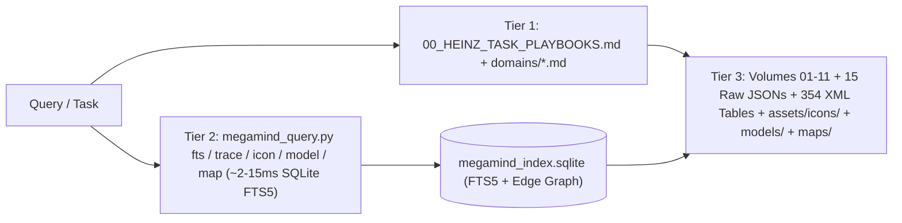

# Last Z + HeinZ Master Megamind Atlas (AI-Native Fast-Jump Edition)

> **Generated:** `2026-11-24 16:07:38 UTC` | **Indexed Entities (SQLite FTS5):** **`57,525` entities** + **`9,501` cross-system edges** | **Raw Data:** **`80.33 MB`** (`15` JSONs + `354` full XML tables)

## 1. Fastest Lookup Path (Always Start Here)

| Goal | Fastest 1-Step Jump | Latency |
|---|---|---|
| **Find anything across ALL layers** | `python megamind/megamind_query.py fts <query>` *(supports `--layer` & `--domain`)* | **~15 ms** |
| **Trace a feature end-to-end (UI -> Bot -> Packet -> DC -> Event -> XML -> Assets)** | `python megamind/megamind_query.py trace <topic>` | **~20 ms** |
| **Find any extracted PNG icon or Hub UI sprite** | `python megamind/megamind_query.py icon <query>` *(supports `--season` & `--category`)* | **~15 ms** |
| **Find any extracted 3D model or 2D Spine Hero Skin** | `python megamind/megamind_query.py model <query>` *(supports `--season`, `--faction` & `--type`)* | **~2 ms** |
| **Find any exported World, Seasonal, Event, City or Terrain Map** | `python megamind/megamind_query.py map <query>` *(supports `--category` & `--season`)* | **~2 ms** |
| **Work on a HeinZ bot task or any of the 9 queued fixes** | Open [00_HEINZ_TASK_PLAYBOOKS.md](00_HEINZ_TASK_PLAYBOOKS.md) | Instant |
| **Work inside one game domain (Radar, Trucks, Garage, Moments, etc.)** | Open `megamind/domains/<domain>.md` (see table below) | Instant |
| **Query exact untruncated rows of any XML table (189,844 rows)** | `python megamind/megamind_query.py xml <table> [filter]` | ~50 ms |
| **Resolve any numeric game text ID to English** | `python megamind/megamind_query.py loc <id_or_text>` | ~20 ms |

## 2. 15 Categorized Domain Quick-Cards (`megamind/domains/`)

| Domain Slug | Quick-Card | Packets | Managers | UI Windows | XML Tables | HeinZ Bot Fns | Size |
|---|---|---:|---:|---:|---:|---:|---:|
| `alliance` | [Alliance & Territory](domains/alliance.md) | 645 | 62 | 196 | 25 | 17 | 33.7 KB |
| `arena_pvp` | [Arena & PVP](domains/arena_pvp.md) | 196 | 29 | 120 | 7 | 4 | 23.8 KB |
| `buildings_city` | [Buildings & City](domains/buildings_city.md) | 85 | 35 | 82 | 21 | 6 | 24.3 KB |
| `chat_moments_mail` | [Chat, Moments & Mail](domains/chat_moments_mail.md) | 136 | 21 | 154 | 13 | 1 | 22.3 KB |
| `daily_tasks_quests` | [Daily Tasks & Quests](domains/daily_tasks_quests.md) | 134 | 23 | 109 | 10 | 17 | 22.8 KB |
| `events_fullprep` | [Events, Activities & Full Preparedness](domains/events_fullprep.md) | 471 | 37 | 296 | 60 | 10 | 28.8 KB |
| `formations_marches_world` | [Formations, Marches & World Map](domains/formations_marches_world.md) | 106 | 28 | 70 | 14 | 9 | 23.1 KB |
| `garage_vehicles` | [Garage, Vehicles & Chips](domains/garage_vehicles.md) | 52 | 9 | 33 | 16 | 1 | 16.6 KB |
| `heroes_skills_equip` | [Heroes, Skills & Equipment](domains/heroes_skills_equip.md) | 97 | 25 | 89 | 42 | 1 | 24.7 KB |
| `army_troops_hospital` | [Army, Troops & Hospital](domains/army_troops_hospital.md) | 16 | 6 | 26 | 9 | 0 | 8.8 KB |
| `items_bag_shops_vip` | [Items, Bag, Shops, Speedups & VIP](domains/items_bag_shops_vip.md) | 134 | 29 | 80 | 22 | 2 | 22.6 KB |
| `pve_exploration_bosses` | [PVE, Area Exploration, Monsters & Bosses](domains/pve_exploration_bosses.md) | 51 | 70 | 30 | 31 | 1 | 20.9 KB |
| `radar_detect` | [Radar & Detect Events](domains/radar_detect.md) | 3 | 0 | 3 | 0 | 0 | 1.9 KB |
| `science_research_talents` | [Science, Research, Talents & Buffs](domains/science_research_talents.md) | 11 | 0 | 10 | 9 | 0 | 5.3 KB |
| `trucks_bounties` | [Trucks, Caravans & Hero Bounties](domains/trucks_bounties.md) | 2 | 0 | 1 | 0 | 0 | 1.6 KB |

## 3. Master Coverage Metrics (100% Synced Across All 11 Volumes)

| Engine / App Layer | Exact Verified Scope | Primary Raw File(s) |
|---|---|---|
| **SmartFoxServer & Chat Protocol** | **2,245** `MsgDefines` / **90** `ChatMsgDefines` / **2,279/2,297** wire packets / **21** WebMsgs / **3** MailV4 | `raw/packets_complete.json`, `raw/datacenter_callgraph_and_protocols.json` |
| **Protobuf, HTTP/CDN & Login APIs** | **269** Protobuf schemas / **34** client HTTP/CDN/PHP URLs / **31** `Loading.*` / **20** C# Net classes / **11** `server_ip` rows / **114** repo API scripts | `raw/csharp_and_http_endpoints.json`, `raw/apis_and_integrations_complete.json` |
| **Event Bus** | **3,344** `EventId`s / **735** live `EventManager` subscriptions | `raw/packets_complete.json`, `raw/ui_windows_and_buttons.json` |
| **DataCenter & Call Graphs** | **354** managers + **21** singletons / **14,020** methods / **6,613** call-graph linked | `raw/datacenter_managers.json`, `raw/datacenter_callgraph_and_protocols.json` |
| **Deep Lua Engine & Unity Runtime** | **12,079** loaded Lua modules / **306** global classes (**186** `CSharpCallLuaInterface`, **6,142** methods) / **936** PVE/Scene/World/Chat/RedDot mods (**15,869** methods) / **119** native DLLs | `raw/deep_engine_scene_pve_world.json`, `raw/lua_package_loaded_all_12010.json` |
| **Complete Game UI & Buttons** | **1,697** `UIWindowNames` / **1,549** full configs (**1,547** prefabs, **7,177** handlers, **3,899** btn refs) / **294** live HUD coords / **142** `GoToUtil` | `raw/ui_windows_and_buttons.json`, `raw/ui_complete_all_windows.json` |
| **XML Data & Localization (Zero Caps)** | **354** XML tables (**189,844** rows) / **355** `LuaDatatable.*` / **8,436** EN strings | `raw/xml_tables/`, `raw/localization_en.json`, `raw/game_tables_and_stats.json` |
| **Native Unity C# Engine** | **98** assemblies / **3,772** C# classes (`3,177` in `Assembly-CSharp`) / **24,774** methods / **14,102** fields | `raw/csharp_and_http_endpoints.json` |
| **Global Enums & Constants** | **1,274** global Lua enum tables | `raw/enums_complete.json` |
| **HeinZ Control Hub & Bot Engine** | **30** RPCs / **51** `action_id` routes / **25** cards / **107** Hub buttons / **98** JS fns / **5** stages (**29** tasks) / **74** bot actions / **123** repo files | `raw/heinz_architecture.json` |
| **Extracted Game Icons & Hub Sprites** | **17,049** edge-to-edge PNGs (**3,827** EN, **13,222** cleaned, **22** categories, **7** seasons) + **197** Hub WebPs (**47** core + **35** heroes + **115** items) | `assets/icons/`, `launcher/assets/game_icons/`, `raw/game_assets_icons_and_models.json` |
| **Extracted 3D Models & 2D Spine Skins** | **493** textured GLB+OBJ scenes (**3,069** OBJs, **3,354** PNGs, **2,825,993** verts, **2,691,867** faces, **12** folders incl. **28** `HQ Skins` & **28** `Vehicle Skins`, **6** seasons) + **110** `Hero Skins 2D Spine` bundles (**118** atlas PNGs, **236** Spine files = **603** total model/skin assets) | `models/`, `models/Models Catalog.json`, `models/Hero Skins Spine Catalog.csv`, `raw/game_assets_icons_and_models.json` |
| **Extracted World, Seasonal & Event Maps** | **499** clean PNG maps (**314.40 MB**, **5** categories: **107** `Main World`, **32** `Seasonal`, **209** `Event`, **46** `City & Base`, **105** `Terrain & Biomes`; **26** subcategories, **7** season buckets `All Seasons` + `Pre-Season 1`..`Season 6`, **5**x `4K` stitched maps, **19** decoded topology/tier maps, **87** `Province Zones`) | `maps/`, `maps/Maps Catalog.json`, `maps/Maps Catalog.csv`, `raw/game_assets_icons_and_models.json` |
| **SQLite FTS5 Search & Graph Index** | **57,525** full-text indexed entities + **9,501** directional cross-layer edges (`41.11 MB`) | `megamind/megamind_index.sqlite` |

## 4. All Reference Volumes (`00`-`11`)

| Vol | File | Size | Purpose |
|---|---|---:|---|
| **Vol 00** | [00_HEINZ_TASK_PLAYBOOKS.md](00_HEINZ_TASK_PLAYBOOKS.md) | 11.1 KB | All 29 HeinZ 5-Stage tasks mapped to exact code/packets/managers + Pre-wired Dossiers for the 9 queued fixes |
| **Vol 01** | [01_NETWORK_PACKETS_AND_ROUTING.md](01_NETWORK_PACKETS_AND_ROUTING.md) | 395.4 KB | All 2,279 inspected SmartFoxServer packets (`OnCreate` + `HandleMessage`), 90 `ChatMsgDefines`, 735 live `EventManager` listeners |
| **Vol 02** | [02_DATACENTER_MANAGERS_AND_SYSTEMS.md](02_DATACENTER_MANAGERS_AND_SYSTEMS.md) | 189.3 KB | `LuaEntry`, 21 singletons, all 352 `DataCenter.*` + 2 `SlgDataCenter.*` managers (`12,440` methods) |
| **Vol 03** | [03_UI_MENUS_WINDOWS_AND_BUTTONS.md](03_UI_MENUS_WINDOWS_AND_BUTTONS.md) | 570.6 KB | 11 UI layers, 294 live `2560×1440` HUD button coords + all 1,549 window prefabs, 7,177 handlers & 3,899 button refs |
| **Vol 04** | [04_GAME_TABLES_TASKS_ABILITIES_AND_STATS.md](04_GAME_TABLES_TASKS_ABILITIES_AND_STATS.md) | 123.6 KB | Live account snapshot + localized Daily Quests, Buildings, Heroes, 968 Hero Skills, Mastery/Talents/Buffs, Research, Armies, Monsters, Radar, Bounties, VIP |
| **Vol 05** | [05_ENUMS_CONSTANTS_AND_MECHANICS.md](05_ENUMS_CONSTANTS_AND_MECHANICS.md) | 163.6 KB | Verified Unity/xLua/SFS engine mechanics, safety rules, priority enums & all 1,274 global enum tables |
| **Vol 06** | [06_HEINZ_HUB_API_UI_AND_BOT_ENGINE.md](06_HEINZ_HUB_API_UI_AND_BOT_ENGINE.md) | 66.7 KB | All 30 `HubBackend` RPCs, 51 `action_id` routes, 25 cards, 107 Hub buttons, 98 JS fns, 5 stages, 74 bot actions, 123 repo files |
| **Vol 07** | [07_CSHARP_ENGINE_HTTP_PROTOBUF_AND_CALLGRAPHS.md](07_CSHARP_ENGINE_HTTP_PROTOBUF_AND_CALLGRAPHS.md) | 175.7 KB | 3,772 C# classes (`24,774` methods), 269 Protobuf schemas, 142 `GoToUtil` jumps, Chat WS, Mail V4 & 14,020-method DataCenter call graph |
| **Vol 08** | [08_COMPLETE_XML_TABLES_AND_LOCALIZATION_ATLAS.md](08_COMPLETE_XML_TABLES_AND_LOCALIZATION_ATLAS.md) | 56.4 KB | Zero-truncation index of all 354 XML tables (`189,844` rows), 355 `LuaDatatable.*` files & 8,436 English strings |
| **Vol 09** | [09_COMPLETE_APIS_ENDPOINTS_AND_INTEGRATIONS.md](09_COMPLETE_APIS_ENDPOINTS_AND_INTEGRATIONS.md) | 29.8 KB | All 34 client HTTP/CDN/PHP URLs, 31 `Loading.*` modules, 20 C# Net classes, `server_ip`, Google Apps Script `doGet`/`doPost` & 114 repo Python/JS modules |
| **Vol 10** | [10_DEEP_ENGINE_SCENE_PVE_WORLD_AND_CALLBACKS.md](10_DEEP_ENGINE_SCENE_PVE_WORLD_AND_CALLBACKS.md) | 259.7 KB | 306 global engine classes (`186` `CSharpCallLuaInterface` callbacks), 936 PVE/Scene/World/Framework/Chat/RedDot mods (`15,869` methods), `12,079` Lua modules, Unity runtime & 119 DLLs |
| **Vol 11** | [11_GAME_ASSETS_ICONS_AND_MODELS_ATLAS.md](11_GAME_ASSETS_ICONS_AND_MODELS_ATLAS.md) | 93.7 KB | All 17,049 extracted PNG icons (`assets/icons/`), 197 Hub WebPs (`launcher/assets/game_icons/`), 493 textured 3D GLB/OBJ models (incl. 28 HQ Skins & 28 Vehicle Skins), 110 2D Spine Hero Skins (`models/`), 499 exported World/Seasonal/Event/City/Terrain maps (`maps/`), 42 playable hero mappings & indexer pipeline |

## 5. Architecture Diagram

